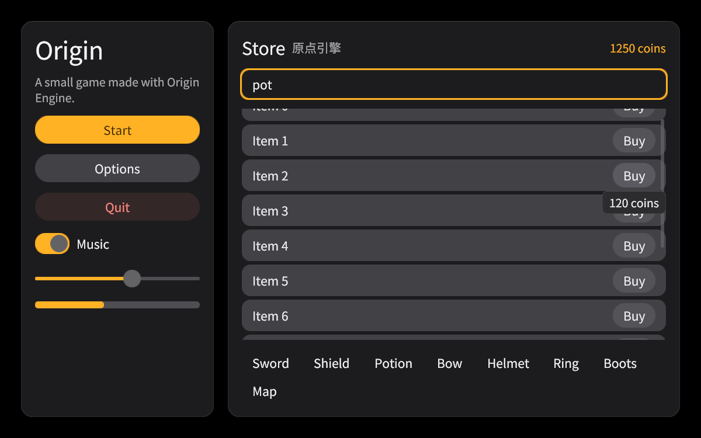

# og-ui

The Origin Engine UI (`docs/design.md` §2.7, M6 in `docs/phase-1.md`): an
immediate-mode toolkit whose tree is declared every tick, laid out
Clay-style, themed by the platform's design tokens
(`origingame/docs/design-language.md`), drawn through og-render's sprite and
MSDF text batches, and addressable by the probe through stable string ids
(`touch_move_to`, `move_to_text`, `dump_ui`).

It depends on og-core, og-ecs, og-input, og-render, og-probe (no
default features), og-tween (its spring), og-i18n, unicode-bidi (UAX #9),
ttf-parser (a font file's metrics and outlines) and, behind the default
`shaping` feature, rustybuzz only. No layout or GUI library: the layout is
~600 lines in `src/layout.rs`.



## Using it

```rust
let ui = SharedUi::new(Ui::new(UiDesc { fonts: Fonts { body: UiFont::new(handle, &msdf), ..Default::default() }, ..Default::default() }));
let (desc, run) = ui.system("ui", || viewport, |ui, _ctx| {
    ui.panel("Menu", PanelDesc::default(), |ui| {
        ui.label("Title", "Origin", LabelDesc { step: Some(ui.theme().type_ramp.display_sm), ..Default::default() });
        if ui.button("Start", "Start", ButtonDesc { variant: ButtonVariant::Primary, ..Default::default() }).clicked {
            // start
        }
        ui.tooltip("Starts a new run");
    });
    Ok(())
});
world.add_system(desc, run)?;          // builds the UI inside the tick from og.Input
probe.set_ui(ui.probe());              // dump_ui, touch_move_to, move_to_text
// after the tick, when rendering:
let atlas = scene.add_texture(og_ui::atlas_texture());   // once
let mut overlay = Overlay::new(viewport.width, viewport.height, viewport.dpr);
ui.lock().frame().emit(&EmitDesc { atlas, layer: 0 }, &mut overlay);
scene.overlay = Some(overlay);                           // over the finished frame, any camera
```

`Ui::begin(input, viewport)` … `Ui::end()` is the whole protocol; widgets
return a `Response { hovered, pressed, clicked, changed, focused, submitted }`
whose edges last one tick. Interaction is decided against the previous
tick's rectangles (the immediate-mode rule), which are also what the probe
resolves against, so a scripted `touch_move_to` and a click agree.

## Widgets

| Call | What it is | Probe text |
|---|---|---|
| `open(id, Element)` / `close() -> Response` | a container (`row`, `column`, `container` take a closure) | — |
| `panel(id, PanelDesc, f)` | a card: `surface`, `radius.card`, `space.lg` padding, `space.md` gap, a column unless `row` | — |
| `scroll(id, ScrollDesc, f)` | a scroll column, vertical by default, horizontal or both ways by `ScrollDesc::axes` (`Element::scroll_x` for any container): the wheel (both axes) or a drag scrolls it, a released drag keeps its momentum, it clips its content, a capsule scrollbar per scrolling axis shows the position and a press on one grabs it; nested containers hand off (§Scrolling) | — |
| `label(id, text, LabelDesc)` | MSDF text; wraps at its width (word breaks; between CJK characters under kinsoku, so no line starts with closing punctuation, a small kana or `ー` nor ends with an opening bracket, and a katakana word stays whole; long words between characters) unless `nowrap`; `align` start/center/end; type step from the ramp; `ellipsis` cuts it with "…" ("..." in a font without it) where it does not fit: a `nowrap` label on its one line (it can then shrink in a row), a wrapping one on its last line with `max_lines` | the whole text, cut or not |
| `button(id, text, ButtonDesc) -> Response` | a capsule of `h-control-sm/md/lg`; `Secondary` (neutral fill, default), `Primary` (amber, one per screen), `Quiet`, `Danger`; `disabled` turns neutral and inert; pressed shrinks by `press-scale` | the label |
| `image(id, ImageDesc)` | a texture region (`uv`, `tint`), or a solid rectangle without a texture; `aspect` (width over height) keeps its proportions: with the height left to fit it is as tall as its laid-out width over it, with a fixed height and the width left to fit as wide as the height times it (`Element::aspect`, any element) | — |
| `zoom_view(id, &ZoomViewDesc) -> ZoomResponse` | a zoomable picture (a map, an artwork): two touches pinch it about their centre and pan it, the wheel zooms about the pointer, a drag pans; it stays on its picture and within `min_zoom`..`max_zoom` (1 to 4 by default); answers the zoom and the centre; role `image` named by its id, its zoom as its value (§Scrolling) | — |
| `progress(id, value, ProgressDesc)` | a capsule track filled to 0–1 | — |
| `slider(id, &mut f32, SliderDesc) -> Response` | track, amber fill, thumb; a press anywhere on it sets the value, dragging follows; `min`/`max`/`step` | — |
| `toggle(id, &mut bool, label) -> Response` | a switch (amber on) with a label; a click flips it | the label |
| `text_field(id, &mut String, &FieldDesc) -> Response` | one line: a press focuses it with the caret at the press and a drag selects (Shift+press extends), typed text replaces the selection at the caret, Backspace/Delete/←/→/Home/End edit and Shift with them selects, Ctrl/Cmd+A selects all, +C copies and +X cuts (`Ui::take_clipboard`; the web shell's copy and cut events), an input method's composition shows underlined at the caret until it commits, Enter submits and leaves, Escape leaves, a press elsewhere blurs; the text scrolls to keep the caret in view; the caret blinks (§Text); placeholder; `max_chars`; focus ring in `focus` | the text, or the placeholder while empty |
| `text_area(id, &mut String, &TextAreaDesc) -> Response` | several lines: the field's editing, Enter breaks the line, ↑/↓ move between lines (and stay out of focus navigation while it is edited), Home/End to a line's ends; wraps between words at its width, `rows` lines tall (default 4), scrolled to keep the caret's line in view | the text, or the placeholder while empty |
| `rich_text(id, markup, RichTextDesc) -> RichTextResponse` | one paragraph of inline spans from markup (`src/markup.rs`: `[b]`, `[color=…]`, `[size=…]`, `[font=…]`, `[icon=…]`, `[link=…]`, `[wave]`, `[shake]`, `[pulse]`; `[[` is a literal `[`): lines break between the spans' words (a word split across spans stays whole), every span on one baseline, each line as tall as its tallest span; bold thickens the glyphs in the MSDF shader (as far as the field reaches) and draws a second copy a device pixel right; links are child elements (kind `link`) that focus and press like buttons; each line runs the bidirectional algorithm over its whole text at the UI's direction, so pieces reorder and so do runs of either direction inside one span, each run drawn shaped (§Text); a bad tag stays as text and warns | the plain text (links: their text) |
| `tooltip(text)` | for the element just built: shown below it (above without room, clamped to the safe area) once the pointer has rested on it for `motion.duration.slow`; drawn over everything | the text |

Any container with `interactive: true` reports its response from `close()`.

### The game widget set (`src/widgets.rs`)

| Call | What it is | Probe ids and text |
|---|---|---|
| `tabs(id, items, &mut usize, TabsDesc)` | a segmented control: `fill` track, the chosen tab on `thumb` | `Tab#i`, the labels |
| `select(id, options, &mut usize, &SelectDesc)` | a field-like trigger and chevron; opens `<id>.menu` (a popover layer and focus scope) with `Option#i`; a press outside or Back closes it | the chosen label |
| `stepper(id, &mut f32, StepperDesc)` | `Dec`, `Value`, `Inc`; bounded; Left/Right step while a button is focused; a screen reader's increment/decrement on the spinbutton | `−`, the value, `+` |
| `radio(id, options, &mut usize, RadioDesc)` | `Option#i` rows: a ring, amber with a dot when chosen | the labels |
| `checkbox(id, &mut bool, label)`, `checkbox_list(id, labels, &mut [bool])` | a box, amber with a tick (two rotated bars) | the label(s) |
| `chip(id, text, ChipDesc)` | a capsule on `fill`; selected inverts to `fg` | the text |
| `badge(id, text, Tone)` | a small capsule in a tone (neutral, success, warn, danger, info, accent, inverse) | the text |
| `key_value(id, key, value, mono)` | `Key` (fg-muted) and `Value` (end) on one row | both |
| `divider(id, vertical)`, `spacer(id, Option<Size>)` | a hairline in `border`; empty space | — |
| `skeleton(id, SkeletonDesc)`, `spinner(id, size)` | the neutral fill with a passing sheen (still under reduced motion); eight dots turning by the tick | — |
| `icon(id, name, IconDesc)` | an icon of the icon atlas (`set_icons`) by name, tinted: a cell of a texture grid, or an icon set's distance-field glyph fitted to its square (§Icon sets) | the name |
| `meter(id, value, max, &MeterDesc)` | health (green, warn under 30 %, danger under 15 %), mana (blue hue), xp (purple hue), accent or custom; a drop leaves a pale trail that follows after `fast`, a rise grows over `slow`, by the tick; notches; a label inside | the label |
| `cooldown(id, remaining, &CooldownDesc)` | a disc whose amber ring fills clockwise from the top as the cooldown runs out (two rotated half discs), full when ready; a label or icon in the middle | the label |
| `minimap(id, &MinimapDesc)` | the map texture in a `border-strong` frame, dots for markers (the player amber and ringed), N, a zone label | `Map`, `Zone` |
| `dialogue(id, &DialogueDesc)` | portrait slot (texture, icon or initial), speaker in `accent-ink`, the line typed at `chars_per_second` by the tick; a press finishes the line, the next answers `advanced` | `Body/Line` shows what is typed |
| `joystick(id, JoystickDesc)` | a base and a knob following a press that started on it; answers −1..1 with a dead zone; at least three touch targets wide | — |
| `dpad(id, DpadDesc)` | `Up`, `Down`, `Left`, `Right` arms (each ≥ 44 CSS px) answering which are held | the arm names |
| `action_button(id, text, &ActionButtonDesc)` | a round touch button (≥ 44): `pressed` while held, `clicked` on a tap; primary is amber | the text |
| `open_list`/`list_item`/`close_list`, `list(id, ListDesc, selected, row)` | a virtualised scroll list: only rows in view (and one each side) are built, fillers keep the full scroll range; `Row#i` rows select and focus | `Row#i` |
| `open_grid`/`grid_item`/`close_list`, `grid(...)` | the same for a wrapping grid of equal cells (`Cell#i`) | `Cell#i` |
| `spotlight(id, Option<Rect>, SpotlightDesc)` | the scrim on four sides of a hole (`Top`, `Left`, `Right`, `Bottom`, `Hole`) with an amber edge; presses on the shades stop there, presses in the hole reach what is under it | — |
| `toast(text, ToastDesc)`, `dismiss_toast(id)` | a queue in the UI state: at most three up (older leave first), 3.2 s (6 s danger), enter and leave by the tick, a press dismisses; stacked at `set_toast_anchor` | `Toasts/Toast#n`, the text |
| `memory(id, initial)`, `remember(id, value)` | a number kept for an id in the UI state (a template's tab) | — |

Widget memory between ticks (a select being open, a meter's trail, the
dialogue's start, a transition's progress, a drag's source) lives in
`State::anims`, keyed by the element's path hash and dropped when the widget
is not built; it, the toast queue, the UI clock, queued navigation and the
focus scope are all in `save_state`, so a restored world replays the UI.

**Drag and drop.** A press on a list row or grid cell marks it the source; a
release over another row or cell answers `Response::dropped = Some(source)`
there, and `dragging(id)` answers the source while the press is held; the
cell under a drag shows the focus ring.

## Scrolling (`src/scroll.rs`)

A container scrolls vertically (`Element::scroll`), horizontally
(`Element::scroll_x`; a horizontal scroller never shrinks its children) or
both ways. Its offsets are UI state, clamped by the layout to its content.

- **The wheel** (`InputFrame::wheel`, both axes) goes to the innermost
  scroll container under the pointer; what it cannot take, because it has
  reached its end or does not scroll that way, goes to the container
  around it, and so on outwards (nested scroll handoff). A drag on a
  container that holds the press (one started on it, not on a control)
  moves it the same way, so a sideways strip in a vertical page scrolls the
  page when dragged up and down.
- **Momentum.** A drag released while moving keeps its velocity (a running
  average of the last ticks' movement) as a fling, which slows by
  `1 − 1/(ticks per second × motion.spring.momentum's response)` a tick
  (arithmetic only) and stops below 0.1 px a tick, on an axis as it reaches
  the content's end, or at the next press. Not under reduced motion.
- **Scrollbars.** A capsule on each scrolling axis (`fill-strong`, at the
  right edge and the bottom), as long as the view is of the content
  (at least `space.xl`); a press within 12 px of the edge grabs the bar
  (the press goes to no control under it) and dragging moves it through
  the range.
- Keyboard and gamepad focus moving to a control outside a container's view
  scrolls it in on both axes.

- **Two touches** (og-input's `og.Pointers`): when two fingers are held
  on one scroll container (the innermost under each), it follows the
  movement of their centre, so a list of buttons, which one finger would
  press, scrolls under two; on a zoom view (`zoom_view`) they pan it the
  same way and zoom it by the change of their spread, about their centre
  (pinch). The press the first finger began presses nothing once the
  second lands, and the primary pointer presses nothing while two are
  held; two fingers on anything else (a stick and a button) are no
  gesture. The gesture is UI state (`State::pinch`, `save_state`
  version 7). A zoom view also zooms by the wheel about the pointer and
  pans by a drag.

`tests/widgets.rs` `scroll_views_scroll_both_ways_hand_off_fling_and_grab`
covers each (and a restore); `two_fingers_scroll_lists_and_pinch_zoom_views`
covers two touches, the zoom view and aspect ratios, and the kit's
`tests/gestures.og.ts` drives them through the probe.

## Layers

Elements outside the tree, laid out after it and drawn over it in rank order:
anchored groups (`anchor`, rank 1; `over: true` raises one to rank 3), dialogs
(`open_modal`/`close_modal`, `modal`: a scrim backdrop that takes presses,
padded by the safe area, with a centred `Panel`, rank 2), popovers (a
select's menu, rank 3), the toast stack (rank 4) and tooltips (rank 5). A
layer's probe path is its own id. Anchored groups sit at one of nine points of
the safe area (`Anchor::TopLeft` … `BottomRight`, `Center`), inset by the
density's gutter (or `margin`), moved by `offset`.

## Accessibility tree (`src/a11y.rs`)

Every frame builds the accessibility tree from the nodes it draws and
takes input on, so it cannot drift from the screen. Each element has a
**role** (`button`, `link`, `text`, `heading`, `image`, `checkbox`,
`radio`, `switch`, `slider`, `spinbutton`, `textbox`, `combobox`,
`listbox`, `option`, `tab`, `tablist`, `radiogroup`, `progressbar`,
`meter`, `timer`, `status`, `dialog`, `tooltip`, `separator`, `group`; none
for layout containers, spacers and unnamed pictures), a **name** (its text;
or what the widget gives it: an icon's name, a dialog's title, Decrease and
Increase for a stepper's buttons; a control showing no text of its own is
named by the text inside it, then by the label just before it in its row,
then by its id; a text field or area, whose text is its value, by that
label, else its placeholder, else its id), a **description** read after
the name (a labelled field's placeholder; the mirror's
`aria-placeholder`), a
**value** (a slider's or stepper's number, a progress's percent, a meter's
amount, a field's text, a select's choice, a cooldown's remaining share)
and **states** (`disabled`, `focused`, `focusable`, `checked`, `selected`,
`expanded`, `pressed`, `busy`; `offscreen` in the tree for a control a
scroll container cuts out of view). The probe's `dump_ui` carries them on
every element; `Ui::a11y()` (`og.ui.a11y()`) answers the tree of the
elements with a role, with full paths, nearest-ancestor parents, whole
bounds, the focus order and the focused path, for a shell to mirror into
the page. Focus order is the tree's order (the drawing order: the page,
then each layer over it): Tab and the pads walk exactly the nodes marked
`focusable`, within the topmost dialog while one is open.
`tests/a11y.rs` checks the roles, names, values and states of every
widget and that Tab walks `focus_order`; the kit's `a11y` playtest checks
that every screen names every control and gives every text a role.

**The web shell's mirror** (`packages/engine/src/web/a11y.ts`). The Worker
creates the engine with `a11y`; a frame's answer then carries the tree
whenever `A11yTree::digest` (every node's path, role, name, value, states
and bounds to the CSS pixel, the focus order, the focused path) changed,
and only then. The shell keeps an invisible element per node at its bounds
over the canvas, nested as the tree nests it, with its ARIA role, label (or
text for text roles), `aria-valuenow`/`-valuetext`, `aria-checked`,
`-selected`, `-expanded`, `-disabled`, `-busy`, a dialog's `aria-modal`,
and `tabindex=-1` on focusable nodes. The DOM focus follows the UI's focus
(not out of the page's own fields, nor from the text control's textarea);
a status or alert node that appears (a toast) is written into a polite or
an assertive live region. What a screen reader does there reaches the UI
as input: a click on a mirrored element (its default action) is og-input's
`a11y` request `activate`, focus moving onto one `focus`, and
`increment`/`decrement` step an adjustable one (`InputFrame::a11y`; nav.rs
`apply_a11y` resolves the path against the last frame and acts as Enter,
Left and Right would, within the topmost dialog, also on a screen that
turned navigation off). A slider and a stepper's spinbutton are mirrored
as an `<input type="range">` with their role, held at the UI's value one
step from either end (`aria-valuenow` and `aria-valuetext` read it): a
screen reader's own adjust gesture (VoiceOver's swipe up or down,
TalkBack's volume keys) moves the native value, or sets it from
`aria-valuenow` and the step, and fires `input`, which the mirror sends as
`increment` or `decrement` before putting the value back (the UI owns the
value and its step). A stepper's `−` and `+` follow its range as siblings
(an input holds no children); og-ui steps the stepper for a request
naming its spinbutton when one of its buttons is in reach. A native range
takes `tabindex=-1`, out of the page's Tab order. Keys pressed while a mirrored
element has the DOM focus still reach the engine as keys (the shell keeps
the arrows from the native range, so a key steps once). The native host creates no mirror
and its frame answers carry no tree. `tests/a11y.rs` covers the requests
and the digest; `packages/engine/tests/web/a11y.ts` checks the DOM against
the tree on ui-kit's settings screen in Chrome, Chrome's own accessibility
tree, the Master slider's native range lowered by an `input` event (the
adjust gesture), a screen-reader-style click toggling Mute, the live
region, and the page preferences below.

## Focus navigation (`src/nav.rs`)

One focus for pointer, keyboard and gamepad. Intents come from the arrow
keys, Tab/Shift+Tab, Enter, Space and Escape (`InputFrame::keys`, `shift`),
from a gamepad (`InputFrame::gamepad`: d-pad and A/B edges, the left stick
past half-way once, then after `motion.duration.slow` every
`motion.duration.fast`) and from `navigate(Nav)` (queued for the next tick).

- Directions pick the nearest focusable control whose centre lies that way,
  scoring distance along it plus three times the gap across it; with none,
  focus wraps to the far end of the same row or column. Next/Prev walk
  reading (draw) order and wrap.
- Activate presses the focused control (`Response::clicked`); Left/Right
  adjust a focused slider or stepper; while a text field is edited, Left,
  Right, Enter, Space and Escape belong to it.
- Back closes the topmost dialog or menu, else `back()` answers true once.
- A dialog or open menu is a focus scope: while it is the topmost, focus
  stays inside; when it opens, focus moves to its first control (or the one a
  widget asks for, the select's chosen option); when it closes, focus returns.
- A press focuses the control without the ring; navigation shows the ring
  (amber `focus`, a gap of what is behind, then the control).
- Navigation that lands on a control outside its scroll container's view
  scrolls it in (rows just outside a virtualised list are reachable).
- `set_navigation(false)` turns arrows and Tab off for a gameplay screen whose
  keys move the player (the HUD templates do); an open scope turns it on.

`InputFrame::from_world` reads og-input's `og.Gamepad` (pad 0:
`GamepadFrame::from_gamepad`, the press edges of the standard buttons and
the left stick) on both hosts. The browser shell still maps a pad's buttons
to keys too (A Space, B Escape, d-pad and stick arrows, Back Tab, Start
Enter) as the fallback for a page without the resource; an intent that
arrives both ways in one tick is taken once (`nav.rs`).

**Several pads (local multiplayer).** `Ui::set_players(n)` (declared each
tick, like `set_navigation`) gives pads 1 to `n - 1` (`InputFrame::extra_pads`,
read from `og.Gamepad`) a focus of their own among the same controls: the
d-pad and the stick move it (its first move lands on the control nearest the
surface's centre), its A presses the control under it, its ring is drawn
outside pad 0's in the player's colour (`info`, `success`, `warn`), and a
dialog's scope holds it inside as it holds pad 0's. `Response::pad` names
the pad whose A pressed a control (`None` for the pointer and the keyboard)
and `Response::focused_by` has a bit per pad whose focus is on it;
`Ui::focus_path(pad)` answers where each pad's focus is. Pad 0 keeps sharing
its focus with the keyboard and the pointer; Back and adjusting a slider
stay pad 0's. The pads' focus and sticks are in the UI state
(`tests/widgets.rs` `pads_beyond_the_first_move_their_own_focus_and_press`;
the kit's `players` screen and playtest). The probe's `gamepad` command
addresses them with `@1` to `@3` after the buttons (`gamepad:a@2`).

**Several touches.** `InputFrame::pointers` is og-input's `og.Pointers`
(pointer 0 is `og.Input`'s pointer; 1 to 4 are further touches). The touch
controls (`joystick`, `dpad`, `action_button`) answer any of them: a stick
keeps the finger that started on it, a button answers whichever is over it,
so a thumb on the stick and another on Hit work together
(`templates/ui-kit/tests/multitouch.og.ts`). Two touches on one scroll
container scroll it, on a zoom view pinch it (§Scrolling).

## Motion (`src/motion.rs`)

`transition(id, show, TransitionDesc, f)` (`open_transition` + `close`) moves
its content in and out: fade, slide up/down/left/right (by `space.xl`) or
scale (from 92 %), over `motion.duration.base` unless given, eased by the
token curves (`ease_out` entering, `ease_exit` leaving, cubic Béziers solved
by bisection: arithmetic only), advancing one tick per frame. Content is
built while visible (it stays visible while it leaves) and takes no input
while it moves. Dialogs scale in over a fading scrim; toasts slide. Under
`Theme::reduced_motion` every movement becomes a fade and skeleton sheens stop.
The transform applies to the laid-out rectangles (so drawing, hit testing and
the probe agree), to opacity and to text size.

## Skins (`src/skin.rs`)

The tokens are the default look; a game's own is a **skin** the theme
carries by value (`Theme::skin`, `Copy`). `Skin::default()` dresses nothing,
so every draw path is exactly the token one without a skin (the reference
frames of `tests/gfx.rs`, `tests/kit_gfx.rs` and the UI kit's
`frames-desktop`/`frames-phone` are unchanged, and were pixel-identical
before and after the skin layer: `tests/evidence/E3/break-and-restore.md`).

A skin file is an `.ogt` of `type skin` (`parse_skin`, grammar in its doc
comment; og-cook validates it and cooks it as an `og.UiSkin` blob,
`og.load.skin` loads it with its assets). It declares:

| Part | What it does |
|---|---|
| `base`, `palette`, `radius`, `ramp`, `durations` | the token scheme it starts from and the ThemeColor, radius, TypeStepName and duration values it changes: these go into the `Theme` itself, so every widget follows |
| `atlas "<id>" <w> <h>`, `scale` | the texture every frame, ornament and tile is cut from. Every id a skin names (atlas, fonts, icons, sounds) is read relative to the skin file first (`atlas.png` beside it, `../shared/rope.png`), then from `assets/` (`SkinFile::resolve`, the same in the cook and at load), so a pack copied to another directory works unchanged; the six packs name their own files relatively and their CJK `fallback` from `assets/` |
| `slice <part> x y w h <inset…> [tint\|authored] [stretch\|repeat\|round]` | a nine-slice frame per element class (`SkinPart`): `panel` (dialogs, anchored screen panels), `card` (`Ui::panel`), `button`, `buttonHover`, `buttonPressed`, `buttonDisabled`, `field`, `slot` (grid cells), `tooltip`, `capsule` (HUD capsules, toasts), `track` and `fill` (progress). `tint` frames are white art multiplied by the element's colour (so primary and secondary buttons keep their palette); `authored` ones keep their own colours. Edges and centre `stretch` (the default), `repeat` (tiled at the art's own size from the corner, the last tile cut) or `round` (a whole number of tiles resized to fit, CSS `round`): patterned borders tile, plain ones stretch |
| `soft` | a blurred white rectangle: soft shadows and glows |
| `corner` + `corners <parts>`, `divider`, `flourish` | ornaments: four mirrored corners on the named parts, an ornament over `Ui::divider`, a flourish beside a heading (`LabelDesc::heading`; both sides when centred). Ink `authored`, `accent`, `fg`, `muted`, `border` or `focus` |
| `tile x y w h <tw> <th> <alpha> [inset] <parts>` | a texture tiled over the parts' fill (parchment, scanlines, grain) |
| `shadow <part> dx dy blur spread "#rrggbbaa"`, `glow <part> size ink alpha` | per class (button states share the button's); blur 0 is a hard shadow |
| `glass <part> blur fill [tint]` | the part is glass: og-render's blurred frame under it (`DrawCmd::Glass`, `og_render::Glass`: the scene and the overlay layers drawn below the glass, blurred by `blur` CSS px, tinted by the part's fill colour at `tint`, default 0.25), under its nine-slice drawn at `fill` of its opacity. The scifi pack's dialogs are glass (`glass panel 16 0.85 0.15`) |
| `textShadow <role> dx dy blur colour`, `textGlow <role> size ink alpha` | per font role (`body`, `display`, `numeric`); the text glow is og-render's distance-field halo (`Text::glow`, one instance per glyph under its ink) reaching twice `size` CSS px, as far as the font's distance range allows: cook a glowing role's font with a wider `px_range` (the neon and scifi packs' display and numeric fonts take 12) |
| `textWeight <role> px` | per font role: the glyphs thickened at their edge by `px` device pixels (0 to 2; a phone's 3 device pixels per CSS pixel draw a font's one-dot stroke three wide, so it gains a third, not double) through the distance field, the text shadow with them, within what the font's distance range allows (half its reach at the size drawn, less 0.75 px). For a pixel font whose one-pixel strokes fall between device pixels and so never take their full ink: the pixel pack's body takes 0.5 with DotGothic16 cooked at `px_range 8` (at 4 its gold primary labels read 2.9:1, hollowbell FINDINGS #20) |
| `press sx sy dy`, `hover dy scale` | the press squash and sink, the hover lift, each on a damped spring (og-tween's `Spring`, arithmetic only, in the UI state): the hover on `motion.hoverSpring` (default the tokens' `motion.spring.default`, damping 1 and 350 ms: no overshoot), the press on `motion.pressSpring` (default damping 0.55 over `motion.duration.instant`: in at once, a small bounce past rest on release) |
| `fonts { body display numeric fallback }`, `icons "<id>" cols rows { names … }` | fonts per role (numeric is the `Mono` role) and the CJK `fallback`: a text whose role font lacks one of its characters is measured and drawn in the fallback (`Fonts::for_text`); the icon set |
| `motion { enter stagger toast progress shake pop hoverSpring pressSpring }` | dialog and panel entrance (`pop` springs past 1 and settles), the stagger of a panel's controls (shortened so a long list ends within one more entrance; only seen: a control takes input once the panel has arrived, wherever it is drawn), the toast arrival, eased progress bars, the refused-press shake, the count-up landing pop, and the hover and press springs (`<damping ratio> <response ms>`) |
| `sound <event> "<id>"` | UI sounds (below) |

Six packs to start from live in `templates/ui-kit/assets/skins/` (pixel,
cartoon, fantasy, scifi, paper, neon), drawn by
`templates/ui-kit/tools/make-skins.py`; art drawn by hand is packed by
`og skin pack <dir>` (og-cli's `src/skin.rs`: `<part>.9.png` nine-patches,
whose one-pixel border marks what stretches, and plain PNGs for ornaments,
into `atlas.png` and the skin file's atlas, slice, soft and ornament-region
lines, every other line kept; `crates/og-cli/tests/cli.rs` packs
`tests/fixtures/skin-pack`); `tests/packs.rs` holds each to 4.5:1
for every ink a template puts on a skinned surface, measured over the frame
art really under the text.

## Icon sets

An icon atlas is a grid of equal cells of a texture (`IconAtlas::texture`,
`columns`, `rows`, `names`), or an **icon set**: SVG icons cooked like a
font. og-cook's `type icons` file names the SVGs (`source`, `size`,
`range`, one `icon "<name>" ["<file>"]` a line; `crates/og-cook/src/cook/icons.rs`)
and cooks them into an `og.Font` blob: icon `i` is the glyph at U+E000 + i,
its em square the SVG's view box (ascender 1, descender 0), the field a
true signed distance in all four channels (strokes with round caps and
joins are exact; a butt cap is cut square; a miter join draws round), the
names in a `names` section. `og.load.font` loads it, `UiDesc.icons.font`
(`IconAtlas::font`) makes it the atlas: `icon` draws its glyph fitted to
the icon's square through the MTSDF text path (crisp at any size, in its
ink), and rich text's `[icon=name]` draws it inline. The UI kit ships 64
iconoir icons (the platform's icon set, MIT) as
`templates/ui-kit/assets/icons/iconoir.ogt`: 72 KB cooked, one 473 × 476
page at 48 px per icon, range 8. Its `materials` screen draws from it;
`tests/materials_gfx.rs` renders them.

## Juice and screen transitions (`src/juice.rs`)

- `counter(id, value, CounterDesc)`: a label that counts (ease-out cubic,
  by the tick, f64) from what it shows to `value` whenever `value` changes;
  the first count starts at `from` (none: no count). Grouped with commas,
  decimals, prefix and suffix; a skin's `motion.pop` bumps it on landing.
- `burst(BurstDesc)`: rays and sparks from the element built just before,
  once, from when it first appears (the results stars); off under reduced
  motion.
- `screen_transition(id, wanted, ScreenTransitionDesc) -> ScreenTransition`:
  call every tick with the screen the game wants and build `shown`. A change
  starts a cover over the old screen (half the duration), switches `shown`
  at full cover, and reveals the new one. `Fade`, `Wipe`, `Iris` (2 px
  bands), `Dissolve` (24 px cells in a fixed hash order) and `Slide`, in a
  colour or a texture region stretched over the surface, from any side; drawn
  after every other command (over every layer) through the overlay pass. The
  state (`shown`, `wanted`, the start tick) is in `Ui::save_state`. Under
  `reduced_motion` every kind is a fade.

## UI sounds

The UI queues an event when the skin (or `UiDesc.sounds` through the host)
has a sound for it: `Hover` (the pointer reaches a navigable control, or
keyboard or gamepad focus moves to one), `Press` (by the pointer, Enter,
Space or the pad's A), `Open` and `Close` (a dialog's first tick each way), `Success`
(a success toast), `Error` (a danger toast or a refused press).
`Ui::take_sounds()` hands them to the host; the runtime's `og.ui.sound`
system (after the physics step, before `og.audio`) plays each through
og-audio on the `ui` bus, one voice per event kept in the UI state
(`Ui::voices_mut`), restarted on a repeat. So `og.audio` turns it into the
same tick's commands and the sound's first sample lies in the tick of the
input that caused it (`packages/engine/tests/ui-sound.test.ts` reads it
from the mix `og run --audio` renders).

## Responsive layout and the safe area

`Viewport::breakpoint()` / `Ui::breakpoint()`: `PhonePortrait` and
`PhoneLandscape` (shorter side under 600), `Tablet` (under 1024 wide),
`Desktop`. Density `Auto` already raises controls to touch size on a coarse
pointer or a surface under 768 px; touch widgets never go under the touch
`h-control-sm` (44). The root and every anchored group keep to the safe area;
dialog backdrops cover the whole surface and pad their content by it.

## Theme variants

`Theme::dark()` (default) and `light()`; `Theme::high_contrast(scheme)`
remaps `fg-muted` → `fg`, `fg-subtle` → `fg-muted`, `fill` → `fill-strong`,
`fill-strong` → `border-strong`, `border` → `border-strong`, deepens the scrim
and outlines every control in `border-strong` (token values only);
`with_accent(Srgba)` and `with_hue(HueName)` set a game's accent and derive
its hover, active, ink, soft and focus tones the way the tokens derive them
from amber (the same mix towards white or black, the same alpha; amber in
gives the token palette back exactly), picking `accent-fg` or the light `fg`
as the ink on it by contrast. `reduced_motion` and `reduced_transparency`
are theme flags; `to_reduced_transparency()` is the flat variant: a skin's
glass parts drawn as opaque surfaces (no blur of the frame under them,
their frame at full opacity), the translucent fills (`fill`,
`fill-strong`, `accent-soft`, the `material-*` grounds,
`material-control`) the opaque colours they make over `surface`, and the
scrim the one it makes over `bg`, so a dialog's backdrop hides the game
rather than dimming it; highlights (sheens, edges, glows) stay. A game
reads the flags (`UiTheme.reducedTransparency`, `reducedMotion`,
`contrast` from `og.ui.theme`/`frameTheme`) to flatten and still its own. The generator
still owns every value (`src/theme.rs`); variants are mappings over it.

**The page's preferences.** `Viewport::reduced_motion`, `high_contrast`
and `reduced_transparency` are what the page asks for (the web shell reads
`prefers-reduced-motion: reduce`, `prefers-contrast: more` and
`prefers-reduced-transparency: reduce` into the viewport and sends it again
when any changes); every frame the UI applies them over the configured
theme (`Ui::set_theme`; `UiDesc.reducedTransparency` in TypeScript):
reduced motion turns its flag on, reduced transparency (the page's or the
game's) takes the flat variant, more contrast the high-contrast one. A game's own settings can add to what the
page asks, not take it away. `Ui::theme` answers the effective theme.

**The edge light.** `Theme::edge` is the tokens' card edge (`shadow.edge`,
generated as `SHADOW_EDGE_DARK` and `SHADOW_EDGE_LIGHT`): an opaque panel,
card or tooltip surface in the token look (no skin atlas) draws it inside
its edge. In dark that is the design language's edge light, a 0.5 px
highlight along the top (white at 10 %) and a 0.5 px hairline all round
(white at 7 %), since drop shadows vanish on black; in light a 0.5 px
hairline (black at 6 %). Skins keep their own frames, shadows and glows.


## Text

Fonts are cooked MTSDF atlases (`crates/og-cook/README.md`: kerning pairs,
shaped forms, msdfgen's error correction); `FontMetrics` (`src/text.rs`)
measures exactly as og-render lays out, so measured and drawn text agree.

- **Roles and choice.** `Fonts` has `body`, `display`, `mono` (the numeric
  role) and `rounded` (levels and scores; falls back to `display`, then
  `body`), the locale's `chain` (og.i18n), the game's `fallbacks`
  (`UiDesc.fallbackFonts`: Hebrew, Devanagari, a CJK face) and a skin's
  `fallback`. `for_text` takes the role's font when its atlas has every
  character, else the first of the chain whose atlas does (a locale's face
  sets its strings whole, its Latin and digits included); a text the role's
  font draws in part is then **laid out per run** (below); else the first
  fallback whose atlas has it all, else the skin's fallback, then a font
  that can draw the text with glyphs rendered at run time (below), and
  when no one font can, per run again; so a Japanese label keeps the
  Japanese face when that face has it cooked. The UI kit cooks the
  design language's display face (Inter at its display optical size,
  semibold) and rounded face (Nunito bold) as atlases of their own
  (`templates/ui-kit/tools/make-faces.py`).
- **A font per run.** A label that mixes scripts no one font covers
  (`Score 42: مرحبا`, `Level 3 古い水車小屋` with no locale face) takes
  each run from the fallback chain, a grapheme cluster at a time
  (og-i18n's `graphemes`, UAX #29: a base and its marks, a conjunct, an
  emoji sequence): a cluster takes its base's font when that font has all
  of it, else the first of the role's font, the chain, the fallbacks and
  the skin's fallback whose atlas has all of it (else whose atlas or file
  does), else its base's; joiners and variation selectors are not asked
  of any face; spaces and punctuation stay with the run before them (a
  leading one with the first letter's).
  `Fonts::link` builds each role's mixed font (`Ui` links the fonts it is
  given), a `FontMetrics` that measures, breaks, kerns (within a run),
  shapes and hit-tests run by run (`is_mixed`; each `VisualGlyph` names its
  `font`), and the label, rich text, field and area draw one text command
  per run, each in its own font, at the advance where the run before it
  ended (`text::pieces`). Fields edit mixed text with the same boxes. A
  text one font covers lays out exactly as before.
- **Kerning.** The cook's pair table rides in `MsdfFont::kerning` and
  `FontMetrics::kern`; og-render applies it between neighbours in world
  and overlay text alike, and og-ui measures with it (a line is measured
  whole, so pairs across words count; a line that fits whole is not
  broken). A font without pairs lays out byte for byte as before.
- **Bidi and shaping** run in og-ui, at layout, on both hosts (the same
  Rust in the wasm and the native addon), so measured widths, line breaks,
  hit testing and drawing agree. A line with a right-to-left or shaped
  character is laid out by unicode-bidi (UAX #9) into level runs in visual
  order (`FontMetrics::visual`, `bidi_runs`): a label at the paragraph
  direction of its first strong character (the UI's with none), rich text
  over each whole line at the UI's direction (pieces reorder, and so do
  runs inside one span). Each run is shaped whole by rustybuzz in its
  direction when it holds a shaped script and the font ships its file
  (`shape::FontFile`): glyph ids map into the atlas as U+F0000 + id (the
  cook renders every form the font's substitutions reach), and the glyphs'
  advances and offsets go to og-render as `Text::placements` (Devanagari's
  conjuncts and pre-base signs, marks on their bases, Arabic joining); an
  unshaped right-to-left run (Hebrew) is reversed with its brackets
  mirrored. Shaping is og-ui's `shaping` feature (rustybuzz; on by default
  and in the shipped wasm, passed on by og-runtime and og-host-web): a
  build without it draws shaped scripts unshaped and keeps bidi, kerning
  and run-time glyphs. What it costs the publish wasm: §What it costs.
- **CJK and other uncooked characters** render at run time
  (`src/glyphs.rs`): a font cooked with `runtime true` ships its file, a
  character outside its atlas is measured from the file's metrics and
  recorded (`FontFile::take_wanted`), and og-runtime renders it from the
  outlines before the frame is laid out for drawing, into 512² pages of the
  font's own (every page learns the advance; `RenderScene::set_font`). The
  glyph is a true distance in all four channels at the cook's geometry
  (`em_px`, `px_range`, the same padding and plane bounds), computed with
  `+ − × ÷` and square roots on f32 in a fixed order, so both hosts render
  the same bytes; at UI sizes its slightly rounded corners do not show. The
  choice over a cook-time fallback atlas: a game cannot know a player's
  name or a chat line, and cooking all of GB2312 is 19.8 MB of atlas, where
  the subset font file is 2.5 MB and renders only what is shown (the UI
  kit's locale screens draw 欢迎回来，旅人晨星 and おかえりなさい、旅人さん
  that way; a frame that still draws a missing glyph warns once).
- **Ellipsis.** `LabelDesc::ellipsis` (and `max_lines`) cut at layout.
- **Editing** (`src/edit.rs`): the caret and selection are placed from the
  same visual layout the text is drawn with, so a press lands on the
  character under it and a selection covers the glyphs it shows in either
  direction. The selection is a neutral fill (`fill-strong`) under the
  glyphs, the composition a hairline under its own, the caret an amber bar
  that blinks: shown for 530 ms (32 ticks at 60 Hz) after the last edit or
  move, hidden as long, by the tick (steady under reduced motion). The
  word key (Option under mac keys, Ctrl or Alt elsewhere: §Input) with
  ←/→ moves by words (to a word's start leftwards, its end rightwards),
  with Backspace and Delete deletes one; Ctrl with Home/End goes to the
  text's ends, and under mac keys Cmd+←/→ to the line's. Words are UAX
  #29's (og-i18n's `word_segments`): letters, digits and marks with the
  apostrophes and points inside them (`can't`, `3.14`), a run of
  punctuation one word, each Han or Hiragana character one, a Katakana run
  one, Thai and the other dictionary scripts a grapheme cluster each. A
  second press within 500 ms and 4 px of the last (which did not drag)
  selects the word under it, a third the line (between its breaks in an
  area, the whole field), and a drag from them extends by words or lines.
  The shortcut key (Cmd under mac keys, else Ctrl or Cmd) with Z undoes
  and with Shift+Z or Y redoes, from a history per control (100 steps, the
  8 most recently edited controls): typing groups a word and its spaces
  into a step (a Han or Hiragana word, an input method's commit, is a
  step of its own; Thai typed on groups to the space), Backspaces and
  Deletes in a row one each, a move ends the step; a text the game set in
  between starts the history again. A drag past a text area's top or bottom (a field's ends) scrolls
  it every tick, a quarter of the distance out per tick between a quarter
  of a line and two lines, and selects to the edge. The caret, anchor,
  composition, scroll, blink phase, click count and histories are in
  `save_state` (version 8). `UiFrame::text_input` names the focused text control, its
  rectangle and its selection: the web shell keeps its hidden textarea over
  it (an input method's window opens there) and copies the selection on
  the page's copy and cut events.

## What it costs

The shipping wasm (`og_host_web-publish`, after wasm-opt, brotli -q 11;
`tests/evidence/P4/ui-text/NOTES.md`): 3,205,718 B before the phase 4 text
round, 3,243,486 B after it (+37,768 B, +1.2 %: unicode-bidi, ttf-parser's
outline reader, the run-time glyph renderer, the editing and the kerning;
77.3 % of the 4 MB budget). rustybuzz was already in it: built without the
`shaping` feature the same module is 3,113,221 B, so shaping costs 130,265
B brotli (444 KB raw), which a game with no shaped script can leave out
(`og-host-web --no-default-features --features publish`; the shipped build
keeps it on). A run-time CJK glyph takes 1.26 ms on average and at most
2.37 ms to render natively at 32 px/em (`examples/glyph_costs.rs`, 16
characters, release, Apple M4 Pro); once per character, then it is an
atlas glyph like any other.

## Layout

Sizes per axis: `Size::Fit { min, max }` (content; the default),
`Size::Grow { min, max }` (content, then the parent's free space),
`Size::Fixed(px)`, `Size::Percent(f)` (of the parent's inner size). An
`Element` has `direction` (`Row` default, `Column`), `padding`, `gap`,
`align` (main axis: start, center, end, space-between), `cross` (start,
center, end, stretch), `wrap` (rows), `scroll`, `interactive`, `background`,
`radius`.

One layout per frame, in five walks over the tree (`src/layout.rs`):

1. widths bottom-up: preferred (content) and minimum widths (a wrapping
   text's longest word; a wrapping row's widest child);
2. widths top-down: a row gives each child its preferred width, then grows
   `Grow` children into the free space by water-filling (the smallest rise
   first, until they level or reach their `max`), or, when it overflows,
   shrinks `Fit`/`Grow` children the same way from the widest down to their
   minimums; a wrapping row breaks its children into lines at its inner width
   and grows within each line; a column gives `Grow` (or `Cross::Stretch`)
   children its inner width and caps the others at it; text then wraps at its
   final width;
3. heights bottom-up from the wrapped lines (`lineHeight` of the type step,
   the CJK leading when the text has CJK) and the line breaks;
4. heights top-down: the same grow/shrink along a column; a scroll container
   never shrinks its children;
5. positions (alignment, scroll offsets clamped to the content), clip
   rectangles (the intersection of every scrolling ancestor), and device-pixel
   snapping of every rectangle (`Viewport::dpr`).

Text is measured and drawn with its font's kerning (§Text) and its type
step's tracking (`tracking_em`, og-render's `Text::tracking`: the tokens
tighten `xl` and up by 0.01 to 0.035 em, and a skin's ramp line may set its
own); tracking is Latin tracking, so a text with CJK characters or a shaped
script takes none.

Everything is in CSS pixels of the play surface (origin top left, y down),
the unit of `og.Input` and the probe. The root is the viewport, padded by
`Viewport::safe_area` (its background still covers the whole surface).
`Theme::density` `Auto` picks the touch control sizes on a coarse pointer or a
viewport under 768 px, compact otherwise, as the design language says.

## Ids and paths

```text
id    := name | name '#' index      ui_id("Start") → "Start", ui_idi("Slot", 3) → "Slot#3"
path  := id ('/' id)*                "Inventory/Slot#3": the element, after its nearest ancestors
```

- An element's probe id is its own id; `touch_move_to` takes an id or a path
  (og-probe's `find_by_id`: the last segment is the element, earlier segments
  its nearest ancestors, topmost match first).
- An element without an id is `<kind>#<n>` (`row#0`, `label#2`), `n` counting
  that kind's anonymous siblings, so an unchanged layout keeps its ids.
- Siblings must differ: a repeat becomes `<id>~<n>` with a frame warning.
  A `/` inside an id becomes `_` with a warning. `:` and `;` are legal but
  must be escaped in command scripts (`\:`).
- The interaction state is keyed by the hash of the full path, so two
  `Buy` buttons under `Row#1` and `Row#2` are distinct.

## Theme

`src/theme.rs` is **generated** from the platform's
`packages/tokens/tokens.json`, vendored verbatim as `tokens/tokens.json`:

```sh
crates/og-ui/scripts/gen-theme.sh            # copy the platform's tokens.json ($OG_TOKENS or ../origingame), regenerate
crates/og-ui/scripts/gen-theme.sh --offline  # regenerate from the vendored copy
crates/og-ui/scripts/gen-theme.sh --check    # fail if the vendored copy or theme.rs is stale
```

The generator (`scripts/theme_codegen.rs`, run as the `gen-theme` example)
emits both palettes (`LIGHT`, `DARK` = `color` overlaid with `dark.color`;
every semantic key as sRGB bytes plus alpha), both hue sets, the spacing
scale, the radii, the type ramp (size, leading, tracking, CJK leading), the
three densities (touch inherits compact's gutter and section), durations,
springs, the cubic easings and `press-scale`. `Theme::light()`/`dark()`
(dark is the default: games run on a stage) read only those constants;
widgets map semantic tokens the way the design language does (amber only
for the primary, the slider/progress/switch fill and the caret; neutral
fills for secondary controls and selection; `fg-subtle` placeholders;
`surface-raised` tooltips). `tests/theme.rs` regenerates from the vendored
file and fails on any difference, so a hand edit or a token change without
regeneration does not pass. Colours convert to linear for og-render
(`Srgba::linear`).

## Drawing

`UiFrame::emit` appends to an og-render `Overlay` (CSS pixels, origin top
left, y down), drawn after every post effect, so token colours come out
exactly as authored over any game, at any camera, sharp under TAA:

- **One atlas.** Every rectangle, rounded or not, is a 9-slice of one 64×64
  white disc (`atlas_texture()`, coverage supersampled, mips), so panels,
  buttons, tracks, thumbs, rings and the caret share one sprite run; a
  texture-less image is a solid slice of it.
- **Painter levels.** og-render sorts by (layer, kind, texture). Each command
  gets a level one above every earlier command it overlaps that batches
  differently, and the level of an overlapping earlier command of its own
  batch; commands of different batches on one level never overlap, so the
  sort reorders nothing visible. The sample screen is 231 sprites and 181
  glyphs in **4 sprite draws** over 4 painter levels (`levels()` reports the
  bound; the test allows two draws per level). Put the UI above other
  overlay sprites with `EmitDesc::layer`.
- **Clipping per pixel.** Each scroll container and clipped panel adds its
  rectangle once to `Overlay::clips` (deduplicated); every quad, image,
  rotated shape and glyph inside names it in `clip`, and the overlay pass
  discards outside it. A row half out of a list is cut mid-glyph; rotated
  shapes (`DrawCmd::Bar`, `DrawCmd::Half`: chevrons, ticks, the d-pad's
  arrows, cooldown pies) are cut at the edge instead of dropped
  (`tests/gfx.rs` `a_scroll_container_clips_everything_it_draws` reads the
  pixels on both sides of the edge).

The runtime (`og_runtime::modules::emit`) writes the frame into
`RenderScene::overlay` with scale 0 (fit the output's height), so the UI
shows over 3D games at any camera; the camera-plane workaround is gone.
Recapturing on the overlay moved only clipped content: the store list's top
row now shows the lower half of "Item 0" and its Buy button, where the CPU
clip hid the whole line (`tests/evidence/E2/ui-sample-screen-before-after.png`);
eleven kit references moved the same way and were recaptured on `metal`.

## Input

The UI reads one `InputFrame` per tick from any `InputSource`. `OgInput`
is the world resource it reads: og-input's `og.Input` (version 2), whose
one-tick edges (`button_pressed`/`button_released`, `pressed`) are the
press and release edges the widgets use; og-ui keeps no input state of its
own. Pointing it at another resource is the one line
`pub type OgInput = og_input::Input;` in `src/input.rs` plus an
`impl InputSource`.

**Modifiers** are read as held keys: `shift`, `ctrl` (Control), `meta`
(Command, or the Windows key) and `alt` (Alt or Option). Text controls read
them by the platform's convention, `Viewport::mac_keys` (IDL
`Viewport.macKeys`, which the web shell sets on Apple platforms and native
hosts leave off, so a script edits alike on every OS):

| | mac keys | other platforms |
|---|---|---|
| select all, copy, cut, undo, redo | Cmd+A, C, X, Z, Shift+Z (Y) | Ctrl (or Cmd) +A, C, X, Z, Shift+Z, Y |
| by words (←/→, Backspace, Delete) | Option | Ctrl (or Alt) |
| the line's ends | Cmd+←/→ (Backspace, Delete delete to them), Ctrl+A/E, Home/End | Home/End |
| the text's ends | Cmd+↑/↓ in an area, Ctrl/Cmd+Home/End | Ctrl+Home/End |

The probe's `key_down:Meta+ArrowLeft` holds Command with the key
(`Shift`, `Ctrl`, `Alt`/`Option`, `Meta`/`Cmd`), and og-input holds the
modifiers a protocol key event names for the tick it happens in. A Mac's
browser sends no keyup for a key released under Command, so the web shell
releases those keys when Command goes up.

**Typed text** is og-input's typed-text stream: `og.TextInput` events
(`text`, `composing`, `more`), which the web shell sends from the page's
`beforeinput` and composition events (its hidden textarea over the focused
field: `packages/engine/src/web/text-input.ts`) and the probe's `type:`,
`compose:` and `commit:` from scripts. `InputFrame::with_text` turns a
tick's events into committed text and the composition so far. A world
that has never had one types from the keys instead (the US-layout
character of each printable key pressed, Shift held); once one has
arrived, key presses type nothing (`State::typed_stream`, saved), so a
key and its character, which reach the engine on two paths, never both
type. `type:Hello` types `Hello` (each character's key and the character).
The probe's default input sink is og-input's layer, which og-probe
re-exports; the tests use it directly.

## Probe contract

`SharedUi::probe()` is og-probe's `UiTree`: `elements(world)` returns the
last completed frame's elements:

- **draw order** (later is on top), so og-probe's "topmost first" means the
  last drawn match; floating tooltips come last;
- `id` the element's own id; `parent` its parent's id (empty under the root;
  a tooltip's parent is the element it describes, so `Buy/tooltip` resolves);
- `text` what the element shows: a label's text, a button's or toggle's
  label, a field's text or its placeholder while empty, a tooltip's text;
- bounds in CSS pixels, **cut to the clip** (what is on screen); an element
  scrolled or clipped entirely out of view is not listed (a probe click on it
  would land on something else); a zero-size element is listed where it sits.

`touch_move_to:<id or path>`, `move_to_text:[=]text[@N]` and `dump_ui[:path]`
then work as `crates/og-probe/README.md` specifies. `UiFrame::element(path)`
and `element_by_text(query)` are the same lookups in Rust.

**Determinism.** Layout and interaction use only `+ − × ÷`, comparisons and
rounding; the UI reads no clock (delays are ticks from `ticks_per_second`).
`Ui::save_state()` / `restore_state(bytes)` carry what persists between
ticks (hot, active, focus, caret, hover ticks, pointer, scroll offsets and
the last frame's hit rectangles); a host snapshot that stores them with the
world replays the UI exactly (`tests/probe.rs` proves it through the probe's
snapshot and restore).

## In TypeScript

The IDL module `ui` (`crates/og-api/api.ogt`, `og.ui` in
`packages/engine/types/index.d.ts`, `packages/knowledge/wiki/ui.md`) carries
every call above with the same names in lowerCamelCase: value-carrying
widgets return the new value (`og.ui.tabs(...).selected`,
`og.ui.stepper(...).value`); containers have `open*`/`close` pairs and
`host false` sugar taking a build callback (`row`, `column`, `panel`,
`scroll`, `anchor`, `transition`, `modal`, `list`, `grid`); `toast`,
`dismissToast`, `navigate` and `previewViewport` take the world and work
between ticks; `frameTheme`, `frameViewport`, `breakpoint`, `hasIcon`,
`seconds`, `tick` read the frame being built. The bindings are in
`og_runtime::modules` (both hosts call them).

**The UI kit** (`packages/engine/src/ui-kit`, merged into `og.ui`): screen
templates written in TypeScript over those calls, each one call per tick with
data in and what happened out, declared in the IDL as `host false`:
`mainMenu`, `pauseMenu`, `settingsScreen` (Audio, Graphics, Controls,
Language over `GameSettings`, `onChange`/`onSave` hooks), `platformerHud`,
`shooterHud`, `puzzleHud`, `idleHud`, `racingHud` (with touch controls on
phones and tablets), `cutscene`, `shopScreen`, `inventoryScreen` (drag and
drop), `levelSelect`, `resultsScreen` (stars landing, the score counting up,
a share hook), `leaderboardScreen` (loading, error and empty states),
`tutorialOverlay` (spotlight and callout), `loadingScreen` (real progress or
a spinner, tips), `confirmDialog`, `alertDialog`, and the toast service
`og.ui.toast`. `templates/ui-kit` shows them all and is the reference source
of `references/<tier>/kit-*.png`; `packages/knowledge/skills/og-ui` teaches a
Maker which to pick and how to theme it.

## Tests

```sh
cargo test -p og-ui                                   # everything below
OG_UI_GOLDEN=1  cargo test -p og-ui --test layout     # re-record the layout golden
OG_UI_CAPTURE=1 cargo test -p og-ui --test gfx --test kit_gfx  # re-record this tier's reference frames
OG_UI_CAPTURE=1 og test templates/ui-kit              # re-record this tier's kit frames and sheets
cargo check --target wasm32-unknown-unknown -p og-ui
```

| Test | Asserts |
|---|---|
| `tests/layout.rs` | a nested tree (grow with a cap, wrap with a growing child, shrink-and-wrap, percent, centre, space-between, stretch, the safe area) gives the rectangles reasoned in the test and `tests/golden/layout.json` |
| `tests/probe.rs` | through og-probe's command channel only: a click needs press and release inside (press-inside-release-outside, press-outside-release-inside and held presses do not click); `dump_ui` lists every visible element with bounds and text, in draw order; `move_to_text` exact, substring, `@N`, `@-N` and misses (which cancel the next touch); wheel scrolling moves rows, clips them to the list and stops at the content's end; the text field, toggle and slider edit game state; restoring the world and `save_state` replays identical frames |
| `tests/text.rs` | Shift+arrows select and typing replaces the selection, Ctrl/Cmd+A, C (the clipboard) and X; a drag selects from the press and a Shift+press extends; a text area breaks lines on Enter, ↑/↓ move between lines and stay out of focus navigation, it wraps; a composition shows at the caret, replaces the selection as it starts, commits, ends when empty; the caret shows 32 ticks and hides 32 at 60 Hz and never blinks under reduced motion; once a typed-text stream exists keys type nothing; labels cut with an ellipsis on one line and at two lines, the probe reading the whole text; the edit state survives a save and restore |
| `tests/rtl.rs` | Arabic shaped into joined forms in visual order; UAX #9 orders runs (digits, neutrals at a line's end, brackets mirrored, Hebrew reversed); Devanagari's conjunct and pre-base sign; kerning pairs tighten the measure and the visual layout alike; a right-to-left UI mirrors |
| `tests/glyphs.rs` | a run-time glyph has ink inside and none outside, rows top to bottom, the same bytes every render; its advance and plane bounds are the font's at the cook's geometry |
| `tests/fields.rs` | Alt/Ctrl+arrows move by words and punctuation runs, Alt/Ctrl+Backspace and Delete delete one, Shift+Ctrl+Home/End select to the text's ends; a double click selects the word (or spaces), a third press the field, the line between breaks in an area, a drag from a double click extends by words, a slow second press or one after a drag is a first click; undo groups typing by words and Backspaces in a row, a move ends a step, Ctrl+Y and Shift+Z redo, a new edit drops the redo, a cut comes back selected, a text the game set starts again, 100 steps kept, save and restore replay it; a drag below an area scrolls it a little each tick to its last line and stops, back above scrolls up; the `text-fields-2` scene's state; words are UAX #29's (`can't` one, `42` one, each Han character one, a Thai cluster one; a double click on a Han character takes it alone; each IME commit after Han text an undo step, Thai typed on one); under mac keys Cmd+←/→ go to the line's ends, Option moves by words, Ctrl+← one character, Ctrl+A/E the line's ends (not select all), Cmd+A selects all, Cmd+Backspace deletes to the line's start, Cmd+Z undoes (Ctrl+Z not), Cmd+↑/↓ the text's ends; elsewhere Cmd+← moves one character and Cmd+A still selects all |
| `tests/runs.rs` | a Latin and CJK label takes each run from the first face that has it and measures as its runs; a base and its combining mark go to one face together, a joiner keeps its letter's face; an Arabic run in a Latin label shaped by the Arabic file, in visual order; neutrals stay with their run; a text one face (or a locale's face) covers whole is not cut, one no face covers is still cut per run; a mixed label draws a command per run in its face, each where the last ended, the same twice |
| `tests/text_gfx.rs` | `references/<tier>/text-bidi.png`, `text-kerning.png`, `text-edit.png` and `text-mixed-runs.png` from the kit's fonts cooked at test time (og-cook): every script, kerned against unkerned (the title narrower kerned), ellipses, a selection, a composition and a text area; Latin labels mixing Japanese, shaped Arabic, Hebrew and Devanagari a run per face (every character in its face's atlas); no missing glyph |
| `tests/support/scenes.rs` | not a test: builds the five reference scenes (`sample-screen`, `text-glow`, `glass`, `widget-set`, `text-fields-2`) for `gfx.rs`, `kit_gfx.rs` and, through `#[path]`, `crates/og-tests-web`, so the browser draws the same scenes; and the `text-mixed-runs` UI `text_gfx.rs` draws with cooked faces |
| `tests/gfx.rs` | a glass panel blurs the frame under it and nothing else, and blurs the overlay layer below it (an amber bar spreads inside the panel) while what is above it stays sharp (`references/<tier>/glass.png`); the sample screen rendered headless matches `references/<tier>/sample-screen.png` (og-tests' tolerance: 32/255 per channel, ≤ 0.5 % outliers, RMSE ≤ 0.01) in at most 2 sprite draws per painter level, no missing glyph; `text-fields-2` (a double-clicked word, an undone field, an area a drag scrolled part way) matches its reference with no missing glyph; a scroll container cuts every sprite and text line it draws to its rectangle |
| `tests/theme.rs` | `src/theme.rs` equals the generator's output for the vendored tokens |
| `tests/widgets.rs` | focus: arrows pick the aligned neighbour and wrap, Tab/Shift+Tab walk reading order and wrap, Enter and Space press, the gamepad d-pad and A, the stick at once then after 24 and every 11 ticks; a dialog takes focus, keeps Tab inside, blocks presses to what is under it, closes on the backdrop and Back (not when locked) and returns focus; a select opens, chooses (mouse and keys) and closes on a press outside; a 1000-row list builds at most 13 rows, reaches its last row and scrolls a keyboard-focused row into view; toasts cap at three, leave after 3.2 s and come back with a restored state; a transition advances 1/15 per tick, is inert while moving, leaves; a meter's trail follows a drop and two runs draw identical frames; the dialogue types 15 characters in 30 ticks at 30/s, a press finishes, the next advances; anchors keep to the safe area and touch controls to 44 px; a joystick answers (1, 0) at its edge; amber in gives the token palette back, a hue accent derives lighter hovers in dark, high contrast takes `fg` for muted ink; a drag from cell 0 to cell 6 drops once and a click is no drop |
| `tests/skin.rs` | a skinned card is nine atlas pieces that cover it with fixed corners, its shadow and corners reach past it; the default theme emits no skin piece; a skin file names the wrong line (a typo, a region outside the atlas, a glow without `soft`, a bad colour); every screen-transition kind keeps the old screen while covering, switches at full cover, ends, and is one fade per tick under reduced motion; a counter starts at `from`, never goes back, lands at 900 ms and replays after a restore; a refused press shakes and comes to rest, queues `Error` only, an enabled press queues `Press`; a glass part draws the blurred frame under its thinned frame, and under reduced transparency no glass and the frame whole |
| `tests/packs.rs` | the six packs parse, name only existing assets, and every ink a template draws on a skinned surface is at least 4.5:1 over the frame art under it (and `fg` on a selected tab) |
| `tests/pack_contrast.rs` | every pack (the six and Ember Vale's copy of fantasy): each button role's label in each state, and `fg`, `fgMuted`, `fgSubtle`, against the draw commands composited over the atlas texels: a label on a panel at 4.5:1, a primary or secondary label at rest or hovered at 7:1; prints every row with its ink and ground |
| `tests/a11y.rs` | roles, names, values and states of every widget; Tab walks `focus_order`; a screen reader's requests (focus, activate, increment, decrement) reach the control the path names and not one under a dialog, increment and decrement on a stepper's spinbutton step it within its range, and the tree's digest moves with what a mirror shows; the page's reduced motion, contrast and transparency reach the theme and leave again, reduced transparency (the page's or the game's) flattening the scrim and the translucent fills |
| `tests/materials_gfx.rs` | `references/<tier>/materials.png`: a dark card with its edge light, 16 of the kit's iconoir icons cooked at test time (og-cook) at 48 and 24 px and one inline in rich text, a 16:9 picture in a growing column, a zoom view pinched to 2x and a list two touches scrolled; no missing glyph |
| `tests/kit_gfx.rs` | the widget set (tabs, an open select menu with the focus ring, stepper, radio, checkboxes, chips, badges, meters with trail, notches and label, skeleton, four cooldown rings, stick, d-pad, action button, spinner, a toast) matches `references/<tier>/widget-set.png` in 4 sprite draws; the pies are the expected half-disc angles |
| `templates/ui-kit/tests/*.og.ts` | through the command channel on the native host: every template at 1280×720 and 390×844@3 matches `references/<tier>/kit-{desktop,phone}-<screen>.png`; every screen in each style pack matches its cell of `references/<tier>/kit-skin-<pack>.png`; an iris transition, the count-up and UI voices (`juice`); touch, keyboard and gamepad flows, drag and drop, the phone's safe area and 44 px targets, the tutorial spotlight (`templates/ui-kit/README.md`) |

Each was checked by breaking the code it covers (the kit round's breaks are
in `tests/evidence/E1/ui-break-and-restore.md`; earlier: grow caps, the
release-inside rule, label probe text, element order, scroll clipping, wheel
scrolling, a theme constant, the primary colour, the saved scroll state,
Backspace, the toggle's click). Every reference frame (85: the five scenes,
the four text scenes, the materials scene, 23 desktop and 22 phone kit
screens, the text screen's three, 15 locale screens, 12 skin sheets of
21 cells) is committed for `metal` and `vulkan-cpu` (Mesa lavapipe, CI's
tier), and the browser tiers judge the 77 they run (not the text and
materials scenes, which cook their fonts and icons, nor the kit's text
playtest) against `metal`. The fields round added `text-fields-2` and
`text-mixed-runs` and moved `text-bidi` (its mixed Latin and Arabic line
is now drawn a run per face). The UI shell round re-recorded the frames its
edge light, glass, materials screen and pack palettes moved
(`tests/evidence/P4/ui-shell/`). All 80 were re-recorded in the
phase 4 text round (kerning, error-corrected atlases, the display face;
`tests/evidence/P4/ui-text/`), and the vulkan-cpu frames now match metal
with no outlier (RMSE at most 0.0019). A tier without its own reference compares with the
`metal` one and says so. `vulkan-cpu` is recorded with `OG_UI_CAPTURE=1`
in the `og-lavapipe` image with Linux binaries from `cargo zigbuild
--target x86_64-unknown-linux-gnu.2.31` (the commands are in
`tests/evidence/P2/ui-tiers/NOTES.md`). The browser tiers come from
`packages/engine/tests/web/reference-gfx.ts` (the four scenes, compiled
into og-tests-web) and `reference-ui.ts` (the kit playtests through
reference.ts), both in `scripts/check.sh web-reference`, `--record` to
re-record (`docs/ci.md` §Browser reference tiers). The other tiers matched
`metal` within the tolerance everywhere before the text round (the largest
gap the large titles' edge coverage, 0.038 % outliers, RMSE 0.0089 on
`kit-desktop-settings`, which lavapipe and both browser tiers shared); the
browser tiers have not been rerun against the re-recorded frames. The test font is og-tests'
committed MSDF atlas (Noto Sans SC subset, OFL).

## What phase 2 owes

- **Text**: og-ui's cooked-font text frames in the browser tiers
  (`text-bidi`, `text-kerning`, `text-edit`, `text-mixed-runs` cook their
  fonts, which og-tests-web cannot; `text-fields-2` draws the test font and
  runs there). A mixed text's runs share the role face's baseline and line
  box. Words are UAX #29's without a dictionary: Thai, Lao, Khmer and
  Myanmar move a grapheme cluster at a time, Han and Hiragana a character
  at a time, a Katakana run as one word; word moves are logical, so in a
  right-to-left run Alt+← moves back in the text, not leftwards. The caret
  and Backspace still step by character, not by grapheme cluster (a base
  and its mark take two). Under mac keys the emacs keys beyond Ctrl+A and
  E (Ctrl+K, F, B, N, P) do nothing; native hosts report standard keys on
  macOS too, so `og run` on a Mac edits with Ctrl. A `[wave]`, `[shake]` or
  `[pulse]` span that mixes faces is drawn still. (Cmd told apart from
  Ctrl with macOS's editing keys, UAX #29 words for moves, double clicks
  and undo, and a font per grapheme cluster landed in the ui-4 round; a
  font per run inside one label, word-wise moves, double- and
  triple-click selection, undo and redo, and drag autoscroll in the fields
  round; the display and rounded faces, kerning, bidi inside one
  rich-text span, shaping with rustybuzz, run-time CJK glyphs, ellipsis
  truncation, selection, text areas, IME composition and the caret blink
  in the phase 4 UI text round; rich text in the phase 2 UI round.)
- **Accessibility**: the spinbutton's and the slider's mirror carry no
  `aria-valuemin`/`-max` (the tree has no bounds; a percent value takes
  0–100); a reader's adjust on Chrome and Safari reaches the UI through
  the native range's `input` event, not checked with VoiceOver itself in
  this round. (A stepper's spinbutton adjustable like the slider, and
  reduced transparency flattening scrims and translucent fills with
  `UiTheme.reducedTransparency`, landed in the ui-4 round; sliders
  mirrored as native ranges and `prefers-reduced-transparency` in the
  fields round; the tree in the phase 2 UI round; the shell's mirror, live
  regions, focus following, requests from the DOM and the page's motion
  and contrast preferences in the phase 4 UI shell round.)
- **Materials**: an icon set's field is one true distance, not three
  channels, so a miter join draws round (under 0.2 units of iconoir's 24);
  the kit's screens other than `materials` keep the 32-cell PNG grid
  (their names are not iconoir's). Each glass run with overlay content
  under it rebuilds the blur pyramid once (`tests/evidence/P4/ui-shell/
  glass-cost.md`). (Glass landed in the phase 2 UI round; glass
  over overlay layers, the edge light and icon sets in the phase 4 UI
  shell round.)
- **Input**: no fling after a two-finger scroll; a zoom view takes no keys
  (it is an image, not a control). (Pads beyond the first landed in the
  phase 2 UI round; two-finger scroll, pinch and the zoom view in the
  phase 4 UI shell round.)
- (Layout: aspect ratios landed in the phase 4 UI shell round; two-axis
  scrolling, nested handoff, momentum and draggable scrollbars in the
  phase 2 UI round.)
