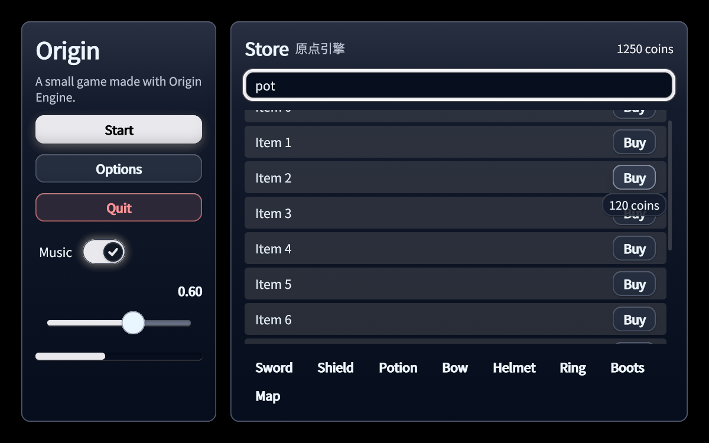

# og-ui

The Origin Engine UI (`docs/design.md` §2.7; the contract is `docs/ui.md`):
the tree that screen and component documents build and the engine's own
widgets add to, laid out, styled by one CSS cascade (the default style, a
style pack, the game's own CSS), moved by the tick, and drawn as og-draw's
commands, which og-render's UI pass draws over the finished frame. The
probe addresses it through stable string ids (`touch_move_to`,
`move_to_text`, `dump_ui`). The same Rust runs in the wasm and the native
host.

The UI is crates along its mechanisms (docs/ui.md §7): og-ui-model
(rectangles, insets, the 2D transforms, the saved bytes' primitives),
og-css (the value lexer and `calc()`), og-reactive (bindings, formats and
the reactive session), og-text (measurement, line breaking, bidi, HarfRust
shaping and run-time glyphs), og-draw (the commands og-render draws) and
og-rive (Rive artboards). og-ui holds the stages, layout, the cascade,
motion, paint and the documents; it depends on those and on og-core,
og-ecs, og-input, og-probe (no default features), og-tween, og-i18n,
cssparser, Parley and Skrifa, and AccessKit off the web. It never links
og-render.



## Using it

A game builds no tree in code: it mounts documents (§Documents), and
og-runtime runs the UI in the tick on both hosts. The immediate calls below
are the engine's own front end, which the documents' controls, the
inspector and the tests use:

```rust
let ui = SharedUi::new(Ui::new(UiDesc { fonts: Fonts { body: UiFont::new(handle, &msdf), ..Default::default() }, ..Default::default() }));
let (desc, run) = ui.system("ui", || viewport, |ui, _ctx| {
    ui.panel("Menu", PanelDesc::default(), |ui| {
        ui.label("Title", "Origin", LabelDesc { step: Some(ui.theme().type_ramp.display_sm), ..Default::default() });
        if ui.button("Start", "Start", ButtonDesc { variant: ButtonVariant::Primary, ..Default::default() }).clicked {
            // start
        }
    });
    Ok(())
});
world.add_system(desc, run)?;          // builds the UI inside the tick from og.Input
probe.set_ui(ui.probe());              // dump_ui, touch_move_to, move_to_text
// after the tick, when rendering:
let mut overlay = Overlay::new(viewport.width, viewport.height, viewport.dpr);
let mut ui = ui.lock();
let time = ui.seconds() as f32;
ui.frame().emit(&EmitDesc { layer: 1000, time }, &mut overlay);
```

`Ui::begin(input, viewport)` … `Ui::end()` is the whole protocol; widgets
return a `Response { hovered, pressed, clicked, changed, focused, submitted }`
whose edges last one tick. Interaction is decided against the previous
tick's rectangles, which are also what the probe resolves against, so a
scripted `touch_move_to` and a click agree.

## Widgets

| Call | What it is | Probe text |
|---|---|---|
| `open(id, Element)` / `close() -> Response` | a container (`row`, `column`, `container` take a closure) | — |
| `panel(id, PanelDesc, f)` | a card: `panel`, `radius.panel`, `space.lg` padding, `space.md` gap, a column unless `row` | — |
| `scroll(id, ScrollDesc, f)` | a scroll column, vertical by default, horizontal or both ways by `ScrollDesc::axes` (`Element::scroll_x` for any container): the wheel (both axes) or a drag scrolls it, a released drag keeps its momentum, it clips its content, a scrollbar per scrolling axis (`radius.bar`) shows the position and a press on one grabs it; nested containers hand off (§Scrolling) | — |
| `label(id, text, LabelDesc)` | MSDF text; wraps at its width (word breaks; between CJK characters under kinsoku, so no line starts with closing punctuation, a small kana or `ー` nor ends with an opening bracket, and a katakana word stays whole; long words between characters) unless `nowrap`; `align` start/center/end; type step from the ramp; `ellipsis` cuts it with "…" ("..." in a font without it) where it does not fit: a `nowrap` label on its one line (it can then shrink in a row), a wrapping one on its last line with `max_lines`; `fit_min` (auto-fit) takes the ramp's smaller sizes, largest first and with its own step's tracking and features, down to that step where the text does not fit (one line with `nowrap`, else its words and `max_lines`), and only then cuts | the whole text, cut or not |
| `button(id, text, ButtonDesc) -> Response` | a box of `h-control-sm/md/lg` cornered by `radius.control`; `Secondary` (neutral fill, default), `Primary` (the style's `primary`, one per screen), `Quiet`, `Danger`, `Ghost` (clear inside a `lineStrong` outline); `square` makes it as wide as it is tall (an icon button); `disabled` turns neutral and inert; pressed shrinks by `press-scale` | the label |
| `image(id, ImageDesc)` | a texture region (`uv`, `tint`), or a solid rectangle without a texture; `aspect` (width over height) keeps its proportions: with the height left to fit it is as tall as its laid-out width over it, with a fixed height and the width left to fit as wide as the height times it (`Element::aspect`, any element) | — |
| `progress(id, value, ProgressDesc)` | a track filled to 0–1, cornered by `radius.bar` | — |
| `slider(id, &mut f32, SliderDesc) -> Response` | track, `primary` fill, thumb; a press anywhere on it sets the value, dragging follows; `min`/`max`/`step` | — |
| `toggle(id, &mut bool, label) -> Response` | a switch (`primary` on) with a label; a click flips it | the label |
| `text_field(id, &mut String, &FieldDesc) -> Response` | one line: a press focuses it with the caret at the press and a drag selects (Shift+press extends), typed text replaces the selection at the caret, Backspace/Delete/←/→/Home/End edit and Shift with them selects, Ctrl/Cmd+A selects all, +C copies and +X cuts (`Ui::take_clipboard`; the web shell's copy and cut events), an input method's composition shows underlined at the caret until it commits, Enter submits and leaves, Escape leaves, a press elsewhere blurs; the text scrolls to keep the caret in view; the caret blinks (§Text); placeholder; `max_chars`; `invalid` dresses `Field.frame[invalid]` (the danger outline undressed); `bare` draws no frame or ring, for a component's own frame; focus ring in `focus` | the text, or the placeholder while empty |
| `text_area(id, &mut String, &TextAreaDesc) -> Response` | several lines: the field's editing, Enter breaks the line, ↑/↓ move between lines (and stay out of focus navigation while it is edited), Home/End to a line's ends; wraps between words at its width, `rows` lines tall (default 4), scrolled to keep the caret's line in view | the text, or the placeholder while empty |
| `rich_text(id, markup, RichTextDesc) -> RichTextResponse` | one paragraph of inline spans from markup (`src/text/markup.rs`: `[b]`, `[i]` (slanted), `[u]`, `[s]`, `[outline=w,colour]`, `[color=…]`, `[size=…]`, `[font=…]`, `[icon=…]`, `[img=…]` (a picture registered with `set_images`, one em tall at its aspect, in its own colours), `[action=…]` (the action's glyph on the device used last, resolved every frame: its icon, else its key's name on a cap), `[link=…]`, `[wave]`, `[shake]`, `[pulse]`; `[[` is a literal `[`): lines break between the spans' words (a word split across spans stays whole), every span on one baseline, each line as tall as its tallest span; bold thickens the glyphs in the MSDF shader (as far as the field reaches) and draws a second copy a device pixel right; links are child elements (kind `link`) that focus and press like buttons; each line runs the bidirectional algorithm over its whole text at the UI's direction, so pieces reorder and so do runs of either direction inside one span, each run drawn shaped (§Text); a bad tag stays as text and warns | the plain text (links: their text; an action: its glyph's name) |
| `tooltip(text)` | for the element just built: shown below it (above without room, clamped to the safe area) once the pointer has rested on it for `motion.duration.slow`; drawn over everything | the text |

Any container with `interactive: true` reports its response from `close()`.

### The game widget set (`src/widgets.rs`)

| Call | What it is | Probe ids and text |
|---|---|---|
| `tabs(id, items, &mut usize, TabsDesc)` | a segmented control: `fill` track, the chosen tab on `thumb` | `Tab#i`, the labels |
| `select(id, options, &mut usize, &SelectDesc)` | a field-like trigger and chevron; opens `<id>.menu` (a popover layer and focus scope) with `Option#i`; a press outside or Back closes it | the chosen label |
| `stepper(id, &mut f32, StepperDesc)` | `Dec`, `Value`, `Inc`; bounded; Left/Right step while a button is focused; a screen reader's increment/decrement on the spinbutton | `−`, the value, `+` |
| `radio(id, options, &mut usize, RadioDesc)` | `Option#i` rows: a ring, `primary` with a dot when chosen | the labels |
| `checkbox(id, &mut bool, label)`, `checkbox_list(id, labels, &mut [bool])` | a box, `primary` with a tick (two rotated bars) | the label(s) |
| `badge(id, text, Tone)` | a small box in a tone (neutral, success, warn, danger, info, primary, inverse); its ink reads 4.5:1 (`READABLE`) on what it is drawn on: a tone's or the primary's ink on a ground across the scale from the palette's `panel` (a light style's badge on its dark stage) lightens or darkens towards its own end until it does (`Srgba::readable_on`), the neutral `inkMuted` wherever it does not read on its `control` (and where no ink of its side could, the fill moves away from it) | the text |
| `divider(id, vertical)`, `spacer(id, Option<Size>)` | a hairline in `border`; empty space | — |
| `icon(id, name, IconDesc)` | an icon of the icon atlas (`set_icons`) by name, tinted: a cell of a texture grid, or an icon set's distance-field glyph fitted to its square (§Icon sets) | the name |
| `joystick(id, JoystickDesc)` | a base and a knob following a press that started on it; answers −1..1 with a dead zone; at least three touch targets wide | — |
| `dpad(id, DpadDesc)` | `Up`, `Down`, `Left`, `Right` arms (each ≥ 44 CSS px) answering which are held | the arm names |
| `open_list`/`list_item`/`close_list` | a virtualised scroll list: only rows in view (and one each side) are built, fillers keep the full scroll range; `Row#i` rows select and focus | `Row#i` |
| `open_grid`/`grid_item`/`close_list` | the same for a wrapping grid of equal cells (`Cell#i`) | `Cell#i` |
| `spotlight(id, Option<Rect>, SpotlightDesc)` | the scrim on four sides of a hole (`Top`, `Left`, `Right`, `Bottom`, `Hole`) with a `focus` edge; presses on the shades stop there, presses in the hole reach what is under it | — |
| `toast(text, ToastDesc)`, `dismiss_toast(id)` | a queue in the UI state: at most three up (older leave first), 3.2 s (6 s danger), enter and leave by the tick, a press dismisses; stacked at `set_toast_anchor` | `Toasts/Toast#n`, the text |
| `memory(id, initial)`, `remember(id, value)` | a number kept for an id in the UI state (a template's tab) | — |

Widget memory between ticks (a select being open, a typewriter's start,
a counter's progress, a drag's source) lives in
`State::anims`, keyed by the element's path hash and dropped when the widget
is not built; it, the toast queue, the UI clock, queued navigation and the
focus scope are all in `save_state`, so a restored world replays the UI.

**Drag and drop.** A press on a list row or grid cell marks it the source; a
release over another row or cell answers `Response::dropped = Some(source)`
there; the cell under a drag shows the focus ring.

## Scrolling (`src/interaction/scroll.rs`)

A container scrolls vertically (`Element::scroll`), horizontally
(`Element::scroll_x`; a horizontal scroller never shrinks its children) or
both ways. Its offsets are UI state, clamped by the layout to its content.

- **The wheel** (`InputFrame::wheel`, both axes) goes to the innermost
  scroll container under the pointer; what it cannot take, because it has
  reached its end or does not scroll that way, goes to the container
  around it, and so on outwards (nested scroll handoff). A drag on a
  container that holds the press (one started on it, not on a control)
  moves it the same way, so a sideways strip in a vertical page scrolls the
  page when dragged up and down.
- **Momentum.** A drag released while moving keeps its velocity (a running
  average of the last ticks' movement) as a fling, which slows by
  `1 − 1/(ticks per second × motion.spring.momentum's response)` a tick
  (arithmetic only) and stops below 0.1 px a tick, on an axis as it reaches
  the content's end, or at the next press. Not under reduced motion.
- **Scrollbars.** A bar on each scrolling axis (`controlStrong`, at the
  right edge and the bottom), as long as the view is of the content
  (at least `space.xl`); a press within 12 px of the edge grabs the bar
  (the press goes to no control under it) and dragging moves it through
  the range.
- Keyboard and gamepad focus moving to a control outside a container's view
  scrolls it in on both axes.

- **Two touches** (og-input's `og.Pointers`): when two fingers are held
  on one scroll container (the innermost under each), it follows the
  movement of their centre, so a list of buttons, which one finger would
  press, scrolls under two. The press the first finger began presses nothing once the
  second lands, and the primary pointer presses nothing while two are
  held; two fingers on anything else (a stick and a button) are no
  gesture. Two fingers lifting off a scroll container fling it with
  their last velocity, as one finger's drag does. The gesture is UI
  state (`State::pinch`, `save_state` version 7). A picture the player
  zooms and pans is a document's own: `onwheel`, `onpinch` and
  `onpointermove` report to the game, which keeps the zoom and the pan and
  binds them to CSS `scale` and `translate` (the `NodeGraph` and
  `RpgWorldMap` components).

`tests/widgets.rs` `scroll_views_scroll_both_ways_hand_off_fling_and_grab`
covers each (and a restore); `two_fingers_scroll_a_list_without_clicking_its_row`
covers two touches and `two_fingers_lifting_off_a_list_fling_it` the
two-finger fling.

## Layers

Elements outside the tree, laid out after it and drawn over it in rank order:
anchored groups (`anchor`, rank 1; `over: true` raises one to rank 3), dialogs
(`open_modal`/`close_modal`, `modal`: a scrim backdrop that takes presses,
padded by the safe area, with a centred `Panel`, rank 2), popovers (a
select's menu, rank 3), the toast stack (rank 4) and tooltips (rank 5). A
layer's probe path is its own id. Anchored groups sit at one of nine points of
the safe area (`Anchor::TopLeft` … `BottomRight`, `Center`), inset by the
density's gutter (or `margin`), moved by `offset`.

## Documents (`src/doc/`)

A screen or component is a scriptless `.svelte` document. Metadata
declares its contract; markup defines structure and bindings; scoped CSS
defines appearance. `UiDocument::parse(source, text)` validates it against
the reflected document schema, and og-cook writes an `og.UiDocument` blob.
The engine's built-in components and screens are documents of the same
form under the `@ui/` root (`packages/engine/src/ui/`, docs/ui.md §5).

### Grammar

```svelte
<meta name="screen" content="shop" data-layer="menu">
<meta name="prop:gold" content="number">
<meta name="prop:price" content="number">

<section id="Shop">
	<button id="Buy" disabled={gold < price} onclick={buy}>
		{t('shop.buy')}
	</button>
</section>

<style>
#Shop { width: 520px; }
@media (width < 600px), (height < 600px) {
	#Shop, #Buy { width: stretch; }
}
</style>
```

The caller supplies `gold`, `price`, the `buy` action, and a string table
containing `shop.buy`. IDs are unique within the document. The tags,
attributes, blocks and CSS a document takes, and what it refuses, are
docs/ui.md §2 and §3; the [screens guide](../og-api/guides/screens.md)
says how to write one and the generated
[component catalogue](../og-api/guides/components.md) lists every element
and property the schema reflects.

### Bindings and formats (og-reactive)

A **viewmodel** is JSON: an object code passes (`og.ui.push(world, "shop", vm)`),
a fixture, or a mount's stores. A path (`hero.health`, `items.0.price`,
`items.length`) reads it, an `{#each}` row's alias first. Expressions:
paths, numbers, strings, `true false null`, `! -`, `* / % + -`,
`< <= > >=`, `== !=`, `&& ||`, `a ? b : c`, parentheses. A binding tracks
only what it read; an unchanged value leaves its element's layout and
drawing kept (docs/ui.md §2.1).

A translated string's arguments take the engine's formats as argument
types (`{gold, compact}`, `{t, clock}`, `{n, scientific, 4}`), by the
language og-i18n sets:

| format | 1234567.891 | what it does |
|---|---|---|
| `plain` | 1234567.891 | as written |
| `grouped` | 1,234,568 | the locale's grouping, `digits` decimals (0) |
| `fixed` | 1,234,567.89 | grouped, always `digits` decimals (2) |
| `compact` | 1.23M | K M B T (CJK: 万 億 兆; 1.23億 in ja) |
| `engineering` | 1.23e6 | exponents in threes |
| `scientific` | 1.23e6 | one digit before the point |
| `letters` | 1.23M | idle notation: K M B T, then aa ab … from 1e15 (1.5e400: 15ey) |
| `percent` | 123,456,789% | ×100 |
| `duration` | 14d 6h | seconds as the two largest units |
| `clock` | 342:56:07 | seconds as h:mm:ss |
| `countdown` | 342:56:08 | as clock, rounded up, never below 0 |
| `ordinal` | 1234567th | og-i18n's ordinal rules (scientific past 1e15) |

Numbers past 1e308 are a mantissa and an exponent: `{ "m": 1.5, "e": 400 }`
or the string `"1.5e400"`, formatted by every format above. Plurals and
selects are og-i18n's message syntax in a template (`"{count, plural, one {#
gem} other {# gems}}"`).

### Documents and code

A document is mounted, not called. `mount_document(mount, document, inputs,
content, env)` mounts it reading named stores; `mount_with_values(mount,
document, &values)` holds its values for it, as a pushed screen's viewmodel
is held (its mount is `og.screen:<name>`). The mounts are built once a tick
by `build_retained_documents(env)` (and by `end` with no host), and an
element is resolved again only when a value it reads changes. Their events
are kept for `take_doc_events`: `click`, `changed`, `select` of a list row,
`emit`, `action`, `set` for each two-way write with the path it wrote, and
`back` when the layer's Back is `emit`. Code and documents build one tree:
a document's elements have the same props, states, motion and checks as
code's.

### The layer stack (`src/layers.rs`)

`push_screen(screen, vm)`, `pop_screen`, `replace_screen`, `clear_screens`;
`layer_stack()` lists them bottom first. Each layer is a full-surface layer
of its own (id: its screen's name), built in stack order:

| kind | input | capture | under | back |
|---|---|---|---|---|
| `hud` | game | no | none | none |
| `menu` | menu | yes | dim | pop |
| `modal` | menu | yes | dim | pop |
| `popover` | menu | no | none | pop |
| `toast` | game | no | none | none |
| `tooltip` | game | no | none | none |
| `system` | all | no | none | pop |

- Input goes to the top layer that takes it, once per tick: a `menu` or
  `all` layer is a focus scope (focus stays inside, it takes Back before
  `Ui::back` sees it), the layers under a `menu` layer are inert, and
  `game_input()` is false while one is on the stack. A capturing layer
  (or a dimmed one) takes the pointer on its gaps.
- Focus: a layer that becomes the top takes the focus it had when a layer
  was pushed over it (`remember`), else its `focus` path, else its first
  control.
- `under dim` and `blur` draw the palette's scrim under the layer (blur
  becomes a backdrop blur with the UI pass); `hide` leaves the layers under
  it unbuilt. `paused()` is true while a `pause` layer is on the stack.
- `save_state` carries the stack, each layer's viewmodel and focus, and the
  states triggers set.

### Actions and glyphs (`src/interaction/actions.rs`)

Named UI actions bound to og-input's controls: `ActionDesc { name, keys,
buttons, trigger, toggle, label }` with `trigger` press, release or
`Hold(ms)`, and `toggle` the hold's alternative (a tap turns it on, the next
off: `action_held`). The defaults: `confirm` (Enter, Space, A), `back`
(Escape, B), `tabNext` (E, `]`, RB), `tabPrev` (Q, `[`, LB), `details` (X,
Y), `rotate` (R, X: a held inventory item or placed piece turns).
`action(name)` is true the tick it fires; a document's `on action`
fires on the top layer that takes input. `device()` is the device used
last (keyboard and mouse, the pad family the host set with
`set_pad_family`: Xbox, PlayStation, Switch or a generic pad, or touch on a
coarse pointer), and `glyph(action)` its glyph there (`icon` a style's
icon name, `xbox.a`, `ps.cross`, `switch.b`, `pad.south`, `key.enter`,
`touch.<action>`, and `text`). `action_bar()` is what an action bar
component reads: the top layer's `actions` with their hints and glyphs.

## Accessibility tree (`src/a11y.rs`)

Every frame builds the accessibility tree from the nodes it draws and
takes input on, so it cannot drift from the screen. Each element has a
**role** (`button`, `link`, `text`, `heading`, `image`, `checkbox`,
`radio`, `switch`, `slider`, `spinbutton`, `textbox`, `combobox`,
`listbox`, `option`, `tab`, `tablist`, `radiogroup`, `progressbar`,
`meter`, `timer`, `status`, `dialog`, `tooltip`, `separator`, `group`; none
for layout containers, spacers and unnamed pictures), a **name** (its text;
or what the widget gives it: an icon's name, a dialog's title, Decrease and
Increase for a stepper's buttons; a control showing no text of its own is
named by the text inside it, then by the label just before it in its row,
then by its id; a text field or area, whose text is its value, by that
label, else its placeholder, else its id), a **description** read after
the name (a labelled field's placeholder; the mirror's
`aria-placeholder`), a
**value** (a slider's or stepper's number, a progress's percent, a
field's text, a select's choice)
and **states** (`disabled`, `focused`, `focusable`, `checked`, `selected`,
`expanded`, `collapsed` (expandable and closed), `pressed`, `busy`; `offscreen` in the tree for a control a
scroll container cuts out of view). A component built from containers (a menu, a tree, a
table) names its own with `Ui::semantics` (a document's `role` and `aria-*`): one of
`a11y::ROLES` (menu, menuitem, tree, treeitem, table, row, cell,
tabpanel, toolbar, region…), a name, a value, its states and a range;
an unknown role is refused with a frame warning. The probe's `dump_ui` carries them on
every element; `Ui::a11y()` (`og.ui.a11y()`) answers the tree of the
elements with a role, with full paths, nearest-ancestor parents, whole
bounds, the focus order and the focused path, for a shell to mirror into
the page. Focus order is the tree's order (the drawing order: the page,
then each layer over it): Tab and the pads walk exactly the nodes marked
`focusable`, within the topmost dialog while one is open.
`tests/a11y.rs` checks the roles, names, values and states of every
widget and that Tab walks `focus_order`; `og ui check` reports a screen's
unnamed controls and texts without a role.

**The web shell's mirror** (`packages/engine/src/web/a11y.ts`). The Worker
creates the engine with `a11y`; a frame's answer then carries the tree
whenever `A11yTree::digest` (every node's path, role, name, value, states
and bounds to the CSS pixel, the focus order, the focused path) changed,
and only then. The shell keeps an invisible element per node at its bounds
over the canvas, nested as the tree nests it, with its ARIA role, label (or
text for text roles), `aria-valuenow`/`-valuetext`, `aria-checked`,
`-selected`, `-expanded`, `-disabled`, `-busy`, a dialog's `aria-modal`,
and `tabindex=-1` on focusable nodes. The DOM focus follows the UI's focus
(not out of the page's own fields, nor from the text control's textarea);
while a text field is focused that textarea has the focus and is the
field for a reader (named after the field's node, its placeholder and its
text), the field's own element is `aria-hidden` and its parent owns the
textarea (`aria-owns`), so a reader meets one text box inside its dialog
and no focused element is ever `aria-hidden`; a status or alert node that appears (a toast) is written into a polite or
an assertive live region. What a screen reader does there reaches the UI
as input: a click on a mirrored element (its default action) is og-input's
`a11y` request `activate`, focus moving onto one `focus`, and
`increment`/`decrement` step an adjustable one (`InputFrame::a11y`; nav.rs
`apply_a11y` resolves the path against the last frame and acts as Enter,
Left and Right would, within the topmost dialog, also on a screen that
turned navigation off). A slider and a stepper's spinbutton are mirrored
as an `<input type="range">` with their role, held at the UI's value one
step from either end (`aria-valuenow` and `aria-valuetext` read it): a
screen reader's own adjust gesture (VoiceOver's swipe up or down,
TalkBack's volume keys) moves the native value, or sets it from
`aria-valuenow` and the step, and fires `input`, which the mirror sends as
`increment` or `decrement` before putting the value back (the UI owns the
value and its step). A stepper's `−` and `+` follow its range as siblings
(an input holds no children); og-ui steps the stepper for a request
naming its spinbutton when one of its buttons is in reach. A native range
takes `tabindex=-1`, out of the page's Tab order. Keys pressed while a mirrored
element has the DOM focus still reach the engine as keys (the shell keeps
the arrows from the native range, so a key steps once). The native host creates no mirror
and its frame answers carry no tree. `tests/a11y.rs` covers the requests
and the digest; `packages/engine/tests/web/a11y.ts` checks the DOM against
the tree on the `tests/fixtures/a11y` settings dialog in Chrome, Chrome's own accessibility
tree, the Master slider's native range lowered by an `input` event (the
adjust gesture), a screen-reader-style click toggling Mute, the live
region, and the page preferences below.

## Focus navigation (`src/interaction/nav.rs`)

One focus for pointer, keyboard and gamepad. Intents come from the arrow
keys, Tab/Shift+Tab, Enter, Space and Escape (`InputFrame::keys`, `shift`),
from a gamepad (`InputFrame::gamepad`: d-pad and A/B edges, the left stick
past half-way once, then after `motion.duration.slow` every
`motion.duration.fast`) and from `navigate(Nav)` (queued for the next tick).

- Directions pick the nearest focusable control whose centre lies that way,
  scoring distance along it plus three times the gap across it; with none,
  focus wraps to the far end of the same row or column. Next/Prev walk
  reading (draw) order and wrap.
- `set_focus(path)` (`og.ui.setFocus`) moves the focus to the control at
  a full path when the frame ends, if one is there: a component moving it
  with its choice (a radio group's arrows, a list opening at its option).
- Activate presses the focused control (`Response::clicked`); Left/Right
  adjust a focused slider or stepper; while a text field is edited, Left,
  Right, Enter, Space and Escape belong to it.
- Back closes the topmost dialog or menu, else `back()` answers true once.
  While a dialog or menu Back closes is the last frame's topmost scope,
  `back()` answers false even when asked before that dialog is built this
  tick (a HUD drawn under pause), so the dialog keeps it; a locked dialog
  lets Back through to `back()`.
- A dialog or open menu is a focus scope: while it is the topmost, focus
  stays inside; when it opens, focus moves to its first control (or the one a
  widget asks for, the select's chosen option); when it closes, focus returns.
- A press focuses the control without the ring; navigation shows the ring
  (the style's `focus`, a gap of what is behind, then the control).
- Navigation that lands on a control outside its scroll container's view
  scrolls it in (rows just outside a virtualised list are reachable).
- `set_navigation(false)` turns arrows and Tab off for a gameplay screen whose
  keys move the player (the HUD templates do); an open scope turns it on.
- **Explicit moves** (`Props::nav`, `NavLinks`): up, down, left, right,
  next and prev, each a path (full, or a sibling's id), win over the
  spatial pick; a path to a focus group lands on its remembered member,
  one to another container on its first focusable control.
- **Focus groups** (`Props::focus_group`, `FocusGroup { wrap, memory }`):
  arrows move among a group's members first. At its edge a wrapping group
  goes round inside itself; one that does not leaves for the nearest
  control outside that way (the group around it first) and stays put when
  there is none. With `memory`, focus coming back in lands on the member it
  last had. Tab ignores groups (reading order).

## Gestures and the cursor (`src/interaction/recognize.rs`)

`Props::gestures` (`GestureSpec { tap, double_tap, long_press,
long_press_ms (500), double_tap_ms (300), slop (10), priority }`) makes any
element recognise a tap, a double tap and a long press, answered by
`Response::{tapped, double_tapped, long_pressed, long_press}` (the last the
held press's progress, 0–1), `Ui::gesture` and frame events (`tap`,
`doubleTap`, `longPress`). One press is an arena of the recognisers at and
around the pressed element: each gesture goes to the highest priority, the
innermost of equals. A tap waits for a double tap only where one is
declared; a long press that fires takes the press (its release clicks and
taps nothing); travel past the slop fails both. Keys and pads tap a
focused recogniser by activating it. The press, the waiting tap and the
recognisers are UI state (`save_state` version 14 on).

`Props::cursor` (`Cursor`, CSS names) sets the pointer's shape over an
element and its subtree; `Auto` takes the parent's, and with none set a
text control's I-beam, a draggable element's open hand (closed while held)
or a link's hand. `UiFrame::cursor` is the resolved shape of what the press
holds or the pointer is over; the frame answer carries it (`cursor`) and
the web shell sets the canvas's CSS cursor from it (`og.ui.frameCursor`).

`InputFrame::from_world` reads og-input's `og.Gamepad` (pad 0:
`GamepadFrame::from_gamepad`, the press edges of the standard buttons and
the left stick) on both hosts. The browser shell still maps a pad's buttons
to keys too (A Space, B Escape, d-pad and stick arrows, Back Tab, Start
Enter) as the fallback for a page without the resource; an intent that
arrives both ways in one tick is taken once (`nav.rs`).

**Several pads (local multiplayer).** `Ui::set_players(n)` (declared each
tick, like `set_navigation`) gives pads 1 to `n - 1` (`InputFrame::extra_pads`,
read from `og.Gamepad`) a focus of their own among the same controls: the
d-pad and the stick move it (its first move lands on the control nearest the
surface's centre), its A presses the control under it, its ring is drawn
outside pad 0's in the player's colour (`info`, `success`, `warn`), and a
dialog's scope holds it inside as it holds pad 0's. `Response::pad` names
the pad whose A pressed a control (`None` for the pointer and the keyboard)
and `Response::focused_by` has a bit per pad whose focus is on it;
`Ui::focus_path(pad)` answers where each pad's focus is. Pad 0 keeps sharing
its focus with the keyboard and the pointer; Back and adjusting a slider
stay pad 0's. The pads' focus and sticks are in the UI state
(`tests/widgets.rs` `pads_beyond_the_first_move_their_own_focus_and_press`). The probe's `gamepad` command
addresses them with `@1` to `@3` after the buttons (`gamepad:a@2`).

**Several touches.** `InputFrame::pointers` is og-input's `og.Pointers`
(pointer 0 is `og.Input`'s pointer; 1 to 4 are further touches). The touch
controls (`joystick`, `dpad`, a document's `<button data-og-touch>`) answer
any of them: a stick keeps the finger that started on it, a button is held
while the touch that started on it is down, so a thumb on the stick and
another on Hit work together. Two touches on one scroll container scroll
it (§Scrolling).

**A virtual cursor for pads (`src/interaction/vcursor.rs`).** `Ui::set_virtual_cursor(Some(
VirtualCursorDesc { speed (900), accel (250 ms; TypeScript's `accelMs`), magnet (0.5), scroll (1200) }))`,
declared every tick like `set_players`, turns pad 0 into a pointer for a
screen built for the mouse (a map, a shop grid, a strategy HUD): the left
stick moves a cursor (squared for fine aim, from a third of its speed to all
of it over `accel`), which slows over a control and settles to its centre
once the stick rests (`magnet`); A is the pointer's button (press, hold,
release, so drags, sliders and long presses work); the right stick feeds the
wheel under it. While it shows the stick and A move and press no focus, the
style draws it (a ring in `focus` on a shadow, larger over a control) and
`UiFrame::cursor` is `none`. The real pointer moving hides it and the stick
shows it again. It is UI state (`save_state` version 15).

**The player's HUD layout (`src/interaction/hud_layout.rs`).** `Props::customize`
(`Customize { key, lock_move, lock_scale, lock_opacity, min_scale (0.5),
max_scale (2), min_opacity (0.2) }`; the touch controls take it in their
descs) lets the player move, scale and fade an element. Each player's
placements (`HudPlacement { x, y, scale, opacity }`) are kept by key (the
element's path when `key` is empty) and applied before the frame's
transforms, so its touches follow it. `Ui::set_hud_edit(true)` is the edit
mode: customisable elements stop answering their presses and show outlines,
a press selects one, a drag moves it (its centre kept on the surface), two
touches or the wheel scale it, and with no virtual cursor pad 0's stick
moves the selected one. `Ui::hud_layout_editor` is its panel (the selected
key, size and opacity steps, Next, Reset, Done). `Ui::hud_layout(player)`
answers the layout as JSON for the game's settings when `hud_edit().changed`
says so, and `Ui::set_hud_layout(player, json)` gives it back on the next run.
The layouts and the edit mode are UI state (version 15; a version 14 state
upgrades with none).

## Motion (`src/motion/`)

Content moves in and out by CSS: a document's `transition:` and `animate:`
directives, `@starting-style` and `@keyframes`, eased by the theme's curves
(`ease_out` entering, `ease_exit` leaving, cubic Béziers solved by
bisection: arithmetic only), advancing one tick per frame. Dialogs scale in
over a fading scrim; toasts slide. Under `Theme::reduced_motion` every
movement becomes a fade. The transform applies to the laid-out rectangles
(so drawing, hit testing and the probe agree), to opacity and to text size.

## Styles (`src/style_pack.rs`, `src/css/`)

A game's UI wears one cascade. Its first layer is the **default style**:
`default.css`, generated with `src/theme.rs` from
`packages/design/tokens/*.css` by `scripts/gen-theme.sh` (`tests/theme.rs`
fails on drift). It sets every value the core controls and the built-in
components draw with as a `:root` token and dresses every role part once
(docs/ui.md §3.1); the theme reads the root tokens back each frame
(`ui/css_tokens.rs`), so a widget drawn in code takes them too. The design
language is the one the engine shares with origin-agent; nothing of it
comes from the platform at run time.

A **style pack** is a directory of CSS and assets with no manifest
(`StylePack::parse`, `Ui::set_style_pack`): its direct-child `.css` files
apply in lexical order in the `og-pack` layer, nested sheets through
`@import`, URLs beside the file that names them. Its CSS is read once and
shared by every document. The layers are `og-default`, `og-components`
(the built-in documents' own `<style>`), `og-pack`, `og-game`, then
unlayered CSS (docs/ui.md §5). The built-in packs are
`templates/styles/fantasy` and `templates/styles/scifi`, each with a
README of its files and tokens.

`style/` keeps what the cascade resolves into: the theme's palette and
ramp (`style.rs`, `style/tokens.rs`), CSS colours (`style/css_color.rs`),
the exposed parts' identities (`style/dress.rs`), `-og-sound`
(`style/sound_css.rs`) and the paint values widgets share
(`style/style_file.rs`). `tests/style_pack.rs` loads packs, their light
blocks and their `url()`s through tokens, and `tests/button_contrast.rs`
holds every button role's label to its fill in both schemes.

**Badges on either side of the scale.** A palette's status tones and
primary are made for its panels: deep on a cream panel, light on a dark
one, and no ink reads 4.5:1 on a dark stage and a cream panel at once. So
a badge reads its ground (`Ui::behind`, the palette's colours): on the
palette's own side it draws the palette's ink as it is, and on the other
side its ink moves towards its own end of the scale until it reads 4.5:1
(`Srgba::readable_on`: a deep green lightens, keeping its hue as far as
the bar allows). The neutral badge's ground is its own flat `control`, so
`inkMuted` moves wherever it does not read on it, and where no ink of its
side could, the fill darkens or lightens away from it instead.

## Icon sets

An icon atlas is a grid of equal cells of a texture (`IconAtlas::texture`,
`columns`, `rows`, `names`), or an **icon set**: SVG icons cooked like a
font. og-cook's `type icons` file names the SVGs (`source`, `size`,
`range`, one `icon "<name>" ["<file>"]` a line; `crates/og-cook/src/cook/formats/icons.rs`)
and cooks them into an `og.Font` blob: icon `i` is the glyph at U+E000 + i,
its em square the SVG's view box, the field a true signed distance in all
four channels of the stroke's own outline (round caps and joins are arcs; a
butt cap is cut square; a miter join reaches its point within
`stroke-miterlimit`, else is bevelled; a path's `stroke-linejoin`, else the
set's `join` line, else SVG's miter), the names in a `names` section.
`og.load.font` loads it and `UiDesc.icons.font` (`IconAtlas::font`) makes
it the atlas: `icon` draws its glyph fitted to the icon's square through
the MTSDF text path (crisp at any size, in its ink), and rich text's
`[icon=name]` draws it inline. The test fixture
`tests/fixtures/ui-text/assets/icons/iconoir.ogt` is 72 iconoir icons
(MIT) at 48 px per icon, range 8; og-tests-cooked's
`tests/materials_gfx.rs` renders them. A document's monochrome icon is
CSS (`mask-image: url()` over `currentColor`, docs/ui.md §2).

## Juice and screen covers (`src/motion/juice.rs`)

- `counter(id, value, CounterDesc)`: a label that counts (ease-out cubic,
  by the tick, f64) from what it shows to `value` whenever `value` changes;
  the first count starts at `from` (none: no count). Grouped with commas,
  decimals, prefix and suffix; the style's `--motion-scale-pop` bumps it on landing.
- `cover(&ScreenTransitionDesc, amount, revealing)`: a full-frame cover at
  `amount` this frame, for a caller that times it (a timeline's transition
  track, a screen's `@view-transition`): `Fade`, `Wipe`, `Iris` (2 px
  bands), `Dissolve` (24 px cells in a fixed hash order) and `Slide`, in a
  colour or a texture region stretched over the surface, from any side; drawn
  after every other command (over every layer) through the overlay pass.
  Under `reduced_motion` every kind is a fade.

## UI sounds

A style's `-og-sound` sets (docs/ui.md §3.2) name what each event plays:
`hover` (the pointer reaches a navigable control, or focus moves to one),
`press` (by the pointer, Enter, Space or the pad's A), `open` and `close`
(a dialog's first tick each way), `success` and `error` (a toast's tone, a
refused press) and the named sounds keyframes cross. `Ui::take_feedback()`
hands the host each play: one sample of the set, never the one played
last, at a volume and pitch from its ranges, chosen from the UI state's
own random stream so a replay plays the same; `take_haptics` the haptic
patterns at the player's strength. The runtime's `og.ui.sound` system
(after the physics step, before `og.audio`) plays each through og-audio on
the `ui` bus, one voice per event, restarted on a repeat, so the sound's
first sample lies in the tick of the input that caused it
(`packages/engine/tests/ui-sound.test.ts` reads it from the mix
`og run --audio` renders).

## Responsive layout and the safe area

`Viewport::breakpoint()` / `Ui::breakpoint()`: `PhonePortrait` and
`PhoneLandscape` (shorter side under 600), `Tablet` (under 1024 wide),
`Desktop`. Density `Auto` already raises controls to touch size on a coarse
pointer or a surface under 768 px; touch widgets never go under the touch
`h-control-sm` (44). The root and every anchored group keep to the safe area;
dialog backdrops cover the whole surface and pad their content by it.
`Viewport::covered` is the host's own control over the surface (the web
shell's Back, top left of a published page): an anchored group that would
overlap it moves along its edge past it (a left group right of it, a right
group left of it, a top or bottom centred group below or above it), and a
document's `env(safe-area-inset-*)` reads `Viewport::env_insets`, the safe
area with the covered region folded into the one edge that clears it for
the least surface.

## Theme variants

`Theme::dark()` (default) and `light()` are the default style's two
schemes; a style replaces the palette whole. `Theme::high_contrast(scheme)`
(`to_high_contrast` over any style) remaps `inkMuted` → `ink`, `inkFaint` →
`inkMuted`, `control` → `controlStrong`, `controlStrong` → `lineStrong`,
`line` → `lineStrong`, deepens the scrim and outlines every control in
`lineStrong` (the palette's own values only); `with_primary(Srgba)`
(`UiDesc.primaryColor`) sets a game's primary and derives its hover and
active tones (15 % towards either end of the scale), its soft wash and the
ink on it (`ink` or `inkInverse`, whichever reads better); `highlight` and
`focus` stay the style's. `reduced_motion` and `reduced_transparency` are
theme flags; `to_reduced_transparency()` is the flat variant: a style's
glass parts drawn as opaque surfaces (no blur of the frame under them,
their frame at full opacity), the translucent fills (`control`,
`controlStrong`, `primarySoft`, `hud`) the opaque colours they make over
`panel`, and the scrim the one it makes over `backdrop`, so a dialog's
backdrop hides the game rather than dimming it; highlights (sheens, glows)
stay. A game reads the flags (`UiTheme.reducedTransparency`,
`reducedMotion`, `contrast` from `og.ui.theme`/`frameTheme`) to flatten
and still its own. Variants are mappings over the theme's own values.

**The page's preferences.** `Viewport::reduced_motion`, `high_contrast`
and `reduced_transparency` are what the page asks for (the web shell reads
`prefers-reduced-motion: reduce`, `prefers-contrast: more` and
`prefers-reduced-transparency: reduce` into the viewport and sends it again
when any changes); every frame the UI applies them over the configured
theme (`Ui::set_theme`; `UiDesc.reducedTransparency` in TypeScript):
reduced motion turns its flag on, reduced transparency (the page's or the
game's) takes the flat variant, more contrast the high-contrast one. A game's own settings can add to what the
page asks, not take it away. `Ui::theme` answers the effective theme.

## Text

Fonts are cooked MTSDF atlases (`crates/og-cook/README.md`: kerning pairs,
shaped forms, msdfgen's error correction); `FontMetrics` (og-text)
measures exactly as og-render lays out, so measured and drawn text agree.

- **Roles and choice.** `Fonts` has `body`, `display`, `mono` (the numeric
  role) and `rounded` (levels and scores; falls back to `display`, then
  `body`), the locale's `chain` (og.i18n), the game's `fallbacks`
  (`UiDesc.fallbackFonts`: Hebrew, Devanagari, a CJK face) and a style's
  `fallback`. `for_text` takes the role's font when its atlas has every
  character, else the first of the chain whose atlas does (a locale's face
  sets its strings whole, its Latin and digits included); a text the role's
  font draws in part is then **laid out per run** (below); else the first
  fallback whose atlas has it all, else the style's fallback, then a font
  that can draw the text with glyphs rendered at run time (below), and
  when no one font can, per run again; so a Japanese label keeps the
  Japanese face when that face has it cooked.
- **A font per run.** A label that mixes scripts no one font covers
  (`Score 42: مرحبا`, `Level 3 古い水車小屋` with no locale face) takes
  each run from the fallback chain, a grapheme cluster at a time
  (og-i18n's `graphemes`, UAX #29: a base and its marks, a conjunct, an
  emoji sequence): a cluster takes its base's font when that font has all
  of it, else the first of the role's font, the chain, the fallbacks and
  the style's fallback whose atlas has all of it (else whose atlas or file
  does), else its base's; joiners and variation selectors are not asked
  of any face; spaces and punctuation stay with the run before them (a
  leading one with the first letter's).
  `Fonts::link` builds each role's mixed font (`Ui` links the fonts it is
  given), a `FontMetrics` that measures, breaks, kerns (within a run),
  shapes and hit-tests run by run (`is_mixed`; each `VisualGlyph` names its
  `font`), and the label, rich text, field and area draw one text command
  per run, each in its own font, at the advance where the run before it
  ended (`text::pieces`). Fields edit mixed text with the same boxes. A
  text one font covers lays out as one run.
- **Kerning.** The cook's pair table rides in `MsdfFont::kerning` and
  `FontMetrics::kern`; og-render applies it between neighbours in world
  and overlay text alike, and og-ui measures with it (a line is measured
  whole, so pairs across words count; a line that fits whole is not
  broken). A font without pairs lays out unkerned.
- **Bidi and shaping** run in og-ui, at layout, on both hosts (the same
  Rust in the wasm and the native addon), so measured widths, line breaks,
  hit testing and drawing agree. A line with a right-to-left or shaped
  character is laid out by unicode-bidi (UAX #9) into level runs in visual
  order (`FontMetrics::visual`, `bidi_runs`): a label at the paragraph
  direction of its first strong character (the UI's with none), rich text
  over each whole line at the UI's direction (pieces reorder, and so do
  runs inside one span). Each run is shaped whole by HarfRust in its
  direction when it holds a shaped script and the font ships its file
  (`shape::FontFile`): a shaped form is drawn by its glyph id
  (`GlyphKey::Id`, a key no character shares, so an icon font's
  private-use characters never alias one; the cook renders every form the
  font's substitutions reach), and the glyphs' ids, advances and offsets
  go to og-render as `Text::placements` (Devanagari's
  conjuncts and pre-base signs, marks on their bases, Arabic joining); an
  unshaped right-to-left run (Hebrew) is reversed with its brackets
  mirrored. Shaping is og-ui's `shaping` feature (HarfRust; on by default
  and in the shipped wasm, passed on by og-runtime and og-host-web): a
  build without it draws shaped scripts unshaped and keeps bidi, kerning
  and run-time glyphs. What it costs the publish wasm: §What it costs.
- **CJK and other uncooked characters** render at run time
  (og-text's `glyphs.rs`): a font cooked with `runtime true` ships its file, a
  character outside its atlas is measured from the file's metrics and
  recorded (`FontFile::take_wanted`), and og-runtime renders it from the
  outlines before the frame is laid out for drawing, into 512² pages of the
  font's own (every page learns the advance; `RenderScene::set_font`). The
  glyph is a true distance in all four channels at the cook's geometry
  (`em_px`, `px_range`, the same padding and plane bounds), computed with
  `+ − × ÷` and square roots on f32 in a fixed order, so both hosts render
  the same bytes; at UI sizes its slightly rounded corners do not show. The
  choice over a cook-time fallback atlas: a game cannot know a player's
  name or a chat line, and cooking all of GB2312 is 19.8 MB of atlas, where
  the subset font file is 2.5 MB and renders only what is shown (a frame
  that still draws a missing glyph warns once).
- **Ellipsis.** `LabelDesc::ellipsis` (and `max_lines`) cut at layout.
- **Editing** (`src/text/edit.rs`): the caret and selection are placed from the
  same visual layout the text is drawn with, so a press lands on the
  character under it and a selection covers the glyphs it shows in either
  direction. The selection is a neutral fill (`controlStrong`) under the
  glyphs, the composition a hairline under its own, the caret a `primary` bar
  that blinks: shown for 530 ms (32 ticks at 60 Hz) after the last edit or
  move, hidden as long, by the tick (steady under reduced motion). The
  word key (Option under mac keys, Ctrl or Alt elsewhere: §Input) with
  ←/→ moves by words (to a word's start leftwards, its end rightwards),
  with Backspace and Delete deletes one; Ctrl with Home/End goes to the
  text's ends, and under mac keys Cmd+←/→ to the line's and Ctrl the
  emacs keys (§Input). The caret stands between grapheme clusters
  (og-i18n's `graphemes`): ←/→, Backspace, Delete and a press step over a
  base and its marks, an emoji with its modifiers and joiners, at once,
  and a long word wraps between clusters. ← and → move visually: a
  cluster on screen, on in the text in a right-to-left run and across a
  bidi run's edge to the caret stop beside it (a place in the text at a
  run's edge has two on screen, the end of one run and the start of the
  other: the caret is drawn at the one it moved to, and of two stops at
  one place the nearer in the text is taken; at a line's edge an area
  goes on to the next line as it runs); word moves go as the run under the
  caret points, and a selection collapses to its side on screen. Under mac
  keys Control+K, U and W kill into a kill buffer, kills in a row adding
  up (K after the buffer, U and W before it) and any other edit or move
  ending the row, Control+Y yanks it over the selection (a field without
  its line breaks), Control+T transposes the clusters at the caret; the
  buffer is one for every text control. A mixed text's line is placed by the highest ascender and the
  lowest descender of its faces (`FontMetrics::extents`), every run on
  one baseline. Words are UAX
  #29's (og-i18n's `word_segments`): letters, digits and marks with the
  apostrophes and points inside them (`can't`, `3.14`), a run of
  punctuation one word, each Han or Hiragana character one, a Katakana run
  one, Thai and the other dictionary scripts a grapheme cluster each. A
  second press within 500 ms and 4 px of the last (which did not drag)
  selects the word under it, a third the line (between its breaks in an
  area, the whole field), and a drag from them extends by words or lines.
  The shortcut key (Cmd under mac keys, else Ctrl or Cmd) with Z undoes
  and with Shift+Z or Y redoes, from a history per control (100 steps, the
  8 most recently edited controls): typing groups a word and its spaces
  into a step (a Han or Hiragana word, an input method's commit, is a
  step of its own; Thai typed on groups to the space), Backspaces and
  Deletes in a row one each, a move ends the step; a text the game set in
  between starts the history again. A drag past a text area's top or bottom (a field's ends) scrolls
  it every tick, a quarter of the distance out per tick between a quarter
  of a line and two lines, and selects to the edge. The caret, anchor,
  composition, scroll, blink phase, click count, histories, the caret's
  place at a bidi edge and the kill buffer are in `save_state` (version 9). `UiFrame::text_input` names the focused text control, its
  rectangle and its selection: the web shell keeps its hidden textarea over
  it (an input method's window opens there) and copies the selection on
  the page's copy and cut events.

## What it costs

HarfRust shaping is behind the default `shaping` feature: a game with no
shaped script can leave it out of the wasm (`og-host-web
--no-default-features --features publish`; the shipped build keeps it on).
A run-time glyph is rendered once per character, then it is an atlas
glyph like any other (`examples/glyph_costs.rs` times it). The per-frame
CPU bars and what the retained tree costs are measured by
`tests/perf.rs` and `scripts/perf.sh` (docs/roadmap.md §Below target).

## Layout

Sizes per axis: `Size::Fit { min, max }` (content; the default),
`Size::Grow { min, max }` (content, then the parent's free space),
`Size::Fixed(px)`, `Size::Percent(f)` (of the parent's inner size). An
`Element` has `direction` (`Row` default, `Column`), `padding`, `gap`,
`align` (main axis: start, center, end, space-between), `cross` (start,
center, end, stretch), `wrap` (rows), `scroll`, `interactive`, `background`,
`radius`.

One layout per frame, in five walks over the tree (`src/layout.rs`):

1. widths bottom-up: preferred (content) and minimum widths (a wrapping
   text's longest word; a wrapping row's widest child);
2. widths top-down: a row gives each child its preferred width, then grows
   `Grow` children into the free space by water-filling (the smallest rise
   first, until they level or reach their `max`), or, when it overflows,
   shrinks `Fit`/`Grow` children the same way from the widest down to their
   minimums; a wrapping row breaks its children into lines at its inner width
   and grows within each line; a column gives `Grow` (or `Cross::Stretch`)
   children its inner width and caps the others at it; text then wraps at its
   final width;
3. heights bottom-up from the wrapped lines (`lineHeight` of the type step,
   the CJK leading when the text has CJK) and the line breaks;
4. heights top-down: the same grow/shrink along a column; a scroll container
   never shrinks its children;
5. positions (alignment, scroll offsets clamped to the content), clip
   rectangles (the intersection of every scrolling ancestor), and device-pixel
   snapping of every rectangle (`Viewport::dpr`).

Text is measured and drawn with its font's kerning (§Text) and its type
step's tracking (`tracking_em`, og-render's `Text::tracking`: the default
ramp tightens `xl` and up by 0.01 to 0.035 em, and a style's
`--font-tracking-*` tokens set their own); tracking is Latin tracking, so a text with CJK characters or a shaped
script takes none.

Everything is in CSS pixels of the play surface (origin top left, y down),
the unit of `og.Input` and the probe. The root is the viewport, padded by
`Viewport::safe_area` (its background still covers the whole surface).
`Theme::density` `Auto` picks the touch control sizes on a coarse pointer or a
viewport under 768 px, compact otherwise.

## Ids and paths

```text
id    := name | name '#' index      ui_id("Start") → "Start", ui_idi("Slot", 3) → "Slot#3"
path  := id ('/' id)*                "Inventory/Slot#3": the element, after its nearest ancestors
```

- An element's probe id is its own id; `touch_move_to` takes an id or a path
  (og-probe's `find_by_id`: the last segment is the element, earlier segments
  its nearest ancestors, topmost match first).
- An element without an id is `<kind>#<n>` (`row#0`, `label#2`), `n` counting
  that kind's anonymous siblings, so an unchanged layout keeps its ids.
- Siblings must differ: a repeat becomes `<id>~<n>` with a frame warning.
  A `/` inside an id becomes `_` with a warning. `:` and `;` are legal but
  must be escaped in command scripts (`\:`).
- The interaction state is keyed by the hash of the full path, so two
  `Buy` buttons under `Row#1` and `Row#2` are distinct.

## Theme

`src/theme.rs` holds the engine's UI values, generated from the design
language's tokens (`packages/design`) beside `default.css`: the `Palette`
(33 roles, `palette!`, `Palette::NAMES` in IDL order, which og-api's tests
hold to the IDL's `ThemeColor`), the default style's `LIGHT` and `DARK`,
the spacing scale, the radii, the type ramp (size, leading, tracking, CJK
leading), the densities (`auto`, `mouse`, `pad`, `touch`), durations,
springs, the cubic easings and `press-scale`. `Theme::light()`/`dark()`
(dark is the default: games run on a stage) read those constants, and the
root tokens of the active cascade override them each frame. Widgets map
roles one way whatever the style (`primary` only for the primary action,
the slider, progress and switch fill and the caret; neutral `control`
fills for secondary controls and selection; `inkFaint` placeholders;
`panelRaised` tooltips). Colours are sRGB as CSS writes them and convert
to linear for og-render (`Srgba::linear`).

## Drawing (`src/draw.rs`, `src/paint.rs`)

`UiFrame::emit` appends to og-draw's `Overlay` (CSS pixels, origin top
left, y down), which og-render draws after every post effect, so the
style's colours come out as authored over any game, at any camera, sharp
under TAA:

- **Analytic shapes.** Every rectangle, bar, half disc, image and glass
  panel is a UI shape (`og_draw::UiShape`): a signed distance evaluated per
  pixel, so its edge is exact at any scale; text is MSDF glyphs. An
  element's paint (`ElementDraw`: layered fills and strokes, shadows,
  glow, backdrop, opacity, blend, clip, a material) becomes commands
  around its own and its children's.
- **Painter levels.** og-render sorts by (layer, kind, texture). Each command
  gets a level one above every earlier command it overlaps that batches
  differently, and the level of an overlapping earlier command of its own
  batch; commands of different batches on one level never overlap, so the
  sort reorders nothing visible, and a typical screen is two to four
  draws. Put the UI above other overlay sprites with `EmitDesc::layer`.
- **Clipping per pixel.** Every command carries its clip rectangle, and
  the commands between a `PushClip` and its `PopClip` are cut to its
  shape, antialiased (a rounded panel's children, nested). The commands
  between a `BeginLayer` and its `EndLayer` draw into a layer of their own
  that its parent composites, through its material.
- **Maps.** Every command carries its element's map: a turn or skew
  reaches every shape, clip, vector and composite whole, text per glyph.

The runtime (`og_runtime::modules::emit`) writes the frame into
`RenderScene::overlay` with scale 0 (fit the output's height), so the UI
shows over 3D games at any camera.

## Input

The UI reads one `InputFrame` per tick from any `InputSource`. `OgInput`
is the world resource it reads: og-input's `og.Input` (version 2), whose
one-tick edges (`button_pressed`/`button_released`, `pressed`) are the
press and release edges the widgets use; og-ui keeps no input state of its
own. Pointing it at another resource is the one line
`pub type OgInput = og_input::Input;` in `src/input.rs` plus an
`impl InputSource`.

**Modifiers** are read as held keys: `shift`, `ctrl` (Control), `meta`
(Command, or the Windows key) and `alt` (Alt or Option). Text controls read
them by the platform's convention, `Viewport::mac_keys` (IDL
`Viewport.macKeys`, which the web shell sets from the browser's platform
and a native host sets on macOS; a script that must edit alike on every
OS pins it with `og.ui.previewViewport`):

| | mac keys | other platforms |
|---|---|---|
| select all, copy, cut, undo, redo | Cmd+A, C, X, Z, Shift+Z (Y) | Ctrl (or Cmd) +A, C, X, Z, Shift+Z, Y |
| by words (←/→, Backspace, Delete) | Option | Ctrl (or Alt) |
| the line's ends | Cmd+←/→ (Backspace, Delete delete to them), Ctrl+A/E, Home/End | Home/End |
| emacs | Ctrl+F/B a character, N/P a line (a field's ends), D/H delete one, K kills to the paragraph's end, U to its start, W the word before, Y yanks the kill buffer, T transposes | — |
| the text's ends | Cmd+↑/↓ in an area, Ctrl/Cmd+Home/End | Ctrl+Home/End |

The probe's `key_down:Meta+ArrowLeft` holds Command with the key
(`Shift`, `Ctrl`, `Alt`/`Option`, `Meta`/`Cmd`), and og-input holds the
modifiers a protocol key event names for the tick it happens in. A Mac's
browser sends no keyup for a key released under Command, so the web shell
releases those keys when Command goes up.

**Typed text** is og-input's typed-text stream: `og.TextInput` events
(`text`, `composing`, `more`), which the web shell sends from the page's
`beforeinput` and composition events (its hidden textarea over the focused
field: `packages/engine/src/web/text-input.ts`) and the probe's `type:`,
`compose:` and `commit:` from scripts. `InputFrame::with_text` turns a
tick's events into committed text and the composition so far. A world
that has never had one types from the keys instead (the US-layout
character of each printable key pressed, Shift held); once one has
arrived, key presses type nothing (`State::typed_stream`, saved), so a
key and its character, which reach the engine on two paths, never both
type. `type:Hello` types `Hello` (each character's key and the character).
The probe's default input sink is og-input's layer, which og-probe
re-exports; the tests use it directly.

## Probe contract

`SharedUi::probe()` is og-probe's `UiTree`: `elements(world)` returns the
last completed frame's elements:

- **draw order** (later is on top), so og-probe's "topmost first" means the
  last drawn match; floating tooltips come last;
- `id` the element's own id; `parent` its parent's id (empty under the root;
  a tooltip's parent is the element it describes, so `Buy/tooltip` resolves);
- `text` what the element shows: a label's text, a button's or toggle's
  label, a field's text or its placeholder while empty, a tooltip's text;
- bounds in CSS pixels, **cut to the clip** (what is on screen); an element
  scrolled or clipped entirely out of view is not listed (a probe click on it
  would land on something else); a zero-size element is listed where it sits.

`touch_move_to:<id or path>`, `move_to_text:[=]text[@N]` and `dump_ui[:path]`
then work as `crates/og-probe/README.md` specifies. `UiFrame::element(path)`
and `element_by_text(query)` are the same lookups in Rust.

**Determinism.** Layout and interaction use only `+ − × ÷`, comparisons and
rounding; the UI reads no clock (delays are ticks from `ticks_per_second`).
`Ui::save_state()` / `restore_state(bytes)` carry what persists between
ticks (hot, active, focus, caret, hover ticks, pointer, scroll offsets and
the last frame's hit rectangles); a host snapshot that stores them with the
world replays the UI exactly (`tests/probe.rs` proves it through the probe's
snapshot and restore).

## In TypeScript

The IDL modules `ui-*` (`crates/og-api/api/ui-*.ogt`, `og.ui` in
`packages/engine/types/index.d.ts`, `og api show ui`) carry the calls a
game makes from TypeScript in lowerCamelCase: scopes, stores and mounts,
the layer stack, actions (`og.ui.actionFired`, `actionHeld`), the frame's
pointer, gestures and theme, motion and timelines, mass elements, toasts
and configuration. The tree itself comes from documents (docs/ui.md §2),
never call by call. The bindings are in `og_runtime::modules` (both hosts
call them); `packages/engine/src/ui-kit` adds their callback sugar to
`og.ui`, and `packages/engine/src/ui/reactive.ts` the store helpers.

The component library is documents: the screens in
`packages/engine/src/ui/screens` and the components in
`packages/engine/src/ui/components` (their genre groups included), built
in under `@ui/`, used by name and ejected with `og ui eject <name>`
(docs/ui.md §5; each directory's README lists them).

## Tests

```sh
cargo test -p og-ui                                            # what the UI lays out and builds: no renderer
cargo test -p og-tests-ui                                      # the frames og-render draws of it, against references/vulkan
OG_UI_GOLDEN=1  cargo test -p og-ui --test tests layout::      # re-record the layout golden
OG_UI_CAPTURE=1 cargo test -p og-tests-ui --test tests gfx::   # re-record reference frames (on the GPU host only)
cargo check --target wasm32-unknown-unknown -p og-ui
```

og-ui's own tests (`tests/`, one binary `tests/it/main.rs`) read the
commands, the layout and the accessibility tree the UI built, and do not
build on og-render. Every test that draws a frame is in
crates/og-tests-ui (one binary as well), a module with both kinds having a
file of the same name in each crate; those that cook first are in
crates/og-tests-cooked (`text_gfx.rs`, `materials_gfx.rs`). Each file's
header says what it covers. The ones a change most often meets:

| Test | Covers |
|---|---|
| `tests/layout.rs` | a nested tree against `tests/golden/layout.json` |
| `tests/documents.rs`, `tests/html_text.rs`, `tests/html_controls.rs`, `tests/input_types.rs`, `tests/control_props.rs` | documents, bindings, the layer stack and the HTML elements and controls, tick by tick |
| `tests/css_*.rs`, `tests/box_decor.rs`, `tests/custom_properties.rs`, `tests/dressing.rs` | the CSS a document and a pack write, and exposed parts |
| `tests/style_pack.rs`, `tests/theme.rs`, `tests/button_contrast.rs` | packs, the generated default style and button contrast |
| `tests/component_documents.rs` | every built-in component and screen parses, takes its strings and builds from its fixtures |
| `tests/text.rs`, `tests/fields.rs`, `tests/rtl.rs`, `tests/runs.rs`, `tests/glyphs.rs`, `tests/linebreak.rs` | text, editing, bidi and shaping, fonts per run, run-time glyphs |
| `tests/widgets.rs`, `tests/recognizers.rs`, `tests/hud_layout.rs`, `tests/probe.rs`, `tests/a11y.rs` | the widget set, focus, gestures, the probe and the accessibility tree |
| `tests/perf.rs` | the per-tick CPU cost (the perf lane, `scripts/perf.sh`) |
| og-tests-ui `tests/document_frames.rs` | every built-in document's `fixture:default` at 1280 and 390, against `references/vulkan/doc-components-*.png`, `doc-screens-*.png` and `documents/` |
| og-tests-ui `tests/gfx.rs`, `kit_gfx.rs`, and a file per feature | the sample screen, the widget set and each feature's frames |

References are recorded on the GPU host (NVIDIA L4, Vulkan; docs/ci.md
§The GPU host, §Reference frames); other backends compare with them under
the cross-platform tolerance, and a missing GPU is unchecked. The browser
tiers come from `packages/engine/tests/web/reference-gfx.ts` and
`reference-ui.ts` in `scripts/check.sh web-reference` (docs/ci.md §Browser
reference tiers).

## Known limits

- **Text**: words are UAX #29's without a dictionary: Thai, Lao, Khmer
  and Myanmar move a grapheme cluster at a time, Han and Hiragana a
  character at a time, a Katakana run as one word. Backspace takes a whole
  grapheme cluster in every script (some platforms take an Indic or Thai
  cluster's last mark alone). A press at a bidi run's edge lands on the
  stop's leading place, and ↑/↓ keep that place's x.
- **Accessibility**: a reader's adjust reaches the UI through the
  mirrored native range's `input` and `change` events (checked over the
  stand-in DOM, `packages/engine/tests/web-a11y-range.test.ts`, and in
  Chrome by `tests/web/a11y.ts`), not checked with VoiceOver itself.
- **Materials**: each glass run with overlay content under it rebuilds
  the blur pyramid once.
