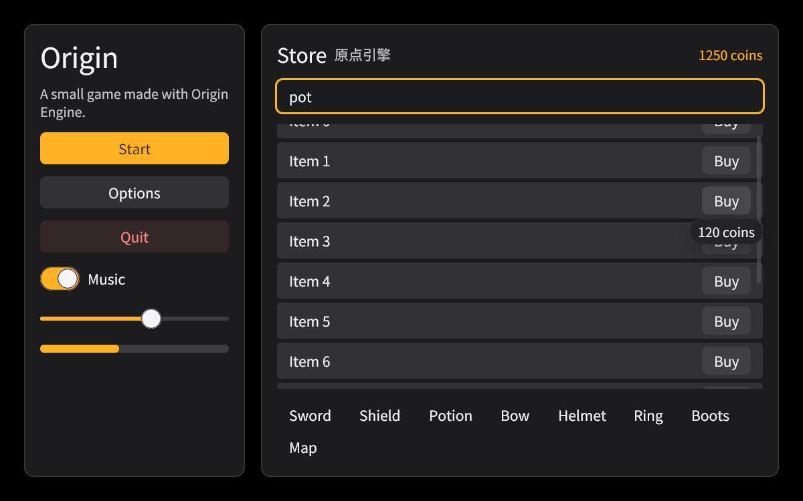

# og-ui

The Origin Engine UI (`docs/design.md` §2.7, M6 in `docs/phase-1.md`): an
immediate-mode toolkit whose tree is declared every tick, laid out
Clay-style, dressed by the game's own UI style (`type style`; the
engine's default style until it picks one: the design language the engine
shares with origin-agent, `packages/design`, for prototypes only), drawn through og-render's sprite and
MSDF text batches, and addressable by the probe through stable string ids
(`touch_move_to`, `move_to_text`, `dump_ui`).

It depends on og-core, og-ecs, og-input, og-render, og-probe (no
default features), og-tween (its spring), og-i18n, unicode-bidi (UAX #9),
ttf-parser (a font file's metrics and outlines) and, behind the default
`shaping` feature, rustybuzz only. No layout or GUI library: the layout is
~600 lines in `src/layout.rs`.



## Using it

```rust
let ui = SharedUi::new(Ui::new(UiDesc { fonts: Fonts { body: UiFont::new(handle, &msdf), ..Default::default() }, ..Default::default() }));
let (desc, run) = ui.system("ui", || viewport, |ui, _ctx| {
    ui.panel("Menu", PanelDesc::default(), |ui| {
        ui.label("Title", "Origin", LabelDesc { step: Some(ui.theme().type_ramp.display_sm), ..Default::default() });
        if ui.button("Start", "Start", ButtonDesc { variant: ButtonVariant::Primary, ..Default::default() }).clicked {
            // start
        }
        ui.tooltip("Starts a new run");
    });
    Ok(())
});
world.add_system(desc, run)?;          // builds the UI inside the tick from og.Input
probe.set_ui(ui.probe());              // dump_ui, touch_move_to, move_to_text
// after the tick, when rendering:
let atlas = scene.add_texture(og_ui::atlas_texture());   // once
let mut overlay = Overlay::new(viewport.width, viewport.height, viewport.dpr);
ui.lock().frame().emit(&EmitDesc { atlas, layer: 0 }, &mut overlay);
scene.overlay = Some(overlay);                           // over the finished frame, any camera
```

`Ui::begin(input, viewport)` … `Ui::end()` is the whole protocol; widgets
return a `Response { hovered, pressed, clicked, changed, focused, submitted }`
whose edges last one tick. Interaction is decided against the previous
tick's rectangles (the immediate-mode rule), which are also what the probe
resolves against, so a scripted `touch_move_to` and a click agree.

## Widgets

| Call | What it is | Probe text |
|---|---|---|
| `open(id, Element)` / `close() -> Response` | a container (`row`, `column`, `container` take a closure) | — |
| `panel(id, PanelDesc, f)` | a card: `panel`, `radius.panel`, `space.lg` padding, `space.md` gap, a column unless `row` | — |
| `scroll(id, ScrollDesc, f)` | a scroll column, vertical by default, horizontal or both ways by `ScrollDesc::axes` (`Element::scroll_x` for any container): the wheel (both axes) or a drag scrolls it, a released drag keeps its momentum, it clips its content, a scrollbar per scrolling axis (`radius.bar`) shows the position and a press on one grabs it; nested containers hand off (§Scrolling) | — |
| `label(id, text, LabelDesc)` | MSDF text; wraps at its width (word breaks; between CJK characters under kinsoku, so no line starts with closing punctuation, a small kana or `ー` nor ends with an opening bracket, and a katakana word stays whole; long words between characters) unless `nowrap`; `align` start/center/end; type step from the ramp; `ellipsis` cuts it with "…" ("..." in a font without it) where it does not fit: a `nowrap` label on its one line (it can then shrink in a row), a wrapping one on its last line with `max_lines`; `fit_min` (auto-fit) takes the ramp's smaller sizes, largest first and with its own step's tracking and features, down to that step where the text does not fit (one line with `nowrap`, else its words and `max_lines`), and only then cuts | the whole text, cut or not |
| `button(id, text, ButtonDesc) -> Response` | a box of `h-control-sm/md/lg` cornered by `radius.control`; `Secondary` (neutral fill, default), `Primary` (the style's `primary`, one per screen), `Quiet`, `Danger`, `Ghost` (clear inside a `lineStrong` outline); `square` makes it as wide as it is tall (an icon button); `disabled` turns neutral and inert; pressed shrinks by `press-scale` | the label |
| `image(id, ImageDesc)` | a texture region (`uv`, `tint`), or a solid rectangle without a texture; `aspect` (width over height) keeps its proportions: with the height left to fit it is as tall as its laid-out width over it, with a fixed height and the width left to fit as wide as the height times it (`Element::aspect`, any element) | — |
| `zoom_view(id, &ZoomViewDesc) -> ZoomResponse` | a zoomable picture (a map, an artwork): two touches pinch it about their centre and pan it, the wheel zooms about the pointer, a drag pans; focused (Tab, a pad) `+`/`-` zoom it, `0` fits it, the arrows pan it; it stays on its picture and within `min_zoom`..`max_zoom` (1 to 4 by default); answers the zoom and the centre; role `image` named by its id, its zoom as its value (§Scrolling) | — |
| `progress(id, value, ProgressDesc)` | a track filled to 0–1, cornered by `radius.bar` | — |
| `slider(id, &mut f32, SliderDesc) -> Response` | track, `primary` fill, thumb; a press anywhere on it sets the value, dragging follows; `min`/`max`/`step` | — |
| `toggle(id, &mut bool, label) -> Response` | a switch (`primary` on) with a label; a click flips it | the label |
| `text_field(id, &mut String, &FieldDesc) -> Response` | one line: a press focuses it with the caret at the press and a drag selects (Shift+press extends), typed text replaces the selection at the caret, Backspace/Delete/←/→/Home/End edit and Shift with them selects, Ctrl/Cmd+A selects all, +C copies and +X cuts (`Ui::take_clipboard`; the web shell's copy and cut events), an input method's composition shows underlined at the caret until it commits, Enter submits and leaves, Escape leaves, a press elsewhere blurs; the text scrolls to keep the caret in view; the caret blinks (§Text); placeholder; `max_chars`; `invalid` dresses `Field.frame[invalid]` (the danger outline undressed); `bare` draws no frame or ring, for a component's own frame; focus ring in `focus` | the text, or the placeholder while empty |
| `text_area(id, &mut String, &TextAreaDesc) -> Response` | several lines: the field's editing, Enter breaks the line, ↑/↓ move between lines (and stay out of focus navigation while it is edited), Home/End to a line's ends; wraps between words at its width, `rows` lines tall (default 4), scrolled to keep the caret's line in view | the text, or the placeholder while empty |
| `rich_text(id, markup, RichTextDesc) -> RichTextResponse` | one paragraph of inline spans from markup (`src/markup.rs`: `[b]`, `[i]` (slanted), `[u]`, `[s]`, `[outline=w,colour]`, `[color=…]`, `[size=…]`, `[font=…]`, `[icon=…]`, `[img=…]` (a picture registered with `set_images`, one em tall at its aspect, in its own colours), `[action=…]` (the action's glyph on the device used last, resolved every frame: its icon, else its key's name on a cap), `[link=…]`, `[wave]`, `[shake]`, `[pulse]`; `[[` is a literal `[`): lines break between the spans' words (a word split across spans stays whole), every span on one baseline, each line as tall as its tallest span; bold thickens the glyphs in the MSDF shader (as far as the field reaches) and draws a second copy a device pixel right; links are child elements (kind `link`) that focus and press like buttons; each line runs the bidirectional algorithm over its whole text at the UI's direction, so pieces reorder and so do runs of either direction inside one span, each run drawn shaped (§Text); a bad tag stays as text and warns | the plain text (links: their text; an action: its glyph's name) |
| `tooltip(text)` | for the element just built: shown below it (above without room, clamped to the safe area) once the pointer has rested on it for `motion.duration.slow`; drawn over everything | the text |

Any container with `interactive: true` reports its response from `close()`.

### The game widget set (`src/widgets.rs`)

| Call | What it is | Probe ids and text |
|---|---|---|
| `tabs(id, items, &mut usize, TabsDesc)` | a segmented control: `fill` track, the chosen tab on `thumb` | `Tab#i`, the labels |
| `select(id, options, &mut usize, &SelectDesc)` | a field-like trigger and chevron; opens `<id>.menu` (a popover layer and focus scope) with `Option#i`; a press outside or Back closes it | the chosen label |
| `stepper(id, &mut f32, StepperDesc)` | `Dec`, `Value`, `Inc`; bounded; Left/Right step while a button is focused; a screen reader's increment/decrement on the spinbutton | `−`, the value, `+` |
| `radio(id, options, &mut usize, RadioDesc)` | `Option#i` rows: a ring, `primary` with a dot when chosen | the labels |
| `checkbox(id, &mut bool, label)`, `checkbox_list(id, labels, &mut [bool])` | a box, `primary` with a tick (two rotated bars) | the label(s) |
| `chip(id, text, ChipDesc)` | a box on `control`, cornered by `radius.control`; selected inverts to `ink` | the text |
| `badge(id, text, Tone)` | a small box in a tone (neutral, success, warn, danger, info, primary, inverse); its ink reads 4.5:1 (`READABLE`) on what it is drawn on: a tone's or the primary's ink on a ground across the scale from the palette's `panel` (a light style's badge on its dark stage) lightens or darkens towards its own end until it does (`Srgba::readable_on`), the neutral `inkMuted` wherever it does not read on its `control` (and where no ink of its side could, the fill moves away from it) | the text |
| `key_value(id, key, value, mono)` | `Key` (`inkMuted`) and `Value` (end) on one row | both |
| `divider(id, vertical)`, `spacer(id, Option<Size>)` | a hairline in `border`; empty space | — |
| `skeleton(id, SkeletonDesc)`, `spinner(id, size)` | the neutral fill with a passing sheen (still under reduced motion); eight dots turning by the tick | — |
| `icon(id, name, IconDesc)` | an icon of the icon atlas (`set_icons`) by name, tinted: a cell of a texture grid, or an icon set's distance-field glyph fitted to its square (§Icon sets) | the name |
| `meter(id, value, max, &MeterDesc)` | health (green, warn under 30 %, danger under 15 %), mana, xp (the palette's `mana` and `xp`), primary or custom; a drop leaves a pale trail that follows after `fast`, a rise grows over `slow`, by the tick; notches; a label inside, over the fill and over the track in whichever of `ink` and `inkInverse` reads better there, moved towards its end where neither reaches 4.5:1 (a mid blue or purple) | the label |
| `cooldown(id, remaining, &CooldownDesc)` | a disc whose `primary` ring fills clockwise from the top as the cooldown runs out (two rotated half discs), full when ready; a label or icon in the middle | the label |
| `minimap(id, &MinimapDesc)` | the map texture in a `lineStrong` frame, dots for markers (the player in `primary` and ringed), N, a zone label | `Map`, `Zone` |
| `dialogue(id, &DialogueDesc)` | portrait slot (texture, icon or initial), speaker in `highlight`, the line typed at `chars_per_second` by the tick; a press finishes the line, the next answers `advanced` | `Body/Line` shows what is typed |
| `joystick(id, JoystickDesc)` | a base and a knob following a press that started on it; answers −1..1 with a dead zone; at least three touch targets wide | — |
| `dpad(id, DpadDesc)` | `Up`, `Down`, `Left`, `Right` arms (each ≥ 44 CSS px) answering which are held | the arm names |
| `action_button(id, text, &ActionButtonDesc)` | a square touch button (≥ 44) cornered by `radius.control`: `pressed` while held, `clicked` on a tap; primary is the style's `primary` | the text |
| `open_list`/`list_item`/`close_list`, `list(id, ListDesc, selected, row)` | a virtualised scroll list: only rows in view (and one each side) are built, fillers keep the full scroll range; `Row#i` rows select and focus | `Row#i` |
| `open_grid`/`grid_item`/`close_list`, `grid(...)` | the same for a wrapping grid of equal cells (`Cell#i`) | `Cell#i` |
| `spotlight(id, Option<Rect>, SpotlightDesc)` | the scrim on four sides of a hole (`Top`, `Left`, `Right`, `Bottom`, `Hole`) with a `focus` edge; presses on the shades stop there, presses in the hole reach what is under it | — |
| `toast(text, ToastDesc)`, `dismiss_toast(id)` | a queue in the UI state: at most three up (older leave first), 3.2 s (6 s danger), enter and leave by the tick, a press dismisses; stacked at `set_toast_anchor` | `Toasts/Toast#n`, the text |
| `memory(id, initial)`, `remember(id, value)` | a number kept for an id in the UI state (a template's tab) | — |

Widget memory between ticks (a select being open, a meter's trail, the
dialogue's start, a transition's progress, a drag's source) lives in
`State::anims`, keyed by the element's path hash and dropped when the widget
is not built; it, the toast queue, the UI clock, queued navigation and the
focus scope are all in `save_state`, so a restored world replays the UI.

**Drag and drop.** A press on a list row or grid cell marks it the source; a
release over another row or cell answers `Response::dropped = Some(source)`
there, and `dragging(id)` answers the source while the press is held; the
cell under a drag shows the focus ring.

## Scrolling (`src/scroll.rs`)

A container scrolls vertically (`Element::scroll`), horizontally
(`Element::scroll_x`; a horizontal scroller never shrinks its children) or
both ways. Its offsets are UI state, clamped by the layout to its content.

- **The wheel** (`InputFrame::wheel`, both axes) goes to the innermost
  scroll container under the pointer; what it cannot take, because it has
  reached its end or does not scroll that way, goes to the container
  around it, and so on outwards (nested scroll handoff). A drag on a
  container that holds the press (one started on it, not on a control)
  moves it the same way, so a sideways strip in a vertical page scrolls the
  page when dragged up and down.
- **Momentum.** A drag released while moving keeps its velocity (a running
  average of the last ticks' movement) as a fling, which slows by
  `1 − 1/(ticks per second × motion.spring.momentum's response)` a tick
  (arithmetic only) and stops below 0.1 px a tick, on an axis as it reaches
  the content's end, or at the next press. Not under reduced motion.
- **Scrollbars.** A bar on each scrolling axis (`controlStrong`, at the
  right edge and the bottom), as long as the view is of the content
  (at least `space.xl`); a press within 12 px of the edge grabs the bar
  (the press goes to no control under it) and dragging moves it through
  the range.
- Keyboard and gamepad focus moving to a control outside a container's view
  scrolls it in on both axes.

- **Two touches** (og-input's `og.Pointers`): when two fingers are held
  on one scroll container (the innermost under each), it follows the
  movement of their centre, so a list of buttons, which one finger would
  press, scrolls under two; on a zoom view (`zoom_view`) they pan it the
  same way and zoom it by the change of their spread, about their centre
  (pinch). The press the first finger began presses nothing once the
  second lands, and the primary pointer presses nothing while two are
  held; two fingers on anything else (a stick and a button) are no
  gesture. Two fingers lifting off a scroll container fling it with
  their last velocity, as one finger's drag does. The gesture is UI
  state (`State::pinch`, `save_state` version 7). A zoom view also zooms
  by the wheel about the pointer and pans by a drag, and takes focus from
  keys and pads: `+` (`=`, the keypad's) and `-` zoom it about its centre
  by 1.25, `0` fits it again, the arrows (↑ and ↓ too) pan it a tenth of
  its size while it is focused.

`tests/widgets.rs` `scroll_views_scroll_both_ways_hand_off_fling_and_grab`
covers each (and a restore); `two_fingers_scroll_lists_and_pinch_zoom_views`
covers two touches, the zoom view and aspect ratios,
`two_fingers_lifting_off_a_list_fling_it` the two-finger fling and
`a_focused_zoom_view_takes_keys` the keys, and the kit's
`tests/gestures.og.ts` drives them through the probe.

## Layers

Elements outside the tree, laid out after it and drawn over it in rank order:
anchored groups (`anchor`, rank 1; `over: true` raises one to rank 3), dialogs
(`open_modal`/`close_modal`, `modal`: a scrim backdrop that takes presses,
padded by the safe area, with a centred `Panel`, rank 2), popovers (a
select's menu, rank 3), the toast stack (rank 4) and tooltips (rank 5). A
layer's probe path is its own id. Anchored groups sit at one of nine points of
the safe area (`Anchor::TopLeft` … `BottomRight`, `Center`), inset by the
density's gutter (or `margin`), moved by `offset`.

## Documents (`src/doc/`)

A **screen** (`type screen`) or a **component** (`type component`) is an
`.ogt` document: an element tree with props, slots, parts, state groups,
transitions, timelines, breakpoint overrides, list templates and bindings
(docs/ui.md §10). `UiDocument::parse(source, text)` reads and validates one
against the reflected props below (`doc::schema`, the one schema: the
parser, `ui:set`, the probe's `schema`, `og.ui.documentSchema` and this
table all read it, and `tests/documents.rs` holds this table equal to
it); every error names its line and its fix. og-cook cooks a document into
an `og.UiDocument` blob (the validated text, as styles are); a game loads it
with `og.load.document` and a `Ui` registers it with `define_document`.

### Grammar

```text
type screen                       # or: type component
version 1
---
name "shop"                       # what og.ui.screen / push / component name it
layer menu                        # screens: hud menu modal popover toast tooltip system
input menu                        # game | menu | all (the kind's default)
capture true                      # takes the pointer on its gaps too
pause true                        # the game pauses while it is on the stack
under dim                         # the layers under it: none | dim | blur | hide
back pop                          # pop | none | emit <event>
focus "Footer/Buy"                # where focus starts (a path below the root)
remember true                     # focus returns where it was when it is the top again
enter slideUp 24 spring 320 0.1   # the layer's presence (as an element's enter/exit)
exit fade
props {                           # the viewmodel's contract: name type "doc"
  gold number "The player's gold."  # number string bool list object any
  items list "What the shop sells."
}
parts frame price                 # part names a style dresses (every one used by an element)
actions {                         # the action bar's hints while this layer is on top
  confirm "Buy"
  back "Leave"
}
timeline bought {                 # defined as <name>/<timeline>: shop/bought
  track "" scale {                # target: "" the element it plays on, or a path below it
    key 0 1                       # <ms> <value> [linear|out|exit|inOut|hold|spring <ms> <bounce>|bezier a b c d]
    key 120 1.08 out
    key 260 1
  }
  event 0 "" sound buy            # sound <name> [pitch] | haptic <kind> | burst [n] [radius] [#colour] | state <group> <state> | callback <name>
  label hit 120
  duration 400
}
fixture rich "{\"gold\": 1250000, \"items\": []}"   # a viewmodel to preview or push with (ui:push:shop:rich)
panel Shop {                      # the one root element: <kind> [id] { … }
  width 520                       # <prop> <value>: the table below
  part frame
  label Gold {
    text bind gold compact        # bind <expression> [format [digits]]
  }
  label Price {
    text "{price, grouped} gold"  # a quoted text with { is a template
  }
  for item in items {             # one copy of the block per entry; $index is its index
    row Item {                    # its elements are told apart: Item#0, Item#1 …
      label Name {
        text bind item.name
      }
      state selection bind "$index == selected" {   # a group: its binding picks the state
        off {                     # (a bool: the second state when true; a string: by name)
          opacity 0.6             # an animatable prop and its value
        }
        on {
          opacity 1
          background token primarySoft    # or ink; a palette role or "#rrggbb[aa]"
          enter bought            # a timeline played when the state is entered (exit: left)
        }
        transition off on spring 260 0.2  # <from|any> <to|any> spring <ms> <bounce> | tween <ms> [ease] | token <name> | instant
      }
    }
  }
  if "gold > 0" {                 # its block only while the expression is true
    label Rich {
      text "Rich"
    }
  }
  list Items {                    # list and cells: virtualised, exactly one `for` inside
    rowHeight 56                  # (only the rows in view are built)
    for item in items {
      label Name {
        text bind item.name
      }
    }
  }
  slot Preview {                  # a place code fills: og.ui.openSlot("shop/Preview")
    height 120
  }
  use PriceTag Tag {              # a component: its props by name (bound ones are two-way)
    price bind item.price
    width 80                      # an element prop applies to the instance's root
  }
  slider Volume {
    value bind volume             # two-way: the slider writes volume back
  }
  button Buy {
    text "Buy"
    disabled bind "gold < price"
    on click emit buy             # on <when> <act>
    on click play bought
    at phone {                    # breakpoint overrides: phonePortrait phoneLandscape
      width grow                  # phone tablet desktop portrait landscape (later wins)
    }
  }
}
```

Lines are `.ogt` lines (one construct per line, `#` comments, quoted strings
for anything that is not a word: paths with `/`, expressions with spaces).
Element ids are unique among siblings (paths name elements by them); an
element without one is `<kind>#<n>` among its same-kind siblings.

- **When** (`on <when> <act>`): `click`, `changed` (a control's value),
  `appear` (it was not built last tick), `change <expression>` (its value
  differs from last tick's), `action <name>` (a UI action fired while the
  element's layer is the top one that takes input).
- **Act**: `play <timeline>` (the document's, or `<doc>/<name>`),
  `state <group> <state>`, `emit <event>` (an event to code), `push
  <screen>`, `pop`, `action <name>`, `set <path> <expression>` (a write into
  the viewmodel).

### Bindings and formats (`src/bind.rs`)

A **viewmodel** is JSON: an object code passes (`og.ui.screen("shop", vm)`),
a fixture, or a reflected resource or component code reads into it. A path
(`hero.health`, `items.0.price`, `items.length`) reads the viewmodel, a
`for`'s item variable first; a Capitalised root (`Wallet.gold`) is the
host's (`Env::lookup`: the resource as of the last tick's end). Expressions:
paths, numbers, strings, `true false null`, `! -`, `* / % + -`,
`< <= > >= == !=`, `&& ||`, `a ? b : c`, parentheses. Bindings are read every
tick after the game's systems; an unchanged value leaves its element's
layout and drawing kept (docs/ui.md §6.3).

Formats (`bind <expr> <format> [digits]`, or `{path, format[, digits]}` in a
template), by the language og-i18n sets:

| format | 1234567.891 | what it does |
|---|---|---|
| `plain` | 1234567.891 | as written |
| `grouped` | 1,234,568 | the locale's grouping, `digits` decimals (0) |
| `fixed` | 1,234,567.89 | grouped, always `digits` decimals (2) |
| `compact` | 1.23M | K M B T (CJK: 万 億 兆; 1.23億 in ja) |
| `engineering` | 1.23e6 | exponents in threes |
| `scientific` | 1.23e6 | one digit before the point |
| `letters` | 1.23M | idle notation: K M B T, then aa ab … from 1e15 (1.5e400: 15ey) |
| `percent` | 123,456,789% | ×100 |
| `duration` | 14d 6h | seconds as the two largest units |
| `clock` | 342:56:07 | seconds as h:mm:ss |
| `countdown` | 342:56:08 | as clock, rounded up, never below 0 |
| `ordinal` | 1234567th | og-i18n's ordinal rules (scientific past 1e15) |

Numbers past 1e308 are a mantissa and an exponent: `{ "m": 1.5, "e": 400 }`
or the string `"1.5e400"`, formatted by every format above. Plurals and
selects are og-i18n's message syntax in a template (`"{count, plural, one {#
gem} other {# gems}}"`).

### Documents and code

`Ui::screen(name, vm, env)` mounts a screen as a layer (pushed when it is
not on the stack), with its viewmodel for this tick, and builds it where it
is called, so code fills its slots right after (`open_slot(path)` …
`close()`); `Ui::component(id, name, &mut props, env)` builds a component
in place, inside whatever code has open. Both answer a `DocResponse`: the
document's events this tick (`click`, `changed`, `select` of a list row,
`emit`, `action`, `set` for each two-way write with the path it wrote,
`back` when the layer's Back is `emit`). Layers code does not build this
tick are built by `build_layers(env)` (and by `end` with no host), their
events kept for `take_doc_events`. Code and documents build one tree: a
document's elements have the same props, states, motion and checks as
code's.

### The layer stack (`src/layers.rs`)

`push_screen(screen, vm)`, `pop_screen`, `replace_screen`, `clear_screens`;
`layer_stack()` lists them bottom first. Each layer is a full-surface layer
of its own (id: its screen's name), built in stack order:

| kind | input | capture | under | back |
|---|---|---|---|---|
| `hud` | game | no | none | none |
| `menu` | menu | yes | dim | pop |
| `modal` | menu | yes | dim | pop |
| `popover` | menu | no | none | pop |
| `toast` | game | no | none | none |
| `tooltip` | game | no | none | none |
| `system` | all | no | none | pop |

- Input goes to the top layer that takes it, once per tick: a `menu` or
  `all` layer is a focus scope (focus stays inside, it takes Back before
  `Ui::back` sees it), the layers under a `menu` layer are inert, and
  `game_input()` is false while one is on the stack. A capturing layer
  (or a dimmed one) takes the pointer on its gaps.
- Focus: a layer that becomes the top takes the focus it had when a layer
  was pushed over it (`remember`), else its `focus` path, else its first
  control.
- `under dim` and `blur` draw the palette's scrim under the layer (blur
  becomes a backdrop blur with the UI pass); `hide` leaves the layers under
  it unbuilt. `paused()` is true while a `pause` layer is on the stack.
- `save_state` carries the stack, each layer's viewmodel and focus, and the
  states triggers set.

### Actions and glyphs (`src/actions.rs`)

Named UI actions bound to og-input's controls: `ActionDesc { name, keys,
buttons, trigger, toggle, label }` with `trigger` press, release or
`Hold(ms)`, and `toggle` the hold's alternative (a tap turns it on, the next
off: `action_held`). The defaults: `confirm` (Enter, Space, A), `back`
(Escape, B), `tabNext` (E, `]`, RB), `tabPrev` (Q, `[`, LB), `details` (X,
Y), `rotate` (R, X: a held inventory item or placed piece turns).
`action(name)` is true the tick it fires; a document's `on action`
fires on the top layer that takes input. `device()` is the device used
last (keyboard and mouse, the pad family the host set with
`set_pad_family`: Xbox, PlayStation, Switch or a generic pad, or touch on a
coarse pointer), and `glyph(action)` its glyph there (`icon` a style's
icon name, `xbox.a`, `ps.cross`, `switch.b`, `pad.south`, `key.enter`,
`touch.<action>`, and `text`). `action_bar()` is what an action bar
component reads: the top layer's `actions` with their hints and glyphs.

### The props

Every kind takes the box and element-model props (`on` all); the rest are
the kinds'. Kinds: `column`, `row`, `stack`, `grid`, `panel`, `scroll`,
`list`, `cells`, `slot` (containers), `label`, `button`, `image`, `art`,
`icon`, `progress`, `slider`, `toggle`, `tabs`, `field`, `badge`, `spacer`,
`divider`.

| prop | value | on | what it does |
|---|---|---|---|
| `width` | size | all | Its width (fit by default). |
| `height` | size | all | Its height (fit by default). |
| `padding` | insets | all | Space inside its edges, CSS px. |
| `gap` | number | all | Space between its children, CSS px. |
| `align` | start \| center \| end \| spaceBetween | all | Where children sit along the main axis. |
| `cross` | start \| center \| end \| stretch \| baseline | all | Where children sit across it. |
| `wrap` | bool | all | A row breaks its children into lines. |
| `direction` | row \| column | row, column | Lays a row's or a column's children out the other way (an `at` block's: a phone in landscape puts the actions beside the content). |
| `background` | paint | all | Its fill. |
| `radius` | number | all | Its corner radius, CSS px. |
| `frame` | panel \| card \| button \| buttonHover \| buttonPressed \| buttonDisabled \| field \| slot \| tooltip \| hud \| track \| fill | all | The style frame its background takes. |
| `aspect` | number | all | Width over height (0: none). |
| `fade` | number | scroll | How far, CSS px, its edges fade where its content runs on past them (a cut row reads as more, not as a clip); 0: none. |
| `fadeInto` | paint | scroll | The colour its fade runs into: the ground it sits on (default panel). |
| `interactive` | bool | all | It reports clicks (`on click`). |
| `focusable` | bool | all | With interactive: keys and pads reach it and press it. |
| `adjustable` | bool | all | With focusable: Left and Right step it while it has the focus instead of moving the focus. |
| `visible` | bool | all | False leaves it (and its subtree) out of the tree. |
| `name` | text | all | What a screen reader calls it. |
| `part` | name | all | Its part name a style dresses (`ShopCard.frame`); the document's `parts` lists them. |
| `x` | number | all | Moved right after layout, CSS px. |
| `y` | number | all | Moved down after layout, CSS px. |
| `scale` | number | all | Both scales. |
| `scaleX` | number | all | Its horizontal scale. |
| `scaleY` | number | all | Its vertical scale. |
| `rotate` | number | all | A turn, radians, clockwise. |
| `skewX` | number | all | A skew, radians. |
| `skewY` | number | all | A skew, radians. |
| `pivot` | x y | all | The transform's origin, fractions of its box. |
| `opacity` | number | all | 0 to 1, multiplied down the tree. |
| `z` | number | all | Drawing order among its siblings. |
| `position` | flow \| absolute \| screen \| anchored | all | In the flow, placed by its insets in its parent, by its insets on the whole screen (full bleed, under the safe area), or against another element. |
| `start` | number | all | The inset from its parent's start edge (absolute). |
| `top` | number | all | The inset from the top. |
| `end` | number | all | The inset from the end edge. |
| `bottom` | number | all | The inset from the bottom. |
| `centerX` | bool | all | Centred across its parent. |
| `centerY` | bool | all | Centred down its parent. |
| `anchorTo` | name | all | The path of the element an anchored element sits against. |
| `anchorAt` | topLeft \| top \| topRight \| left \| center \| right \| bottomLeft \| bottom \| bottomRight | all | The target's point it sits on. |
| `anchorSelf` | topLeft \| top \| topRight \| left \| center \| right \| bottomLeft \| bottom \| bottomRight | all | Its own point that sits there. |
| `hitSlop` | number | all | Extra pointer reach, CSS px. |
| `columns` | tracks | all | A grid's column tracks. |
| `rows` | tracks | all | A grid's row tracks. |
| `areas` | names | all | A grid's named areas, one string per row. |
| `flow` | row \| column | all | How a grid auto-places. |
| `dense` | bool | all | A grid back-fills holes. |
| `area` | name | all | The named grid area it takes. |
| `cell` | x y | all | Its grid column and row, 1-based. |
| `span` | x y | all | Columns and rows it spans. |
| `overlaps` | names | all | Paths it overlaps on purpose. |
| `match` | name | all | A shared-element key. |
| `motion` | transition | all | How its animatable values move when they change. |
| `layoutMotion` | transition | all | Moves from its old rectangle to its new one. |
| `enter` | presence | all | How it arrives. |
| `exit` | presence | all | How it leaves. |
| `inert` | bool | all | It and its subtree take no input. |
| `navUp` | name | all | Where Up moves the focus from it (a path). |
| `navDown` | name | all | Where Down moves the focus from it. |
| `navLeft` | name | all | Where Left moves the focus from it. |
| `navRight` | name | all | Where Right moves the focus from it. |
| `navNext` | name | all | Where Tab moves the focus from it. |
| `navPrev` | name | all | Where Shift+Tab moves the focus from it. |
| `focusGroup` | stop \| wrap | all | Its focusable controls are a focus group that stops (leaves) or wraps at its edge. |
| `focusMemory` | bool | all | With focusGroup: focus coming back lands on its last member. |
| `tap` | bool | all | It recognises a tap (`on tap`). |
| `doubleTap` | bool | all | It recognises a double tap (`on doubleTap`); its tap waits for it. |
| `longPress` | bool | all | It recognises a long press (`on longPress`). |
| `longPressMs` | number | all | How long its long press is held, ms (0: 500). |
| `gesturePriority` | number | all | Among nested recognisers of one press: higher wins. |
| `cursor` | auto \| default \| pointer \| text \| grab \| grabbing \| move \| notAllowed \| crosshair \| help \| wait \| progress \| resizeEw \| resizeNs \| resizeNesw \| resizeNwse \| zoomIn \| zoomOut \| none | all | The pointer's shape over it and its subtree. |
| `customize` | bool | all | The player can move, scale and fade it in the HUD edit mode. |
| `customizeKey` | name | all | With customize: its name in the saved HUD layout (default: its path). |
| `reduced` | fade \| none \| keep | all | Its reduced-motion fallback. |
| `text` | text | label, button, badge, toggle, tabs | What it says. |
| `key` | name | label, button, badge, toggle, tabs | A string table key (og.i18n) its text comes from; `text` is the fallback. |
| `step` | body \| xs \| meta \| caption \| sm \| reading \| base \| lg \| xl \| xl2 \| xl3 \| xl4 \| xl5 \| xl6 \| xl7 \| xl8 \| displaySm \| displayMd \| displayLg \| displayXl \| displayXl2 \| hero | label | The type step. |
| `color` | paint | label, icon | Its ink. |
| `onScene` | bool | label | Scene ink and separation shadow. |
| `uppercase` | bool | label | Uppercase in the UI's locale, as a type role with `case upper` is. |
| `secondary` | name | icon | The second icon layer, in the same atlas. |
| `secondaryTint` | paint | icon | The second layer's ink; accent by default. |
| `textAlign` | start \| center \| end | label | How its lines align. |
| `nowrap` | bool | label | One line. |
| `maxLines` | number | label | The most lines it shows. |
| `fitMin` | body \| xs \| meta \| caption \| sm \| reading \| base \| lg \| xl \| xl2 \| xl3 \| xl4 \| xl5 \| xl6 \| xl7 \| xl8 \| displaySm \| displayMd \| displayLg \| displayXl \| displayXl2 \| hero | label | Shrinks by type steps to fit its width, down to this step. |
| `ellipsis` | bool | label | Cut with … where it does not fit. |
| `font` | body \| display \| mono \| rounded | label | The font role. |
| `heading` | bool | label | A heading (a style's flourish frames it). |
| `variant` | secondary \| primary \| quiet \| danger \| ghost | button | The button's role. |
| `size` | small \| medium \| large | button | The control height. |
| `disabled` | bool | button, slider, toggle, field | Takes no input. |
| `autofocus` | bool | button | Takes the focus when it appears. |
| `square` | bool | button | A square of the control height: an icon button. |
| `value` | number | progress, slider | Its value (a slider writes it back). Two-way. |
| `min` | number | slider | The range's low end. |
| `max` | number | slider | The range's high end. |
| `stepBy` | number | slider | Snap to multiples of this (0: continuous). |
| `checked` | bool | toggle | Whether it is on (written back). Two-way. |
| `items` | names | tabs | The tab labels, literal names or a bound list of strings. |
| `keys` | names | tabs | A string table key (og.i18n) per tab its label comes from; its item is the fallback. |
| `values` | names | tabs | A name per tab (a screen's mode) that `current` holds instead of `selected`'s index. |
| `current` | name | tabs | The selected tab's name from `values`; it takes over from `selected` when `values` is set. Two-way. |
| `selected` | number | tabs | The selected tab's zero-based index. Two-way. |
| `fill` | bool | tabs | Equal tabs filling the available width. |
| `input` | text | field | The field's text (written back). Two-way. |
| `placeholder` | text | field | Shown while it is empty. |
| `maxChars` | number | field | The most characters it takes. |
| `tight` | bool | field | No inset and its text's line height: the text sits where the field is laid (in a box the screen draws). |
| `component` | name | field | The component its style dresses it as (`Poem`, `Search[large]`): `<component>.frame`, `.text` and `.placeholder`; else Field. |
| `invalid` | bool | field | Its text is wrong: the danger frame. |
| `tone` | neutral \| info \| success \| warn \| danger \| accent | badge | Its tone. |
| `vertical` | bool | divider | Upright. |
| `texture` | number | image, art | A texture handle (og.load.texture), usually bound. |
| `tint` | paint | image, art | Multiplies the texture (or fills without one). |
| `icon` | name | icon | The icon's name in the style's set. |
| `iconSize` | number | icon | CSS px (24 by default). |
| `kind` | name | art | The slot's kind (Appendix F: itemIcon, bust, keyArt…). |
| `ratio` | x y | art | The slot's aspect, width and height in whole numbers. |
| `focal` | x y | art | The point cropping keeps, 0–1. |
| `safe` | 4 numbers | art | Where text or controls lie over it: x0 y0 x1 y1, 0–1. |
| `fit` | cover \| contain \| fill \| nineSlice \| tile | art | How the art fills the slot. |
| `rowHeight` | number | list | Every row's height, CSS px. |
| `cellWidth` | number | cells | A cell's width, CSS px. |
| `cellHeight` | number | cells | A cell's height, CSS px. |
| `cellColumns` | number | cells | Cells across (0: as many as fit). |

## Accessibility tree (`src/a11y.rs`)

Every frame builds the accessibility tree from the nodes it draws and
takes input on, so it cannot drift from the screen. Each element has a
**role** (`button`, `link`, `text`, `heading`, `image`, `checkbox`,
`radio`, `switch`, `slider`, `spinbutton`, `textbox`, `combobox`,
`listbox`, `option`, `tab`, `tablist`, `radiogroup`, `progressbar`,
`meter`, `timer`, `status`, `dialog`, `tooltip`, `separator`, `group`; none
for layout containers, spacers and unnamed pictures), a **name** (its text;
or what the widget gives it: an icon's name, a dialog's title, Decrease and
Increase for a stepper's buttons; a control showing no text of its own is
named by the text inside it, then by the label just before it in its row,
then by its id; a text field or area, whose text is its value, by that
label, else its placeholder, else its id), a **description** read after
the name (a labelled field's placeholder; the mirror's
`aria-placeholder`), a
**value** (a slider's or stepper's number, a progress's percent, a meter's
amount, a field's text, a select's choice, a cooldown's remaining share)
and **states** (`disabled`, `focused`, `focusable`, `checked`, `selected`,
`expanded`, `collapsed` (expandable and closed), `pressed`, `busy`; `offscreen` in the tree for a control a
scroll container cuts out of view). A component built from containers (a menu, a tree, a
table) names its own with `Ui::semantics` (`og.ui.semantics`): one of
`a11y::ROLES` (menu, menuitem, tree, treeitem, table, row, cell,
tabpanel, toolbar, region…), a name, a value, its states and a range;
an unknown role is refused with a frame warning. The probe's `dump_ui` carries them on
every element; `Ui::a11y()` (`og.ui.a11y()`) answers the tree of the
elements with a role, with full paths, nearest-ancestor parents, whole
bounds, the focus order and the focused path, for a shell to mirror into
the page. Focus order is the tree's order (the drawing order: the page,
then each layer over it): Tab and the pads walk exactly the nodes marked
`focusable`, within the topmost dialog while one is open.
`tests/a11y.rs` checks the roles, names, values and states of every
widget and that Tab walks `focus_order`; the kit's `a11y` playtest checks
that every screen names every control and gives every text a role.

**The web shell's mirror** (`packages/engine/src/web/a11y.ts`). The Worker
creates the engine with `a11y`; a frame's answer then carries the tree
whenever `A11yTree::digest` (every node's path, role, name, value, states
and bounds to the CSS pixel, the focus order, the focused path) changed,
and only then. The shell keeps an invisible element per node at its bounds
over the canvas, nested as the tree nests it, with its ARIA role, label (or
text for text roles), `aria-valuenow`/`-valuetext`, `aria-checked`,
`-selected`, `-expanded`, `-disabled`, `-busy`, a dialog's `aria-modal`,
and `tabindex=-1` on focusable nodes. The DOM focus follows the UI's focus
(not out of the page's own fields, nor from the text control's textarea);
while a text field is focused that textarea has the focus and is the
field for a reader (named after the field's node, its placeholder and its
text), the field's own element is `aria-hidden` and its parent owns the
textarea (`aria-owns`), so a reader meets one text box inside its dialog
and no focused element is ever `aria-hidden`; a status or alert node that appears (a toast) is written into a polite or
an assertive live region. What a screen reader does there reaches the UI
as input: a click on a mirrored element (its default action) is og-input's
`a11y` request `activate`, focus moving onto one `focus`, and
`increment`/`decrement` step an adjustable one (`InputFrame::a11y`; nav.rs
`apply_a11y` resolves the path against the last frame and acts as Enter,
Left and Right would, within the topmost dialog, also on a screen that
turned navigation off). A slider and a stepper's spinbutton are mirrored
as an `<input type="range">` with their role, held at the UI's value one
step from either end (`aria-valuenow` and `aria-valuetext` read it): a
screen reader's own adjust gesture (VoiceOver's swipe up or down,
TalkBack's volume keys) moves the native value, or sets it from
`aria-valuenow` and the step, and fires `input`, which the mirror sends as
`increment` or `decrement` before putting the value back (the UI owns the
value and its step). A stepper's `−` and `+` follow its range as siblings
(an input holds no children); og-ui steps the stepper for a request
naming its spinbutton when one of its buttons is in reach. A native range
takes `tabindex=-1`, out of the page's Tab order. Keys pressed while a mirrored
element has the DOM focus still reach the engine as keys (the shell keeps
the arrows from the native range, so a key steps once). The native host creates no mirror
and its frame answers carry no tree. `tests/a11y.rs` covers the requests
and the digest; `packages/engine/tests/web/a11y.ts` checks the DOM against
the tree on ui-kit's settings screen in Chrome, Chrome's own accessibility
tree, the Master slider's native range lowered by an `input` event (the
adjust gesture), a screen-reader-style click toggling Mute, the live
region, and the page preferences below.

## Focus navigation (`src/nav.rs`)

One focus for pointer, keyboard and gamepad. Intents come from the arrow
keys, Tab/Shift+Tab, Enter, Space and Escape (`InputFrame::keys`, `shift`),
from a gamepad (`InputFrame::gamepad`: d-pad and A/B edges, the left stick
past half-way once, then after `motion.duration.slow` every
`motion.duration.fast`) and from `navigate(Nav)` (queued for the next tick).

- Directions pick the nearest focusable control whose centre lies that way,
  scoring distance along it plus three times the gap across it; with none,
  focus wraps to the far end of the same row or column. Next/Prev walk
  reading (draw) order and wrap.
- `set_focus(path)` (`og.ui.setFocus`) moves the focus to the control at
  a full path when the frame ends, if one is there: a component moving it
  with its choice (a radio group's arrows, a list opening at its option).
- Activate presses the focused control (`Response::clicked`); Left/Right
  adjust a focused slider or stepper; while a text field is edited, Left,
  Right, Enter, Space and Escape belong to it.
- Back closes the topmost dialog or menu, else `back()` answers true once.
  While a dialog or menu Back closes is the last frame's topmost scope,
  `back()` answers false even when asked before that dialog is built this
  tick (a HUD drawn under pause), so the dialog keeps it; a locked dialog
  lets Back through to `back()`.
- A dialog or open menu is a focus scope: while it is the topmost, focus
  stays inside; when it opens, focus moves to its first control (or the one a
  widget asks for, the select's chosen option); when it closes, focus returns.
- A dialogue box takes the focus when it appears (unless a dialog is open
  over it), so a cutscene answers Enter, Space and A from its first line.
- A press focuses the control without the ring; navigation shows the ring
  (the style's `focus`, a gap of what is behind, then the control).
- Navigation that lands on a control outside its scroll container's view
  scrolls it in (rows just outside a virtualised list are reachable).
- `set_navigation(false)` turns arrows and Tab off for a gameplay screen whose
  keys move the player (the HUD templates do); an open scope turns it on.
- **Explicit moves** (`Props::nav`, `NavLinks`): up, down, left, right,
  next and prev, each a path (full, or a sibling's id), win over the
  spatial pick; a path to a focus group lands on its remembered member,
  one to another container on its first focusable control.
- **Focus groups** (`Props::focus_group`, `FocusGroup { wrap, memory }`):
  arrows move among a group's members first. At its edge a wrapping group
  goes round inside itself; one that does not leaves for the nearest
  control outside that way (the group around it first) and stays put when
  there is none. With `memory`, focus coming back in lands on the member it
  last had. Tab ignores groups (reading order).

## Gestures and the cursor (`src/recognize.rs`)

`Props::gestures` (`GestureSpec { tap, double_tap, long_press,
long_press_ms (500), double_tap_ms (300), slop (10), priority }`) makes any
element recognise a tap, a double tap and a long press, answered by
`Response::{tapped, double_tapped, long_pressed, long_press}` (the last the
held press's progress, 0–1), `Ui::gesture` and frame events (`tap`,
`doubleTap`, `longPress`). One press is an arena of the recognisers at and
around the pressed element: each gesture goes to the highest priority, the
innermost of equals. A tap waits for a double tap only where one is
declared; a long press that fires takes the press (its release clicks and
taps nothing); travel past the slop fails both. Keys and pads tap a
focused recogniser by activating it. The press, the waiting tap and the
recognisers are UI state (`save_state` version 14 on).

`Props::cursor` (`Cursor`, CSS names) sets the pointer's shape over an
element and its subtree; `Auto` takes the parent's, and with none set a
text control's I-beam, a draggable element's open hand (closed while held)
or a link's hand. `UiFrame::cursor` is the resolved shape of what the press
holds or the pointer is over; the frame answer carries it (`cursor`) and
the web shell sets the canvas's CSS cursor from it (`og.ui.frameCursor`).

`InputFrame::from_world` reads og-input's `og.Gamepad` (pad 0:
`GamepadFrame::from_gamepad`, the press edges of the standard buttons and
the left stick) on both hosts. The browser shell still maps a pad's buttons
to keys too (A Space, B Escape, d-pad and stick arrows, Back Tab, Start
Enter) as the fallback for a page without the resource; an intent that
arrives both ways in one tick is taken once (`nav.rs`).

**Several pads (local multiplayer).** `Ui::set_players(n)` (declared each
tick, like `set_navigation`) gives pads 1 to `n - 1` (`InputFrame::extra_pads`,
read from `og.Gamepad`) a focus of their own among the same controls: the
d-pad and the stick move it (its first move lands on the control nearest the
surface's centre), its A presses the control under it, its ring is drawn
outside pad 0's in the player's colour (`info`, `success`, `warn`), and a
dialog's scope holds it inside as it holds pad 0's. `Response::pad` names
the pad whose A pressed a control (`None` for the pointer and the keyboard)
and `Response::focused_by` has a bit per pad whose focus is on it;
`Ui::focus_path(pad)` answers where each pad's focus is. Pad 0 keeps sharing
its focus with the keyboard and the pointer; Back and adjusting a slider
stay pad 0's. The pads' focus and sticks are in the UI state
(`tests/widgets.rs` `pads_beyond_the_first_move_their_own_focus_and_press`;
the kit's `players` screen and playtest). The probe's `gamepad` command
addresses them with `@1` to `@3` after the buttons (`gamepad:a@2`).

**Several touches.** `InputFrame::pointers` is og-input's `og.Pointers`
(pointer 0 is `og.Input`'s pointer; 1 to 4 are further touches). The touch
controls (`joystick`, `dpad`, `action_button`) answer any of them: a stick
keeps the finger that started on it, a button answers whichever is over it,
so a thumb on the stick and another on Hit work together
(`templates/ui-kit/tests/multitouch.og.ts`). Two touches on one scroll
container scroll it, on a zoom view pinch it (§Scrolling).

**A virtual cursor for pads (`src/vcursor.rs`).** `Ui::set_virtual_cursor(Some(
VirtualCursorDesc { speed (900), accel (250 ms), magnet (0.5), scroll (1200) }))`,
declared every tick like `set_players`, turns pad 0 into a pointer for a
screen built for the mouse (a map, a shop grid, a strategy HUD): the left
stick moves a cursor (squared for fine aim, from a third of its speed to all
of it over `accel`), which slows over a control and settles to its centre
once the stick rests (`magnet`); A is the pointer's button (press, hold,
release, so drags, sliders and long presses work); the right stick feeds the
wheel under it. While it shows the stick and A move and press no focus, the
style draws it (a ring in `focus` on a shadow, larger over a control) and
`UiFrame::cursor` is `none`. The real pointer moving hides it and the stick
shows it again. It is UI state (`save_state` version 15).

**The player's HUD layout (`src/hud_layout.rs`).** `Props::customize`
(`Customize { key, lock_move, lock_scale, lock_opacity, min_scale (0.5),
max_scale (2), min_opacity (0.2) }`; the touch controls take it in their
descs) lets the player move, scale and fade an element. Each player's
placements (`HudPlacement { x, y, scale, opacity }`) are kept by key (the
element's path when `key` is empty) and applied before the frame's
transforms, so its touches follow it. `Ui::set_hud_edit(true)` is the edit
mode: customisable elements stop answering their presses and show outlines,
a press selects one, a drag moves it (its centre kept on the surface), two
touches or the wheel scale it, and with no virtual cursor pad 0's stick
moves the selected one. `Ui::hud_layout_editor` is its panel (the selected
key, size and opacity steps, Next, Reset, Done). `Ui::hud_layout(player)`
answers the layout as JSON for the game's settings when `hud_edit().changed`
says so, and `Ui::set_hud_layout(player, json)` gives it back on the next run.
The layouts and the edit mode are UI state (version 15; a version 14 state
upgrades with none).

## Motion (`src/motion.rs`)

`transition(id, show, TransitionDesc, f)` (`open_transition` + `close`) moves
its content in and out: fade, slide up/down/left/right (by `space.xl`) or
scale (from 92 %), over `motion.duration.base` unless given, eased by the
theme's curves (`ease_out` entering, `ease_exit` leaving, cubic Béziers solved
by bisection: arithmetic only), advancing one tick per frame. Content is
built while visible (it stays visible while it leaves) and takes no input
while it moves. Dialogs scale in over a fading scrim; toasts slide. Under
`Theme::reduced_motion` every movement becomes a fade and skeleton sheens stop.
The transform applies to the laid-out rectangles (so drawing, hit testing and
the probe agree), to opacity and to text size.

## Styles (`src/style_file.rs`)

A game's UI wears a **style**: one complete asset the theme carries by value
(`Theme::art`, `Copy`, with the palette, radii, ramp and durations it set
in the `Theme` itself). Before a game picks one it has the **default
style** (`src/theme.rs`, generated from `packages/design/tokens.json` by
`scripts/gen-theme.sh`, `tests/theme.rs` failing on drift): the design
language's neutral ladder, amber primary and focus, radii 4/6/capsule/12,
flat glass on floating chrome (`default_dressings`: dialogs, sheets,
menus, popovers and tooltips thick, HUD capsules and action hints regular)
and borderless controls. It is for origin-agent and prototypes; `og build --publish` refuses a
game left in it (`dump_ui`'s `style` is empty). Nothing of a style comes from the platform: the
engine owns these values and the platform's design language styles only
its own pages and the player shell (`docs/design.md` §9).

A style file is an `.ogt` of `type style` (`parse_style`, grammar in its doc
comment; og-cook validates it and cooks it as an `og.UiStyle` blob,
`og.load.style` loads it with its assets; a look's `ui` line names one by
slug, `@styles/<slug>/style.ogt` built in, or by the game's own id). It declares:

| Part | What it does |
|---|---|
| `scheme`, `palette`, `radius`, `ramp`, `durations` | its light or dark scheme, **every** `ThemeColor` (the palette's 33 roles) and all four radii (`small`, `control`, `bar`, `panel`), and the TypeStepName and duration values it changes from the scheme's: these go into the `Theme` itself, so every widget follows. A style that leaves out a role or a radius is refused, naming them (`type skin` and `base` lines name their fix) |
| `atlas "<id>" <w> <h>`, `scale` | the texture every frame, ornament and tile is cut from. Every id a style names (atlas, fonts, icons, sounds) is read relative to the style file first (`atlas.png` beside it, `../shared/rope.png`), then from `assets/` (`StyleFile::resolve`, the same in the cook and at load), so a style copied to another directory works unchanged |
| `slice <part> x y w h <inset…> [tint\|authored] [stretch\|repeat\|round]` | a nine-slice frame per element class (`StylePart`): `panel` (dialogs, anchored screen panels), `card` (`Ui::panel`), `button`, `buttonHover`, `buttonPressed`, `buttonDisabled`, `field`, `slot` (grid cells), `tooltip`, `hud` (HUD boxes, toasts), `track` and `fill` (progress). `tint` frames are white art multiplied by the element's colour (so primary and secondary buttons keep their palette); `authored` ones keep their own colours. Edges and centre `stretch` (the default), `repeat` (tiled at the art's own size from the corner, the last tile cut) or `round` (a whole number of tiles resized to fit, CSS `round`): patterned borders tile, plain ones stretch |
| `soft` | a blurred white rectangle: soft shadows and glows |
| `corner` + `corners <parts>`, `divider`, `flourish` | ornaments: four mirrored corners on the named parts, an ornament over `Ui::divider`, a flourish beside a heading (`LabelDesc::heading`; both sides when centred). Ink `authored`, `primary`, `ink`, `muted`, `line` or `focus` |
| `tile x y w h <tw> <th> <alpha> [inset] <parts>` | a texture tiled over the parts' fill (parchment, scanlines, grain) |
| `shadow <part> dx dy blur spread "#rrggbbaa"`, `glow <part> size ink alpha` | per class (button states share the button's); blur 0 is a hard shadow |
| `glass <part> blur fill [tint]` | the part is glass: og-render's blurred frame under it (`DrawCmd::Glass`, `og_render::Glass`: the scene and the overlay layers drawn below the glass, blurred by `blur` CSS px, tinted by the part's fill colour at `tint`, default 0.25), under its nine-slice drawn at `fill` of its opacity. The scifi style's dialogs are glass (`glass panel 16 0.85 0.15`) |
| `textShadow <role> dx dy blur colour`, `textGlow <role> size ink alpha` | per font role (`body`, `display`, `numeric`); the text glow is og-render's distance-field halo (`Text::glow`, one instance per glyph under its ink) reaching twice `size` CSS px, as far as the font's distance range allows: cook a glowing role's font with a wider `px_range` (the neon and scifi styles' display and numeric fonts take 12) |
| `textWeight <role> px` | per font role: the glyphs thickened at their edge by `px` device pixels (0 to 2; a phone's 3 device pixels per CSS pixel draw a font's one-dot stroke three wide, so it gains a third, not double) through the distance field, the text shadow with them, within what the font's distance range allows (half its reach at the size drawn, less 0.75 px). For a pixel font whose one-pixel strokes fall between device pixels and so never take their full ink: the pixel style's body takes 0.5 with DotGothic16 cooked at `px_range 8` (at 4 its gold primary labels read 2.9:1, hollowbell FINDINGS #20) |
| `press sx sy dy`, `hover dy scale` | the press squash and sink, the hover lift, each on a damped spring (og-tween's `Spring`, arithmetic only, in the UI state): the hover on `motion.hoverSpring` (default damping 1 and 350 ms: no overshoot), the press on `motion.pressSpring` (default damping 0.55 over the `instant` duration: in at once, a small bounce past rest on release) |
| `fonts { body display numeric fallback }`, `icons "<id>" cols rows { names … }` | fonts per role (numeric is the `Mono` role) and a `fallback` (a CJK face for a game that shows CJK): a text whose role font lacks one of its characters is measured and drawn in the fallback (`Fonts::for_text`); the icon set |
| `motion { enter stagger toast progress shake pop hoverSpring pressSpring }` | dialog and panel entrance (`pop` springs past 1 and settles), the stagger of a panel's controls (shortened so a long list ends within one more entrance; only seen: a control takes input once the panel has arrived, wherever it is drawn), the toast arrival, eased progress bars, the refused-press shake, the count-up landing pop, and the hover and press springs (`<damping ratio> <response ms>`) |
| `sound <event> "<id>"` | UI sounds (below) |

Six built-in styles live in `templates/styles/<slug>/` (pixel, cartoon,
fantasy, scifi, paper, neon; og-cook embeds them as `@styles/<slug>/`),
drawn by `templates/ui-kit/tools/make-styles.py`; art drawn by hand is
packed by `og style pack <dir>` (og-cli's `src/style.rs`: `<part>.9.png`
nine-patches, whose one-pixel border marks what stretches, and plain PNGs
for ornaments, into `atlas.png` and the style file's atlas, slice, soft
and ornament-region lines, every other line kept;
`crates/og-cli/tests/cli.rs` packs `tests/fixtures/style-pack`);
`tests/packs.rs` holds each to 4.5:1 for every ink a template puts on a
dressed surface, measured over the frame art really under the text, and
og-tests-cooked's `tests/pack_contrast.rs` holds them and the games' own styles (the
archetypes' and the examples') to the same bars for every button state,
field, badge tone, meter label and slot count.

**Badges on either side of the scale.** A palette's status tones and
primary are made for its panels: deep on a cream panel, light on a dark
one, and no ink reads 4.5:1 on a dark stage and a cream panel at once. So
a badge reads its ground (`Ui::behind`, the palette's colours): on the
palette's own side it draws the palette's ink as it is (the tests hold
the palette there), and on the other side (a light style's badge straight
on its dark screen, a dark style's on a light card) its ink moves towards
its own end of the scale until it reads 4.5:1 (`Srgba::readable_on`: a
deep green lightens, keeping its hue as far as the bar allows; cartoon's
success read 1.98:1 on its stage before). The neutral badge's ground is
its own flat `control`, so `inkMuted` moves wherever it does not read on it
(neon's 2.81:1), and where no ink of its side could, the fill darkens or
lightens away from it instead (scifi's mid-blue fill, 2.15:1).

## Icon sets

An icon atlas is a grid of equal cells of a texture (`IconAtlas::texture`,
`columns`, `rows`, `names`), or an **icon set**: SVG icons cooked like a
font. og-cook's `type icons` file names the SVGs (`source`, `size`,
`range`, one `icon "<name>" ["<file>"]` a line; `crates/og-cook/src/cook/icons.rs`)
and cooks them into an `og.Font` blob: icon `i` is the glyph at U+E000 + i,
its em square the SVG's view box (ascender 1, descender 0), the field a
true signed distance in all four channels of the stroke's own outline
(round caps and joins are arcs; a butt cap is cut square; a miter join
reaches its point within `stroke-miterlimit`, else is bevelled, and a
bevel is cut across, so a miter's corner stays sharp but for one texel's
rounding a single channel gives; a path's `stroke-linejoin`, else the
set's `join` line, else SVG's miter), the names in a `names` section. `og.load.font` loads it, `UiDesc.icons.font`
(`IconAtlas::font`) makes it the atlas: `icon` draws its glyph fitted to
the icon's square through the MTSDF text path (crisp at any size, in its
ink), and rich text's `[icon=name]` draws it inline. The UI kit ships 72
iconoir icons (the platform's icon set, MIT) as
`templates/ui-kit/assets/icons/iconoir.ogt` (`join round`), 17 of them
again under the kit's own names (`coin`, `gear`, `sword`…), at 48 px per
icon, range 8. Every kit screen draws from it (a style pack keeps its own
icons; the 32-cell PNG grid is the fallback when the set does not load);
og-tests-cooked's `tests/materials_gfx.rs` renders them.

## Juice and screen transitions (`src/juice.rs`)

- `counter(id, value, CounterDesc)`: a label that counts (ease-out cubic,
  by the tick, f64) from what it shows to `value` whenever `value` changes;
  the first count starts at `from` (none: no count). Grouped with commas,
  decimals, prefix and suffix; a style's `motion.pop` bumps it on landing.
- `burst(BurstDesc)`: rays and sparks from the element built just before,
  once, from when it first appears (the results stars); off under reduced
  motion.
- `screen_transition(id, wanted, ScreenTransitionDesc) -> ScreenTransition`:
  call every tick with the screen the game wants and build `shown`. A change
  starts a cover over the old screen (half the duration), switches `shown`
  at full cover, and reveals the new one. `Fade`, `Wipe`, `Iris` (2 px
  bands), `Dissolve` (24 px cells in a fixed hash order) and `Slide`, in a
  colour or a texture region stretched over the surface, from any side; drawn
  after every other command (over every layer) through the overlay pass. The
  state (`shown`, `wanted`, the start tick) is in `Ui::save_state`. Under
  `reduced_motion` every kind is a fade.

## UI sounds

The UI queues an event when the style (or `UiDesc.sounds` through the host)
has a sound for it: `Hover` (the pointer reaches a navigable control, or
keyboard or gamepad focus moves to one), `Press` (by the pointer, Enter,
Space or the pad's A), `Open` and `Close` (a dialog's first tick each way), `Success`
(a success toast), `Error` (a danger toast or a refused press).
`Ui::take_sounds()` hands them to the host; the runtime's `og.ui.sound`
system (after the physics step, before `og.audio`) plays each through
og-audio on the `ui` bus, one voice per event kept in the UI state
(`Ui::voices_mut`), restarted on a repeat. So `og.audio` turns it into the
same tick's commands and the sound's first sample lies in the tick of the
input that caused it (`packages/engine/tests/ui-sound.test.ts` reads it
from the mix `og run --audio` renders).

## Responsive layout and the safe area

`Viewport::breakpoint()` / `Ui::breakpoint()`: `PhonePortrait` and
`PhoneLandscape` (shorter side under 600), `Tablet` (under 1024 wide),
`Desktop`. Density `Auto` already raises controls to touch size on a coarse
pointer or a surface under 768 px; touch widgets never go under the touch
`h-control-sm` (44). The root and every anchored group keep to the safe area;
dialog backdrops cover the whole surface and pad their content by it.
`Viewport::covered` is the host's own control over the surface (the web
shell's Back, top left of a published page): an anchored group that would
overlap it moves along its edge past it (a left group right of it, a right
group left of it, a top or bottom centred group below or above it).

## Theme variants

`Theme::dark()` (default) and `light()` are the default style's two
schemes; a style replaces the palette whole. `Theme::high_contrast(scheme)`
(`to_high_contrast` over any style) remaps `inkMuted` → `ink`, `inkFaint` →
`inkMuted`, `control` → `controlStrong`, `controlStrong` → `lineStrong`,
`line` → `lineStrong`, deepens the scrim and outlines every control in
`lineStrong` (the palette's own values only); `with_primary(Srgba)`
(`UiDesc.primaryColor`) sets a game's primary and derives its hover and
active tones (15 % towards either end of the scale), its soft wash and the
ink on it (`ink` or `inkInverse`, whichever reads better); `highlight` and
`focus` stay the style's. `reduced_motion` and `reduced_transparency` are
theme flags; `to_reduced_transparency()` is the flat variant: a style's
glass parts drawn as opaque surfaces (no blur of the frame under them,
their frame at full opacity), the translucent fills (`control`,
`controlStrong`, `primarySoft`, `hud`) the opaque colours they make over
`panel`, and the scrim the one it makes over `backdrop`, so a dialog's
backdrop hides the game rather than dimming it; highlights (sheens, glows)
stay. A game reads the flags (`UiTheme.reducedTransparency`,
`reducedMotion`, `contrast` from `og.ui.theme`/`frameTheme`) to flatten
and still its own. Variants are mappings over the theme's own values.

**The page's preferences.** `Viewport::reduced_motion`, `high_contrast`
and `reduced_transparency` are what the page asks for (the web shell reads
`prefers-reduced-motion: reduce`, `prefers-contrast: more` and
`prefers-reduced-transparency: reduce` into the viewport and sends it again
when any changes); every frame the UI applies them over the configured
theme (`Ui::set_theme`; `UiDesc.reducedTransparency` in TypeScript):
reduced motion turns its flag on, reduced transparency (the page's or the
game's) takes the flat variant, more contrast the high-contrast one. A game's own settings can add to what the
page asks, not take it away. `Ui::theme` answers the effective theme.

## Text

Fonts are cooked MTSDF atlases (`crates/og-cook/README.md`: kerning pairs,
shaped forms, msdfgen's error correction); `FontMetrics` (`src/text.rs`)
measures exactly as og-render lays out, so measured and drawn text agree.

- **Roles and choice.** `Fonts` has `body`, `display`, `mono` (the numeric
  role) and `rounded` (levels and scores; falls back to `display`, then
  `body`), the locale's `chain` (og.i18n), the game's `fallbacks`
  (`UiDesc.fallbackFonts`: Hebrew, Devanagari, a CJK face) and a style's
  `fallback`. `for_text` takes the role's font when its atlas has every
  character, else the first of the chain whose atlas does (a locale's face
  sets its strings whole, its Latin and digits included); a text the role's
  font draws in part is then **laid out per run** (below); else the first
  fallback whose atlas has it all, else the style's fallback, then a font
  that can draw the text with glyphs rendered at run time (below), and
  when no one font can, per run again; so a Japanese label keeps the
  Japanese face when that face has it cooked. The UI kit cooks a
  display face (Inter at its display optical size, semibold) and a
  rounded face (Nunito bold) as atlases of their own
  (`templates/ui-kit/tools/make-faces.py`).
- **A font per run.** A label that mixes scripts no one font covers
  (`Score 42: مرحبا`, `Level 3 古い水車小屋` with no locale face) takes
  each run from the fallback chain, a grapheme cluster at a time
  (og-i18n's `graphemes`, UAX #29: a base and its marks, a conjunct, an
  emoji sequence): a cluster takes its base's font when that font has all
  of it, else the first of the role's font, the chain, the fallbacks and
  the style's fallback whose atlas has all of it (else whose atlas or file
  does), else its base's; joiners and variation selectors are not asked
  of any face; spaces and punctuation stay with the run before them (a
  leading one with the first letter's).
  `Fonts::link` builds each role's mixed font (`Ui` links the fonts it is
  given), a `FontMetrics` that measures, breaks, kerns (within a run),
  shapes and hit-tests run by run (`is_mixed`; each `VisualGlyph` names its
  `font`), and the label, rich text, field and area draw one text command
  per run, each in its own font, at the advance where the run before it
  ended (`text::pieces`). Fields edit mixed text with the same boxes. A
  text one font covers lays out exactly as before.
- **Kerning.** The cook's pair table rides in `MsdfFont::kerning` and
  `FontMetrics::kern`; og-render applies it between neighbours in world
  and overlay text alike, and og-ui measures with it (a line is measured
  whole, so pairs across words count; a line that fits whole is not
  broken). A font without pairs lays out byte for byte as before.
- **Bidi and shaping** run in og-ui, at layout, on both hosts (the same
  Rust in the wasm and the native addon), so measured widths, line breaks,
  hit testing and drawing agree. A line with a right-to-left or shaped
  character is laid out by unicode-bidi (UAX #9) into level runs in visual
  order (`FontMetrics::visual`, `bidi_runs`): a label at the paragraph
  direction of its first strong character (the UI's with none), rich text
  over each whole line at the UI's direction (pieces reorder, and so do
  runs inside one span). Each run is shaped whole by rustybuzz in its
  direction when it holds a shaped script and the font ships its file
  (`shape::FontFile`): glyph ids map into the atlas as U+F0000 + id (the
  cook renders every form the font's substitutions reach), and the glyphs'
  advances and offsets go to og-render as `Text::placements` (Devanagari's
  conjuncts and pre-base signs, marks on their bases, Arabic joining); an
  unshaped right-to-left run (Hebrew) is reversed with its brackets
  mirrored. Shaping is og-ui's `shaping` feature (rustybuzz; on by default
  and in the shipped wasm, passed on by og-runtime and og-host-web): a
  build without it draws shaped scripts unshaped and keeps bidi, kerning
  and run-time glyphs. What it costs the publish wasm: §What it costs.
- **CJK and other uncooked characters** render at run time
  (`src/glyphs.rs`): a font cooked with `runtime true` ships its file, a
  character outside its atlas is measured from the file's metrics and
  recorded (`FontFile::take_wanted`), and og-runtime renders it from the
  outlines before the frame is laid out for drawing, into 512² pages of the
  font's own (every page learns the advance; `RenderScene::set_font`). The
  glyph is a true distance in all four channels at the cook's geometry
  (`em_px`, `px_range`, the same padding and plane bounds), computed with
  `+ − × ÷` and square roots on f32 in a fixed order, so both hosts render
  the same bytes; at UI sizes its slightly rounded corners do not show. The
  choice over a cook-time fallback atlas: a game cannot know a player's
  name or a chat line, and cooking all of GB2312 is 19.8 MB of atlas, where
  the subset font file is 2.5 MB and renders only what is shown (the UI
  kit's locale screens draw 欢迎回来，旅人晨星 and おかえりなさい、旅人さん
  that way; a frame that still draws a missing glyph warns once).
- **Ellipsis.** `LabelDesc::ellipsis` (and `max_lines`) cut at layout.
- **Editing** (`src/edit.rs`): the caret and selection are placed from the
  same visual layout the text is drawn with, so a press lands on the
  character under it and a selection covers the glyphs it shows in either
  direction. The selection is a neutral fill (`controlStrong`) under the
  glyphs, the composition a hairline under its own, the caret a `primary` bar
  that blinks: shown for 530 ms (32 ticks at 60 Hz) after the last edit or
  move, hidden as long, by the tick (steady under reduced motion). The
  word key (Option under mac keys, Ctrl or Alt elsewhere: §Input) with
  ←/→ moves by words (to a word's start leftwards, its end rightwards),
  with Backspace and Delete deletes one; Ctrl with Home/End goes to the
  text's ends, and under mac keys Cmd+←/→ to the line's and Ctrl the
  emacs keys (§Input). The caret stands between grapheme clusters
  (og-i18n's `graphemes`): ←/→, Backspace, Delete and a press step over a
  base and its marks, an emoji with its modifiers and joiners, at once,
  and a long word wraps between clusters. ← and → move visually: a
  cluster on screen, on in the text in a right-to-left run and across a
  bidi run's edge to the caret stop beside it (a place in the text at a
  run's edge has two on screen, the end of one run and the start of the
  other: the caret is drawn at the one it moved to, and of two stops at
  one place the nearer in the text is taken; at a line's edge an area
  goes on to the next line as it runs); word moves go as the run under the
  caret points, and a selection collapses to its side on screen. Under mac
  keys Control+K, U and W kill into a kill buffer, kills in a row adding
  up (K after the buffer, U and W before it) and any other edit or move
  ending the row, Control+Y yanks it over the selection (a field without
  its line breaks), Control+T transposes the clusters at the caret; the
  buffer is one for every text control. A mixed text's line is placed by the highest ascender and the
  lowest descender of its faces (`FontMetrics::extents`), every run on
  one baseline. Words are UAX
  #29's (og-i18n's `word_segments`): letters, digits and marks with the
  apostrophes and points inside them (`can't`, `3.14`), a run of
  punctuation one word, each Han or Hiragana character one, a Katakana run
  one, Thai and the other dictionary scripts a grapheme cluster each. A
  second press within 500 ms and 4 px of the last (which did not drag)
  selects the word under it, a third the line (between its breaks in an
  area, the whole field), and a drag from them extends by words or lines.
  The shortcut key (Cmd under mac keys, else Ctrl or Cmd) with Z undoes
  and with Shift+Z or Y redoes, from a history per control (100 steps, the
  8 most recently edited controls): typing groups a word and its spaces
  into a step (a Han or Hiragana word, an input method's commit, is a
  step of its own; Thai typed on groups to the space), Backspaces and
  Deletes in a row one each, a move ends the step; a text the game set in
  between starts the history again. A drag past a text area's top or bottom (a field's ends) scrolls
  it every tick, a quarter of the distance out per tick between a quarter
  of a line and two lines, and selects to the edge. The caret, anchor,
  composition, scroll, blink phase, click count, histories, the caret's
  place at a bidi edge and the kill buffer are in `save_state` (version 9). `UiFrame::text_input` names the focused text control, its
  rectangle and its selection: the web shell keeps its hidden textarea over
  it (an input method's window opens there) and copies the selection on
  the page's copy and cut events.

## What it costs

The shipping wasm (`og_host_web-publish`, after wasm-opt, brotli -q 11;
`tests/evidence/P4/ui-text/NOTES.md`): 3,205,718 B before the phase 4 text
round, 3,243,486 B after it (+37,768 B, +1.2 %: unicode-bidi, ttf-parser's
outline reader, the run-time glyph renderer, the editing and the kerning;
77.3 % of the 4 MB budget). rustybuzz was already in it: built without the
`shaping` feature the same module is 3,113,221 B, so shaping costs 130,265
B brotli (444 KB raw), which a game with no shaped script can leave out
(`og-host-web --no-default-features --features publish`; the shipped build
keeps it on). A run-time CJK glyph takes 1.26 ms on average and at most
2.37 ms to render natively at 32 px/em (`examples/glyph_costs.rs`, 16
characters, release, Apple M4 Pro); once per character, then it is an
atlas glyph like any other.

## Layout

Sizes per axis: `Size::Fit { min, max }` (content; the default),
`Size::Grow { min, max }` (content, then the parent's free space),
`Size::Fixed(px)`, `Size::Percent(f)` (of the parent's inner size). An
`Element` has `direction` (`Row` default, `Column`), `padding`, `gap`,
`align` (main axis: start, center, end, space-between), `cross` (start,
center, end, stretch), `wrap` (rows), `scroll`, `interactive`, `background`,
`radius`.

One layout per frame, in five walks over the tree (`src/layout.rs`):

1. widths bottom-up: preferred (content) and minimum widths (a wrapping
   text's longest word; a wrapping row's widest child);
2. widths top-down: a row gives each child its preferred width, then grows
   `Grow` children into the free space by water-filling (the smallest rise
   first, until they level or reach their `max`), or, when it overflows,
   shrinks `Fit`/`Grow` children the same way from the widest down to their
   minimums; a wrapping row breaks its children into lines at its inner width
   and grows within each line; a column gives `Grow` (or `Cross::Stretch`)
   children its inner width and caps the others at it; text then wraps at its
   final width;
3. heights bottom-up from the wrapped lines (`lineHeight` of the type step,
   the CJK leading when the text has CJK) and the line breaks;
4. heights top-down: the same grow/shrink along a column; a scroll container
   never shrinks its children;
5. positions (alignment, scroll offsets clamped to the content), clip
   rectangles (the intersection of every scrolling ancestor), and device-pixel
   snapping of every rectangle (`Viewport::dpr`).

Text is measured and drawn with its font's kerning (§Text) and its type
step's tracking (`tracking_em`, og-render's `Text::tracking`: the default
ramp tightens `xl` and up by 0.01 to 0.035 em, and a style's ramp line may set its
own); tracking is Latin tracking, so a text with CJK characters or a shaped
script takes none.

Everything is in CSS pixels of the play surface (origin top left, y down),
the unit of `og.Input` and the probe. The root is the viewport, padded by
`Viewport::safe_area` (its background still covers the whole surface).
`Theme::density` `Auto` picks the touch control sizes on a coarse pointer or a
viewport under 768 px, compact otherwise.

## Ids and paths

```text
id    := name | name '#' index      ui_id("Start") → "Start", ui_idi("Slot", 3) → "Slot#3"
path  := id ('/' id)*                "Inventory/Slot#3": the element, after its nearest ancestors
```

- An element's probe id is its own id; `touch_move_to` takes an id or a path
  (og-probe's `find_by_id`: the last segment is the element, earlier segments
  its nearest ancestors, topmost match first).
- An element without an id is `<kind>#<n>` (`row#0`, `label#2`), `n` counting
  that kind's anonymous siblings, so an unchanged layout keeps its ids.
- Siblings must differ: a repeat becomes `<id>~<n>` with a frame warning.
  A `/` inside an id becomes `_` with a warning. `:` and `;` are legal but
  must be escaped in command scripts (`\:`).
- The interaction state is keyed by the hash of the full path, so two
  `Buy` buttons under `Row#1` and `Row#2` are distinct.

## Theme

`src/theme.rs` holds the engine's UI values, generated from the design
language's tokens (`packages/design`):
the `Palette` (33 roles, `palette!`, `Palette::NAMES` in IDL order, which
og-api's tests hold to the IDL's `ThemeColor`), the default style's
`LIGHT` and `DARK`, the spacing scale, the four radii, the type ramp (size,
leading, tracking, CJK leading), the densities (`auto`, `mouse`, `pad`,
`touch`), durations, springs, the cubic easings and `press-scale`. No
platform token file reaches it. `Theme::light()`/`dark()` (dark is the
default: games run on a stage) read those constants; widgets map roles
one way whatever the style (`primary` only for the primary action, the
slider, progress and switch fill and the caret; neutral `control` fills
for secondary controls and selection; `inkFaint` placeholders;
`panelRaised` tooltips). Colours convert to linear for og-render
(`Srgba::linear`).

## Drawing

`UiFrame::emit` appends to an og-render `Overlay` (CSS pixels, origin top
left, y down), drawn after every post effect, so the style's colours come out
exactly as authored over any game, at any camera, sharp under TAA:

- **One atlas.** Every rectangle, rounded or not, is a 9-slice of one 64×64
  white disc (`atlas_texture()`, coverage supersampled, mips), so panels,
  buttons, tracks, thumbs, rings and the caret share one sprite run; a
  texture-less image is a solid slice of it.
- **Painter levels.** og-render sorts by (layer, kind, texture). Each command
  gets a level one above every earlier command it overlaps that batches
  differently, and the level of an overlapping earlier command of its own
  batch; commands of different batches on one level never overlap, so the
  sort reorders nothing visible. The sample screen is 231 sprites and 181
  glyphs in **4 sprite draws** over 4 painter levels (`levels()` reports the
  bound; the test allows two draws per level). Put the UI above other
  overlay sprites with `EmitDesc::layer`.
- **Clipping per pixel.** Each scroll container and clipped panel adds its
  rectangle once to `Overlay::clips` (deduplicated); every quad, image,
  rotated shape and glyph inside names it in `clip`, and the overlay pass
  discards outside it. A row half out of a list is cut mid-glyph; rotated
  shapes (`DrawCmd::Bar`, `DrawCmd::Half`: chevrons, ticks, the d-pad's
  arrows, cooldown pies) are cut at the edge instead of dropped
  (`tests/gfx.rs` `a_scroll_container_clips_everything_it_draws` reads the
  pixels on both sides of the edge).

The runtime (`og_runtime::modules::emit`) writes the frame into
`RenderScene::overlay` with scale 0 (fit the output's height), so the UI
shows over 3D games at any camera; the camera-plane workaround is gone.
Recapturing on the overlay moved only clipped content: the store list's top
row now shows the lower half of "Item 0" and its Buy button, where the CPU
clip hid the whole line (`tests/evidence/E2/ui-sample-screen-before-after.png`);
eleven kit references moved the same way and were recaptured on `metal`.

## Input

The UI reads one `InputFrame` per tick from any `InputSource`. `OgInput`
is the world resource it reads: og-input's `og.Input` (version 2), whose
one-tick edges (`button_pressed`/`button_released`, `pressed`) are the
press and release edges the widgets use; og-ui keeps no input state of its
own. Pointing it at another resource is the one line
`pub type OgInput = og_input::Input;` in `src/input.rs` plus an
`impl InputSource`.

**Modifiers** are read as held keys: `shift`, `ctrl` (Control), `meta`
(Command, or the Windows key) and `alt` (Alt or Option). Text controls read
them by the platform's convention, `Viewport::mac_keys` (IDL
`Viewport.macKeys`, which the web shell sets from the browser's platform
and a native host sets on macOS; a script that must edit alike on every
OS pins it with `og.ui.previewViewport`):

| | mac keys | other platforms |
|---|---|---|
| select all, copy, cut, undo, redo | Cmd+A, C, X, Z, Shift+Z (Y) | Ctrl (or Cmd) +A, C, X, Z, Shift+Z, Y |
| by words (←/→, Backspace, Delete) | Option | Ctrl (or Alt) |
| the line's ends | Cmd+←/→ (Backspace, Delete delete to them), Ctrl+A/E, Home/End | Home/End |
| emacs | Ctrl+F/B a character, N/P a line (a field's ends), D/H delete one, K kills to the paragraph's end, U to its start, W the word before, Y yanks the kill buffer, T transposes | — |
| the text's ends | Cmd+↑/↓ in an area, Ctrl/Cmd+Home/End | Ctrl+Home/End |

The probe's `key_down:Meta+ArrowLeft` holds Command with the key
(`Shift`, `Ctrl`, `Alt`/`Option`, `Meta`/`Cmd`), and og-input holds the
modifiers a protocol key event names for the tick it happens in. A Mac's
browser sends no keyup for a key released under Command, so the web shell
releases those keys when Command goes up.

**Typed text** is og-input's typed-text stream: `og.TextInput` events
(`text`, `composing`, `more`), which the web shell sends from the page's
`beforeinput` and composition events (its hidden textarea over the focused
field: `packages/engine/src/web/text-input.ts`) and the probe's `type:`,
`compose:` and `commit:` from scripts. `InputFrame::with_text` turns a
tick's events into committed text and the composition so far. A world
that has never had one types from the keys instead (the US-layout
character of each printable key pressed, Shift held); once one has
arrived, key presses type nothing (`State::typed_stream`, saved), so a
key and its character, which reach the engine on two paths, never both
type. `type:Hello` types `Hello` (each character's key and the character).
The probe's default input sink is og-input's layer, which og-probe
re-exports; the tests use it directly.

## Probe contract

`SharedUi::probe()` is og-probe's `UiTree`: `elements(world)` returns the
last completed frame's elements:

- **draw order** (later is on top), so og-probe's "topmost first" means the
  last drawn match; floating tooltips come last;
- `id` the element's own id; `parent` its parent's id (empty under the root;
  a tooltip's parent is the element it describes, so `Buy/tooltip` resolves);
- `text` what the element shows: a label's text, a button's or toggle's
  label, a field's text or its placeholder while empty, a tooltip's text;
- bounds in CSS pixels, **cut to the clip** (what is on screen); an element
  scrolled or clipped entirely out of view is not listed (a probe click on it
  would land on something else); a zero-size element is listed where it sits.

`touch_move_to:<id or path>`, `move_to_text:[=]text[@N]` and `dump_ui[:path]`
then work as `crates/og-probe/README.md` specifies. `UiFrame::element(path)`
and `element_by_text(query)` are the same lookups in Rust.

**Determinism.** Layout and interaction use only `+ − × ÷`, comparisons and
rounding; the UI reads no clock (delays are ticks from `ticks_per_second`).
`Ui::save_state()` / `restore_state(bytes)` carry what persists between
ticks (hot, active, focus, caret, hover ticks, pointer, scroll offsets and
the last frame's hit rectangles); a host snapshot that stores them with the
world replays the UI exactly (`tests/probe.rs` proves it through the probe's
snapshot and restore).

## In TypeScript

The IDL module `ui` (`crates/og-api/api/ui.ogt`, `og.ui` in
`packages/engine/types/index.d.ts`, `packages/knowledge/wiki/ui.md`) carries
every call above with the same names in lowerCamelCase: value-carrying
widgets return the new value (`og.ui.tabs(...).selected`,
`og.ui.stepper(...).value`); containers have `open*`/`close` pairs and
`host false` sugar taking a build callback (`row`, `column`, `panel`,
`scroll`, `anchor`, `transition`, `modal`, `list`, `grid`); `toast`,
`dismissToast`, `navigate` and `previewViewport` take the world and work
between ticks; `frameTheme`, `frameViewport`, `breakpoint`, `hasIcon`,
`seconds`, `tick` read the frame being built. The bindings are in
`og_runtime::modules` (both hosts call them).

**The UI kit** (`packages/engine/src/ui-kit`, merged into `og.ui`): the
small widgets written in TypeScript over those calls and the toast service
`og.ui.toast`. Whole screens are not templates: a game ejects a screen
document (`og ui eject <screen>`, `packages/engine/src/ui/screens/`) and fills
its slots with components and patterns (docs/ui.md §11). `templates/ui-kit`
shows the components, the patterns and the genre showcases, and is the
reference source of `references/<tier>/kit-*.png`;
`packages/knowledge/skills/og-ui` teaches a Maker which to pick and how to
theme it.

**The component library** (`packages/engine/src/ui/containers` and
`ui/data`, merged into `og.ui`, docs/ui.md §11): `host false` components
built from the public calls only (open/close with `ElementDesc.focusable`
and `part`, `props`, `setDraw`, `semantics`, `animate`, `memory`, `gesture`,
the modal layer). Containers and navigation: `card`, `scrollArea`,
`accordion`, `splitView`, `dialog`, `confirm`, `popover`, `menu`,
`contextMenu`, `sheet`, `tabBar`, `carousel`, `breadcrumbs`, `pagination`,
`actionHints`, `radialMenu`. Data: `dataList`, `dataGrid`, `table` (sorted
and filtered once per change of its rows, only the rows in view built),
`tree`, `nodeGraph`, `chart` (line, area, bar, radar, pie, donut over
`DrawShape.filled` paths and arcs), `keyValueRows`, `statCompare`,
`calendar`. Each draws named parts a style dresses (`Card.frame`,
`Card.media`, `Accordion.header`, `Split.divider`, `Dialog.tone`,
`Popover.frame`, `Popover.arrow`, `Menu.frame`, `Menu.item`, `Sheet.frame`,
`Sheet.handle`, `Tabs.track`, `Tabs.tab`, `Tabs.indicator`, `Tabs.bumper`,
`Carousel.viewport`, `Carousel.page`, `Carousel.arrow`, `Carousel.dot`,
`Breadcrumbs.crumb`, `Breadcrumbs.more`, `Pagination.page`,
`Pagination.step`, `ActionBar.hint`, `ActionBar.glyph`, `Radial.frame`,
`Radial.slice`, `Radial.centre`, `List.row`, `Grid.cell`, `Table.frame`,
`Table.header`, `Table.column`, `Table.row`, `Tree.item`, `Tree.toggle`,
`Graph.node`, `Graph.zoom`, `Chart.frame`, `Chart.bar`, `Chart.wedge`,
`Chart.tooltip`, `Chart.legend`, `KeyValue.row`, `StatCompare.row`,
`StatCompare.delta`, `Calendar.day`, `Calendar.step`, `Data.stateMark`)
with selector flags for its states (`[hover]`, `[pressed]`, `[focused]`,
`[disabled]`, `[selected]`, `[expanded]`, `[collapsed]`, `[current]`,
`[sorted]`, `[today]`, `[better]`). `templates/ui-kit`'s `containers`,
`navigation`, `overlays`, `data`, `charts` and `graph` screens show them
(`tests/components*.og.ts` draw their states).

## Tests

```sh
cargo test -p og-ui                                   # everything below
OG_UI_GOLDEN=1  cargo test -p og-ui --test tests layout::  # re-record the layout golden
OG_UI_CAPTURE=1 cargo test -p og-ui --test tests gfx::  # re-record this tier's reference frames
OG_UI_CAPTURE=1 og test templates/ui-kit              # re-record this tier's kit frames and sheets
cargo check --target wasm32-unknown-unknown -p og-ui
```

| Test | Asserts |
|---|---|
| `tests/layout.rs` | a nested tree (grow with a cap, wrap with a growing child, shrink-and-wrap, percent, centre, space-between, stretch, the safe area) gives the rectangles reasoned in the test and `tests/golden/layout.json` |
| `tests/probe.rs` | through og-probe's command channel only: a click needs press and release inside (press-inside-release-outside, press-outside-release-inside and held presses do not click); `dump_ui` lists every visible element with bounds and text, in draw order; `move_to_text` exact, substring, `@N`, `@-N` and misses (which cancel the next touch); wheel scrolling moves rows, clips them to the list and stops at the content's end; the text field, toggle and slider edit game state; restoring the world and `save_state` replays identical frames |
| `tests/text.rs` | Shift+arrows select and typing replaces the selection, Ctrl/Cmd+A, C (the clipboard) and X; a drag selects from the press and a Shift+press extends; a text area breaks lines on Enter, ↑/↓ move between lines and stay out of focus navigation, it wraps; a composition shows at the caret, replaces the selection as it starts, commits, ends when empty; the caret shows 32 ticks and hides 32 at 60 Hz and never blinks under reduced motion; once a typed-text stream exists keys type nothing; labels cut with an ellipsis on one line and at two lines, the probe reading the whole text; an auto-fit label keeps its step when it fits, takes the largest smaller step it fits at, and at its minimum step is cut; the edit state survives a save and restore |
| `tests/rtl.rs` | Arabic shaped into joined forms in visual order; UAX #9 orders runs (digits, neutrals at a line's end, brackets mirrored, Hebrew reversed); Devanagari's conjunct and pre-base sign; kerning pairs tighten the measure and the visual layout alike; a right-to-left UI mirrors |
| `tests/glyphs.rs` | a run-time glyph has ink inside and none outside, rows top to bottom, the same bytes every render; its advance and plane bounds are the font's at the cook's geometry |
| `tests/fields.rs` | Alt/Ctrl+arrows move by words and punctuation runs, Alt/Ctrl+Backspace and Delete delete one, Shift+Ctrl+Home/End select to the text's ends; a double click selects the word (or spaces), a third press the field, the line between breaks in an area, a drag from a double click extends by words, a slow second press or one after a drag is a first click; undo groups typing by words and Backspaces in a row, a move ends a step, Ctrl+Y and Shift+Z redo, a new edit drops the redo, a cut comes back selected, a text the game set starts again, 100 steps kept, save and restore replay it; a drag below an area scrolls it a little each tick to its last line and stops, back above scrolls up; the `text-fields-2` scene's state; words are UAX #29's (`can't` one, `42` one, each Han character one, a Thai cluster one; a double click on a Han character takes it alone; each IME commit after Han text an undo step, Thai typed on one); under mac keys Cmd+←/→ go to the line's ends, Option moves by words, Ctrl+← one character, Ctrl+A/E the line's ends (not select all), Cmd+A selects all, Cmd+Backspace deletes to the line's start, Cmd+Z undoes (Ctrl+Z not), Cmd+↑/↓ the text's ends; elsewhere Cmd+← moves one character and Cmd+A still selects all; the caret, Backspace, Delete and a press step over a grapheme cluster (a base and its mark, an emoji and its skin tone, a ZWJ family); ← and → (and with Alt by words) move on in the text in a Hebrew field, a selection collapsing to its left side there; under mac keys Ctrl+F, B, N, P, D, H, K, U and W edit as emacs does, elsewhere nothing; K, U and W kill into a buffer Y yanks (kills in a row add up, a move ends the row, a field yanks without line breaks, a save and restore keeps it), T transposes; ← and → cross a bidi run's edge on screen in a Latin line ending in Hebrew and a Hebrew line ending in Latin, keeping the caret's place at the edge |
| `tests/runs.rs` | a Latin and CJK label takes each run from the first face that has it and measures as its runs; a base and its combining mark go to one face together, a joiner keeps its letter's face; an Arabic run in a Latin label shaped by the Arabic file, in visual order; neutrals stay with their run; a text one face (or a locale's face) covers whole is not cut, one no face covers is still cut per run; a mixed label draws a command per run in its face, each where the last ended, the same twice; its runs share one baseline centred on every face's extents (a taller fallback face moves it); a `[wave]` span mixing faces moves glyph by glyph, each in its face, and rests under reduced motion |
| `tests/text_gfx.rs` (crates/og-tests-cooked: it cooks) | `references/<tier>/text-bidi.png`, `text-kerning.png`, `text-edit.png` and `text-mixed-runs.png` from the kit's fonts cooked at test time (og-cook, the project `tests/text-fonts`: the import settings, beside the kit's font files) and decoded from the blobs' bytes, as the browser tiers decode them; the scenes are og-tests-cooked's `tests/support/text_scenes.rs`, which og-tests-web includes: every script, kerned against unkerned (the title narrower kerned), ellipses, a selection, a composition and a text area; Latin labels mixing Japanese, shaped Arabic, Hebrew and Devanagari a run per face (every character in its face's atlas); no missing glyph |
| `tests/support/scenes.rs` | not a test: builds the five reference scenes (`sample-screen`, `text-glow`, `glass`, `widget-set`, `text-fields-2`) for `gfx.rs`, `kit_gfx.rs` and, through `#[path]`, `crates/og-tests-web`, so the browser draws the same scenes; and the `text-mixed-runs` UI `text_gfx.rs` draws with cooked faces |
| `tests/gfx.rs` | a glass panel blurs the frame under it and nothing else, and blurs the overlay layer below it (a bright bar spreads inside the panel) while what is above it stays sharp (`references/<tier>/glass.png`); the sample screen rendered headless matches `references/<tier>/sample-screen.png` (og-tests' tolerance: 32/255 per channel, ≤ 0.5 % outliers, RMSE ≤ 0.01) in at most 2 sprite draws per painter level, no missing glyph; `text-fields-2` (a double-clicked word, an undone field, an area a drag scrolled part way) matches its reference with no missing glyph; a scroll container cuts every sprite and text line it draws to its rectangle |
| `tests/widgets.rs` | focus: arrows pick the aligned neighbour and wrap, Tab/Shift+Tab walk reading order and wrap, Enter and Space press, the gamepad d-pad and A, the stick at once then after 24 and every 11 ticks; a dialog takes focus, keeps Tab inside, blocks presses to what is under it, closes on the backdrop and Back (not when locked) and returns focus; a HUD asking `back()` before an open dialog is built leaves Back to the dialog (a locked one lets it through); an anchored group moves out of `Viewport::covered`; a select opens, chooses (mouse and keys) and closes on a press outside; a 1000-row list builds at most 13 rows, reaches its last row and scrolls a keyboard-focused row into view; toasts cap at three, leave after 3.2 s and come back with a restored state; a transition advances 1/15 per tick, is inert while moving, leaves; a meter's trail follows a drop and two runs draw identical frames; the dialogue types 15 characters in 30 ticks at 30/s, a press finishes, the next advances; anchors keep to the safe area and touch controls to 44 px; a joystick answers (1, 0) at its edge; a game's primary derives its hover, press and ink, high contrast takes `ink` for muted ink; a drag from cell 0 to cell 6 drops once and a click is no drop; two fingers lifting off a list fling it (none under reduced motion); a focused zoom view zooms with + and -, fits with 0 and pans with the arrows, keeping the focus |
| `tests/style.rs` | a dressed card is nine atlas pieces that cover it with fixed corners, its shadow and corners reach past it; the default style emits no atlas piece; a style file names the wrong line (a missing palette role or radius, (a typo, a region outside the atlas, a glow without `soft`, a bad colour); every screen-transition kind keeps the old screen while covering, switches at full cover, ends, and is one fade per tick under reduced motion; a counter starts at `from`, never goes back, lands at 900 ms and replays after a restore; a refused press shakes and comes to rest, queues `Error` only, an enabled press queues `Press`; a glass part draws the blurred frame under its thinned frame, and under reduced transparency no glass and the frame whole |
| `tests/packs.rs` | the six built-in styles parse, name only existing assets, and every ink a template draws on a dressed surface is at least 4.5:1 over the frame art under it (and `ink` on a selected tab) |
| `tests/pack_contrast.rs` (crates/og-tests-cooked: it cooks) | every style (the six built-ins, Ember Vale's copy of fantasy, the archetypes' sparkorb, lampdive, lanebeat and pathguard, the examples' hollowbell, lantern and kestrel): each button role's label in each state, and `ink`, `inkMuted`, `inkFaint`, a field's placeholder and text at rest and focused, a stack's count on a bag slot at rest and selected, a meter's label over each kind's fill and its track, against the draw commands composited over the atlas texels: a label on a panel at 4.5:1, a primary or secondary label at rest or hovered at 7:1; the primary and secondary labels read from a rendered frame at 4.5:1; a badge in every tone at 4.5:1 on the screen and in a panel, the status tones and the primary with the palette's own ink in a panel; prints every row with its ink and ground |
| `tests/a11y.rs` | roles, names, values and states of every widget; Tab walks `focus_order`; a screen reader's requests (focus, activate, increment, decrement) reach the control the path names and not one under a dialog, increment and decrement on a stepper's spinbutton step it within its range, and the tree's digest moves with what a mirror shows; a slider, a stepper (bounded or not), a progress and a meter carry their bounds and value as numbers; the page's reduced motion, contrast and transparency reach the theme and leave again, reduced transparency (the page's or the game's) flattening the scrim and the translucent fills |
| `tests/materials_gfx.rs` (crates/og-tests-cooked: it cooks) | `references/<tier>/materials.png`: a dark card, 16 of the kit's iconoir icons cooked at test time (og-cook) at 48 and 24 px and one inline in rich text, a 16:9 picture in a growing column, a zoom view pinched to 2x and a list two touches scrolled and flung as they lift; no missing glyph |
| `tests/kit_gfx.rs` | the widget set (tabs, an open select menu with the focus ring, stepper, radio, checkboxes, chips, badges, meters with trail, notches and label, skeleton, four cooldown rings, stick, d-pad, action button, spinner, a toast) matches `references/<tier>/widget-set.png` in 4 sprite draws; the pies are the expected half-disc angles |
| `templates/ui-kit/tests/*.og.ts` | through the command channel on the native host: every template at 1280×720 and 390×844@3 matches `references/<tier>/kit-{desktop,phone}-<screen>.png` over the pack's plain ground; the packs' approved states match their cells of `references/<tier>/kit-style-<pack>[-phone]-states.png`; an iris transition, the count-up and UI voices (`juice`); touch, keyboard and gamepad flows, drag and drop, the phone's safe area and 44 px targets, the tutorial spotlight (`templates/ui-kit/README.md`) |

Each was checked by breaking the code it covers (the kit round's breaks are
in `tests/evidence/E1/ui-break-and-restore.md`; earlier: grow caps, the
release-inside rule, label probe text, element order, scroll clipping, wheel
scrolling, a theme constant, the primary colour, the saved scroll state,
Backspace, the toggle's click). Every reference frame (85: the five scenes,
the four text scenes, the materials scene, 23 desktop and 22 phone kit
screens, the text screen's three, 15 locale screens, 12 style sheets of
21 cells) is committed for `metal` and `vulkan-cpu` (Mesa lavapipe, CI's
tier), and the browser tiers judge the 77 they run (not the materials
scene, which cooks its icons, nor the kit's text playtest) against
`metal`, and the four text scenes since release-f2 (their fonts cooked by
the runner, below; their browser runs and any per-tier references the
coordinator's, not yet recorded). The fields round added `text-fields-2` and
`text-mixed-runs` and moved `text-bidi` (its mixed Latin and Arabic line
is now drawn a run per face). The UI shell round re-recorded the frames its
edge light, glass, materials screen and pack palettes moved
(`tests/evidence/P4/ui-shell/`). All 80 were re-recorded in the
phase 4 text round (kerning, error-corrected atlases, the display face;
`tests/evidence/P4/ui-text/`), and the vulkan-cpu frames now match metal
with no outlier (RMSE at most 0.0019). A tier without its own reference compares with the
`metal` one and says so. `vulkan-cpu` is recorded with `OG_UI_CAPTURE=1`
in the `og-lavapipe` image with Linux binaries from `cargo zigbuild
--target x86_64-unknown-linux-gnu.2.31` (the commands are in
`tests/evidence/P2/ui-tiers/NOTES.md`). The browser tiers come from
`packages/engine/tests/web/reference-gfx.ts` (the five scenes and the
four text scenes, compiled into og-tests-web; the text scenes' fonts
cooked first from `tests/text-fonts` with `og cook` and handed to the
module as blobs, `tests/web/text-fonts.ts`) and `reference-ui.ts` (the kit playtests through
reference.ts), both in `scripts/check.sh web-reference`, `--record` to
re-record (`docs/ci.md` §Browser reference tiers). The other tiers matched
`metal` within the tolerance everywhere before the text round (the largest
gap the large titles' edge coverage, 0.038 % outliers, RMSE 0.0089 on
`kit-desktop-settings`, which lavapipe and both browser tiers shared); the
browser tiers have not been rerun against the re-recorded frames. The test font is og-tests'
committed MSDF atlas (Noto Sans SC subset, OFL).

## What phase 2 owes

- **Text**: og-ui's cooked-font text frames in the browser tiers
  (`text-bidi`, `text-kerning`, `text-edit`, `text-mixed-runs` cook their
  fonts, which og-tests-web cannot; `text-fields-2` draws the test font and
  runs there): since release-f2 the browser runner cooks them
  (`tests/text-fonts` through `og cook`) and og-tests-web draws them from
  the blobs; their first browser run and references are the
  coordinator's. Words are UAX #29's without a dictionary: Thai, Lao, Khmer
  and Myanmar move a grapheme cluster at a time, Han and Hiragana a
  character at a time, a Katakana run as one word. Backspace takes a whole
  grapheme cluster in every script (some platforms take an Indic or Thai
  cluster's last mark alone). A press at a bidi run's edge lands on the
  stop's leading place, and ↑/↓ keep that place's x. (The kill buffer with
  Ctrl+Y and Ctrl+T, and ← and → moving visually across a bidi edge, owed
  row 59's remainder, landed in release-f2. The caret and Backspace by grapheme
  clusters, ←/→ and word moves as they point in right-to-left runs, the
  emacs keys F, B, N, P, D, H, K, U and W under mac keys, mac keys on a
  native host on macOS, a mixed text's line placed by every face's extents
  and a moving span that mixes faces moving glyph by glyph landed in the
  ui-five round. Cmd told apart from
  Ctrl with macOS's editing keys, UAX #29 words for moves, double clicks
  and undo, and a font per grapheme cluster landed in the ui-4 round; a
  font per run inside one label, word-wise moves, double- and
  triple-click selection, undo and redo, and drag autoscroll in the fields
  round; the display and rounded faces, kerning, bidi inside one
  rich-text span, shaping with rustybuzz, run-time CJK glyphs, ellipsis
  truncation, selection, text areas, IME composition and the caret blink
  in the phase 4 UI text round; rich text in the phase 2 UI round.)
- **Accessibility**: a reader's adjust reaches the UI through the
  mirrored native range's `input` and `change` events (checked over the
  stand-in DOM, `packages/engine/tests/web-a11y-range.test.ts`, and in
  Chrome by `tests/web/a11y.ts`), not with VoiceOver itself. (Bounds in
  the tree, `A11yNode::value_min`, `value_max` and `value_now`, mirrored
  as `aria-valuemin`, `-max` and `-now`, landed in the ui-five round; a
  stepper's spinbutton adjustable like the slider, and
  reduced transparency flattening scrims and translucent fills with
  `UiTheme.reducedTransparency`, landed in the ui-4 round; sliders
  mirrored as native ranges and `prefers-reduced-transparency` in the
  fields round; the tree in the phase 2 UI round; the shell's mirror, live
  regions, focus following, requests from the DOM and the page's motion
  and contrast preferences in the phase 4 UI shell round.)
- **Materials**: each glass run with overlay content under it rebuilds
  the blur pyramid once (`tests/evidence/P4/ui-shell/glass-cost.md`; an
  optimisation, deferred). (Miter and bevel joins in an icon set's field,
  a set's `join` line and every kit screen on the iconoir set landed in
  the ui-five round; glass in the phase 2 UI round; glass over overlay
  layers, the edge light and icon sets in the phase 4 UI shell round.)
- (Input: a two-finger fling and a zoom view's keys landed in the ui-five
  round; pads beyond the first in the phase 2 UI round; two-finger
  scroll, pinch and the zoom view in the phase 4 UI shell round.)
- (Layout: aspect ratios landed in the phase 4 UI shell round; two-axis
  scrolling, nested handoff, momentum and draggable scrollbars in the
  phase 2 UI round.)
