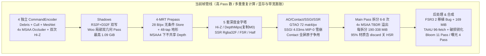
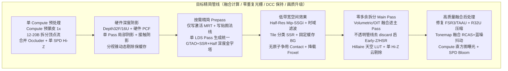

# Origin Engine GPU 使用与渲染管线深度源码审计报告

> **审计基线**：`main` @ `fb1a7ea8`（已同步至最新 `origin/main`），范围覆盖 `crates/og-render`（389 个 Rust 文件约 12.87 万行 + 227 个 WGSL 着色器）、`crates/og-render-data`、`crates/og-cook`、`crates/og-bundle`、`crates/og-runtime/src/present`、`crates/og-host-web`、`packages/engine/src/web` 及 `Cargo.toml` 锁定的 `wgpu-flash`（`68f335b7` / wgpu 30.0.2），结合仓库内 NVIDIA L4 (Vulkan)、Apple M4 Pro (Metal & Chrome WebGPU) 实测基线与 [roadmap.md](roadmap.md) 达标缺口逐行核实。
>
> **审计目标**：遵循 [AGENTS.md](../AGENTS.md) 的「根因修复、单实现无兼容层、按硬件能力分 Tier」原则，同时达成 **更好视觉效果** 与 **更低 GPU/CPU-GPU 性能与显存消耗**。

---

## 0. 全局诊断：管线全景、硬件基线与五大结构性根因

### 0.1 渲染管线全景：现状痛点 vs 目标架构

### 0.2 仓库实测硬件性能基线与 Roadmap 缺口归因

数据来自 `crates/og-tests/perf/`（1280×720, release, 7×100 帧最优值）及 [roadmap.md](roadmap.md#L69-L81)（1080p, L4 Vulkan）：

| 场景 / 指标 | NVIDIA L4 (Vulkan) | Apple M4 Pro (Metal / Chrome WebGPU) | 实测瓶颈拆解与已定位根因 |
|---|---:|---:|---|
| `showcase` (720p) | **2.065 ms** | 3.245 ms / 2.146 ms | `contact` 0.422ms + `ao` 0.375ms > `main` 0.833ms 的 95%；`bloom` 11 Pass 0.157ms；`meter` 3 Pass 0.054ms |
| `point-spot-lights` (720p) | **1.042 ms** | **2.478–3.944 ms** | `contact` 0.452ms（全屏 `atomicMax` 在 Apple Silicon 争用放大）+ Woo 双 Pass 局部阴影 |
| `crowd-50k` (720p) | **9.220 ms** (GPU 5.625ms) | **16.499 ms** | GPU: `prepass` 1.939ms + `main` 2.527ms + `casc` 0.768ms（每帧 5× VS 蒙皮 + 32–64 `textureLoad`/顶点）；CPU: **+3.6ms**（profile 下 11.4ms）源于每帧全量重建 + 3.2MB `DataTexture` 上传 |
| `spheres-20k` / `-moving` | **2.162 / 3.403 ms** | 5.245 / 6.487 ms (WebGPU) | 无 `MULTI_DRAW_INDIRECT`、64B 顶点步幅、移动时 CPU 上传 + 1.07ms 开销 |
| `sprites-20k` (720p) | **6.021 ms** (GPU **0.489ms**) | 1.051 / 1.108 ms | **5.53 ms 纯 CPU 瓶颈**：每帧 7 `HashMap` + 136B 元组排序 + 全量 2.2MB 上传 + 无视锥剔除 |
| **Screen GI (1080p, L4)** | **5.09 ms** (SSGI 单独 **4.03 ms**) | — | 默认全分辨率 + [pass_list.rs](../crates/og-render/src/renderer/render/pass_list.rs#L86) 禁用 `DepthMips` 致 MIP-0 缓存雪崩 + 无颜色金字塔 + 200M `gi_sector`/帧 |
| **DDGI Probes (1080p, L4)** | **1.99 ms** (净增 **+1.55 ms**) | — | 688k 软 BVH 光线/帧、3× 冗余 AABB、72-lane 非对齐 WG + 线程 0 串行 + 33M `pow(c,50)`/帧 |
| **FSR 3.1 (1080p, L4)** | TAAU **+0.37~+0.54 ms**; 静态 **-0.84~-1.71 dB** | — | **2 个确认移植 Bug**（自动曝光永不重置 + 未抖动 `dilated_motion`）；`Rgba32F` 运动矢量 4× 带宽 + 8 次手动双线性加载 + 6 次多余 alpha 加载 |
| **TAAU 边缘 (1080p, L4)** | 阶梯噪边 / 断栅栏 / 发糊 | — | `history_on_surface` 斜率归零容差 `3.8e-6` 回退最近邻低分 `cur4`（96 fetch/px）+ 32-tap `moving_nearby` + 数学失效的 `fs_sharpen` |
| **体积云 & 深度合成 (1080p)** | 0.808–1.498 ms; 深度合成 **+0.32~0.61 ms** | — | `clouds_covered` 每像素 **16–64× 全分辨率 `textureLoad`**；日落步进高达 **35 次采样/步**；`T=0.5` 硬切与 `Rgba16F` 3D 噪声 |
| **`terrain-grass` (L4)** | 9.13 → **9.78 ms (+0.6 ms)** | — | Compat 模式强制草/地形 VS 走 `rgba32uint` `DataTexture`（草 2 次相关加载 ×5 Pass；地形最高 12 加载/顶点） |

### 0.3 五大跨子系统结构性根因

1. **WebGPU Compatibility-Mode 限制「一刀切」降级了 `Tier::Full`**：[wgsl_rules.rs](../crates/og-render/tests/wgsl_rules.rs#L761-L1117) 在所有 Tier 强制 Workgroup≤128、禁用 VS Storage Buffer（迫使 8 大子系统走 2D `DataTexture`）、禁用 `SHADER_F16`/`SUBGROUP`/`RG11B10UFLOAT_RENDERABLE`/`DEPTH_CLIP_CONTROL`/`MULTI_DRAW_INDIRECT` 和 Bindless；同时 [caps.rs](../crates/og-render/src/gpu/caps.rs#L59) 虽检测了 `Caps::HIGH_BINDING_SLOTS`，全库却是 **0 调用点**。这违背 [design.md §2.6](design.md#L397)（"the WebGPU tier is never lowered to meet it"）。
2. **帧图与 `wgpu-flash` 协同失配导致带宽/显存成倍放大**：① [graph.rs](../crates/og-render/src/frame/graph.rs#L435) 对复用物理纹理做 `usage |= desc.usage`，把 `STORAGE_BINDING` 传染给纯光栅目标，触发 `wgpu-flash` 的 `VK_IMAGE_LAYOUT_GENERAL` 路径，**全局关闭 Vulkan DCC/AFBC 无损压缩**；② `Main` Pass 最多拆分 **6–8 个 RenderPass**，在 Apple Silicon / TBDR 上反复 `Store+Load` 4× MSAA 95–169 MiB；③ FSR3（169–301 MiB）、SSR（96–414 MiB）、阴影（High 高达 1.09 GiB）游离于帧图别名池之外，1440p 下仅 RenderTarget 就可达 **1.25–2.0+ GiB**。
3. **关键管线缺乏「计算一次、多处复用」**：蒙皮/形变在 VS 重复 7–15 次；同一帧构建 **5 套独立深度金字塔**；顶点从 12–20B 烘焙格式解压回 64B 并连带阴影/深度 Pass 浪费 81.25% 缓存行；局部阴影 Woo 方案重复提交 2× 几何；`Oit::Front` 标记 Pass 调用完整 PBR 着色；所有不透明带贴图材质均带 `DISCARD = true` 杀死全屏 Early-Z 与 Apple HSR。
4. **多处核心算法存在可验证的实现缺陷，同时伤害画质与性能**：FSR 3.1、TAAU、SSGI、DDGI、体积云、水体、运动模糊、色调映射均有明确的代码级缺陷（见 §1），修好即可**同步提质且提速**。
5. **CPU-GPU 桥接层存在重度每帧分配与绑定风暴**：`gpu/bind_cache.rs` 为零调用死代码，热路径每帧新建 **25–45+ `BindGroup`**；`og-runtime` 提取层每帧对 5 万人群做 15 万+ 次堆分配；`GpuTimer` 在 Vulkan/DX12 每槽额外 `queue.submit`；`Bundles::play` 每帧全量克隆 `Arc` 并深度比较。

---

## 1. 已确认的 14 项源码级 Bug 与画质缺陷清单

以下问题全部经源码精确行号核实，修复风险低、画质与稳定性收益极高：

| # | 严重度 | 模块与源码位置 | 缺陷机制与实际后果 | 修复方案 |
|---|:---:|---|---|---|
| **B1** | **P0** | [fsr_luma_pyramid.wgsl](../crates/og-render/shaders/fsr_luma_pyramid.wgsl#L91-L95) | 首帧重置把 `info.y` 设为 `1.0` 而非 `RESET_AUTO_EXPOSURE_AVERAGE_SMOOTHING` (`1e4`)，导致 `prev_log_luma < 1e4` **恒真**，FSR 自动曝光从不重置，需约 **240 帧（4 秒）**才收敛，短帧/暗场内色调映射偏差可达 50×，直接拉低 FSR PSNR | 改为 `vec4<f32>(-1.0, RESET_AUTO_EXPOSURE_AVERAGE_SMOOTHING, 0.0, 0.0)` |
| **B2** | **P0** | [fsr_accumulate.wgsl](../crates/og-render/shaders/fsr_accumulate.wgsl#L178) | `dilated_motion_tex` 按**未抖动** `p.hr_uv` 索引，但写入时在抖动空间（同 `color_tex`/`dilated_reactive_tex`），造成最高 ±0.5 LR / ±1.0 HR 像素的运动矢量错位，破坏细栅栏与草叶边缘 | 改用 `p.lr_uv_jittered` 坐标加载 `dilated_motion_tex`，并消除 `fsr_shading_change` 重复双线性偏移 |
| **B3** | **P0** | [vis.rs](../crates/og-render/src/visibility/meshlet_gpu/vis.rs#L238)、[meshlet_raster.wgsl](../crates/og-render/shaders/meshlet_raster.wgsl#L392-L395) | VisBuffer `setup` 展开为 96–144 B/px 胖缓冲，受 WebGPU 128 MiB 单缓冲上限截断为约 **87 万像素**（仅 1080p 42% / 4K 10%），超出直接 `attrs[pixel] = 0u; return;` **在画面上打出黑色空洞** | 删除胖 G-Buffer 展开，改用 4–8B/px 原始 VisBuffer + 8×8/16×16 Tile 材质分类着色 |
| **B4** | **P0** | [shadow_array.wgsl](../crates/og-render/shaders/shadow_array.wgsl#L12) | 阵列贴图阴影 VS 写 `o.layer = u32(max(look.z, 0.0));`，误读了 `GpuTransform.fx[1]`（8:8:8 受击闪白 RGB！）而非 `look_layer(look)`（`look.x`），导致逐实例贴图层在阴影剪裁中失效，受击闪白时越界采样高达 `2^24 - 1` 层 | 改为 `o.layer = u32(look_layer(look));` |
| **B5** | **P0** | [crowd_card.wgsl](../crates/og-render/shaders/crowd_card.wgsl#L118) | 人群卡片直接用原始 `in.look.y` 做 `mix(color, card_rgb(in.look.z), in.look.y)`，未解码 `look_flash_amount(in.look)`；一旦带描边组或淡入淡出，`look.y >= 2.0`，外推产生负数/爆炸 HDR 颜色 | 改用 `let flash = look_flash_amount(in.look);` |
| **B6** | **P0** | [pass_list.rs](../crates/og-render/src/renderer/render/pass_list.rs#L86-L89)、[ssgi.wgsl](../crates/og-render/shaders/ssgi.wgsl#L250) | `depth_mips` 显式要求 `effects.gi.is_none()`，导致开启 SSGI 时不仅 SSGI 自己狂踩 MIP-0 深度，连内联运行的 GTAO 也退化为全 MIP-0 读取，是 SSGI 4.03ms 的头号元凶 | 解除 `effects.gi.is_none()` 限制，SSGI 与内联 GTAO 均改用 `depth_mip_tap` |
| **B7** | **P1** | [gi_probes.rs](../crates/og-render/src/shading/gi_probes.rs#L652)、[gi_trace.wgsl](../crates/og-render/shaders/gi_trace.wgsl#L186-L210) | DDGI 上传未剔除的场景总灯光数 `scene.lighting.lights.len()`，而 `light_tables` 仅存视锥剔除后的 `kept` 灯光，越界采样旧/零槽位并错乘概率权重 `f32(lights)` | 传入 `kept.len()`（实际上传的灯光数） |
| **B8** | **P1** | [weather_surface.wgsl](../crates/og-render/shaders/weather_surface.wgsl#L111-L112)、[decals.wgsl](../crates/og-render/shaders/decals.wgsl#L111)、[pbr_fs.wgsl](../crates/og-render/shaders/pbr_fs.wgsl#L346) | VisBuffer Resolve（`ANALYTIC=true`）在 `discard` 后仍对天气与湿贴花调用硬件 `fwidthFine`/`dpdxFine`（邻像素为 0 产生毛刺尖峰），且显式跳过 `specular_aa` 令微三角形高光闪烁 | 对天气/湿贴花接入 `analytic_dx/dy` 与 `world_dx/dy`；在 `ANALYTIC` 路径保留解析曲率 `specular_aa` |
| **B9** | **P1** | [post.wgsl](../crates/og-render/shaders/post.wgsl#L190-L192)、[display_transfer.wgsl](../crates/og-render/shaders/display_transfer.wgsl#L30-L33) | 仅软件 `fs_srgb_encode` 有抖动，原生 Vulkan/Metal/DX12 硬件 sRGB 输出（`fs`）与 P3 sRGB 表面**完全无抖动**，天空与暗部出现明显 8-bit 色带 | 在 sRGB 感知空间注入 1-LSB 三角分布蓝噪声抖动（复用已常驻的 64² `blue_noise` 纹理） |
| **B10** | **P1** | [screen_ao.wgsl](../crates/og-render/shaders/screen_ao.wgsl#L69-L77) | `contact_shadow()` 用**未抖动** `fx.view_proj_unjittered * p` 去采样由**抖动** Prepass 生成的 `ssao_tex`，既在每像素每灯浪费一次 `mat4×vec4`，又令 TAA 下接触阴影每帧错位 ±0.5 px | 直接使用 `@builtin(position).xy * fx.screen.zw` |
| **B11** | **P1** | [taa.wgsl](../crates/og-render/shaders/taa.wgsl#L431-L445)、[post_uniforms.rs](../crates/og-render/src/renderer/render/post_uniforms.rs#L85-L87) | ① `fs_sharpen` 将锐化结果钳制到含中心像素的 `[min(c,n,s,e,w), max(...)]`，数学上对所有 1px 极值（细线/高光/草尖）产生 **0 锐化**；② 动态分辨率切换时重建全零 `taa_depth` 却未跳过首帧深度拒绝 | 用 RCAS/CAS 替代并融合进 Tonemap；动态分辨率换档时置 1 帧 `taa_depth_valid = false` |
| **B12** | **P1** | [motion_blur.wgsl](../crates/og-render/shaders/motion_blur.wgsl#L89-L94) | 重建采样无每像素抖动（3.3px 步进拖影）且软 Z 权重 `(q_z - z0)/soft_z + 1` **前景/背景反号**（衰减近处前景、放行远处背景渗透） | 加 IGN/蓝噪声步进抖动并改用 McGuire 双向软深度+锥形权重 |
| **B13** | **P1** | [pbr_fs.wgsl](../crates/og-render/shaders/pbr_fs.wgsl#L360)、[physical.wgsl](../crates/og-render/shaders/physical.wgsl#L593-L598)、[gltf.rs](../crates/og-render/src/mesh/gltf.rs#L328)、[ktx2.rs](../crates/og-bundle/src/ktx2.rs#L422-L460) | ① 双面背面级联阴影法线偏移未乘 `material_face(hook_front)`；② 眼球 `dpdxFine` 在分支 `iris_uv()` 之后造成虹膜边 Mip 接缝；③ `gltf.rs` 烘焙法线未用逆转置矩阵；④ 无损 sRGB KTX2 Mipmap 在 Gamma 空间直接均值变暗偏色 | 逐一修补：翻转背面法线、前置 `dpdxFine`、用伴随/逆转置变换法线、线性空间降采样 |
| **B14** | **P2** | [canvas.rs](../crates/og-host-web/src/canvas.rs#L447) | Web GPU 能力遥测上报的是 `device.features()` 而非 `adapter.features()`，由于 `adapter.rs` 未请求 `shader-f16`/`subgroups`/`rg11b10ufloat-renderable`，线上数据永远误报为「全员不支持」 | 改为传入 `adapter.features()` 以获取真实终端覆盖率 |

---

## 2. 帧图、RenderPass/TBDR 带宽、`wgpu-flash` 与 VRAM 深度剖析

### 2.1 RenderPass 拆分风暴与 4× MSAA TBDR 灾难

在重负载场景中，单帧可达 **65–85+ RenderPass + 25–35+ Compute Dispatch + 6–8 次全/半分辨率纹理拷贝**（见 [schedule.rs](../crates/og-render/src/renderer/render/schedule.rs#L232-L469)）：

1. **Main Pass 拆分 6–8 次导致的 MSAA TBDR 溢出**（[pass_main.rs](../crates/og-render/src/renderer/render/pass_main.rs#L132-L957)）：
   - 当水体、折射、体积雾、OIT 或扭曲粒子任一开启时，主 Pass 强制对 `hdr-msaa`（4× `Rgba16F` = 32 B/px）与 `depth`（4× `Depth32F` = 16 B/px）使用 `StoreOp::Store`，后续子 Pass 再 `LoadOp::Load`。
   - **单次拆分 DRAM 往返流量**：1080p **189.8 MiB** / 1440p **337.5 MiB**（60 fps 下 3 次拆分即额外吞掉 **34.2 / 60.8 GB/s** 显存带宽，彻底摧毁 Apple Silicon / 移动端 TBDR 的片上无损 MSAA Resolve）。
   - **最直接浪费**：[volumetric.rs](../crates/og-render/src/media/volumetric.rs#L957-L972) 的 `encode_apply` 与 [pass_oit.rs](../crates/og-render/src/renderer/render/pass_oit.rs#L567-L582) 的 `encode_resolve` 仅做全屏 Alpha 混合、根本不采样 `hdr-msaa`，却强行结束主 Pass、另开无深度 Pass、再重开主 Pass！只需给二者管线配上 `depth_write_enabled: false, depth_compare: Always` 即可**零成本并入当前主 Pass**，直接省下 **380–760 MiB/帧 @1080p**。
2. **Prepass 4-MRT 无条件写入与 MSAA4 深度丢弃**：
   - [pass_prepass.rs](../crates/og-render/src/renderer/render/pass_prepass.rs#L59-L119) 永远绑定并 `Store` 全部 4 个颜色 MRT（`gbuffer` 8B + `lindepth` 8B + `outline-id` 4B + `motion-depth` 4B）+ `depth` 4B = **28 B/px**（1080p **55.4 MiB** / 1440p **98.4 MiB**），即便描边、运动模糊或 SSR 全关。
   - 更糟的是，次级视角与反射探针（[slots.rs](../crates/og-render/src/frame/views/slots.rs#L44-L84)、[draw_ctx.rs](../crates/og-render/src/renderer/render/draw_ctx.rs#L429-L464)）分配的 `gbuffer`/`outline`/`motion_depth` 甚至**没有 `TEXTURE_BINDING`（完全不可读取）**，却依然每视角每面完整写入 **16 B/px**；且 [views.rs](../crates/og-render/src/frame/views.rs#L183) 无条件 `Store` 无人读取的 `slot.depth`，[resolve.rs](../crates/og-render/src/frame/views/resolve.rs#L207) 全屏覆写目标却使用 `LoadOp::Load`。
   - MSAA4 下 `shares_prepass_depth == false`（[plan.rs](../crates/og-render/src/post/plan.rs#L30-L32)），Prepass 与 Main 完全无法共享深度，Early-Z 归零。

### 2.2 `wgpu-flash` 的 Vulkan `VK_IMAGE_LAYOUT_GENERAL` 失压传染

[Cargo.toml](../Cargo.toml#L425) 明确记录：`wgpu-flash` 在 Vulkan 上将所有带 `TextureUsages::STORAGE_BINDING` 的纹理固定采样于 **`VK_IMAGE_LAYOUT_GENERAL`**——这在 NVIDIA/AMD/ARM 硬件上会**禁用帧缓冲无损压缩（DCC / Delta Color Compression / AFBC）**，增加 30%–100% 实际 DRAM 读写流量。

源码核查发现两处严重传染源：
1. **无条件标记 `STORAGE_BINDING`**：[targets.rs (plan)](../crates/og-render/src/post/plan/targets.rs#L168-L175) 无条件给 `lindepth` 加 `STORAGE_BINDING`（仅 Scatter 卡片写它）；[targets.rs (post)](../crates/og-render/src/post/targets.rs#L78-L82) 无条件给 `taa history[2]` 加 `STORAGE_BINDING`（内置 TAAU 是片段着色器）；`hdr.sharp` 同理（[targets.rs:362](../crates/og-render/src/post/plan/targets.rs#L362)）。
2. **帧图物理槽位 Usage 合并传染**：[graph.rs](../crates/og-render/src/frame/graph.rs#L435) 执行 `physical[s].0.usage |= desc.usage;`。只要某个物理槽位生命周期内曾复用过一次计算目标，该物理纹理就会**永久感染 `STORAGE_BINDING`**，把与其复用的 `hdr`、`hdr.outline`、`hdr.dof`、`ao` 等纯光栅目标全部拖入 `VK_IMAGE_LAYOUT_GENERAL`！

> **根治**：在 `RenderGraph::compile` 中按 `usage.contains(STORAGE_BINDING)` 将物理别名池一分为二，同时按实际功能（FSR3 / Scatter）条件授予 `STORAGE_BINDING`。

### 2.3 RenderTarget VRAM 账本（1080p vs 1440p 实算）

| 显存大户 | 格式与来源 | 生命周期 | 1080p (MiB) | 1440p (MiB) | 可削减空间 |
|---|---|---|---:|---:|---|
| **阴影贴图 (High `2.0×`)** | 4 级联 `4096²` (`R32F`+`D32F`) + 局部 `1024²×96` (`Rg32F` 只增不缩) ([quality.rs](../crates/og-render/src/frame/quality.rs#L177-L188)) | 常驻 (+ 缓存拷贝高达 +256 MiB) | **420–1,092** | **420–1,092** | 深度单写 + 局部 `Rg16U`/限 512–768 → **省 50%–75%** |
| **FSR 3.1 内部状态** | 16 纹理 + 4 缓冲，含 `Rgba32F` `dilated_motion` 31.6/56.3 MiB ([fsr.rs](../crates/og-render/src/post/fsr.rs#L320-L390)) | 全常驻（其中 **90/160 MiB 为帧内瞬态**） | **169.3** | **301.0** | 瞬态入帧图别名 + `R32U` 压缩运动矢量 + `R8U`/`R16F` → **省 ~65%** |
| **SSR (Half / Full)** | 8 级 `Rgba32F` Hi-Z（对齐 256）+ 15 张 `Rgba16F` ([ssr.rs](../crates/og-render/src/shading/ssr.rs#L163-L301)) | 全常驻（6+ 瞬态 + DX12 拷贝副本） | **96.4 / 234.8** | **167.7 / 413.8** | Hi-Z 合并 & `R32U` f16×2 + 瞬态别名 + 删 DX12 副本 → **省 ~55%** |
| **OIT (`List 4L` / 4× MSAA)** | 3-MRT 20 B/sample + Arena `116 B/px` ([oit.rs](../crates/og-render/src/shading/oit.rs#L274-L328)) | MRT 瞬态 / Arena 常驻 | **166 + 128–229** | **281 + 128–408** | RGBA `pack2x16float` (28B→20B) + 深度预剔除 |
| **Meshlet VisBuffer** | `words` 8 B/px + 展开胖 `attrs` 100–148 B/px ([vis.rs](../crates/og-render/src/visibility/meshlet_gpu/vis.rs#L230-L258)) | 常驻（WebGPU 截断 128 MiB 致黑洞） | **144–214** | **156–380** | 删除 `attrs` 胖表改 Tile 分类 → **省 >90%** |
| **Main + Prepass + TAA + JFA + 遮挡** | `Rgba16F` 全链 + 4× MSAA + `occluder_depth` 4× MSAA | 图内瞬态 + 历史常驻 | **~180–260** | **~320–460** | 无 Alpha HDR 换 `Rg11b10U`、1× Occluder、精简 Prepass → **省 ~40%** |

> 重场景 1440p High 仅 RenderTarget 就吃掉 **1.25–2.0+ GiB**（尚不含模型/贴图/ShadowCache），对 4–6 GiB 核显、笔记本及移动端形成致命显存墙。

### 2.4 提交开销、死缓存、同步编译卡顿与渲染序

- **每帧 `BindGroup` 分配风暴（[bind_cache.rs](../crates/og-render/src/gpu/bind_cache.rs) 为 0 调用死代码）**：每帧实时新建 **25–45+ 个 `BindGroup`**——`ssr.rs` (9/帧)、`fsr.rs` (7–8/帧)、`frame_binds.rs` (2–20+/帧)、`volumetric.rs` (4/帧)、`pass_clouds.rs` (2–3/帧)、`views.rs` (6–8/视角)、`fluid3d.rs` (7/帧 + 4 新建 Uniform Buffer)、`crowd_gpu.rs`、`vis.rs`、`pass_oit.rs`、`display.rs`、`post_custom.rs`、`debris.rs`、`visual_fluid.rs`、`garment_gpu.rs`、`ui/pass/upload.rs`。其中绝大部分只是 2 槽乒乓轮转，预建 2 套静态绑定组即可彻底归零。
- **Uniform 上传膨胀**：`ShadowPassUniform` 272B 向上对齐到 **512B 步幅**，[frame_uniform.rs](../crates/og-render/src/renderer/render/frame_uniform.rs#L236) 每帧堆分配并上传全部 102 槽（**51 KiB/帧**，哪怕只有 3 个级联！减掉 16B 即可降到 256B 步幅并只传活跃槽位）；`FrameUniform` 内嵌 `local_view_proj[96]`（**6,144 B**），在主视角/反射/6 面探针/次级视角全部复制上传。
- **多余 `queue.submit` 与编码器分裂**：[timing.rs](../crates/og-render/src/frame/timing.rs#L645-L650) 在非发布版（含 L4 性能测试）每个已完成时间戳槽位都单开 `CommandEncoder` 并调用一次 `queue.submit()`（Vulkan/DX12 可直接并入主编码器）；[submit_frame.rs](../crates/og-render/src/renderer/render/submit_frame.rs#L83-L88) 拆成 4 个 `VkCommandBuffer` 提交（`debris`, `cull`, `meshlets`, `frame`），前三者还绕过了 GPU 耗时统计。
- **`RenderBundle` 反向负优化**：[bundle.rs](../crates/og-render/src/gpu/bundle.rs#L267-L315) 每帧新建 `Vec<Command>`、逐条克隆所有 `RenderPipeline`/`BindGroup`/`Buffer` 的 `Arc` 再做全量深度 `PartialEq`。在原生 `wgpu-flash`（直通 HAL 无校验）上比直接录命令更慢；应改为基于版本号/脏位的缓存键校验。
- **绘制排序与状态去重缺失**：[instances.rs](../crates/og-render/src/visibility/instances.rs#L674-L685) 按 `(mesh, material, ...)` 排序而非 `(pipeline, material, mesh)`，且**完全无由近到远（Front-to-Back）粗排序**（在关闭 Prepass 或 MSAA4 下大幅放大过度绘制）；[draw_skinned.rs](../crates/og-render/src/renderer/render/draw_skinned.rs#L92) 在每个批次循环内重复绑定循环不变的骨骼 `palette` 绑定组，[draw_list.rs](../crates/og-render/src/renderer/render/draw_list.rs#L129-L138) 与 [draw_ctx.rs](../crates/og-render/src/renderer/render/draw_ctx.rs#L473-L475) 缺少管线/材质/VB/IB 去重。
- **5 处同步管线编译卡顿点**：[ssr.rs:793](../crates/og-render/src/shading/ssr.rs#L793)（8 条计算管线且 `cache: None`）、[views/resolve.rs:56](../crates/og-render/src/frame/views/resolve.rs#L56)、[cull_gpu/encode.rs:15](../crates/og-render/src/visibility/cull_gpu/encode.rs#L15)（实例数首次跨越 16,384 时局内突发卡顿！）、[meshlet_gpu/encode.rs:341](../crates/og-render/src/visibility/meshlet_gpu/encode.rs#L341)、[readback.rs:231](../crates/og-render/src/renderer/readback.rs#L231)；此外切换 MSAA 时 [settings.rs:253](../crates/og-render/src/renderer/settings.rs#L253) `forget_lit_pipelines()` 会清空所有已编译管线。

---

## 3. 硬件能力利用、资产 GPU 格式与 CPU 提取瓶颈

### 3.1 错失的现代 GPU 硬件特性

[adapter.rs](../crates/og-render/src/renderer/init/adapter.rs#L159-L178) 仅请求了块压缩纹理、`PIPELINE_CACHE`、`TIMESTAMP_QUERY`、`INDIRECT_FIRST_INSTANCE` 四项，以下现代特性**全库零使用**：

| 硬件特性 | 现状与代价 | 建议启用策略（`Tier::Full` 能力门控） |
|---|---|---|
| **`RG11B10UFLOAT_RENDERABLE`** | 全链强制 `Rgba16Float` (64 bpp)，连无 Alpha 的 Bloom/SSR/SSGI/FSR/云/反射/动态模糊也翻倍带宽 | 立即请求，所有无 Alpha HDR 目标切 `Rg11b10Ufloat`（32 bpp，**带宽与 VRAM 直降 50%**） |
| **`SHADER_F16`** & 内建 `pack2x16float` | 零 `enable f16;`；[common.wgsl](../crates/og-render/shaders/common.wgsl#L153-L174) 和 [area.wgsl](../crates/og-render/shaders/area.wgsl#L18-L60) 甚至**手写软件整型位运算**编解码 fp16！ | 立即用核心 WGSL `pack2x16float`/`unpack2x16float` 替代手写软编解码（零特性门槛）；在 SSGI/FSR/云/PBR 中按 `Caps::SHADER_F16` 启用 `f16`（Ada/M4 2× ALU + 减半 VGPR） |
| **`SUBGROUP`** | 剔除前缀和、FSR 亮度金字塔、曝光归约全靠共享内存树 + 12–15 次 `workgroupBarrier()`，且 WG 被锁在 128 | `Tier::Full` 解锁 WG=256 + `subgroupExclusiveAdd`/`subgroupAdd`，大幅压缩剔除与归约延迟 |
| **VS Storage Buffer** | `wgsl_rules.rs` 全局禁用，把蒙皮/地形角点/草叶/人群/UI/2D 瓦片全塞进 `Rgba32F/U` `DataTexture`，直接制造了 L4 `terrain-grass` **+0.6ms** 回归 | `Tier::Full` 恢复 VS Storage Buffer（或将草/地形改用 `VERTEX \| STORAGE` 实例化顶点缓冲，兼顾全 Tier！） |
| **`DEPTH_CLIP_CONTROL`** | 方向光阴影级联无法启用硬件深度钳制，被迫拉长正交 Z 范围浪费深度精度 | 请求并开启 `unclipped_depth`，提升级联深度精度与近面投影稳定 |
| **`MULTI_DRAW_INDIRECT` / Bindless** | 每批次 CPU 循环单独发 `draw_indexed_indirect`；每材质独立 `BindGroup` 导致 HLOD 被拆为 404 批次 | Native `Tier::Full` 接入 MDI+Count 与 Bindless 材质表，合并批次与消除零计数 Draw 提交 |

### 3.2 顶点与纹理资产 GPU 格式优化

1. **严重的顶点反量化膨胀（[primitive.rs](../crates/og-cook/src/cook/formats/model/primitive.rs#L907-L940) → [model.rs](../crates/og-bundle/src/runtime/model.rs#L1448-L1494) → [resources.rs](../crates/og-render/src/renderer/resources.rs#L70-L105)）**：
   - `og-cook` 已把模型精良量化为 **12–20 字节/顶点**（`unorm16x3` 位置 + 切线角 + `snorm16x2` 八面体法线 + `unorm16x2` UV + `unorm8x4` 颜色），但 `og-bundle` 加载时**全部反量化回 64 字节 f32 `Vertex`** 上传 GPU！
   - 更糟的是，阴影/遮挡/Prepass 用的 `POSITION_LAYOUT` 依然采用 **`array_stride: 64`**——每读取 12B 位置就浪费 **52B（81.25%）GPU 顶点缓存行**！
   - **优化**：直接向 GPU 上传分流压缩顶点：**Stream 0（位置专用流）** `8B`（`unorm16x4` 位置+切线角）或 `12B`（`f32x3`）；**Stream 1（着色属性流）** `12B`（八面体法线+UV+颜色）。**模型显存降 2.6–3.2×，阴影与深度 Prepass 顶点带宽直降 5.3×**！另外为粗 LOD 补上 `optimize_overdraw_in_place`（目前仅 LOD0 执行）。
2. **纹理格式与加载链路优化**：
   - 新增 **4 bpp** 格式支持（`BC4`/`EAC_R11` 用于单通道 AO/粗糙度/金属度/高度；`BC1`/`ETC2_RGB8` 用于不透明反照率）并在 ASTC/ETC2 GPU 上法线优先用 2 通道 `EAC_RG11` 而非 4 通道 `Astc4x4`（目前全员 8 bpp）；法线图取消 G→A 4 通道冗余复制以提升 UASTC XY 比特精度；Cook 阶段将分离的 glTF `occlusion` 与 `metallicRoughness` 自动合为单张 ORM 贴图（省 2 个采样槽位 + 1/3 显存）；提高 UASTC Zstd 压缩等级（当前为 `Level::Fastest`）。
   - 修复无损 sRGB KTX2 的 Gamma 空间 Mipmap 均值 Bug（[ktx2.rs:422-460](../crates/og-bundle/src/ktx2.rs#L422-L460)）；消除 Web Basis 解码后的 4 次 Mip 链全量内存拷贝（扁平 `Vec<u8>` + 偏移表）；纹理流式系统（[mips.rs](../crates/og-runtime/src/world/stream/mips.rs#L242-L374)）淘汰时直接保留常驻 44KB 256px 尾链而非重新读盘转码，并纳入蒙皮/人群/地形/精灵统计。

### 3.3 CPU 提取与提交瓶颈（`crowd-50k` 11.4ms & `sprites-20k` 5.53ms 根因）

- **ECS 提取层（[present/fx/models.rs](../crates/og-runtime/src/present/fx/models.rs#L359-L501)、[extract/frame/models.rs](../crates/og-runtime/src/present/extract/frame/models.rs#L43-L599)）**：
  - `crowd_model` 每帧对每个实体深拷贝 `ModelInfo`（含 `String` + 6 个 `Vec`）、克隆 `skinned_meshes`、并分配 `Vec<CrowdPart>` + 2 个内层 `Vec` 仅用于线性扫描匹配后立即丢弃——5 万人群每帧制造 **15 万+ 次堆分配**！
  - `KeptModels` 以相机 `view` 矩阵精确相等为缓存键，**相机移动 1 ulp 即全场景重建**；GPU 人群仍在 CPU 逐实体跑 `Mat4::to_scale_rotation_translation` + `lod::select`；`meshes()` 每帧全量 `.clone()` 两个句柄表；灯光与骨骼提取（`lights.rs` / `skeletons`）仍在走 `serde_json::Value` 往返而非列式直读。
- **`og-render` 内部 CPU 热区**：
  - `crowd-50k` 每帧重建 4.0MB `members` + 3.2MB `previous`，并把 `previous` 经 2D `DataTexture` 逐行上传（若有普通蒙皮还 `[data, after].concat()` 再拷一份）；改用 GPU 双缓冲 `members` 即可直接消灭 **3.2 MB/帧** PCIe 上传。
  - `sprites-20k`（[sprites/build.rs](../crates/og-render/src/sprites/build.rs#L174-L680)）每帧新建 7 个 `HashMap`、对 136B 元组做原地排序并全量上传 2.2MB；改为**16B 排序键 + 索引数组**与脏块追踪可把 5.53ms CPU 压至 <0.5ms。

---

## 4. 几何、可见性、GPU 剔除、Meshlet 软光栅、蒙皮与 2D 管线

### 4.1 GPU 剔除与 Hi-Z 遮挡剔除

- **门槛过高与双重金字塔**：`OCCLUSION_MIN_INSTANCES = 16_384`（[config.rs:405](../crates/og-render/src/renderer/config.rs#L405)）令所有中等规模高面数室内/场景完全禁用遮挡剔除与 VisBuffer；启用后又分配独立 **4× MSAA** `occluder_depth` 仅为了立即求 `min` 折叠，且 Meshlet 激活后会先建一次完整 11 级 Hi-Z，再画 `meshlet early depth`，然后调用 `gc.rebuild_pyramid()`（[meshlet_gpu/encode.rs:383](../crates/og-render/src/visibility/meshlet_gpu/encode.rs#L383)）**把全部 11 级 Hi-Z 重建第二遍**！且每级 Mip 都是单独的 `8×8` Dispatch + UAV 屏障。
- **剔除精度与扫描低效**：[cull.wgsl](../crates/og-render/shaders/cull.wgsl#L175-L194) 已存有 `b.extent` 并实现了 OBB 平面投影，却只给蒙皮体用，普通静态体退回宽松外接球；[cull_scan.wgsl](../crates/og-render/shaders/cull_scan.wgsl#L7-L32) 共享内存无 Bank-Conflict 填充（最高 32 路冲突）且 `scan_blocks` 仅派发 **1 个 Workgroup** 串行扫完全图；场景中只要有 **1 个蒙皮角色或 1 个植被批次**，就击穿全场景静态变换缓存并触发每帧全量克隆与 memcmp（[cull_gpu/encode.rs:288](../crates/og-render/src/visibility/cull_gpu/encode.rs#L288)）。

### 4.2 Meshlet 与软件 Visibility Buffer 重构要点

当前软件光栅 VisBuffer 存在 4 个根本性设计瓶颈：
1. **容量派发而非间接派发**：[vis.rs:304-317](../crates/og-render/src/visibility/meshlet_gpu/vis.rs#L304-L317) 按容量 `SOFT_CAP = 65,536` 派发 `raster_depth` + `raster_id`（即使仅 10 个软簇也启动 **840 万线程**！），且两遍完全重复做顶点读取、风场摇曳、投影与无增量边方程光栅，簇内无共享内存顶点缓存（384 次顶点变换 vs 64 唯一顶点），`atomicMax` 前无 `atomicLoad` 预过滤。
2. **胖 G-Buffer 展开 + 全局单原子热点 + 黑洞**：`setup` 阶段全屏所有可见软像素狂砸**同一个全局原子计数器** `atomicAdd(&vbuf[2u * wh], 1u)`，再做 24–36 次非合并散写（96–144 B/px），并在超出 128 MiB 限制后直接丢弃像素变黑洞。
3. **`2M` 次全屏 Resolve + 关闭 Early-Z + 破坏 MSAA**：Prepass 与 Main 对每个软批次画 1 个全屏三角形（100 材质 = 200 次全屏 Pass），每个像素写 `@builtin(frag_depth)` + `discard` 杀死硬件 Early-Z；且 1× 软光栅结果广播到 4× MSAA 目标导致锯齿接缝。
4. **负载失衡**：`meshlet_cull` 按 1 WG(64 线程) = 1 实例派发，远景 4 簇闲置 60 线程，高模 5,000 簇单 WG 串行，且 LOD 切换时 `vis` 历史位发生跨 LOD 槽位混叠。

> **根治方向**：拆分为「实例 LOD 剔除 → 均衡 64 簇/WG 剔除」；软光栅改 `dispatch_workgroups_indirect` + 共享内存 64 顶点缓存 + 增量边步进 + `atomicLoad` 预检；**彻底删除 144B `attrs` 胖表与 `2M` 全屏 Resolve**，改为 8×8/16×16 Tile 材质分类 Compute Pass + 间接 Tile 绘制/计算着色。

### 4.3 蒙皮/形变、人群卡片与 2D 管线

- **引入单次 Compute 预蒙皮（高 ROI）**：当前 [skin_storage.wgsl](../crates/og-render/shaders/skin_storage.wgsl#L44-L109) 在级联阴影、局部阴影（×2）、Prepass（**×2：当前+上一帧**）、Main、反射、探针（×6）、次级视角重复执行 **7–15 次顶点蒙皮与形变**；烘焙人群走 `DataTexture` 每顶点每 Pass 高达 **32–64 次 `textureLoad`**；`morph_weight` 甚至为读 1 个标量调用 `joint_matrix` 做 **4 次 `textureLoad`**（64B）！改为帧首**单次 Compute 预蒙皮**（直读原生 Storage Buffer，双缓冲输出当前/上帧变形顶点，关节压缩为 3×4 48B、`SkinVertex` 压为 8–12B），可立竿见影削减 `crowd-50k` 的 `prepass`（1.94ms）与 `cascade`（0.77ms）耗时，同时移除 `BakeCache::update` 每帧逐矩阵深度比对。
- **人群卡片与 2D 优化**：为人群增加 2–3 层仰角/半球八面体烘焙、编码金属度通道、加入抖动 LOD 过渡并释放烘焙后常驻的 64MB 4× MSAA 目标；2D 阴影（[light2d_shadow.wgsl](../crates/og-render/shaders/light2d_shadow.wgsl#L56-L73)）存储每遮挡体边区间避免二次全图扫描，2D 光照（[light2d.wgsl](../crates/og-render/shaders/light2d.wgsl#L84-L197)）用预过滤 1D 极坐标 Mip/固定核替代最高 ~140 次嵌套二分加载、聚光用紧贴扇形网格替代 `2r×2r` 方框；为普通 2D 精灵/文本/瓦片增加视锥剔除（当前仅 billboard 剔除）、缩小 128B 实例步幅并合并同贴图 `SpriteMesh`（停止每帧 CPU 解索引）。

---

## 5. PBR 材质、Forward+、阴影、GI (SSGI/DDGI)、SSR 与 OIT

### 5.1 PBR 画质短板与着色彩度/寄存器浪费

1. **95% 真实材质禁用了 Early-Z 与 Apple HSR（[pbr_fs.wgsl](../crates/og-render/shaders/pbr_fs.wgsl#L14-L188)）**：目前仅无贴图纯色 `pbr_lean` 在无贴花时将 `override DISCARD = false`，所有带贴图的普通不透明 glTF 模型（角色/建筑/道具）均以 `DISCARD = true` 编译！静态存在 `discard` 即在 NVIDIA/AMD/Apple 硬件上**废除 Early-Z 与 TBDR Hidden Surface Removal**。将不透明材质（`alphaMode == Opaque && no dissolve && !fading`）独立为 `DISCARD = false` 管线，在复杂场景中可大幅降低着色 Overdraw。
2. **无条件纹理采样与 Uber 寄存器膨胀**：`fs_lean`（[pbr_lean.wgsl:81](../crates/og-render/shaders/pbr_lean.wgsl#L81)）委托给 `lit_fragment`，对无贴图材质仍执行 5 次 1×1 纹理采样；`physical.wgsl` 的 `pack_sample` 无条件读取 5 层 `material_pack`；`PhysicalPipelines`、`ArrayMaps`、`Lightmaps` 均未接入 `Variants<...>` 特性特化（全员背负 345 行 `weather_surface.wgsl` 等 18 项功能寄存器压力）；`VertexOut`（[pbr.wgsl:75-103](../crates/og-render/shaders/pbr.wgsl#L75-L103)）多达 **37 个标量插值器**（含全局传的 `affine`/`season`/`crown`/`oit_key`），极易在移动端/Apple Silicon 触发 Parameter Buffer 溢出；`stochastic_texel` 开启时仍多采 1 次 `ordinary` 且对每张贴图重复算六边形网格；`area.wgsl` `ltc_half` 每面光做 24 次软解码（换 `unpack2x16float` 即可）。
3. **直接提升写实质感的 4 项 PBR 补齐**：
   - **直接光多散射 GGX 能量补偿**：IBL 已实现 `multi_scatter_ibl`（[surface_shade.wgsl:123](../crates/og-render/shaders/surface_shade.wgsl#L123)），但直接光（[lighting.wgsl:639](../crates/og-render/shaders/lighting.wgsl#L639)）仍为单散射，导致粗糙金属在阳光下偏暗 40%–50%。复用已采样的 `brdf_lut` 仅需 2 条 ALU 指令即可对齐直光与 IBL 能量。
   - **IBL 地平线遮蔽（Horizon Occlusion）与材质 AO 镜面遮蔽**：加入 `clamp(1 + dot(R, N_geom), 0, 1)^2` 消除强法线贴图下的环境漏光；将 `min(aoMap, ssao)` 送入 Lagarde `specular_occlusion`。
   - **清漆（Clearcoat）修复**：仅当 `dot(coat_normal, n) < 0.999` 时执行第二次 `gi_sample_at`（省 64–128 次存储加载），为 `coat_roughness` 补上 `specular_aa` 与独立镜面 AO，且不混用底层 SSR。
   - **毛发 IBL 与次表面优化**：为 `hair` IBL 增加各向异性近似，用 2D/预积分查表替代 `subsurface.wgsl` 每灯 24 次 `exp()`。

### 5.2 Forward+ 聚簇与阴影系统

- **Forward+ 聚簇（[clusters.rs](../crates/og-render/src/shading/clusters.rs#L215-L447)）**：当前 `16×9×24` 在 1080p 下单瓦片高达 120×120 px，纯对数 Z 划分令前 6–8 层浪费在 `<1m` 处，且用球体 AABB 8 角投影（无聚光圆锥剔除、无面光半空间剔除、贴近近面直接回退全屏）。建议改为 `z_near_cluster = max(near, 1.0)` + 精确球/圆锥与 Cluster AABB 相交检测 + 细化到 `32×18×24`，并在着色器中先读 16B `position_range` 做距离剔除再加载其余 64B。
- **方向光与局部阴影（[shadow_target.rs](../crates/og-render/src/shading/shadow_target.rs#L34-L91)、[lighting.wgsl](../crates/og-render/shaders/lighting.wgsl#L23-L356)）**：
  - 级联阴影放弃 `R32Float`+`Depth32Float` 双写，改用**纯深度 `Depth32Float`/`Depth16Unorm` + 硬件 `textureSampleCompare`**：立享硬件 2× 纯深度光栅速率、带宽减半，PCSS 从 **80–96 次 `textureLoad`/级联（混合带 192 次！）**骤降至 16–24 次硬件 2×2 比较采样；TAA 下级联混合带用 IGN 抖动单级联采样再省一半。
  - 局部阴影放弃 Woo 2-Pass 双倍几何渲染（8 盏点光 96 个 Pass，M4 Pro 3.2ms GPU + 2.0ms CPU），改用单 Pass 背面投影 + 距离缩放偏置 + 已有的接触阴影，直接减半局部阴影开销；High 预设局部图尺寸从 1024² 收敛至 512–768（防 768 MiB 显存爆炸）。
  - 静态阴影缓存（[pass_shadows.rs:98-109](../crates/og-render/src/renderer/render/pass_shadows.rs#L98-L109)）：把全局 `unculled_overlay` 改为**按视锥相交判定**，避免场景角落里 1 个蒙皮角色击穿所有阴影级联与所有局部灯光的静态缓存。

### 5.3 全局光照（SSGI 4.03ms & DDGI 1.55ms）、SSR 与 OIT

- **SSGI 从 4.03 ms 压至 ~0.7–1.2 ms 的四步组合拳**：
  1. 默认改 **`AoResolution::Half`**（复用已有 `fs_gi_upsample`，像素数直降 4×）。
  2. 启用 `DepthMips` 并为上一帧 lit 图像建 5 级预过滤颜色金字塔，按步进距离 `n_off` 选 Mip，根除 MIP-0 缓存雪崩。
  3. 迁至 `8×8` Compute Shader，精简内循环每步 `gi_sector` 次数与约 25 个活跃寄存器，恢复 SM 占用率。
  4. 用可分离双边/2-Pass À-Trous + 专用时域累积替代当前全分辨率 3×3 非分离模糊（27 加载/px）与高步数暴力采样。
- **DDGI Probes 从 1.55 ms 压至 ~0.4–0.6 ms**：
  1. 修复 [gi_trace.wgsl](../crates/og-render/shaders/gi_trace.wgsl#L87-L161) BVH 遍历：仅压入命中且 `t <= best.t` 的子节点、删除出栈后重复 `gi_box`、合并双栈为单 32-`u32` 栈（省 128B/线程寄存器）；阳光阴影改查级联阴影图替代 BVH 阴影光线。
  2. 按**同光线方向 × 邻近探针**组织 Workgroup（大幅提升 BVH SIMT 一致性），并将 Cascade 0 分帧周期设为 2–4（时域混合下几乎无感知，光线数减半）。
  3. 修复 [gi_blend.wgsl](../crates/og-render/shaders/gi_blend.wgsl#L114-L275)：改 `@workgroup_size(64)`（消除 25% Warp 空转）、用 6 次乘法替代 `pow(c, 50.0)`（消灭 3,300 万次 `pow`/帧）、将 `t == 0` 串行 SH 投影与探针重定位并行化；将距离矩存入 `Rg16Float` 2D 纹理图集利用硬件双线性（[gi_sample.wgsl](../crates/og-render/shaders/gi_sample.wgsl#L59-L146) 加载量直降 4×），并跳过静态场景每帧 CPU SAH TLAS 重建。
- **SSR（[ssr.rs](../crates/og-render/src/shading/ssr.rs) / [ssr.wgsl](../crates/og-render/shaders/ssr.wgsl)）**：
  - 增加 `8×8` Tile 分类 + 间接派发，跳过天空与粗糙表面（`roughness > 0.6`），户外/哑光场景提速 2–4×。
  - 修复 `guide.z` 的 `f16` 远距深度量化（直读 `R32F` `lindepth` 或存 `1/z`），在 Prepass 中为低粗糙度材质写入法线贴图法线以对齐镜面微表面朝向，共享上一帧预过滤颜色金字塔降低粗糙反射噪点，删除 [frame.wgsl:204-213](../crates/og-render/shaders/frame.wgsl#L204-L213) 每不透明像素多余的 `view_proj * vec4(p, 1)`，根治 DX12 屏障以删掉全分辨率 `lit_texture` 拷贝。
- **OIT / 贴花 / 折射**：
  - `Oit::Front` 编写专用**仅算 Alpha 的 `fs_oit_mark`**（提速 5–10×）；`Oit::List` 节点 RGBA 改 `pack2x16float`（28B→20B）、分离非原子负载缓冲、尺寸走 Uniform（省 3 次 `atomicLoad`/片元）、按 `budget` 特化排序数组避免 896B 私有栈溢出、并先比对 `lindepth` 防止被遮挡透明片元抢占节点。
  - 贴花（[decals.wgsl:130](../crates/og-render/shaders/decals.wgsl#L130)）先读 64B `inv` 矩阵做 OBB 拒绝再读其余 96B；维护湿贴花子集避免 Prepass 遍历干贴花；分离线性法线贴花图集。
  - 折射（[physical.wgsl:486-527,862-928](../crates/og-render/shaders/physical.wgsl#L486-L527)）将 10 Pass 2×2 盒滤 Mip 替换为 2 Dispatch 的 13-tap 预过滤 Compute 金字塔，既消除非 2 次幂闪烁又允许 `scene_behind` 从 8–48 次双三次采样降回 1–6 次硬件三线性采样，Newton 迭代封顶 3–4 次。

---

## 6. 后处理链、TAAU、FSR 3.1、GTAO、接触阴影与曝光/Bloom

### 6.1 五套深度金字塔统一与 Pass 融合

当前帧内存在 **5 套深度降采样**（`hiz.wgsl`、`depth_mips.wgsl`、`ssr` 8 级 `Rgba32F`、`fsr` `farthest_depth`、`fx.half_depth`）。其中 [depth_mips.wgsl:70-73](../crates/og-render/shaders/depth_mips.wgsl#L70-L73) 甚至白白复制整张全分辨率 Mip 0（1080p 浪费 8.3 MB 显存与写入带宽，还占掉 1 个 Storage 槽位把 XeGTAO 截断在 4 级而非 5 级）。
- **统一方案**：在 Prepass 后仅运行 **1 个共享内存 LDS Compute Pass** 读取 `lindepth` 一次，同步写出：XeGTAO Mips 1..4（0 级直读 `lindepth`）、SSR 压缩 Min/Max Mips（`R32Uint` f16×2 或 `Rgba16F`，比 `Rgba32F` 小 2–4×）、以及 `fx.half_depth`。
- **关键 Pass 融合**：① `TaaSharpen` / `fsr_rcas` 并入 [post.wgsl](../crates/og-render/shaders/post.wgsl#L150-L169) Tonemap（省 1 次全屏 `Rgba16F` R+W + 16.6 MB 目标）；② `fsr_shading_change` 并入 `fsr_prepare_reactivity`；③ 曝光 4 个片段 Pass（当前仅采样 **0.8%–3% 像素** 致亮度跳变！）改为 2 个 Compute Pass（256-bin 截尾直方图 + 指数平滑）；④ Bloom 11 个片段 Pass（且 [post.wgsl:211](../crates/og-render/shaders/post.wgsl#L211) 每 tap 调 `sample_exact` 浪费分支）改为 Compute LDS SPD 降采样 + 融合上采样；⑤ 关闭风格化时跳过 [stylise_frame.rs:24](../crates/og-render/src/renderer/render/stylise_frame.rs#L24) 的 2 次 `Mat4::inverse()` + 592B 上传；⑥ `motion.x/tile/neighbor` 改 `Rg16Float` 减半带宽；⑦ [lens_flare.wgsl:258](../crates/og-render/shaders/lens_flare.wgsl#L258) 将 `t >= 1.0` 圆裁剪提至内循环之前（跳过 95%+ 查询）。

### 6.2 TAAU 与 FSR 3.1 同时达标的精准方案

- **TAAU 重构（根治 [roadmap.md:79](roadmap.md#L79) 全部边缘缺陷并大提速）**：
  1. 彻底删除 **96-fetch/px `history_on_surface`**（[taa.wgsl:108-149](../crates/og-render/shaders/taa.wgsl#L108-L149)）和 **96-load + 96-mat4/px `moving_nearby`**（[taa.wgsl:409-425](../crates/og-render/shaders/taa.wgsl#L409-L425)）。
  2. 默认切为 5-tap / 9-tap `CatmullRom` 历史采样（当前默认 `Bilinear` 是发糊主因）；在 1× TAA 与 TAAU 下**均开启 3×3 最近深度速度膨胀**。
  3. 用单次视图空间（米为单位，非原始 `3.81e-6` 裁剪深度）重投影深度差判定解遮挡；解遮挡/首帧改用 **3×3 Blackman-Harris / Lanczos-2 空间重建**替代单点最近邻 `cur4`（直接根除运动球体 2×2 阶梯噪边）。
  4. 在可逆色调映射的 YCoCg 空间做 **方差裁剪（`μ ± γσ` + Ray-AABB 向中心裁剪）** 替代原始线性 HDR min/max，并用细特征置信度历史替代粗糙的 `relax`/`gone`（根除细栅栏断裂与鬼影）。
- **FSR 3.1 提速 0.25–0.40ms 并反超静态细线画质**：
  1. 修复 **B1**（自动曝光重置）与 **B2**（`dilated_motion` 抖动对齐）+ 融合 `fsr_shading_change`。
  2. 带宽瘦身：`dilated_motion` 从 `Rgba32F`（16B）改 **`R32Uint` `pack2x16float`（4B，4× 削减且全 Tier 兼容）**；`lock` 与 `luma_instability` 改可过滤 `R8Unorm`/`R16Float`（将 1080p 下每像素 8 次软件 `bilinear_r` 降为 2 次硬件双线性）；将 `alpha` 装入已有 LDS `tile` 或按 `untonemapped` 标志门控（省 1,240 万次加载/帧）；增加静态像素 `motion == 0` 单次 `textureLoad` 快路径；`reconstructed_depth` 仅清活跃区域或改帧标签；缓存 2 套乒乓 `BindGroup`；`dilate_reactive_masks` 无 OIT 时跳过；RCAS 融合进 Tonemap。
  3. 静态细线提质：在 `velocity_4k == 0 && shading_change == 0` 时收窄 Lanczos 核、放宽 20m 内 `distance_factor` 方差盒收缩并允许首命中即刻建锁。

### 6.3 GTAO、接触阴影与物理 DoF

- **GTAO（[fxpost.wgsl:162-235](../crates/og-render/shaders/fxpost.wgsl#L162-L235)）**：将内循环 36 次 `view_pos()`（**72 次 `mat4×vec4`/px！**）改为同 `ssgi.wgsl` 的线性射线 `unproject`（立省 >30% ALU）；拆分 `fs_gtao` 与 `fs_gtao_bent` 防止空算 30 次 Bent-Normal 三角函数；修复 `[-2..+1]` 滤波导致的 **0.5px 左上偏移**并加入法线权重与时域旋转累积；默认 `Half` 分辨率或 `2×4` 时域 GTAO，Bent-Normal 改 `Rgba8Snorm` 减半带宽。
- **Contact Shadows（[contact.wgsl](../crates/og-render/shaders/contact.wgsl#L81-L244)）**：`unlit()` 复用已加载的 `sampling_depth[0]` + 线性 `unproject` 替代 2 次 `mat4×vec4`；对天空与背光像素跳过全局 `atomicMax`（仅当 `value < 1.0` 时才写入阴影掩码，未写像素默认 1.0，**瞬间消除 70%–90% 的 L2 全局原子争用**，这是 720p 下 `contact` 0.422ms 且 M4 Pro 暴涨的直接解法！）。
- **物理 DoF（[fxpost.wgsl:793-858](../crates/og-render/shaders/fxpost.wgsl#L793-L858)）**：改用光学薄透镜 CoC `A·|d-f|/d`，引入近场 Tile Max/Dilate CoC 与前景/背景分层合成（去掉 `near_cover` 启发式与非能量守恒的 `boost`），对 `max_tile_coc == 0` 的清晰区域直接 Early-Out。

---

## 7. 大气天空、体积云雾、水体海洋、地形植被、粒子与 UI GPU 管线

### 7.1 天空大气与体积云（同时解决性能超标 + 日落浑浊/弱银边/塑胶球/棋盘点）

- **Hillaire (EGSR 2020) 大气 LUT 落地**：当前 [sky.wgsl:167](../crates/og-render/shaders/sky.wgsl#L167) 每帧对每个全分辨率天空像素步进 **24 步**（有月光双倍），[cloud_air:517](../crates/og-render/shaders/sky.wgsl#L517) 对云像素再步进 4–12 步，CPU 端 [atmosphere.rs:624](../crates/og-render/src/media/atmosphere.rs#L624) 还每帧射 **120 条光线 × 8–16 步 + 240 次互斥锁**，`SkyCapture` 每 8 帧在 Step 0 突发重绘 6 个 128² 立方体面！
  - **改造**：预计算 `256×64` Transmittance LUT（仅大气变时更新）、`192×108` Sky-View LUT 与 `32³` Aerial Perspective LUT（仅太阳/相机高度变化时更新，静止帧 **0 ms**），天空与云空透变为单次双线性/三线性采样；CPU 侧缓存氛围结果；`SkyCapture` 改为脏触发且每帧摊销 1 面。
- **体积云提速 3× + 画质根治**：
  1. **深度合成直收 +0.32–0.61 ms**：用 1 次 Hi-Z / max-depth Mip 查询替代 [sky.wgsl:1051-1066](../crates/og-render/shaders/sky.wgsl#L1051-L1066) `clouds_covered` 的 **16–64× 全分辨率 `textureLoad`** 循环，并在合成阶段做深度双边 2×2 上采样。
  2. **采样量与显存直砍**：3D 噪声（`128³` + `64³`）从 `Rgba16Float`（20.6 MiB）降至 **`Rgba8Unorm`（10.3 MiB，3D 纹理缓存命中率翻倍）**并剔除未读的 `cloud_detail.a`；日落光照步进与 `cloud_light_depth` 改 1-tap 硬件双线性替代 4-tap `cloud_cubic`（日落单步采样从 **35 次降至 ~10–14 次**）；消除低仰角阴天 `clouds_over` 双重步进。
  3. **画质 4 项精修**：① 将多散射八度偏心率 `c` 从 `0.5` 提到 `0.75–0.85` 恢复强银边，云环境光基于未压缩的物理天空亮度计算，杜绝蓝+橙 `mix(0.35)` 调出浑浊棕灰；② 去掉 `T = 0.5` (`CLOUD_BEHIND`) 硬切换（改 `smoothstep(0.3, 0.7, T)` 平滑过渡）并限制步长膨胀系数 `1 + 2(1-T)`，消灭亮度断层；③ 取消硬距离细节截断并提高高频细节侵蚀比例（`0.45–0.55`），消除粗 Worley 塑胶球感；④ 在 `fs_clouds_resolve` 对新步进像素加轻度空间方差滤波并与 2×2 块一致混合，消除 2×2 棋盘点状噪声。
- **顺手修**：[weather_surface.wgsl:127,166](../crates/og-render/shaders/weather_surface.wgsl#L127) 跳过 `snow==0 && dust==0` 的 4 次覆盖噪声与 `raining==true` 的 3 次干燥噪声；`aurora_footprint` 仅在极光变化时派发。

### 7.2 体积雾、水体海洋、地形植被、粒子与 UI

- **体积雾（[volumetric_froxel.wgsl](../crates/og-render/shaders/volumetric_froxel.wgsl)）**：增加时域 Froxel 复投影历史（8 步暴力注入 → **1–2 抖动步 + 90%–95% EMA，直降 4–8×**）；注入前读取瓦片最大深度跳过遮挡体后方的所有 Z 层；把全分辨率 `spots_in` 的无剔除 $O(N_{\text{lights}})$ 线性遍历改为基于灯光聚簇或直接注入时域 Froxel；用 Probe GI 天空可见性调制全局雾环境光，解决室内/林下雾气自发光。
- **水体与海洋（[pass_reflection.rs](../crates/og-render/src/renderer/render/pass_reflection.rs)、[water.wgsl](../crates/og-render/shaders/water.wgsl)、[water_sea.wgsl](../crates/og-render/shaders/water_sea.wgsl)、[caustics.wgsl](../crates/og-render/shaders/caustics.wgsl)）**：
  - **修复水下光柱暗淡**：提升 `WATER_ANISOTROPY`（`0.35 → 0.82–0.88`）、以 Beer-Lambert 衰减后的太阳光着色，且焦散滤波仅按横向足迹 `across` 而非沿射线 Froxel 厚度 `deep`（[caustics.wgsl:107-108](../crates/og-render/shaders/caustics.wgsl#L107-L108) 的 `smoothstep(0.5, 2.0, reach)` 仍将 Froxel 焦散调制归零；且 `fb1a7ea8` 起海洋焦散 [caustics.wgsl:146](../crates/og-render/shaders/caustics.wgsl#L146) 也叠加了双倍频 20 次 `cos()` 涟漪计算，建议为海面焦散烘焙 128²/256² 循环纹理替代每像素/每 Froxel 20 次三角函数）。
  - **修复平面湖波浪条纹**：将 [water.wgsl:401](../crates/og-render/shaders/water.wgsl#L401) 改为同海洋的各向异性 `pixel_keep(k, gx, gy)`，并将 16 条 `lake_wave` 方向分散至黄金角/JONSWAP 扇区。
  - **提速 3–5×**：平面反射禁 MSAA、限制或跳过草地、用 GPU 卡片替代 `CardSource::Cpu`、复用 Sky LUT + `clouds_low` 替代全像素天空步进；平面反射覆盖像素跳过 [water.wgsl:703](../crates/og-render/shaders/water.wgsl#L703) 多余的环境立方体采样；`1ca231ee` 新增的 [water.wgsl:949](../crates/og-render/shaders/water.wgsl#L949) 软岸线 `textureSampleLevel(scene_color, ...)` 应以 `if (edge < 0.999)` 门控（当前对 99% 远岸水像素无条件多采一次全分辨率 HDR `scene_color`！）；`sea_foam` 门控 `lace_amount > 1e-3` 省 7 次空闲风花采样；FFT 时间未变时不派发且不再每帧重算静态泡沫细节 Mip；缓存高度场上传与绑定组。
- **地形与植被（直收 L4 +0.6ms 与大幅减负）**：
  - **草与地形顶点流**：`grass_generate` 输出到 3 个按 LOD 分区的 `VERTEX | STORAGE` 实例缓冲（`first_instance = 0`，全 Tier 兼容，彻底消除 5 个 Pass 的双次 VS `textureLoad`）；地形角点同改 `VERTEX | STORAGE` 或至少从 `terrain_vertex` 直接返回 `relief`（立省 4 次重复加载），静止帧跳过 `encode_corners`。
  - **地形着色 & 预通道**：跳过 `w^7 < 0.01` 的六边形采样（省 50%–65% 纹理读取）；剥离 `terrain_lit.wgsl` 深度 Prepass 中的 **48-tap 反照率计算**；无洞地形阴影拆分纯深度 Early-Z 管线。
  - **Scatter 阴影与植被**：将父级 `impostor`/`card_from` 传给多部件（`d.with`）防止完整 LOD0 泄露进全级联，给 `CullSet::OffCamera` 补上视锥裁剪，拆分不透明 vs 镂空 `scatter_shadow` 恢复树干/岩石 Early-Z。
- **粒子、GPU 视觉模拟与 UI**：
  - 粒子：为空发射器跳过模拟/压缩派发；对非 OIT Alpha 发射器开启 GPU 压缩（`particles_compact.wgsl` 本身保序，勿限 64 粒子）；`fx_upsample` + `fs_reactive` 合并为单 MRT Pass（省一半半分辨率合成开销）。
  - GPU 视觉模拟：`debris.rs` 在 `steps == 0` / 静止时直接短路（停止每帧重传碰撞体、建编码器、派发 `gpu.step`）；`visual_fluid.rs` 与 `visual_sim.rs` 在 `steps == 0` 时跳过上传与实例回写；`garment_gpu.rs` 骨架未变时跳过；`fluid3d.rs` 停止每帧新建 7 绑定组 + 4 缓冲，改 `LoadOp::DontCare` 并精简双 24-tap 2D 方框模糊。
  - **UI Uber Shader（[ui_paint.wgsl](../crates/og-render/shaders/ui_paint.wgsl) & [ui.wgsl](../crates/og-render/shaders/ui.wgsl)）**：① `ui_paint.wgsl` 改用片段阶段原生 Storage Buffer（Compat 模式允许 FS Storage！）或由 VS 传入扁平字段，**消灭每像素 9 次 `rgba32uint` `textureLoad`**；② 将 `if (cut) { discard; }` 提到 `switch` 之前并配合 `textureSampleGrad`，跳过所有裁剪像素的渐变/SDF/图标计算及纯色矩形的冗余采样；③ 在 CPU/VS 预计算 Skia 3-bit `preblend` 行号（消灭每字形像素 7 次 `pow()`）并消除 sRGB→linear→sRGB 往返；④ `ui.wgsl` 将 `image_uv` 移入 `PAINT_IMAGE` 分支；⑤ 统一至 sRGB 原生混合管线消除 `SrgbOver` 全屏拷贝与 Pass 拆分。

---

## 8. 分阶段落地路线图与预期收益矩阵

按 **收益 / 风险比** 排序为 4 个可执行阶段，每个阶段可拆成独立逻辑 Commit 栈，按 [AGENTS.md](../AGENTS.md) 流程在 Colab L4 上做帧质审查与基准回归验证：

### Phase 0 — 极速止血与确凿 Bug 修复（1–3 天，低风险，画质与性能双立竿见影）

| 序号 | 改动项 | 关键文件 | 预期效果（性能 + 画质） |
|---:|---|---|---|
| 0.1 | 修复 FSR 3.1 自动曝光重置 + `dilated_motion` 抖动对齐 + 融合 `fsr_shading_change` | `fsr_luma_pyramid.wgsl`, `fsr_accumulate.wgsl`, `fsr_prepare_reactivity.wgsl` | 修复 240 帧曝光错误与 1px 细线错位，显著回升静态 PSNR 并省 1 个 Pass |
| 0.2 | 修复 `shadow_array.wgsl` 读错层、`crowd_card.wgsl` 颜色爆炸、`gi_probes` 灯光越界、背面阴影法线、眼球 Mip 接缝、`ktx2` sRGB Mip、Web 遥测 | 见 §1 B4/B5/B7/B13/B14 | 清除 7 项隐藏画质/稳定性错误 |
| 0.3 | 原生硬件 sRGB 1-LSB 蓝噪声抖动 + 接触阴影直用 `frag` + 运动模糊抖动与软 Z 修正 | `post.wgsl`, `display_transfer.wgsl`, `screen_ao.wgsl`, `motion_blur.wgsl` | 消除原生 8-bit 色带、接触阴影 0.5px 抖动偏移与运动模糊穿帮 |
| 0.4 | 帧图 `STORAGE_BINDING` 分池保 Vulkan DCC + 关闭无用 `STORAGE_BINDING` 标志 | `frame/graph.rs`, `post/plan/targets.rs`, `post/targets.rs` | 恢复 Vulkan 全局无损帧缓冲压缩（DCC/AFBC） |
| 0.5 | 零风险纯算力快赢：GTAO/Contact 去 72× `mat4`、Contact 跳过 `1.0` 原子写、SSGI 解禁 `DepthMips`、`common.wgsl`/`area.wgsl` 改 `pack2x16float`、关 Stylise 零上传、空闲 Debris/Fluid/Garment 短路、`lens_flare` 提裁剪、`clouds_covered` 改单次 Hi-Z | `fxpost.wgsl`, `contact.wgsl`, `pass_list.rs`, `common.wgsl`, `area.wgsl`, `stylise_frame.rs`, `debris.rs`, `sky.wgsl` | **`contact` 耗时大幅下降（L4 & M4 Pro）、云深度合成直收 +0.32–0.61ms、GTAO ALU 降 >30%、消除多项空转** |

### Phase 1 — 带宽、VRAM、CPU 提交与热点着色器攻坚（1–2 周，最高综合收益）

| 序号 | 改动项 | 目标收益 |
|---:|---|---|
| 1.1 | **合并 `Main` Pass 中 `volumetric apply` & `oit resolve` + 清理未读 Prepass/View MRT** | 4× MSAA 下每帧省 **380–760 MiB @1080p** TBDR DRAM 流量；次级视角/探针省 16 B/px |
| 1.2 | **启用 `RG11B10UFLOAT_RENDERABLE` + 压缩 FSR/SSR/Motion 格式 + 瞬态入帧图别名** | 无 Alpha HDR 带宽降 50%；FSR `dilated_motion` 降 4× (`R32U`) + `lock`/`instability` 硬件双线性；**总 RT 显存压减 400–800+ MiB** |
| 1.3 | **不透明带贴图材质 `DISCARD = false` 管线 + 去除 `pbr_lean`/`physical` 无条件纹理读取 + 补齐 PBR 多散射直光/Horizon Occlusion** | 恢复 95% 场景几何 Early-Z & Apple HSR；粗糙金属与法线贴图写实度跃升 |
| 1.4 | **SSGI 默认 Half-Res + 颜色金字塔 + Compute 重构；DDGI BVH 剪枝 + 64-lane + 纹理矩** | **SSGI 4.03ms → ~0.7–1.2ms**；**DDGI 1.55ms → ~0.4–0.6ms** |
| 1.5 | **草/地形顶点迁回 `VERTEX \| STORAGE` + 剥离地形 48-tap Prepass & 六边形剪枝 + 多部件 Scatter 阴影修复** | **直收 L4 `terrain-grass` +0.6ms 回归**，地形/植被片元与阴影开销骤降 |
| 1.6 | **CPU 提交与提取瘦身**：启用 `BindGroup` 缓存（消灭 25–45+/帧）、修复 `og-runtime` 50k 人群 15 万次堆分配与 `KeptModels` 失效、重构 `sprites-20k` 16B 排序、GPU 折叠 `GpuTimer` 提交与 256B `ShadowPassUniform`、异步化 5 处同步编译 | **`sprites-20k` CPU 5.53ms → <0.5ms**；**`crowd-50k` CPU 11.4ms → ~2–3ms**；消除局内编译卡顿 |
| 1.7 | **UI Uber Shader（`ui_paint.wgsl` / `ui.wgsl`）瘦身**：FS Storage 替 9 `textureLoad`、前置 `cut`、预算 `preblend` | 大幅降低高密度 UI 填充率与 ALU |

### Phase 2 — 核心渲染机制升级（2–4 周，画质与帧率跨代跃升）

| 序号 | 改动项 | 目标收益 |
|---:|---|---|
| 2.1 | **硬件深度阴影管线（`Depth32F`/`Depth16U` + `textureSampleCompare`）+ 单 Pass 局部阴影 + 分视锥静态缓存** | 阴影光栅 2× 速率、PCSS 采样降 4×、局部阴影减半、High 阴影显存降 **>50%** |
| 2.2 | **顶点压缩直传 + 位置流分离（12B + 12B）+ 单次 Compute 预蒙皮** | 模型显存降 2.6–3.2×、阴影/Prepass 顶点带宽降 **5.3×**、消除 7–15× 重复蒙皮（大幅提速 `crowd-50k` 与角色密集场景） |
| 2.3 | **TAAU 重构 + FSR 3.1 静态细线增强 + RCAS 融合 Tonemap + 统一 1-Pass 深度金字塔 + Compute 直方图曝光 & SPD Bloom** | 彻底达成 [roadmap.md](roadmap.md#L71-L79) 的 FSR 3.1 与 TAAU 边缘目标，消除 15+ 碎片 RenderPass |
| 2.4 | **Hillaire 天空/大气 LUT + 体积云画质与采样重构 + 时域 Froxel 体积雾 + 水体光柱/湖面/反射优化** | 云雾与天空稳定跑进 0.8–1.5ms 预算并彻底解决日落/塑胶/断层/棋盘点/水下光柱/湖面条纹 |
| 2.5 | **纹理 4 bpp（`BC4`/`BC1`/`EAC_R11`）+ 自动 ORM 合并 + `Oit::Front` 极简标记着色 + `Oit::List` 20B 打包** | 贴图显存与带宽再降 30%–50%，OIT 标记提速 5–10× |

### Phase 3 — 下一代 GPU 驱动与硬件特性全释放（中长期架构演进）

| 序号 | 改动项 | 目标收益 |
|---:|---|---|
| 3.1 | **Tier 分离化 WGSL（`Tier::Full` 解锁 `SHADER_F16`、`SUBGROUP`、WG=256、`DEPTH_CLIP_CONTROL`）** | 彻底卸下 Compat 税，Ada/Apple Silicon/RDNA 算力全释放 |
| 3.2 | **VisBuffer Tile 分类重构 + 均衡双阶段 Meshlet 剔除 + 单遍 SPD Hi-Z** | 根除 VisBuffer 黑洞与 `2M` 全屏 Resolve，百万面高密度场景真 GPU-Driven |
| 3.3 | **Native `MULTI_DRAW_INDIRECT_COUNT` + Bindless 材质表 + DX12/Metal 管线二进制缓存** | 终结材质合批分裂（404 HLOD → 1–2 MDI），加速冷启动 |

---

## 附：待决策与配合确认事项

1. **Tier 策略确认**：是否同意按 [design.md §2.6](design.md#L397) 放宽 [wgsl_rules.rs](../crates/og-render/tests/wgsl_rules.rs#L761)，允许 `Tier::Full` 按能力位使用 `SHADER_F16`、`SUBGROUP`、WG=256 与 VS Storage Buffer（同时保持 `Tier::Compat` 独立校验）？
2. **局部阴影策略**：将局部光从 2-Pass Woo 改为「单 Pass 背面投影 + 距离缩放偏置 + 接触阴影」，单面薄墙若需投射局部阴影需设置 `DoubleSided` 或开启薄片偏移——该语义是否可接受？
3. **默认预设画质边界**：`SSGI` 与 `GTAO` 默认切为 `Half` 分辨率 + 双边上采样（`High` 预设保留 `Full`）、`QualityPreset::High` 局部阴影封顶 `512`–`768` 是否符合各质量档位预期？
4. **首个落地切片**：建议优先以 **Phase 0（8 项确凿 Bug + Vulkan DCC + `clouds_covered`/GTAO/Contact 快赢）** 切入，随后推进 **Phase 1（带宽/SSGI/DDGI/草地形回归/CPU 提取）**。
