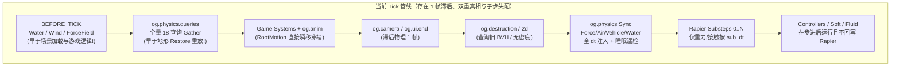
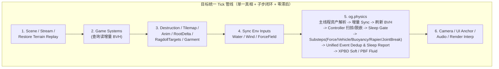

# Origin Engine 物理机制深度源码审计报告

> 审计范围：`og-physics`（约 21.7k 行）、`og-physics-data`、`og-runtime` 物理/破坏/服装/地形/瓦片/提取绑定、`og-anim` 物理动画约束（`SpringBone`/`IK`/`FootLock`/`Hang`/`Trs`）、`og-env`（风场/力场/海洋/河流）、`og-cook`（碰撞体与破碎烘焙）、`og-render` GPU 视觉模拟（布料/柔体/MLS-MPM 流体/碎片/水面）及 `wasm-modules.json`、`og-api` IDL。所有问题均经源码行号逐一核实。

---

## 0. 物理管线全景与核心架构失配

当前引擎物理已覆盖 9 大机制（刚体与关节、场景查询、3D/2D 角色与平台控制器、3D/2D 布娃娃、3D/2D 载具与传动系、绳索/布料/柔体/服装、水体/浮力/河流、2D/3D 粒子流体、3D 预破碎应力破坏与 2D 像素地形破坏），但在**调度时序、数据真相源、求解器代数模型与 CPU/GPU 边界**上存在结构性割裂：

---

## 一、全物理机制现存问题深度剖析

### 1.1 核心刚体、碰撞器、ECS 同步、休眠、查询、持久化与多线程（Lanes）

#### 严重缺陷（Critical / High）

1. **`Parent { entity: 0 }` 与已销毁父实体静默挂载到无关活体刚体/载具**
   - [kept.rs](../crates/og-physics/src/gather/kept.rs#L108-L124) 中 `ByEntity<T>` 仅以 `e.index()` 索引 `Vec<Option<T>>`，**从未校验 `e.generation()`**。
   - [gather.rs](../crates/og-physics/src/gather.rs#L434-L443) 读取 `Q_PARENTS` 时未过滤 `*parent == 0`。由于 `Entity::from_bits(0).index() == 0`，任何带默认/清空 `og.Parent { entity: 0 }` 的碰撞体都会通过 `bodies.get(parent)`（[gather.rs](../crates/og-physics/src/gather.rs#L270-L291)）**静默作为复合子碰撞体挂到活体 0 号槽实体上**；已销毁父实体槽位被复用到新刚体/载具时同理发生跨实体串扰。

2. **非骨骼父级 `og.Parent` 层级被静态碰撞体及 `fixed`/`kinematic` 刚体完全忽略**
   - [gather.rs](../crates/og-physics/src/gather.rs#L453-L472) 与 [gather.rs](../crates/og-physics/src/gather.rs#L504-L518) 仅在 `under_parent_frame(...)`（骨骼挂载）为真时计算世界矩阵。
   - 任何挂载在普通容器/房间/关卡根节点 `og.Parent` 下的静态碰撞体或刚体，都被放在**局部坐标**（原点附近），与渲染的 `MatrixWorld` 彻底错位，直接违背物理世界坐标契约。

3. **复合刚体质量双倍计入且 `centerOfMass` 失效/错位**
   - [stepping.rs](../crates/og-physics/src/rigid/sim/stepping.rs#L171-L191) 将 `body.mass` 按比例分摊给自身 `m[0]` 和子碰撞体 `m[1..]`，随后对自身调用 [colliders.rs](../crates/og-physics/src/rigid/sim/colliders.rs#L216-L242) 的 `centred()`。
   - 当 `centerOfMass != 0` 且 `body.mass > 0` 时，`centred()` 第 235 行直接执行 `mp.set_mass(body.mass, true)`，**无视 `m[0]` 覆盖为 100% 整车质量**，叠加子碰撞体份额后总质量最高暴涨至 **200%**；若复合体只有子碰撞体（父实体无 `Collider`），`centerOfMass` 直接被忽略。

4. **Sensor（触发器）碰撞体错误向动态刚体贡献真实质量和转动惯量**
   - [colliders.rs](../crates/og-physics/src/rigid/sim/colliders.rs#L196-L203) 与 [stepping.rs](../crates/og-physics/src/rigid/sim/stepping.rs#L224-L253) 未跳过 `c.sensor == true`。给 1 kg 动态抛射物挂一个半径 10 m 的传感器球，会赋予其 **4,188 kg** 质量或抢走主体 99.9% 质量。

5. **`Rest::Still` 静止规则将任意低于 `restSpeed / dt` 的加速度永久粘死**
   - [readback.rs](../crates/og-physics/src/rigid/sim/readback.rs#L299-L310)：当 `rest_speed = 0.02`（默认）、60 Hz 时，任意接触表面的动态刚体若单帧速度增量 `< 0.02 m/s`（即净加速度 `< 1.2 m/s²`，120 Hz 下 `< 2.4 m/s²`——例如 6° 无摩擦冰面、轻风吹拂、低重力、100 kg 物体受 100 N 推力、慢速传送带），每帧都会被**硬重置回 `pre` 位置并清零速度**，永远无法启动。
   - `supported` 仅看最小穿透深度 `d >= -0.002`，不检查接触法线方向——低重力下擦碰垂直墙面或天花板也会被永久钉在半空。

6. **休眠系统多重逻辑与性能缺陷**
   - **步中唤醒丢帧**（[readback.rs](../crates/og-physics/src/rigid/sim/readback.rs#L181-L183), [L283-L285](../crates/og-physics/src/rigid/sim/readback.rs#L283-L285)）：检查步前快照 `sleeping[i]` 而非步后 `rb.is_sleeping()`，导致碰撞唤醒的刚体整整 1 帧不回写 `Transform`/`Velocity`。
   - **修改 `Physics.gravity` 永不唤醒休眠体**（[bodies.rs](../crates/og-physics/src/rigid/sim/bodies.rs#L258)）：翻转重力/失重后所有休眠体悬停不动。
   - **`airDrag` 与 `ForceField` 引发无限 `BodySlept`/`BodyWoke` 抖动**（[air.rs](../crates/og-physics/src/rigid/air.rs#L28-L31), [forces.rs](../crates/og-physics/src/rigid/forces.rs#L29-L32)）：每帧无条件 `set_linvel(..., true)` 唤醒并同时**绕过 `RigidBody.lock` 锁轴约束**（导致锁轴刚体被风/力场推离锁定轴）。
   - **布娃娃骨骼与 2D 载具车轮永不休眠且毒化整个接触岛**（[sleep.rs](../crates/og-physics/src/rigid/sleep.rs#L195-L246)）：未在 `scene.bodies` 中的动态体 `ok[idx]` 恒为 `false`。
   - **`wake_touching` 复杂度 $O(\text{depth} \cdot (E + J))$**（[sleep.rs](../crates/og-physics/src/rigid/sleep.rs#L70-L107)）：不动点循环每轮重新遍历分配全图所有接触边与关节。

7. **连续力与 `substeps > 1` 数值失配**
   - [stepping.rs](../crates/og-physics/src/rigid/sim/stepping.rs#L320-L378) 与 [bodies.rs](../crates/og-physics/src/rigid/sim/bodies.rs#L455-L478)：`applyForce`/`applyTorque`、`airDrag`、`ForceField`、`vehicles`、`water`/`buoyancy` 都在 `0..substeps` 循环**之前**按完整 `dt` 一次性施加冲量，而 Rapier 重力/碰撞按 `dt / substeps` 步进。
   - 在 $S = 4$ 子步的反重力房间（`+g` 力场抵消 `-g` 重力）中，物体每帧向上漂移 $\frac{S-1}{2S} g \Delta t^2 = 0.375 g \Delta t^2$；且子步间瞬态弹跳碰撞会被 [stepping.rs](../crates/og-physics/src/rigid/sim/stepping.rs#L112-L127) 丢弃（零碰撞事件）。

8. **多线程 Lanes 激活时 `mesh_source` 读取主线程 TLS 导致直接报错**
   - [stepping.rs](../crates/og-physics/src/rigid/sim/stepping.rs#L289-L298) 将含 `sync()` 在内的整个 `step_here` 派发到 Rayon / Web Worker 池。
   - 当延迟加载的 glTF 网格首次触发 [colliders.rs](../crates/og-physics/src/rigid/sim/colliders.rs#L5-L12) 的 `mesh_source` 回调（[modules.rs](../crates/og-runtime/src/bind/modules.rs#L115-L117), [L717-L724](../crates/og-runtime/src/bind/modules.rs#L717-L724)）时，工作线程上的线程局部 `ENGINES` 为空，**开启 Lanes 报 `NotFound` 失败，关闭 Lanes 则成功**。

9. **序列化通过原始字节子串查找抠洞（静默快照损坏 + $O(N \cdot M)$ 卡顿）**
   - [rigid/sim/persist.rs](../crates/og-physics/src/rigid/sim/persist.rs#L67-L112) 硬编码 Rapier `PhysicsWorld` 字段顺序，重复序列化世界 2–3 次，并用 `full[at..end].windows(shape.len()).position(...)` 匹配资产形状字节。
   - 一旦前方非资产碰撞体（如 `GENERATED_MESH` 瓦片碰撞体）恰含相同形状字节，会**把洞打在错误的碰撞体上**导致恢复后静默数据损坏；任何 Rapier 版本字段调整也会静默失效。

10. **世界原点偏移 `Sim::shift()` 破坏 `ContactHook`、醒体碰撞器位姿与父级对象**
    - [sim.rs](../crates/og-physics/src/rigid/sim.rs#L389-L401)：有休眠体时调用 `w.detect_collisions(&(), &())` 传入空钩子，**破坏 `ignore` 与单向平台状态**；无休眠体时跳过 `detect_collisions`，令刚体子碰撞器停留在旧坐标；对带 `og.Parent` 的骨骼挂载体/静态体跳过了 `t.position` 平移或未清 `static_runs`，导致下帧瞬移或永久错位。

11. **场景查询 `QueryWorld` 的正确性缺陷与严重性能架构浪费**
    - **复合体自命中**（[queries.rs](../crates/og-physics/src/rigid/sim/queries.rs#L17-L20)）：`QueryFilter.exclude` 仅比对低 64 位 `entity_of(c)`，未检查高 64 位 `body_of(c)`，排除自身刚体时射线仍击中自己的子碰撞体。
    - **`Quat::ZERO` 与 2D 复合体查询错位**（[queries.rs](../crates/og-physics/src/rigid/sim/queries.rs#L42-L55)）：直接用原始 `b.quaternion * child.position` 而非 `pose()`，零四元数将子碰撞体折叠到原点。
    - **分块高度场 `raycast_all` 重复返回同实体多次命中**（[queries.rs](../crates/og-physics/src/rigid/sim/queries.rs#L186-L217)），且 `raycast` 丢弃 `t == max` 边界命中；负值/`NaN` 的 `max_distance` 静默变为 `f32::MAX`（[query.rs](../crates/og-physics/src/rigid/query.rs#L35-L37)）。
    - **每帧全量重建 BVH + 18 查询空转**（[lib.rs](../crates/og-physics/src/lib.rs#L274-L343)）：`og.physics.queries` 每帧开头执行全量 18 个 ECS 查询（含关节/绳索/布料/流体等无关数据），首次查询从零构建整套 `BroadPhaseBvh` + `ColliderSet` 并在下帧销毁；Tick 外每次查询均全量重建。同时 `QueryWorld` 缺失布娃娃和 2D 车轮碰撞体且忽略 `ContactHook`。

12. **其他刚体与几何缺陷**
    - **镜像缩放错位**（[colliders.rs](../crates/og-physics/src/rigid/sim/colliders.rs#L27), [L245](../crates/og-physics/src/rigid/sim/colliders.rs#L245)）：`shape()` 取 `scale.abs()` 而 `offset` 取有符号 `scale`，负缩放下非对称凸包/三角网格未镜像但偏移反号；旋转子碰撞体在非均匀父缩放下 `scale: s * body.scale` 沿错轴拉伸（[gather.rs](../crates/og-physics/src/gather.rs#L498)）。
    - **任意非休眠属性修改均销毁重建刚体**（[bodies.rs](../crates/og-physics/src/rigid/sim/bodies.rs#L105-L134)）：调阻尼/重力倍率/摩擦/碰撞层直接拆重建刚体，丢失 Warm-Start 并连带重置关节零位。
    - **静止运动学体每帧强制唤醒**（[bodies.rs](../crates/og-physics/src/rigid/sim/bodies.rs#L147), [L323-L324](../crates/og-physics/src/rigid/sim/bodies.rs#L323-L324)）；缺少 `is_finite()` 校验允许 `NaN` 毒化 Rapier；零尺寸高度场触发除零；2D 轮廓提取 `-0.0`/`+0.0` 哈希裂开与 8 字交叉环、开放链连出跨屏幻影墙（[outline.rs](../crates/og-physics/src/rigid/outline.rs#L27-L157), [dim2.rs](../crates/og-physics/src/dim2.rs#L179)）。

---

### 1.2 关节（Joints）与接触钩子（ContactHook）

1. **开关马达或改限位即重建关节并篡改铰链零位**
   - [joints.rs](../crates/og-physics/src/rigid/joints.rs#L113-L126) 的 `structure()` 未排除 `motor`、`limits`、`min`、`max`、`collide`、`rest_length`、`length`。
   - 运行时关闭铰链马达（`MOTOR_VELOCITY -> MOTOR_NONE`）触发销毁重建，第 219 行按两刚体**当前瞬时姿态**重算 `frame1`，导致零角度与 `[min, max]` 永久偏移（同时使 [joints.rs](../crates/og-physics/src/rigid/joints.rs#L152-L158) 成为不可达死代码）。
2. **`joint_load` 扭矩物理错误且 `breakForce` 对冲击/爆炸完全失明**
   - **弹簧/绳索力方向错误**（[dim3.rs](../crates/og-physics/src/dim3.rs#L289-L298), [dim2.rs](../crates/og-physics/src/dim2.rs#L220-L228)）：用 `f1.rotation`（刚体 1 局部 X 轴）而非真实锚点连线方向旋转线性冲量，再做 `lever.cross(linear)`，在纯拉力的绳/弹簧和无摩擦自由铰链/球窝关节上凭空捏造巨大力矩（若 `body2` 是原点距锚点 50 m 的静态墙，凭空放大 50 倍力矩误断 `breakTorque`）。
   - **冲击失明**（[stepping.rs](../crates/og-physics/src/rigid/sim/stepping.rs#L363-L374), [joints.rs](../crates/og-physics/src/rigid/joints.rs#L346-L372)）：仅取 Rapier 最后一次内部迭代冲量除以 `dt / num_solver_iterations`，在第一次迭代就被吸收的碰撞冲击、爆炸、`applyImpulse`、`applyForce` 完全不计入，且断裂阈值随 `solverIterations` 漂移。
3. **`ContactHook` 句柄顺序非确定性与功能残缺**
   - [stepping.rs](../crates/og-physics/src/rigid/sim/stepping.rs#L482-L506)：按 Rapier 内部 Arena 句柄顺序依次遍历 `(h1, 1.0)`、`(h2, -1.0)`，导致双方都带 `ContactHook` 时 `h2` **直接覆盖** `friction`、`restitution` 和 `tangent_velocity`（应叠加传送带相对速度，且句柄序非确定）；双方均设 `one_way` 会互相踩坏流形单一 `user_data`；不支持复合体父级挂载 `ContactHook`；开启传送带不唤醒休眠物体。
4. **多碰撞体共享实体 ID 每帧刷屏虚假 `CollisionStarted`/`SensorEntered` 事件**
   - [tick.rs](../crates/og-physics/src/tick.rs#L199-L238) 对 `previous` 执行了 `dedup()`（剩 1 条），但未对 `current` 去重（布娃娃 $K$ 根骨头或 2D 载具 2 个车轮触地产生 $K$ 条相同 `(a, b, sensor)` 记录），导致**此后每一帧永久发送 $K-1$ 条虚假 `CollisionStarted` / `SensorEntered`**。

---

### 1.3 角色控制器（3D/2D）与 2D 平台控制器

1. **擦边命中提前退出导致穿墙/穿地（灾难级）**
   - [mover.rs](../crates/og-physics/src/character/mover.rs#L126-L132) 与 [L167-L172](../crates/og-physics/src/character/mover.rs#L167-L172)：当最近的 `cast_shape` 命中擦边墙面/三角缝隙且 `0 < -dir.dot(n) <= 1e-4` 时，直接执行 `pos += rem; break;`，**直接穿透擦边点后方的任何实心墙壁**；[mover.rs](../crates/og-physics/src/character/mover.rs#L252-L254) 的 `settle()` 同理，擦到垂墙即返回 `free` 穿地坠落。
2. **完全缺失脱嵌（Depenetration）恢复与阶梯边缘 `skin / n.y` 悬空跳变**
   - [mover.rs](../crates/og-physics/src/character/mover.rs#L84-L104) 使用 `stop_at_penetration: false` 且无任何 MTD 推离流程；平台快速上升、推门或出生重叠时直接卡死或漏穿。
   - [mover.rs](../crates/og-physics/src/character/mover.rs#L218-L231), [L255-L270](../crates/og-physics/src/character/mover.rs#L255-L270)：胶囊擦到台阶棱角时 `n.y` 很小，`skin / n.y` 爆炸到数十厘米；`edge_top()` 不校验是否命中同一碰撞体，只要上方 5 cm 内有可行走面就会误判着地并向上弹出悬空。
3. **单平面滑行在“斜坡+侧墙”处死锁，且完全无视 `ContactHook`**
   - [mover.rs](../crates/og-physics/src/character/mover.rs#L116-L145) 无双平面交线（Crease）求解，且第 142 行 `s.y.min(0.0)` 在角色斜着贴墙上坡时直接清零爬坡的向上分量，将角色顶死在斜坡上。
   - `Mover` 通过 `QueryPipeline` 投射，完全绕过 `ContactHook`，导致角色无视 `oneWay`、传送带 `surfaceVelocity` 和 `ignore`。
4. **控制器在 Rapier 步进之后运行且不回写 Rapier（引发 5 重级联 Bug）**
   - [stepping.rs](../crates/og-physics/src/rigid/sim/stepping.rs#L318-L397)、[bodies.rs](../crates/og-physics/src/rigid/sim/bodies.rs#L137-L140)：
     1. **瞬移横扫爆炸**：`set_next_kinematic_position` 始终被调用，角色传送/复活时无限质量胶囊以 `距离/dt` 扫穿全图炸飞刚体；
     2. **子步速度倍增**：多子步下仅在子步 0 以 `substeps ×` 倍速猛撞动态体；
     3. **双重推力无视 `pushBodies: false`**：`push()` 推一次，下帧 Rapier 运动学解算器再无限质量硬推一次；
     4. **多角色穿模、柔体碰撞与触发器滞后**：角色 B 与柔体/布料看到的都是角色 A 上一帧位置，传感器事件延迟 2 帧；
     5. **`BodyWoke` 事件永久丢失**：`push()` 在 `sleep::report()` 之后才唤醒休眠箱子。
5. **移动平台承载与推箱力学错误**
   - **复合移动平台零承载**（[characters.rs](../crates/og-physics/src/character/characters.rs#L51-L54), [L147](../crates/og-physics/src/character/characters.rs#L147), [carry.rs](../crates/og-physics/src/rigid/carry.rs#L22-L24)）：`c.ground` 存子碰撞体 ID，而 `carry::body_of` 仅查 `sim.bodies` 根刚体表，船甲板/多部件电梯完全不带人。
   - **未扫掠直接瞬移进墙**（[characters.rs](../crates/og-physics/src/character/characters.rs#L111) `start = foot + ride`），且只用胶囊中心点做平移、无旋转平台偏航角跟随、速度读数违背文档不含平台速度。
   - **推力无视接触点力矩且踩板自重按板子质量算**（[carry.rs](../crates/og-physics/src/rigid/carry.rs#L57-L72)）：踩 100 kg 木板比踩 10 kg 木板重 10 倍，且踩翘翘板一端零力矩。
   - **大坐标 f32 精度误判天花板**（[characters.rs](../crates/og-physics/src/character/characters.rs#L138), [mover.rs](../crates/og-physics/src/character/mover.rs#L318)）：`> 2048 m` 处 ULP `> 1e-4`，起跳即被误判撞天花板清零竖直速度；`CHARACTER_BUMPED` 从未发出；入水时按住上浮瞬间将 `-15 m/s` 坠速清零如撞水泥（[characters.rs](../crates/og-physics/src/character/characters.rs#L225-L228)）；河流载流在脚趾刚沾水时从 0% 跳变 100%（[L106](../crates/og-physics/src/character/characters.rs#L106)）。
6. **2D `PlatformerController` 专项缺陷**（[platformer.rs](../crates/og-physics/src/character/platformer.rs)）
   - **下落侧 `apexGravity` 为死代码**（[L144-L150](../crates/og-physics/src/character/platformer.rs#L144-L150)）：`if vy < 0.0` 抢先匹配，顶点后重力从 `0.6g` 突跳 `1.8g`。
   - **修改 `Physics.gravity` 破坏 `jumpHeight`/`timeToApex`**（[L140-L143](../crates/og-physics/src/character/platformer.rs#L140-L143)）；`jumpHeight == 0` 令重力归零飘空。
   - **单向平台不支持斜面、硬编码 `0.25 s` 下落计时器一次漏穿多层、侧面挡路且 `ground_is_one_way` 全图线性扫描**（[L29-L35](../crates/og-physics/src/character/platformer.rs#L29-L35), [L108](../crates/og-physics/src/character/platformer.rs#L108), [L322-L327](../crates/og-physics/src/character/platformer.rs#L322-L327)）；下穿平台不清除土狼时间；空中超速时按前进键比松手减速快近 2 倍（[L118-L133](../crates/og-physics/src/character/platformer.rs#L118-L133)）；45°–50° 可行走斜坡误触发滑墙/蹬墙跳；双墙窄道恒偏右墙；顶角修正可穿薄墙且不计 `skin`。

---

### 1.4 布娃娃（Ragdoll）与物理-动画耦合（`SpringBone` / `IK` / `RootMotion`）

1. **布娃娃硬编码 `BONE_GROUP = 1 << 31` 导致与自身胶囊剧烈炸飞且无法叠尸**
   - [ragdoll.rs](../crates/og-physics/src/character/ragdoll.rs#L23), [L99-L112](../crates/og-physics/src/character/ragdoll.rs#L99-L112)：角色自身 `Collider` 默认 `mask = u32::MAX`（包含第 31 位），激活 `weight = 1` 时骨骼在角色胶囊内重叠**瞬间炸飞**；所有布娃娃共用 `!BONE_GROUP` 导致尸体互相穿透、肢体不能自碰撞、遇到自定义 `mask` 地面直接漏穿。
2. **缩放错位（`scale²` 坍缩）、关节错轴与手指骨骼爆炸**
   - [physics_ext.rs](../crates/og-runtime/src/bind/physics_ext.rs#L676-L739), [L797-L821](../crates/og-runtime/src/bind/physics_ext.rs#L797-L821), [L906-L921](../crates/og-runtime/src/bind/physics_ext.rs#L906-L921)：构建和同步目标时忽略实体 `Transform.scale`，渲染回写却乘 `world_of(e).inverse()`，厘米导出（`scale = 0.01`）或放大 Boss 直接坍缩/撕裂。
   - `rig_from_skeleton` 为所有 65 根蒙皮骨骼（含 30 根 0.02 m / 0.05 kg 手指骨）全部创建刚体关节，质量比悬殊导致 4 迭代解算器拉丝爆炸；且 3D 关节限位 [dim3.rs](../crates/og-physics/src/dim3.rs#L272-L281) 无视骨骼轴向 `b.axis`，全局对称限位允许膝肘反折 ±51.6°。
   - 切入布娃娃时**不传递角速度**、按骨骼原点而非质心算线速度、**按根数均分 `impulse / n`** 导致手指/头骨以躯干 200 倍速度飞出（[ragdoll.rs](../crates/og-physics/src/character/ragdoll.rs#L221-L225)）；实体 `Transform` 不跟随骨盆导致视锥剔除消失、`Garment`/`BoneAttachment` 留在原地；无渲染插值导致高刷屏卡顿；`mass`/`thickness`/`jointLimit` 标为 `tunable` 但运行期修改完全无效。
3. **`og-anim` 严重数学 Bug 与崩溃**
   - **`Trs::inverse()` 在非均匀缩放+旋转下数学错误**（[xform.rs](../crates/og-anim/src/xform.rs#L48-L64)）：因 $S$ 与 $R$ 不可交换，配合内置挤压拉伸动画 `og.tween.squash` 在世界坐标 100 m 处可注入 **45 米**级错误，直接污染 `SpringBone`、`FootLock`、`IkChain` 与 `RootMotion::pin`。
   - **`ik::two_bone()` 在极短骨骼（`< 1e-6`）处硬 Panic**（[ik.rs](../crates/og-anim/src/ik.rs#L174-L184) `clamp(min > max)`）。
   - **`og.Hang.point`/`anchor` 漏加 `WorldOrigin` 偏移**（[origin.rs](../crates/og-runtime/src/world/origin.rs#L38-L47)），触发世界原点重设后悬挂角色瞬移。
   - **`SpringBone` 缺陷**（[constraints.rs](../crates/og-anim/src/system/constraints.rs#L193-L380)）：`frequency == 0`（垂挂摆动）导致阻尼 `c = 2 * zeta * omega == 0` 永动不衰减；仅测末端点不测骨段、单次顺序推离、瞬移/碰撞后 `(x - x0)/dt` 抽风、无视 `og.Parent`/`JointLimit`/`og.Wind`/世界碰撞体、非对称缩放下 `reach` 与节点缩放差 100 倍。
   - **Root Motion 直接修改 `Transform` 穿墙**（[og-anim/src/system.rs](../crates/og-anim/src/system.rs#L1063-L1068)），且骨骼挂载运动学武器碰撞箱以零速度瞬移（[bodies.rs](../crates/og-physics/src/rigid/sim/bodies.rs#L320)）。

---

### 1.5 载具物理（3D Raycast / 2D Wheel-Joint / Drivetrain）

1. **3D `side_impulse` 转动惯量量纲错误（$I^{-2}$ 误作 $I^{-1}$，继承自 Rapier 0.36.1 上游 Bug）**
   - [raycast_vehicle.rs](../crates/og-physics/src/vehicle/raycast_vehicle.rs#L741-L756)：计算 `iaj = effective_world_inv_inertia * aj` 后写了 `iaj.gdot(iaj)`（即 $a_j^T I^{-2} a_j$），而非正确的 $a_j^T I^{-1} a_j$。
   - 对 1,000 kg 汽车（$I_{yy} \approx 1350$），惯量项偏小 **1,350 倍**，横向冲量放大 **2.25 倍**（过修正/甩尾震荡）；对 1 kg 小车偏大 **1,000 倍**（冰面打滑）。
2. **休眠 3D 载具每帧累积 `+9.81 m/s` 垂直速度 -> 唤醒瞬间发射入轨**
   - [vehicle3.rs](../crates/og-physics/src/vehicle/vehicle3.rs#L196)、[raycast_vehicle.rs](../crates/og-physics/src/vehicle/raycast_vehicle.rs#L435-L450)：休眠动态底盘仍执行 `update_vehicle`，调用 `apply_impulse_at_point(..., false)` 在不唤醒的情况下持续往 `linvel.y` 注入悬架力（同时不跑重力），唤醒即一飞冲天；且第 437 行 `wheel.engine_force > 0.0` 导致**倒车永不唤醒休眠车辆**。
3. **3D 载具数值、稳定性与多轮崩溃缺陷**
   - **除零 `NaN` 毒化**（[raycast_vehicle.rs](../crates/og-physics/src/vehicle/raycast_vehicle.rs#L684)）：锁轴或翻车顶墙时 `denom0 + denom1 == 0` 直接输出 `NaN` 冲量。
   - **第 0 帧空 `broad_phase` & 1 帧陈旧 BVH**（[stepping.rs](../crates/og-physics/src/rigid/sim/stepping.rs#L318-L327)）：车轮射线在 `broad_phase` 更新前投射，第 0 帧全漏穿地板。
   - **多轮侧向阻尼指数发散**（[raycast_vehicle.rs](../crates/og-physics/src/vehicle/raycast_vehicle.rs#L534-L539), [L759](../crates/og-physics/src/vehicle/raycast_vehicle.rs#L759)）：`SIDE_FRICTION_DAMPING = 0.2` 不随 `dt` 缩放也未除以接地轮数，6 轮卡车每帧反向过冲（1.2×），10 轮以上（API 支持至 16 轮）直接**横向爆炸**。
   - **运动学地面被过滤 + 悬架阻尼无视地面速度 + 擦墙 10× 无阻尼爆炸**（[raycast_vehicle.rs](../crates/og-physics/src/vehicle/raycast_vehicle.rs#L389-L403), [L536](../crates/og-physics/src/vehicle/raycast_vehicle.rs#L536)）：车停在移动渡轮上被横向甩下；射线长度 `rest + radius` 令悬架伸张行程（Droop）成为死代码；`driftGrip` 引发 **30 Hz 奈奎斯特抖动**（[vehicle3.rs](../crates/og-physics/src/vehicle/vehicle3.rs#L277-L311)）；隐藏的 `grip * 5.0` 与 `FORWARD_GRIP_SHARE = 0.5` 令默认抓地力高达 **10 G 横向 / 20 G 纵向**；3D 无视地面碰撞体摩擦与 `ContactHook`；同时踩油门+刹车在 3D 忽略刹车、在 2D 忽略油门。
4. **传动系（`drivetrain.rs`）死区与逻辑错误**
   - **0.5–1.0 m/s 前进/倒车死区**（[drivetrain.rs](../crates/og-physics/src/vehicle/drivetrain.rs#L109-L112), [L157-L158](../crates/og-physics/src/vehicle/drivetrain.rs#L157-L158)）：速度落在该区间时反踩油门产生零扭矩且零刹车；倒溜坡时 `speed.abs()` 竟使自动挡**升入 2 挡**并触及断油转速锁死前进扭矩；换挡空档期间油门飙红线；无齿轮滞回可无限来回跳挡；默认挂空挡导致起步强制 0.25 s 延迟。
5. **2D 载具严重缺陷（[vehicle2.rs](../crates/og-physics/src/vehicle/vehicle2.rs)）**
   - 悬架使用默认 `MotorModel::AccelerationBased` 却又乘 `chassis_mass`（[L200-L201](../crates/og-physics/src/vehicle/vehicle2.rs#L200-L201)），对 1,000 kg 车辆刚度/阻尼偏大 **1,000 倍**（$\zeta = 11.5$ 焊死）；刹车力矩无故乘 `10.0`（[L212](../crates/og-physics/src/vehicle/vehicle2.rs#L212)）；瞬移底盘遗留车轮导致关节爆炸；调整 `grip` 销毁重建车轮清零转速；每帧刷屏假 `CollisionStarted`；永不休眠。
   - `og.VehicleWheel` 复用 `Transform.position` 作悬架硬点，若在同实体上按 `vehicleWheels()` 更新视觉位置会引发每帧下沉与全量重建（[gather.rs](../crates/og-physics/src/gather.rs#L581)），且扫描全图父子实体。

---

### 1.6 柔体、布料、绳索、服装（CPU + GPU 视觉模拟）

1. **CPU Verlet PBD 刚度依赖 `dt`/子步/迭代且改 `substeps`/慢动作污染速度**
   - [verlet.rs](../crates/og-physics/src/soft/verlet.rs#L54-L74), [softbody.rs](../crates/og-physics/src/soft/softbody.rs#L413-L449)：无 XPBD 柔度项 $\alpha/\Delta t^2$，默认 16 次投影下 `stiffness = 0.5` 等效刚度 `0.999985`；切换慢动作（`scaled_dt`）或 `substeps` 不重缩放 `points - previous`，动能可瞬间跳变 16 倍；CPU `Cloth` 完全没有弯曲约束（Bending），自碰撞仅顶点-顶点无点面/边边检测，且速度截断 `0.5 * thickness` 导致默认自由落体限速 `1.5 m/s`。
2. **`Garment` 碰撞推离保持速度 -> 接触地面无限累积重力**
   - [garment.rs](../crates/og-physics/src/soft/garment.rs#L240-L270)：推离固体后第 268 行无条件 `self.previous[i] += p - before`，法向碰撞速度永不清零，重力持续累积；`backstop` 是平面半空间而非球体，且 `backstop`/`maxDistance` 未随角色缩放；`gust` 按顶点索引哈希而非空间坐标导致抖动；传送无阈值保护。
3. **`SoftBody` 体积与梯度远距世界原点发生灾难性 `f32` 相消**
   - [softbody.rs](../crates/og-physics/src/soft/softbody.rs#L208-L226), [L486-L497](../crates/og-physics/src/soft/softbody.rs#L486-L497)：直接对世界坐标算 $p_a \cdot (p_b \times p_c)/6$ 与梯度（量级 $O(R^3)$、$O(R^2)$），在距原点 `>= 200 m` 时 24 位尾数耗尽，`1000 m` 处彻底变成噪声；且表面无四面体化，强挤压后永久翻转塌陷。
4. **共享碰撞推离 `Near::push_out` 把穿透点往 `TriMesh` 内部推**
   - [og-physics-data/src/trimesh.rs](../crates/og-physics-data/src/trimesh.rs#L18) 未设置 `TriMeshFlags::ORIENTED`，导致 [points.rs](../crates/og-physics/src/rigid/points.rs#L55-L76) 永远收不到 `is_inside = true`，布料/流体一旦越过三角面片就被反向推入网格内部；2D `Polyline` 同理；精确落在表面（`len <= 1e-9`）直接跳过碰撞；高度场仅查正下方单格导致撞悬崖后垂直瞬移；多碰撞体墙角只保留 Arena 顺序最后一个法线（既丢墙角又依赖槽位历史）；且线性遍历全图碰撞体无 BVH。
5. **`Rope.end` 只能挂刚体/静态体，且所有柔体仅在中点采样一次风场/力场**
   - [soft.rs](../crates/og-physics/src/soft/soft.rs#L6-L29) 绑到纯 `Transform` 实体静默失效；[soft.rs](../crates/og-physics/src/soft/soft.rs#L92-L99) 单点采样令漩涡/径向力场失效；所有柔体均单向耦合。
6. **GPU 视觉模拟（`visual_body.wgsl` / `extract/frame/colliders.rs` / `scene_colliders.rs`）严重 Bug**
   - **传感器变实墙**：[extract/frame/colliders.rs](../crates/og-runtime/src/present/extract/frame/colliders.rs#L30-L117) **完全未检查 `sensor`**，全图触发器都会弹飞 GPU 布料/柔体/流体/碎片！且忽略 `TriMesh`/`Convex`/`Cylinder`；负缩放产生负半径。
   - **全局共享 64×64 高度场补丁退化**：[scene_colliders.rs](../crates/og-render/src/fields/scene_colliders.rs#L102-L151) 将所有视觉体的包围盒合并为一块 64×64 补丁，相距 500 m 的两块布料共享 ~8 m 精度地形（且无视洞口）。
   - **风力奇点爆炸**：[visual_body.wgsl](../crates/og-render/shaders/visual_body.wgsl#L171-L202) 加速度按 $|v_{\text{rel}}|^2 / |\text{wind}|$ 缩放，角色在 `0.01 m/s` 微风中奔跑触发 **255 G 爆炸**。
   - **FTZ 非正规数破坏**：[visual_body.wgsl](../crates/og-render/shaders/visual_body.wgsl#L234-L262) 用 `bitcast<f32>(u32)` 在存储缓冲区存放小整数，符合 WGSL 标准的 FTZ GPU 可直接将其清零。
   - 边着色 `u128` 掩码在顶点数度 `> 127` 时数据竞争；`volumeStiffness < 1` 柔度偏弱 1000×；摩擦未按子步归一化；`visual_garment` 未应用骨架绑定变换；**所有 GPU 视觉柔体/布料/服装未接入 `RenderScene::rebase` 与 `WorldOrigin` 偏移**，超过 4096 m 彻底丢失全部碰撞体。

---

### 1.7 水体、浮力、河流与 2D/3D 粒子流体

1. **CPU 粒子流体 `fluid/solve.rs` 三大核心算法 Bug**
   - **单边半对压力缺失 `pressure[j]`（致命）**（[solve.rs](../crates/og-physics/src/fluid/solve.rs#L372-L403), [pairs.rs](../crates/og-physics/src/fluid/pairs.rs#L34-L40)）：无序对 `{i, j}` 仅存一份于 `i < j`，但松弛阶段**只算了 `pressure[i]` 完全漏掉 `pressure[j]`**！末位粒子 `rho[n-1]` 永不使用，高序号粒子撞墙无法反推；多流体分组中流体 1–3 在界面处的刚度/密度参数全被流体 0 覆盖忽略。
   - **平流前找邻对导致穿透与爆炸**（[solve.rs](../crates/og-physics/src/fluid/solve.rs#L309), [L339](../crates/og-physics/src/fluid/solve.rs#L339)）：相向粒子单子步可逼近 `1.0 * h`，平流后深度重叠却不在邻对表内，零排斥力直到下子步爆开。
   - **未截断黏度冲量直接爆炸**（[solve.rs](../crates/og-physics/src/fluid/solve.rs#L326-L330)）：Schema 允许 `viscosity <= 4.0`，但 `t * s > 2.0` 时相对速度反向放大呈指数爆炸；此外单步 DDR 深水柱可压缩 30–50%、多流体高密度比失稳、空间哈希 `i32` 溢出风险、发射器重粒子永久融合、完全单向无刚体浮力耦合。
2. **GPU 视觉流体 MLS-MPM（`visual_fluid.wgsl` / `visual_fluid.rs`）致命 Bug**
   - **`hash()` 返回 `[0, 2)` 而非 `[0, 1)`**（[visual_fluid.wgsl](../crates/og-render/shaders/visual_fluid.wgsl#L100)）：`f32(h >> 8u) / f32(1u << 23u)` 少除 2，喷嘴偏歪、生成盒偏移、发射拉长 2 倍。
   - 发射位置不钳制导致 P2G/G2P **越界写网格**（[L136](../crates/og-render/shaders/visual_fluid.wgsl#L136)）；定点 `i32`（`FIXED = 1e7`）在 Tait $\gamma = 5$ 强飞溅下溢出翻号；纯发射器（`count == 0`）液滴半径算成 **1.43 m 巨球**（[present/atmosphere/fluid.rs](../crates/og-runtime/src/present/atmosphere/fluid.rs#L119-L125)）；反射探针遗漏纯视觉流体；**每次 `WorldOrigin` 偏移或渲染 `rebase` 都会重置整池 GPU 流体**。
3. **水体、浮力与河流缺陷**
   - **浮力循环内顺序修改速度产生幽灵力矩与角阻尼发散**（[buoyancy.rs](../crates/og-physics/src/water/buoyancy.rs#L399-L414)）：在逐体素循环中边 `apply_impulse_at_point` 边读 `velocity_at_point`，结果依赖 `(i,j,k)` 遍历顺序，且未约束旋转稳定条件 `m_i r_i^2 / I`；每帧重建多达 `1728` 个采样点不缓存；大倾角船体按局部列中点查波高错位；2D 禁用 `og.Buoyancy`；矩形 `WaterBody` 丢弃旋转（渲染旋转、物理轴对齐）。
   - **多层水体与水体拼接错误**（[water/query.rs](../crates/og-physics/src/water/query.rs#L16-L52), [L144-L194](../crates/og-physics/src/water/query.rs#L144-L194), [surfaces.rs](../crates/og-physics/src/water/surfaces.rs#L185-L193)）：`water::level`/`at` 完全忽略 `point.y`，船从高架水渠下方海面经过直接读取高架水面冲上天；相邻重叠 `WaterSurface` 叠加施加 200% 浮力。
   - **`WaterLine`（2D）与 `WaterSurface`（3D）波动方程缺陷**：`WaterLine` 8 遍邻域传播**未乘 `dt` 也未除以网格间距**，显式欧拉 `damping * dt > 2` 直接发散（[line.rs](../crates/og-physics/src/water/line.rs#L113-L140)）；`WaterSurface` 超 CFL 时静默降波速而非子步、100% 刚性全反射边界、水平高速划船零尾迹、飞溅不乘 `dt`、AABB 浮力随旋转暴涨 3 倍（[surface.rs](../crates/og-physics/src/water/surface.rs#L126-L165)）。
   - **河流彻底不兼容 `WorldOrigin` 与 `RenderScene::rebase`**（[present/atmosphere/water.rs](../crates/og-runtime/src/present/atmosphere/water.rs#L83-L113), [frame/origin.rs](../crates/og-render/src/frame/origin.rs#L189-L194)）：每次 4096 m 原点重设河流跳飞 ±4096 m；且 `River::at` 是每采样列 $O(N)$ 线性扫最多 2048 段。

---

### 1.8 破坏系统（3D 预破碎/应力求解器 + 2D 像素地形）

1. **3D 脱落碎块在 Rapier 中轻了 1,000–2,600 倍**
   - [destruction/spawn.rs](../crates/og-runtime/src/bind/destruction/spawn.rs#L147-L175)：`spawn_chunk` 只保留 `["friction", "restitution", "layers", "mask"]`，**从未写入 `density`**，配合 `kind: "dynamic"`（`mass = 0`），Rapier 回退到默认 `1.0 kg/m³`，砖石/混凝土碎块像泡沫塑料一样乱飞，与应力求解器及 `Fractured.mass` 的真实密度差 3 个数量级。
2. **静态刚体破坏物丧失全部锚点、首帧/粉碎子块全部垂直向上炸飞**
   - [destruction/tick.rs](../crates/og-runtime/src/bind/destruction/tick.rs#L149-L153)：仅凭是否存在 `og.RigidBody` 就设 `moving = true`，**无视 `RigidBody.kind == fixed`**，导致静态体破坏物全部失去锚点一碰即塌；`mass_of()` 同样忽略 `kind` 把静态撞击体算成有限质量。
   - [destruction/islands.rs](../crates/og-runtime/src/bind/destruction/islands.rs#L47-L51) + [prop/blast.rs](../crates/og-physics/src/destruction/prop/blast.rs#L44-L45)：新粉碎子块不在步前 `poses` 中，回退位置竟传入爆炸中心 `point`，导致 `at - point == 0 -> normalize_or(Vec3::Y)`，**所有子块以最大中心冲量齐刷刷垂直射向天空**！
   - 旋转多块岛分裂时用根块质心代替复合刚体质心计算 `ang.cross(r)`；粉碎子块丢弃角速度杠杆项与首碎 `inherit` 速度；销毁 `Destructible` 实体后遗留的动态 `og.Chunk` 变为**不可见、不受 `maxChunks` 回收的幽灵刚体**（[tick.rs](../crates/og-runtime/src/bind/destruction/tick.rs#L167-L174), [draw.rs](../crates/og-runtime/src/bind/destruction/draw.rs#L60-L132)）。
3. **3D 应力求解器（Blast 移植）算法与物理模型缺陷**
   - **CGNR 收敛判据错配且静默吞掉不收敛**（[stress.rs](../crates/og-physics/src/destruction/stress.rs#L261-L308), [destruction.rs](../crates/og-physics/src/destruction.rs#L446,L485)）：用 $\|A^T r\|^2$ 比 $\|b\|^2$（应比 $\|A^T b\|^2$），且不收敛返回负数被 `unsigned_abs()` 丢弃并清除 `dirty`。
   - **弯矩臂长错用质心间距**（[destruction.rs](../crates/og-physics/src/destruction.rs#L452-L460)）对薄墙/扁砖偏差 3–10 倍；锚点与支撑键是**永不断裂的双边约束**（无拉砌体照样承受无限拉力和倾覆力矩）；砌体 `unsupported()` 将左右独立桥墩并成单个连续区间，悬空跨梁也能通过中三分之一校核（[L232-L265](../crates/og-physics/src/destruction.rs#L232-L265)）；`Damage::at` 未校验 `innerRadius <= radius`；爆炸无空间裁剪、无遮挡穿透实心墙；`draw.rs` 每帧重跑岛屿 BFS 与 `spread()`。
4. **2D 像素破坏地形（`terrain2d` / `destruction2d`）严重 Bug**
   - **洞口探针未归一化导致空洞静默消失变空气墙**（[terrain2d/collider.rs](../crates/og-physics/src/destruction/terrain2d/collider.rs#L149-L163)）：`probe` 按 `0.25 * (b - a)` 垂直偏移，合并后长 20–64 格的直边把探针射出洞外 5–16 格，导致空洞被丢弃或配错外环。
   - **无拓扑校核 DP 简化 + 荒诞 `轮廓 -> Earcut -> MeshDesc -> outline() -> Polyline` 往返**：DP 允许最大 4 格误差且不查自交，薄桥反转交叉后被 `outline.rs` 消边或翻面，产生破洞与废线。
   - **全局 $O(W \times H)$ 泛洪分离与全图 CPU/GPU 纹理重绘**：4096×4096 地形每挨一发子弹就全图洪泛 1,670 万像素 + 重绘并上传 **64 MB 纹理**；脱落块强制用单凸包丢失所有凹陷；修改地形颜色不自增 `revision` 永不刷新；多发同帧爆炸作用不对称；忽略旋转/缩放/父级且孤儿碎片不受 `maxPieces` 限制。

---

### 1.9 运行时集成、地形/瓦片地图、Cook 管线与 WASM 分包

1. **Tick 调度与预钩子时序倒置**
   - [registry.rs](../crates/og-runtime/src/registry.rs#L791-L810)：`Water`/`Wind`/`ForceField` 在 `BEFORE_TICK` 最前采集（早于场景加载、流式区块加载与游戏逻辑），导致整整 **1 帧滞后**；`og.physics.queries` 早于 `og.terrain` 的恢复重放（读档首帧射线打中旧地形）；`og.camera` 与 `og.ui.end` 跑在 `og.physics` 之前（相机与世界锚定 UI 恒慢 1 帧）；物体在同帧破碎时排队的 `applyImpulse` 被静默丢弃。
2. **地形高度场与瓦片地图碰撞问题**
   - **刷地表贴图（`mode == 4`）竟销毁重建 Rapier 高度场碰撞体**（[terrain/edit.rs](../crates/og-runtime/src/bind/terrain/edit.rs#L282-L288)），每笔刷都唤醒周围休眠物体并清空 Warm-Start！
   - `og.terrain.stamp` 漏增 `generation` 导致海底缓存永久过期；首挖洞/末填洞触发整张地形全量重建；无流式物理高度场（勾选 `collision` 即全量解码常驻 CPU）。
   - **Tilemap 碰撞体忽略 `og.Parent`/旋转/缩放**（[present/feel/tiles.rs](../crates/og-runtime/src/present/feel/tiles.rs#L536-L546)），移动或改 1 格即销毁重建全图所有层碰撞体；Tiled 碰撞导入仅取第 1 个 AABB，**静默丢弃多边形/斜坡/圆/旋转盒/多形状**（[cook/systems/tilemap.rs](../crates/og-cook/src/cook/systems/tilemap.rs#L555-L580)）；正交格贪心合并产生内部接缝鬼顶点（Ghost Vertex）卡脚。
3. **Cook 烘焙与 WASM 分包泄漏**
   - **WASM 主包泄漏**：`destruction::drawn`、`destruction2d::extract`、`destruction::load_asset` 未列入 [wasm-modules.json](../packages/engine/scripts/wasm-modules.json#L72-L83) 的 `entries`，`og_engine_frame` 的直接调用把 3D/2D 破坏模块拽进所有游戏的主包；且 3D Blast 与 2D 像素破坏被捆死在同一 `destruction` 包内。
   - **烘焙三角网格在任意非 `(1,1,1)` 缩放下全部作废**（[dim3.rs](../crates/og-physics/src/dim3.rs#L186)），即使缩放为 1 也在运行时做 $O(V+T)$ 逐位校验；3D 破碎 Cook 存储完整网格顶点数而非简化凸包（膨胀资产），非凸 Voronoi 键配对错误，锚点只支持轴对齐平面。
   - **多处 Reflection 默认值与 IDL 静默漂移**：`Fluid3D.radius`（0.5 vs 0.2）、`CharacterController.snapDistance`（0.5 vs 0.2）、`Vehicle.mountHeight`（0.5 vs 0.2）、`ProjectPointDesc.solid`（false vs true），因 `og-api/tests/modules.rs` 仅校哈希不校默认值与单位。

---

## 二、十大根因与根本性架构解决方案

上述 80+ 问题并非孤立 Bug，而是由以下 **10 个根本架构决策**直接派生。建议按“从根部修、不做表层补丁”的原则推进重构：

### 方案 1：建立统一的 Tick 阶段编排与主/工作线程边界
- **根治对象**：1 帧环境滞后、读档首帧地形查询陈旧、相机/UI 滞后、`mesh_source` 跨线程 TLS 崩溃、破坏同帧丢冲量。
- **架构方案**：
  1. 将 `Water`/`Wind`/`ForceField` 同步从 `BEFORE_TICK` 移至游戏系统与 `og.anim`/`og.destruction` 之后、`og.physics` 之前。
  2. 将 `og.camera`、`og.ui.end` 移至 `og.physics` 之后，并为刚体/布娃娃/载具车轮建立统一的 `(prev_pose, curr_pose)` 渲染插值表。
  3. 资产解析（`mesh_source`）与 ECS 增量收集在引擎主线程完成（或让渲染几何只读表 `Arc`-共享跨线程安全），仅将纯计算（Rapier 步进、XPBD、流体、查询）交给 `og-lanes`。

### 方案 2：以“增量原地更新 + 单一 BVH”替代全量销毁重建与影子 `QueryWorld`
- **根治对象**：改参数毁 Warm-Start、开关马达歪关节、每帧 18 查询空转与全图 BVH 重建、复合体自命中/缺布娃娃/无视 `ContactHook`。
- **架构方案**：
  1. 拆分刚体/碰撞体/关节属性为“拓扑级（仅形状/网格/类型/子结构变更时重建）”与“参数级（全部原地调用 Rapier setter 更新）”，关节保存显式参考帧而非重建时由现位反推。
  2. 彻底废除 `QueryWorld::build` 每帧重建，直接复用 `Sim.world` 增量维护的 `BroadPhaseBvh` + `ColliderSet`（Tick 开始前保留轻量快照或增量更新，Tick 外零重建 $O(\log N)$ 查询），在 `QueryFilter` 中同时检查 `entity_of`/`body_of` 与 `ContactHook`。
  3. 用带世代校验的 `ByEntity<T>(Vec<Option<(u32, T)>>)` 替代裸索引，过滤 `Parent { entity: 0 }`，统一所有实体（含普通 `og.Parent` 静态体/刚体）的世界矩阵合成与负缩放镜像绕序翻转。

### 方案 3：将所有连续外力、载具与浮力纳入子步循环，并重塑休眠与事件去重
- **根治对象**：多子步漂移、`RigidBody.lock` 越权、`Rest::Still` 粘死、休眠车发射入轨、休眠唤醒丢帧与抖动、瞬态碰撞丢失、多碰撞体事件刷屏、关节冲击断裂失明。
- **架构方案**：
  1. 在 `0..substeps` 循环内按 `sub_dt = dt / substeps` 施加连续力（`applyForce`、`airDrag`、`ForceField`、3D 载具、浮力），全部经 Rapier `add_force`/`add_torque`（天然服从 `locked_axes`），仅对瞬时 `applyImpulse` 在子步 0 施加。
  2. 接入 Rapier `EventHandler` 捕获子步内瞬态碰撞；对所有共享实体 ID 的碰撞对按 `(a, b, sensor)` 合并去重（累加冲量），彻底根治布娃娃/2D 车/分块地形重复事件。
  3. 修复休眠闭环：`sync` 后先刷 `broad_phase` 再跑 `sleep::before_step`（监听重力/`ContactHook`/控制输入变化唤醒）；跳步休眠载具；步后按真实 `rb.is_sleeping()` 回写；将 `wake_touching` 改为 $O(V_{\text{woke}})$ 邻接 BFS；将所有动态体纳入休眠岛（或启用 Rapier 确定性原生休眠）；用基于法线支撑判定的微速度阻尼取代会粘死小推力的 `Rest::Still`。
  4. 修复 `joint_load`：跨内部迭代/子步累计约束冲量以响应冲击，弹簧/绳索按真实锚点轴向分解，去掉自由铰链/弹簧上的伪 `lever × F` 项。

### 方案 4：无字节黑客的资产形状剥离与完整 `WorldOrigin` 偏移契约
- **根治对象**：`persist.rs` `windows().position()` 静默损坏快照、`Sim::shift()` 踩坏钩子、河流/GPU 视觉模拟/Hang 偏移错乱。
- **架构方案**：
  1. 序列化前直接把资产碰撞体的 `SharedShape` `Arc` 临时替换为零开销占位符，记录 `Vec<(ColliderHandle, ShapeKey)>`，单次 `encode(&sim)` 后换回 `Arc`；反序列化后按句柄回填 `SharedShape`——零字节扫描、$O(K)$ 开销、升级 Rapier 永不失效。
  2. `Sim::shift()` 传入有效 `Hooks` 并在无休眠体时同样同步刚体子碰撞器位姿；为 `og.Hang`、`atmosphere.rivers`、`VisualPipelines`（布料/柔体/服装 GPU 状态缓冲）、`VisualFluids` 和 `RenderScene::rebase` 实现统一偏移接口，确保 4096 m 漂移无缝连续。

### 方案 5：按 Jolt `CharacterVirtual` 范式重构 `Mover` 与角色控制器时序
- **根治对象**：擦边穿墙/穿地、零脱嵌、`skin / n.y` 悬空、斜坡侧墙死锁、1 帧滞后 5 大级联 Bug、复合平台不载人、平台器单向平台与重力 Bug。
- **架构方案**：
  1. 将控制器移至 `sim.world.step()` 之前（或与子步联动），步进完成后立即更新 Rapier 刚体位姿及 BVH；区分游戏瞬移（`set_position`）与正常位移；用角色显式 `mass` + 实际接触点冲量替代无限质量二次推挤。
  2. 重构 `Mover` 为 **4 步闭环**：① 迭代 MTD 脱嵌（解决移动门/升降台/缩放嵌入）；② 多面约束滑行（1 面滑、2 面交线 `n1 × n2`、3 面停；擦边命中改为排除重投而非 `pos += rem; break`）；③ 扫掠平台承载（用 `sim::body_of` 查根刚体 + 脚底接触点 + 偏航角旋转传递）；④ 接入 `ContactHook`（方向性单向平台、传送带、忽略列表）与局部相对位移算术（彻底消除 `> 2048 m` `f32` ULP 误差）。
  3. 2D `PlatformerController` 修复 `apex_gravity` 优先级、按 $\sqrt{g_{\text{scale}}}$ 缩放起跳速、按实体追踪下穿直到完全脱离包围盒（取代 `0.25 s` 硬编码）、修复超速前进减速与双墙偏置。

### 方案 6：基于真实车轮动力学与轮胎滑移模型重构载具与传动系
- **根治对象**：$I^{-2}$ 惯量量纲错、多轮横向发散、30 Hz 漂移抖动、10 G 假抓地、悬架无伸张行程、传动系死区/倒车升挡、2D 1000× 刚度与 10× 刹车。
- **架构方案**：
  1. 淘汰 Bullet 式 `btRaycastVehicle` 冲量补丁，构建确定性子步耦合车轮模型：为每个车轮维护真实角速度 $\omega_w$ 与转动惯量 $I_w$，计算相对地面接触点速度的纵向滑移率 $\kappa$ 与侧偏角 $\alpha$，采用 **Pacejka / Brush 组合滑移摩擦椭圆**（含低速静摩擦防溜坡与峰值-滑动衰减自然漂移）× 地面碰撞体材质摩擦；悬架采用半隐式弹簧-阻尼 + 渐进限位块 + 完整伸张行程 + 左右防倾杆。
  2. 传动系直接与驱动轮 $\omega_w$ 耦合（飞轮 + 离合器/液力变矩器 + 差速器 + 发动机制动 + 带滞回多挡降挡自动变速箱），彻底消除 `0.5..1.0` 死区与倒溜升挡。
  3. 2D 载具改为 `MotorModel::ForceBased`、删去 `* 10.0` 刹车乘数、原地改摩擦、底盘瞬移同步迁移车轮。

### 方案 7：将布娃娃与物理动画纳入统一骨架层级与 PD 驱动架构
- **根治对象**：自碰撞炸飞、缩放 `scale²` 坍缩、65 根手指骨失稳、局部/主动布娃娃缺失、`Trs::inverse` 数学错误、`SpringBone` 悬摆无阻尼。
- **架构方案**：
  1. 引入显式布娃娃部位配置 + 智能人形构建器（仅建 12–17 根主干/肢体胶囊，按实体世界缩放与**休息姿态**对齐骨骼轴向，膝肘用非对称铰链、肩髋用真锥扭限位）；按每具布娃娃独立碰撞过滤（排除自身胶囊与相邻骨，支持叠尸与非相邻自碰）。
  2. 转换布娃娃为骨骼局部旋转做层级 FK 混合（消除肢体缩短），支持骨盆同步 `Transform` 与渲染插值，支持 PD 关节马达（主动布娃娃/受击反应/部分肢体布娃娃）。
  3. 立即修复 `og-anim` 的 `Trs::inverse`（采用精确 $S^{-1}(R^T(p - T))$ 或 `Mat4::inverse`）、`two_bone` 退化防 Panic、`SpringBone` 独立阻尼与骨段迭代碰撞，并暴露 `Skeleton.rootDelta` 与角色控制器联动防穿墙。

### 方案 8：统一 CPU/GPU 柔体与流体至 XPBD + PBF/MLS-MPM，修复水体与双向耦合接口
- **根治对象**：Verlet `dt` 依赖、Garment 重力累积、SoftBody 远距相消、流体单边压力/平流前邻对/黏度爆炸、GPU 传感器实墙/风奇点/FTZ/`hash [0,2)`、浮力顺序偏差与水渠穿帮。
- **架构方案**：
  1. CPU 绳/布/服装/柔体统一升级为**显式速度小步 XPBD**（柔度 $\alpha / h^2$ 与步长无关、修正碰撞速度清除法向分量、所有体积/面积采用相对质心坐标 `p - p_ref`）；为 `TriMesh` 构建 `ORIENTED` 标记（或局部 SDF），进化 `Solids` 返回带速度与刚体句柄的接触流形以支持墙角多面求解与双向反作用冲量。
  2. CPU 流体立即热修三大 Bug（补全 `pressure[i] + pressure[j]`、平流后查邻对、钳制黏度 `<= u`），中长期升级为 **PBF（Macklin & Müller 2013）** + 确定性并行 gather；修复 GPU `visual_body.wgsl`（风力相对速度公式、禁用 `bitcast<f32>` 存整数）与 `visual_fluid.wgsl`（`hash` 除以 `2^24`、钳制发射坐标、`f32`/放宽定点尺度）；GPU 碰撞体提取过滤 `sensor` 并改为每体独立高度场补丁。
  3. 浮力缓存刚体局部体素/网格采样并在单快照内汇总净力与净力矩（配合指数角阻尼）；`water::level`/`at` 传入 `point.y` 支持水体垂向分层；`WaterLine` 改为 CFL 子步 1D 浅水波、`WaterSurface` 加子步与海绵吸收边；`River` 加空间索引。

### 方案 9：修复破坏系统的物理真相一致性与 2D 局部化增量管线
- **根治对象**：3D 碎块 1000× 过轻、静态体丢锚、子块齐飞 `+Y`、应力不收敛与双边锚点、2D 空洞消失/往返网格退化/64 MB 全图重绘。
- **架构方案**：
  1. 3D 碎块写入真实材料密度，按 `RigidBody.kind` 判定动静，以真质心位置与角速度杠杆计算分裂/粉碎速度与爆炸方向，独立跟踪脱管碎块的渲染与预算回收。
  2. 应力求解器修正 CGNR 范数判据、保留不收敛脏标与跨帧热启动，Cook 阶段预计算每个粘结面的真实截面惯性矩，支持无拉砌体/地基单边受压（Active-Set / PGS）以真实倾覆。
  3. 2D 像素破坏取消 `Earcut -> MeshDesc -> outline()` 往返（新增原生 2D 多边形/折线碰撞体，DP 增加防自交检查，归一化洞口探针）；将 `detach()` 改为**分块连通分量图**局部更新，将渲染改为**脏矩形 `write_texture` 局部上传**，脱落凹块改用 2D 凸分解复合碰撞体。

### 方案 10：补齐 Cook 管线、增量地形/瓦片物理与 WASM 强约束门禁
- **根治对象**：WASM 主包泄漏、刷贴图重建地形碰撞体、Tilemap 全图重建与丢斜坡、非 1 缩放作废烘焙、Reflection 默认值漂移。
- **架构方案**：
  1. 将 `destruction::drawn`、`destruction2d::extract`、`load_asset` 纳入 `wasm-modules.json` 入口守卫（并将 `destruction3d` 与 `destruction2d` 拆包），建立自动化分包体积回归检查。
  2. 地形编辑按模式分流（纯贴图绘制绝不触发物理重建），缓存分块高度场洞口切换；Tilemap 尊重父级/旋转/缩放、分块局部更新碰撞体、完整解析 Tiled 多边形/斜坡/圆/多形状并输出无内缝统一轮廓。
  3. 扩展 `og-api` 漂移检查覆盖默认值与单位；支持缩放复用的烘焙三角网格与 Cook 阶段凸包/凸分解烘焙。

---

## 三、引擎物理能力的系统性缺失清单

### A. Rapier 0.36.1 / Parry 0.31.1 底层已具备、但引擎尚未暴露的高价值能力（低成本高收益）

| 类别 | 底层已有但未暴露的能力 | 典型游戏场景 |
|---|---|---|
| **碰撞形状** | `Cone`（3D）、**2D HeightField**（目前被 `dim2.rs` 显式拒绝）、圆角体（`round_cuboid`/`cylinder`/`cone`/`convex`）、`HalfSpace`、`Segment`/`Triangle`/`Polyline`、**Parry VHACD 凸分解** | 2D 山地车地形、动态凹形道具（碗/门框/L 形物）、光滑防卡脚圆角碰撞箱 |
| **刚体与材质** | 摩擦/弹性组合规则 `CoefficientCombineRule`（Min/Max/Multiply/Average）、`dominance_group`（-127..127）、`contact_skin`、`solver_groups` 独立于 `collision_groups`、开关启用 `set_enabled`、自定义主惯量张量、每体额外求解迭代数、`soft_ccd_prediction`、陀螺力 | 冰面（Min 摩擦）、重型载具/Boss 绝对推开小怪（Dominance）、单向只检不解算、旋转飞轮陀螺效应 |
| **关节与多体** | **通用 6-DOF `GenericJoint`**（圆柱/万向/平面/独立三轴软硬限位）、球窝关节锥扭限位与角马达、`MotorModel`/`SpringModel`（Force vs Accel）、**`MultibodyJointSet`（Featherstone 减缩坐标关节链）** | 零拉伸吊车/铁链/机械臂/高质量布娃娃、复杂机关门/机械结构 |
| **场景查询** | `castShapeAll`（多命中扫掠）、旋转非线性扫掠 `cast_shapes_nonlinear`、射线 `solid=false`（穿出面查询）、`overlapPoint`、形状间精确距离/接触点查询、`QueryFilterFlags`（仅静态/仅动态/仅传感器）、多实体排除列表 | 精准激光穿透、旋转挥剑扫掠、AI 贴墙距离、复杂排除过滤 |
| **求解器与 CCD** | `IntegrationParameters` 全参数暴露（`max_ccd_substeps`、`num_internal_pgs_iterations`、接触/关节固有频率与阻尼比、`normalized_allowed_linear_error`、`length_unit`） | 微观/宏观尺度游戏调优、高堆叠稳定性调优 |

---

### B. 对标现代商业物理引擎（Jolt / PhysX / Unreal Chaos / Unity / NvCloth）的系统性缺失

| 物理领域 | 缺失的关键机制 | 影响与典型缺口 | 建议优先级 |
|---|---|---|---|
| **核心刚体与可观测性** | 1. 固定 Tick 渲染插值统一框架（含布娃娃/车轮/平台） 2. 富持续接触遥测（持续接触点、法线、穿透深度、切向摩擦冲量） 3. 滚动摩擦（Rolling Friction）与各向异性摩擦 4. 运行时质量/世界质心/惯量张量/`velocityAtPoint` 查询 5. `Acceleration`/`VelocityChange` 施力模式与局部空间施力 | 高刷屏抖动；球体/轮胎无法自然滚停；刮擦音效/压碎检测缺数据；玩法代码难获密度推导后的质量与表面线速度 | **P0–P1** |
| **角色与平台控制** | 1. 下蹲/姿态切换（带头顶净空校验的胶囊无损变高） 2. 旋转平台角速度跟随 & 离地惯性继承 3. 角色真实质量、动态踩压反馈与**挤压/夹伤检测（Crush Detection）** 4. 上台阶视觉平滑（Step Smoothing） 5. 任意重力/Up 向量（星球重力、走墙、倒挂） 6. 抓边/攀爬/梯子/2D 游泳支持；`CharacterController` 的 `jumpBuffer`/`addVelocity` 与 3D 单向平台；墙面土狼时间 | 现代动作/FPS/3D 平台游戏必备手感与防卡死机制全缺失 | **P0–P1** |
| **布娃娃与物理动画** | 1. **主动/驱动布娃娃（Active Ragdoll / Physical Animation PD 驱动）** 2. **局部布娃娃（骨遮罩：受击硬直/单臂物理）** 3. 逐骨配置资产（自定义形状/质量/铰链 vs 锥扭/非对称限位） 4. 逐骨定点冲量 API（爆头/击中四肢） 5. **地面自适应脚部 IK（Raycast Foot IK + 骨盆沉降）** 6. 碰撞安全 Root Motion 桥接 & 倒地起立朝向辅助 7. VRM 级 `SpringBone`（独立拖拽/速度上限/骨段与世界碰撞体/风场） | 动作游戏打击反馈、斜坡贴脚、高保真死亡倒地与起立无法落地 | **P1** |
| **载具物理** | 1. **车轮球体/圆柱扫掠投射**（取代零宽单射线，过路缘/楼梯/格栅不卡不穿） 2. **防倾杆（Anti-Roll Bar）**与前后侧倾分配 3. **差速器**（开放式/限滑 LSD/差速锁/AWD 前后分配）与**制动平衡（Brake Bias）** 4. **阿克曼转向几何**、车速敏感转向、可开关驾驶辅助（ABS/TCS/ESC） 5. 速度二次方空气阻力与**下压力（Downforce）** 6. `WheelPose` 扩展（压缩量/法向载荷/接触点法线/地面实体/轮速，供胎印/烟尘/悬挂 IK） 7. **非四轮载具**：两轮摩托压弯自稳、履带坦克差速转向、挂车/铰接列车、2D 多轴载具 | 竞速/越野/动作载具手感与视觉表现天花板受限 | **P1–P2** |
| **柔体、布料与绳索** | 1. **四面体 FEM / XPBD Neo-Hookean 体积柔体** + 粗网格驱动高模嵌入 + 塑性形变 2. **布料撕裂/切割**、各向异性经纬刚度、二面角弯曲、远距拉绳约束（Tethers）、布料 CCD 与点面/边边自碰 3. **服装逐骨胶囊/锥形胶囊/SDF 身体碰撞体** 4. **绳索双向动态刚体挂载**（吊物/荡绳/滑轮/绞盘收放/拉断）与 Cosserat 刚性杆（软管/铁链扭转） 5. **布料/柔体与刚体双向耦合**（蹦床/网兜/旗帆推船） | 目前所有柔体仅作单向装饰，无法支撑真实物理交互玩法 | **P2** |
| **水体与流体** | 1. **精确网格/凸包水下裁切体积与浮心积分** + 流体力学水阻/升力/拍击/附加质量（真船艇与潜艇） 2. 湖泊/海洋流场、2D `og.Buoyancy`、水下洞穴/多层堆叠水体 3. **流体-刚体双向耦合**（水流冲倒箱子、积水压沉载具） 4. **不可压缩 CPU 流体（PBF / DFSPH）**与多线程并行 5. 稀疏网格/开放域 GPU 流体、各向异性表面重建与白沫/飞沫/气泡 | 航海/物理益智/流体交互玩法核心缺口 | **P2** |
| **破坏、地形与调试工具** | 1. **运行时动态破碎/实时切割（CSG 切西瓜/剑斩/动态 Voronoi）** 2. **多级递归破碎树（>2 层）**与**跨实体/整栋建筑联合应力图** 3. **爆炸射线遮挡与掩体衰减** 4. **Cook 阶段凸包与 VHACD/CoACD 凸分解烘焙** 5. **流式分页物理高度场**与真 3D 洞穴/悬崖体素碰撞体 6. **全机制物理调试可视化**：3D 应力图热力边/锚点/支撑射线、2D 像素地形脏块与轮廓、3D 载具车轮圆柱与轮胎力矢量、力场/风场/浮力切面/布娃娃目标骨架 | 大规模开放世界、建筑倒塌、实时切割与调优效率短板 | **P1–P2** |

---

## 四、建议修复与演进路线图

1. **阶段 P0（正确性、确定性与崩溃止血 — 最高优先级）**
   - 修复 `ByEntity` 世代校验与 `Parent == 0` 误挂载、非骨骼 `og.Parent` 静态体世界坐标、复合体 `centred()` 双倍质量、Sensor 计入质量。
   - 修复 `lanes` 开启时 `mesh_source` 工作线程 TLS 崩溃、`persist.rs` 原始字节抠洞改为 `SharedShape` 句柄替换、`Sim::shift()` 空钩子与河流/GPU 视觉体/Hang 偏移同步。
   - 修复 `mover.rs` 擦边穿墙/穿地与 `> 2048 m` 精度误判、`raycast_vehicle` $I^{-2}$ 惯量与休眠车入轨、`vehicle2` 1000× 刚度/10× 刹车与假事件刷屏、`fluid/solve.rs` 缺 `pressure[j]`/平流前邻对/黏度爆炸、`garment.rs` 碰撞累积重力、`softbody.rs` 远距相消、`destruction` 碎块无密度/静态体丢锚/子块飞 `+Y`、`terrain2d` 未归一化探针、`og-anim` `Trs::inverse` 与 `two_bone` Panic、GPU `extract_colliders` 忽略 `sensor`、`visual_body.wgsl` 风奇点/FTZ、`visual_fluid.wgsl` `hash [0,2)`、刷地形贴图重建碰撞体、`wasm-modules.json` 主包泄漏。
2. **阶段 P1（核心架构统一与体验跃迁）**
   - 重排 Tick 管线（环境同步、控制器前置回写、子步外力/载具/浮力、相机/UI 后置、渲染插值）。
   - 以增量原地更新 + 单一共享 BVH 淘汰 `QueryWorld` 每帧重建，引入 Jolt 式脱嵌+多面滑行 `Mover` 与 `ContactHook` 全兼容。
   - 开放 Rapier/Parry 现成能力（2D 高度场、VHACD、组合规则、Dominance、6-DOF 关节、Multibody、`castShapeAll`），补齐布娃娃主干构建/局部驱动/脚部 IK 与全机制 `debug:physics` 可视化。
3. **阶段 P2（深度物理模拟能力补齐）**
   - 替换 `btRaycastVehicle` 为滑移轮胎 + 球/柱扫掠 + 防倾杆 + 差速器体系；CPU 柔体/流体升级至 XPBD + PBF 并建立双向刚体耦合接口；2D 破坏分块连通图 + 局部纹理上传 + 凹块凸分解；3D 破坏支持跨实体建筑应力与运行时动态切割；地形支持流式分页物理块。
