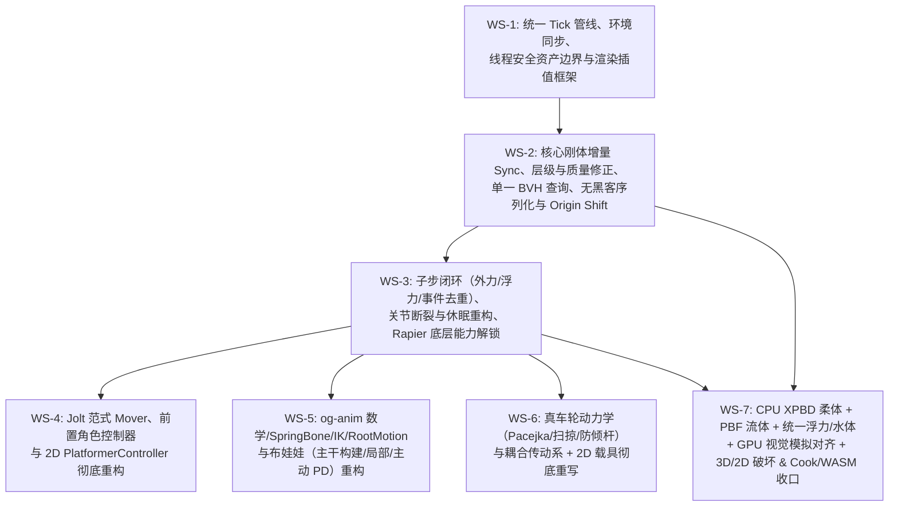

# Origin Engine 物理机制一次性根治架构方案

> **目标**：不对旧实现做局部补丁，而是从**管线时序、状态真相源、数学/物理求解器、渲染/序列化边界**四层一次性根治 [physics_deep_audit.md](physics-deep-audit.md) 中定位的全部 80+ 项缺陷，并同步补齐 Rapier 底层未暴露能力与现代商业引擎核心物理机制。

---

## 0. 顶层约束与不可违背契约（对齐 `AGENTS.md`）

1. **比特级跨宿主确定性**：所有新增/重写求解器仅使用 `f32` `+ - * / sqrt` 及 `og_core::math`；所有集合遍历按实体 ID 或规范键排序，杜绝依赖 Rapier `Arena` 槽位序或哈希序；`og-lanes` 任意线程数与单线程 WASM 输出比特一致。
2. **单一状态块版本基线（彻底清债）**：将 `og.physics` 状态块升级至 **Format v2**（带显式版本号头字节），废弃原始 bincode 子串抠洞（[persist.rs](../crates/og-physics/src/rigid/sim/persist.rs#L67-L112)）；同步切新确定性基准并更新 [beyond_determinism.rs](../crates/og-physics/tests/beyond_determinism.rs) 与 [saves.rs](../crates/og-physics/tests/saves.rs)。旧快照由 `save_migrations.rs` 显式升级或重建，不留两套并存逻辑。
3. **单一 IDL 与 Schema 同步**：任何字段增删或默认值修正均以 `crates/og-api/api/*.ogt` 为唯一来源，按规则更新 `assemble.rs::versioned`、执行 `og api gen` / `og api check`，并在同提交添加 `changelog/unreleased/` 片段。
4. **“机制按名组合、零值即关闭”**：所有新物理机制（防倾杆、差速器、PD 驱动布娃娃、XPBD 柔度、双向耦合等）遵循零值无开销原则，绝不内置玩法模板或品味阈值。
5. **WASM 按需分包不回退**：严格维护 [wasm-modules.json](../packages/engine/scripts/wasm-modules.json) 的 `entries` 边界，确保未用物理/破坏的游戏主包体零增长，并将 `destruction` 拆为 `destruction3d` 与 `destruction2d`。

---

## 1. 总体实施依赖图（7 个逻辑 Workstream）

所有改造拆为 **7 个内聚、按依赖栈顺序提交的 Workstream**，每个 WS 独立通过快检（`fmt`、`cargo check --workspace --all-targets`、受影响 crate clippy 与单测、`og api gen && og api check`），避免巨石提交：



---

## 2. 分 Workstream 深度技术设计

---

### WS-1：Tick 管线重排、环境输入同步、线程安全资产边界与渲染插值

#### 根治的问题
- `Water`/`Wind`/`ForceField` 在 `BEFORE_TICK` 最前读取导致 1 帧滞后、无视场景/流式加载。
- `og.physics.queries` 早于 `og.terrain` 读档重放导致首帧射线击中旧地形。
- `og.camera` 与 `og.ui.end` 跑在 `og.physics` 之前导致 1 帧视觉滞后。
- `og_lanes::install_from` 在工作线程调用 `mesh_source` 读主线程 TLS `ENGINES` 导致开 Lanes 直接 `NotFound` 报错。
- 布娃娃与载具车轮缺乏渲染插值导致高刷屏卡顿。

#### 核心设计

1. **新系统调度顺序**（修改 [registry.rs](../crates/og-runtime/src/registry.rs#L760-L810)、[assemble.rs](../crates/og-runtime/src/engine/creation/assemble.rs#L579-L612)、[modules.rs](../crates/og-runtime/src/bind/modules.rs#L170-L315)）：
   - `BEFORE_TICK` 仅保留世界级前置：`origin::before_tick` -> `scenes::before_tick` -> `timeline::before_tick` -> `stream::cells::before_tick` -> `sight::before_tick`。
   - **移除** `BEFORE_TICK` 中的 `physics_ext::before_tick`、`wind::before_tick`、`forces::before_tick`。
   - **正式 Tick 系统阶段**：
     1. **Front**：`og.input.intents` -> `og.input` -> `og.ui.begin` -> `og.terrain`（含读档 `replay_if_restored`）-> `og.physics.query_sync`（仅标记本帧起始快照边界，不再做 18 份全量 Gather）-> 其余 `FRONT`（`platform`/`stream`/`net`/`story`/`ai`）。
     2. **Gameplay**：游戏系统 + 钩子。
     3. **Middle**：`og.tween`/`flipbook` -> `MIDDLE`（`video`/`weather`/`season`/`path`/`timeline`）-> `og.anim`（生成骨骼姿态与 `rootDelta`）-> `og.tilemap` -> `og.nav` -> `og.destruction` / `og.destruction2d` -> `og.play` -> `og.ragdollTargets` -> `og.garments`。
     4. **Physics Env Sync**：新增轻系统 `og.physics.env`（置于 `og.physics` 正前方），一次性读取最新 `og.Water`、`og.Wind`/`og.WindMotor`、`og.ForceField`/`og.Volume` 写入 `PhysicsSystem`（消除 1 帧滞后，且场景/流式/游戏系统同帧生效）。
     5. **Physics**：`og.physics`（含前置控制器、子步刚体/外力/载具/浮力/关节、后置 XPBD/PBF）。
     6. **Post-Physics Presentation & Audio**：`og.camera`（移至 `og.physics` 之后）-> `og.ui.end`（世界锚定 UI 与相机均取物理同帧最新位姿！）-> `og.ui.sound` -> `og.audio` -> `og.sprite`。

2. **彻底消除 `mesh_source` 跨线程 TLS 依赖**：
   - 在 [og-runtime/src/bind/modules.rs](../crates/og-runtime/src/bind/modules.rs#L115-L117) 中，维护一个与 `Engine` 生命周期绑定的线程安全只读几何注册表 `Arc<RwLock<IdMap<u64, Arc<MeshDesc>>>>`（在 `note_mesh` / glTF 加载时同步写入）。
   - `PhysicsSystem::set_mesh_source` 闭包直接捕获该 `Arc`，**彻底不访问 TLS `ENGINES`**。
   - 同时在 `og-physics/src/rigid/sim/stepping.rs` 中将 `sync()` 所需的懒加载网格预解析在进入 `og_lanes::install_from` 前完成，消除工作线程锁竞争。

3. **统一物理渲染插值扩展（[interpolate.rs](../crates/og-runtime/src/present/interpolate.rs)）**：
   - 在 `InterpState` 中新增 `ragdoll_poses: IdMap<u64, Vec<(Vec3, Quat)>>` 与 `wheel_poses: IdMap<u64, Vec<WheelPose>>`，每个 Tick 开始时拍存上一帧快照；`draw_ragdolls` 与车轮渲染在 `alpha.is_some()` 时按 `lerp`/`slerp`（短弧）插值，彻底消除高刷屏布娃娃与车轮抖动。

---

### WS-2：核心刚体增量同步、层级/质量修正、单一 BVH 查询与无黑客序列化

#### 根治的问题
- `ByEntity` 缺世代校验导致 `Parent { entity: 0 }` 与已销毁父级错挂到活体 0 号槽。
- 非骨骼 `og.Parent` 静态体/刚体丢父变换；非均匀缩放与负缩放错位；复合体 `centred()` 双倍质量；`sensor` 贡献真实质量。
- 改阻尼/摩擦/层/锁轴等参数全量销毁重建刚体（丢 Warm-Start、歪关节）。
- 每帧 18 查询空转 + 影子 `QueryWorld` 全量重建 BVH + 复合体自命中 + 缺布娃娃/2D 车轮。
- `persist.rs` 原始 bincode 子串抠洞静默毁快照；`Sim::shift()` 空钩子与醒体碰撞器失步。

#### 核心设计

1. **世代安全的 `ByEntity` 与统一层级解析**（[gather/kept.rs](../crates/og-physics/src/gather/kept.rs)、[gather.rs](../crates/og-physics/src/gather.rs)）：
   ```rust
   pub(super) struct ByEntity<T>(Vec<Option<(u32, T)>>); // 存 (generation, value)
   ```
   - `Q_PARENTS` 读取时显式跳过 `*parent == 0`。
   - 环路检测改用栈上小位图或 Floyd 判环（杜绝 256 次反复解码溢出 `scale`）。
   - **所有** `RigidBody`（`fixed`/`kinematic` 及 `controller`）和 `Static` 碰撞体，只要存在 `og.Parent`（无论是否有骨骼 `parent_frame`），均通过 `og_ecs::transform::world_matrix` 合成世界变换，与渲染 `MatrixWorld` 100% 一致；动态刚体若挂在普通 `og.Parent` 下，按 `parent_world.inverse()` 回写局部变换（并在奇异矩阵时报错而非写入 `NaN`）。
   - **骨骼附着运动学体速度推算**：记录上一帧世界位姿，通过 `set_next_kinematic_position`（或隐式推算 `(linvel, angvel)`）驱动，使挥剑/动画门产生真实碰撞动量而非零速度瞬移。
   - **复合子碰撞体与负缩放修正**：
     - 复合子碰撞体在父体局部系下保留真实 `Mat4` 分解；对于负缩放（`det < 0`），[colliders.rs](../crates/og-physics/src/rigid/sim/colliders.rs) 保留有符号轴向对 `SHAPE_CONVEX`/`SHAPE_TRIMESH`/`SHAPE_HEIGHTFIELD` 进行镜像并在 `det < 0` 时翻转三角面片绕序（`[a, c, b]`），使镜像碰撞体与视觉严格重合。
     - 输入边界防毒：对 `Transform.position/quaternion/scale`、`Velocity`、`Physics.gravity`、`air_drag`、`gravity_scale` 全量执行 `is_finite()` 检查，零尺寸高度场/图元直接返回 `ErrorKind::Invalid`。

2. **复合刚体质量与 `centerOfMass` 重构**（[stepping.rs](../crates/og-physics/src/rigid/sim/stepping.rs#L162-L253)、[colliders.rs](../crates/og-physics/src/rigid/sim/colliders.rs#L185-L242)）：
   - **Sensor 永远零质量**：`c.sensor == true` 时在 `ColliderBuilder` 上调用 `.density(0.0)`（或 `.mass(0.0)`），且在 `compound_masses()` 中完全跳过 sensor 碰撞体。
   - **`centerOfMass` 在刚体级统一设定**：
     - 先按非 sensor 碰撞体的 `density` 或分摊后的 `body.mass` 正常构建所有子/父碰撞体（删除 `centred()` 内部对 `body.mass` 的重复覆盖！）。
     - 若 `body.center_of_mass != Vec3::ZERO`，先汇总全部碰撞体的总 `MassProperties`（质量 $M$、合质心 $C$、关于 $C$ 的惯量张量 $I_C$），再将碰撞体质量设为 0 并通过 `RigidBodyBuilder::additional_mass_properties(MassProperties::with_principal_inertia_properties(C + offset * scale, M, I_C))` 一次性赋给刚体——无论父实体有无 `Collider`、无论有几个子碰撞体，总质量、质心偏移和惯量张量全部精确无误。

3. **刚体/碰撞体/关节“拓扑 vs 参数”原地增量更新**（[bodies.rs](../crates/og-physics/src/rigid/sim/bodies.rs)、[joints.rs](../crates/og-physics/src/rigid/joints.rs)）：
   - 将 `Plan` 升级为：
     - `Plan::Patch { handle, body_diff, collider_diff, pose_op, vel_op }`：仅修改 `gravity_scale`、`linear_damping`、`angular_damping`、`ccd`、`lock`、`friction`、`restitution`、`layers`/`mask`、`sensor`、`mass` 时，**原地调用 Rapier setter**（`set_gravity_scale`、`set_linear_damping`、`enable_ccd`、`set_locked_axes`、`set_friction`、`set_collision_groups` 等），保留全部接触 Warm-Start 与关联关节！
     - `Plan::Rebuild`：仅在 `kind`、`shape`、`mesh`、`scale`、复合子拓扑或 `stale_mesh` 变更时触发。
   - **静止运动学体免唤醒**：仅在速度相对 `Tracked.velocity` 变化或非零时调用 `set_linvel`/`set_angvel`，避免每帧强制唤醒静止运动学体；`moves_itself` 先经 `unlocked(flat(v))` 过滤。
   - **关节原地热更新 + 持久参考帧**：
     - `TrackedJoint` 额外保存建关节时的原始参考帧 `ref_frame1: rp::Pose` 与 `ref_frame2: rp::Pose`。
     - 切换 `motor`（含 `MOTOR_NONE`）、调整 `limits`/`min`/`max`/`collide`/`rest_length`/`length`/`stiffness`/`damping`/`break_force`/`break_torque` **全部原地更新** `impulse_joints.get_mut(handle, ...)`，绝不销毁重建，彻底杜绝铰链零位漂移！

4. **废除影子 `QueryWorld`，建立单一共享增量 BVH 查询管线**（[queries.rs](../crates/og-physics/src/rigid/sim/queries.rs)、[lib.rs](../crates/og-physics/src/lib.rs#L274-L343)）：
   - **消除 `og.physics.queries` 的 18 查询全量 Gather 与每帧重建 `BroadPhaseBvh`**：
     - 直接以 `Sim.world`（的 `broad_phase`、`colliders`、`bodies`、`narrow_phase`）作为唯一查询加速结构。
     - 当游戏在 Tick 前（刚启动或恢复快照后、尚未首步）或 Tick 外有变换写入后发起查询时，仅运行一次轻量的 `sync_colliders_for_query`（基于 `StaticRun` 与 `Tracked` 写戳增量同步变动行并增量 `broad_phase.update`），之后同帧所有查询 $O(\log N)$ 零构建开销。
     - 为保证“系统内查询看到本 Tick 起始态”的确定性契约，`og.physics` 步进结束时 `Sim.world` 已经恰好是下一 Tick 开始时的碰撞体态！只需在 `og.terrain` 重放或游戏启动首帧前做一次增量刷新即可，**彻底消除 95% 的查询 CPU 与内存浪费**。
   - **查询正确性一次修全**：
     - `QueryFilter::exclude` 同时比对 `entity_of(c)` 与 `body_of(c)`（解决复合体自命中）；扩展为支持多实体排除列表与 `QueryFilterFlags`。
     - 查询内直接支持 `scene.hooks`（`ContactHook.ignore`），涵盖布娃娃与 2D 车轮碰撞体。
     - `raycast_all` 对分块高度场按 `entity` 去重保留最近穿越点；`raycast` 接受 `<= limit` 精确边界命中；`max_distance < 0 || !is_finite()` 返回 `Invalid` 错误（仅 `0.0` 代表无限远）；`origin`/`position` 校验 `is_finite()`。
     - `rigid/query.rs` 查完 `Shape` 后立即释放 `Mutex<Shared>`，不在 BVH 遍历期间持锁。

5. **无字节黑客的状态块 Format v2 序列化与完整 `WorldOrigin` 偏移**（[persist.rs](../crates/og-physics/src/persist.rs)、[rigid/sim/persist.rs](../crates/og-physics/src/rigid/sim/persist.rs)、[sim.rs](../crates/og-physics/src/rigid/sim.rs#L352-L434)）：
   - **Asset Shape 句柄占位替换法**：
     ```rust
     // save():
     // 1. 遍历所有 asset collider，用 SharedShape::ball(1e-3) 零分配静态占位替换其 Arc，记录 (handle, key, orig_arc)
     // 2. 单次 bincode::encode(&(sim, holes_by_handle))
     // 3. 立即将 orig_arc 换回 w.colliders[handle]（不触发 mass/contact 重算）
     // load():
     // 1. 单次 bincode::deserialize -> (sim, holes_by_handle)
     // 2. 遍历 (handle, key) 重建 SharedShape，直接原地写回 collider.shape 字段（保留保存的 mass_properties 与接触流形）
     ```
     彻底消灭 `windows().position()` 误抠洞、2–3 次重复序列化与 Rapier 字段布局耦合。
   - **`Sim::shift()` 修复**：
     - 无论是否存在休眠体，均更新所有附着碰撞器的世界位姿（调用带真实 `&Hooks(&last_hooks)` 的增量 broadphase/collider 更新，严禁传 `&()` 破坏单向平台与忽略状态）。
     - 统一追踪 `Tracked.is_world_space`：有普通 `og.Parent` 的实体按规则平移或失效 `static_runs`，消除位移后瞬移。
     - 在 [world/origin.rs](../crates/og-runtime/src/world/origin.rs#L38-L47) 中补齐 `("og.Hang", "point")`、`("og.Hang", "anchor")`；在 `PhysicsState::shift` 中同步平移 `shared.ragdoll_targets` 与 `shared.garment_poses`。
     - `PhysicsState::apply`（读档）清空 `ragdoll_targets` 与 `garment_poses`，杜绝跨档残留。

---

### WS-3：子步闭环、事件去重、关节断裂、休眠重构与 Rapier 能力解锁

#### 根治的问题
- 连续力/风阻/力场/浮力/载具在子步外按全 `dt` 施加导致多子步漂移与锁轴越权。
- 子步内瞬态碰撞全部丢失；布娃娃/2D 载具/分块地形每帧刷屏假 `CollisionStarted`。
- `joint_load` 错算弹簧/绳索方向与自由铰链伪力矩，且对冲击/爆炸完全失明。
- `ContactHook` 按 Arena 句柄序覆盖摩擦/传送带速度、不唤醒休眠体、不支持复合体。
- `Rest::Still` 粘死一切低于 `restSpeed / dt` 的推力；休眠步中唤醒丢帧、改重力不唤醒、布娃娃/2D 车永不休眠。

#### 核心设计

1. **统一子步循环（`stepping.rs`）**：
   ```rust
   // Sync 完成后：
   // 1. 增量刷新 broad_phase（保证本帧新增/移动碰撞体对载具/控制器/查询即时可见）
   // 2. 运行前置控制器（WS-4）并立即写入 Rapier 位姿 + 刷 BVH
   // 3. 运行 sleep::before_step（检测重力/ContactHook/控制输入/外部推力变化）
   // 4. 仅在 substeps 循环前施加瞬时 PushKind::Impulse / TorqueImpulse
   let sub_dt = dt / substeps as f32;
   let mut collector = SubstepEventCollector::default();
   for k in 0..substeps {
       // 4a. 施加本子步连续力（全部用 rb.add_force / add_torque / add_force_at_point，
       //     Rapier 内部自动掩码 locked_axes 且自动按 sub_dt 积分，步后自动清零）：
       //     - PushKind::Force / Torque
       //     - air_drag（显式阻尼等效连续力，跳过已休眠且风力不足以唤醒的体）
       //     - force_fields（所有 dynamic 体 + 活体布娃娃骨）
       //     - buoyancy（水体与浮力，按 sub_dt）
       //     - vehicles 3D（跳步休眠底盘，按 sub_dt，WS-6）
       // 4b. 记录本子步前速度 motions_now
       // 4c. sim.world.step_with_events(&hooks, &collector)
       // 4d. 累计关节本子步/求解器冲量，判定 break_joints
       // 4e. 捕获本子步接触对与冲量到 collector（含瞬态弹跳！）
   }
   ```
   - **锁轴绝对安全**：`air_drag`、`force_fields` 不再直接篡改 `rb.set_linvel`，改由 Rapier 自身力积分路径自动遵守 `LockedAxes`。
   - **子步事件与全局去重**：
     - 通过自定义 `rp::EventHandler` + 子步接触采集，即使物体在子步 0 撞击并在子步 1 反弹分离，也会正确产生 `CollisionStarted` + 真实 `impulse` + 下一帧 `CollisionEnded`。
     - 在 [readback.rs](../crates/og-physics/src/rigid/sim/readback.rs#L140-L153) 中对**所有** `touching` 对按 `(a, b, sensor)` 规范归并（累加 `impulse`，保留最深接触点与最早相对速度，过滤 `a == b` 自碰撞噪声），彻底根治布娃娃/2D 载具/分块地形的重复事件刷屏。
     - 修复传感器切换边事件（[tick.rs](../crates/og-physics/src/tick.rs#L209-L213)）：按位比较 `p.sensor ^ c.sensor`，仅对真正状态翻转的那一侧发 `Entered`/`Exited`。

2. **确定性 `ContactHook` 合并（[stepping.rs](../crates/og-physics/src/rigid/sim/stepping.rs#L440-L508)）**：
   - `Hooks::of` 先查 `entity_of(c)` 再回退 `body_of(c)`（支持复合体父级挂载）。
   - `modify_solver_contacts` 按**规范实体序**（`e_min` 与 `e_max`）决定合并规则，绝不依赖 `collider1`/`collider2` 句柄序：
     - `friction` / `restitution`：双方均指定时按组合规则（或取均值/最小）确定性合并；
     - `surface_velocity`：**叠加相对速度** `v_surf = s1 - s2`（转换到接触切平面），双传送带交汇不再互相覆盖；
     - `one_way`：独立判定双方允许方向，不互相覆写 `ctx.user_data`；
     - `sync_hooks` 检测到 `ContactHook` 内容变更（如开启传送带或改变 `ignore`）时，主动唤醒该碰撞体所在接触图的休眠刚体。

3. **重写 `joint_load` 与冲击敏感的 `break_joints`**（[dim3.rs](../crates/og-physics/src/dim3.rs#L289-L298)、[dim2.rs](../crates/og-physics/src/dim2.rs#L220-L228)、[joints.rs](../crates/og-physics/src/rigid/joints.rs#L344-L392)）：
   - **正确的力与力矩分解**：
     - 约束力 `F`：对 `JOINT_SPRING`/`JOINT_ROPE`，沿真实锚点世界连线 `(anchor2 - anchor1).normalize_or_zero()` 取轴向张力，且**力矩为 0**；对其他关节，取局部坐标系线性约束冲量模长 `|linear|`。
     - 约束力矩 `T`：仅取关节局部角向约束/限位/马达冲量模长 `|angular|`（**彻底删除错误叠加的 `lever.cross(linear)`**，因为 Rapier `impulses[3..6]` 已是关节帧处的真实约束角冲量，叠加 `lever × F` 会在无摩擦自由铰链与远原点静态墙上捏造巨额假力矩）。
   - **支持冲击断裂**：在 `og.Joint` 保留 `breakForce`（N）和 `breakTorque`（N·m），通过累计整 Tick 子步总冲量 `J_total / dt`（或在 Rapier `wgpu-flash` 式/自维护小补丁中让 solver 写回整个步长的累计冲量而非仅最后一次迭代），使重物砸击、爆炸和 `applyForce` 均能以与 `solverIterations` 无关的物理力准确拉断关节。

4. **重构休眠与微动稳态（取代破坏物理的 `Rest::Still`）**（[sleep.rs](../crates/og-physics/src/rigid/sleep.rs)、[readback.rs](../crates/og-physics/src/rigid/sim/readback.rs#L273-L339)）：
   - **废弃 `Rest::Still` 的硬位置回滚与无条件清零速度**：改为两层正交机制：
     1. 接触支撑微阻尼：仅当动态体受法向向上（或逆重力方向）支撑、无非平衡净外力加速度且速度 `< rest_speed` 时，施加轻度额外阻尼帮助收敛，绝不硬回滚位姿吞掉小推力/斜坡加速。
     2. 完整岛屿休眠（[sleep.rs](../crates/og-physics/src/rigid/sleep.rs)）：
        - 将**所有**动态刚体（含布娃娃骨骼与 2D 载具车轮，通过遍历 `w.bodies` 而非仅 `scene.bodies`）纳入休眠判定与岛屿合并。
        - 监听 `Physics.gravity` 变化与 `ContactHook` 变更，变化时触发唤醒。
        - `air_drag` / `force_fields` 对休眠体先判断加速度是否超过唤醒阈值（如 `|a| > sleep_wake_accel`），彻底根除低重力室/微风下的无限 `BodySlept`/`BodyWoke` 抖动。
        - `wake_touching` 改为构建一次邻接表 + 从已唤醒队列出发的 $O(V + E)$ BFS（每帧仅在有新唤醒体时运行）。
        - `read_body` 检查**步后** `rb.is_sleeping()` 而非步前快照，消除步中唤醒丢帧；解耦线速度/角速度休眠阈值（`sleepLinearSpeed` / `sleepAngularSpeed`，向后默认兼容）。

5. **一次性解锁 Rapier 0.36.1 / Parry 0.31.1 现成底层能力**（扩展 `physics.ogt` & `physics-queries.ogt`）：
   - 形状：`cone`（3D）、2D `heightfield`、`polyline`（2D 原生，供 WS-7 2D 破坏与 Tilemap 复用）、`roundRadius` 圆角修饰、Cook/运行期 `convexDecomp`（VHACD 复合凸包）。
   - 刚体与材质：`Collider.{frictionCombine, restitutionCombine, contactSkin, solverLayers, solverMask, enabled}`、`RigidBody.{dominance, enabled, gyroscopic, additionalSolverIterations}`。
   - 关节：新增 `JOINT_GENERIC`（6-DOF 自由轴/软硬限位/马达掩码）、`JOINT_BALL` 锥扭限位与角马达、`motorModel`（`acceleration | force`）、`Multibody` 减缩坐标关节链选项（零拉伸）。
   - 查询：`castShapeAll`、`overlapPoint`、`QueryFilter.{excludeList, kindFlags}`、`RaycastDesc.solid`、`ShapeCastHit.body`、`OverlapHit { entity, body }`；以及富接触事件/查询（按需读取持续接触点/法线/深度/冲量）与 `og.physics.massProperties(world, entity)` / `velocityAtPoint`。

---

### WS-4：Jolt 范式 `Mover`、前置角色控制器与 2D 平台器重构

#### 根治的问题
- 擦边命中 `pos += rem; break` 穿墙/穿地；零 MTD 脱嵌；`skin / n.y` 阶梯边缘悬空；斜坡+侧墙死锁；无视 `ContactHook`。
- 控制器在步进后运行不回写 Rapier 导致的 5 大级联 Bug（瞬移横扫、子步倍速撞击、无视 `pushBodies: false` 双重推力、柔体/多角色/传感器滞后、丢 `BodyWoke`）。
- 复合移动平台不载人、未扫掠进墙、无旋转平台偏航跟随、推箱按箱子质量算且零力矩、大坐标 `> 2048 m` 误判天花板。
- 2D 平台器下落侧 `apexGravity` 失效、重力破坏跳高、硬编码 0.25 s 单向平台漏穿与全图线性扫描、超速前进减速、45°–50° 斜坡误滑墙、双墙偏置。

#### 核心设计

1. **控制器前置并即时回写 Rapier（闭环消除 5 大级联 Bug）**：
   - 将 `characters()` 与 `platformers()` 移至 `stepping.rs` 的 **`sync()` + 刷 `broad_phase` 之后、`0..substeps` 之前**（支持控制器多实体确定性按序更新并在每次移动后更新自身 Rapier 位姿与 BVH，彻底消除双角色同帧对穿）。
   - **瞬移 vs 正常运动区分**：若 ECS `Transform` 相对 `Tracked.position` 被游戏代码直接改写（传送/复活），直接调用 `rb.set_position(new_at, true)` 同步不产生扫掠速度；正常控制器位移由 `Mover` 算出最终 `end`，并在各子步内将 `KinematicPositionBased` 均匀插值推进 `lerp(start, end, (k+1)/substeps)`，彻底根除子步 0 倍速撞击。
   - **单真相动态体推挤（遵守 `pushBodies` 与 `pushStrength`）**：
     - 控制器组件新增 `mass: f32`（默认 `75.0 kg`）与 `addVelocity: Vec3`（供弹跳板/击退使用）、`jumpBuffer: f32`、`up: Vec3`（默认 `(0,1,0)`，支持任意重力方向）。
     - 通过 `ContactHook`/求解器过滤关闭 Rapier 对控制器-动态体的无限质量硬推（或将控制器碰撞体 `solver_groups` 与动态体解耦），**全部推力由控制器按真实动量守恒计算**：
       - 侧向推箱：基于角色 `mass` 与动态体接触点有效质量，在**实际接触点 `hit.point`** 施加 `apply_impulse_at_point`，受 `pushStrength * dt` 封顶；
       - 站立施压：站在动态木板/跷跷板时，在脚底 `contact_point` 向下施加真实自重冲量 `character.mass * |g| * dt`（产生真实压弯与跷跷板力矩，不再按木板质量算！）。

2. **重写 `Mover`（[mover.rs](../crates/og-physics/src/character/mover.rs)）为 Jolt `CharacterVirtual` 4 阶段模型**：
   - **全流程局部相对坐标算术**：所有位移量 `delta` 直接累加，绝不做 `end - centre` 再与 `1e-4` 比对；天花板碰撞由向上扫掠的真实 `Hit` 标志直接返回，**彻底根除 `> 2048 m` `f32` ULP 精度退化**。
   - **Phase 1 — 迭代 MTD 脱嵌（Depenetration，最多 4 次）**：调用 Parry `contact` 对重叠碰撞体求最小穿透向量（MTD）推出，并检测相反法线夹击（两实心墙/升降台相向夹紧 -> 置位 `crushed: bool` 并发出 `CHARACTER_CRUSHED`）。
   - **Phase 2 — 平台承载扫掠（Carry Sweep）**：
     - `c.ground` 存 `entity_of(collider)`，`c.ground_body` 存 `sim::body_of(collider)`（支持复合移动平台！同时追踪移动静态体位姿变化）。
     - 在**脚底接触点**计算平台位移 `ride_pos` 及绕 `up` 轴的**偏航旋转 `ride_yaw`**（同时旋转角色与朝向），先将 `ride_pos` 经 `slide_multi_plane` 扫掠（遇墙停住或触发挤压，绝不直接瞬移穿墙），并将 `ContactHook.surface_velocity` 纳入承载速度。
     - `c.velocity` 包含平台承载速度，离地起跳时按 `platformInherit` 继承平台动量。
   - **Phase 3 — 多平面约束滑行（Multi-Plane Constraint Slide）**：
     - **彻底删除擦边 `pos += rem; break`**：若 `cast_shape` 返回擦边命中（`0 < -dir.dot(n) <= 1e-4`），将其句柄加入本次扫掠的临时忽略集继续重投，绝不跳过后方实墙。
     - 维护当前步累积约束平面集 `planes: SmallVec<[Vec3; 4]>`：
       - 1 平面：投影滑行（可行走坡面保持水平投影速率）；
       - 2 平面：沿交线 `crease = n1.cross(n2).normalize()` 滑行（彻底根治“斜坡+侧墙”被 `s.y.min(0.0)` 顶死的 Bug）；
       - 3 平面（凹角）：直接停止。
     - 用 `skin` 恒定法向/垂向留白替代 `skin / n.y` 爆炸；`edge_top` 必须验证射线命中同一碰撞体且高度误差在合理窗内，彻底消灭阶梯悬空。
     - 阶梯试探检查低步碰撞体中若包含动态箱，优先推箱而非凭空瞬移越过。
   - **Phase 4 — 完整 `ContactHook` 接入**：`Mover` 的查询过滤器与步进直接读取 `scene.hooks`，原生支持 3D/2D `ignore`、任意斜率方向性 `oneWay` 平台与传送带 `surfaceVelocity`。
   - **补齐核心手感机制**：新增 `og.physics.resizeCharacter(world, entity, height, radius)`（带头顶净空 `cast_shape` 检测，通过则原地更新胶囊无损下蹲/起立）、修复游泳 `stroke` 入水混凝土截断与 `under.ceil()` 河流突跳、补齐 `CHARACTER_BUMPED` 与正确的 `CHARACTER_LANDED` 落速。

3. **2D `PlatformerController`（[platformer.rs](../crates/og-physics/src/character/platformer.rs)）彻底修正**：
   - 修复 `apex_gravity` 条件顺序（置于 `vy < 0.0` 之前，且限定 `!grounded` 空中态）。
   - 修复世界重力缩放：`world_scale = (-g.y / 9.81).max(0.0)`，`g = base_g * world_scale`，`jump_speed = base_g * apex * world_scale.sqrt()`（保持设计跳高严格守恒）；`jumpHeight == 0` 时直接用 `settings.gravity.y` 不失重。
   - **实体级单向平台与斜面支持**：利用 `Mover` 的方向性 `ContactHook.oneWay` / `oneWayMask` 法线检测（支持倾斜单向平台，消除侧面卡墙与全图扫描），下穿记录 `dropping_through: u64` 实体直到角色包围盒完全脱离该实体后自动清除（取代易漏穿的 `0.25 s` 硬编码，同时清零 `coyote`）。
   - 修复超速顺向按住刹车（`|vx| > maxSpeed` 且同向时用 `decel` 或空气阻力而非 `accel`）、墙面探测排除可行走斜坡（`|n.y| < walkable`）、双墙窄道按输入方向优先选择接触墙、新增 `wallCoyoteTime`、修正顶角修正扫掠与 `skin` 对齐、3D 模式下返回明确诊断错误而非静默劫持刚体。

---

### WS-5：`og-anim` 物理动画与布娃娃（Ragdoll）全面重构

#### 根治的问题
- `Trs::inverse` 非均匀缩放+旋转下数学错误（45 m 级偏移）；`ik::two_bone` 短骨 Panic；`og.Hang` 缺 `WorldOrigin` 偏移。
- `SpringBone` 在 `frequency == 0` 时阻尼归零、单端点碰撞、瞬移抽风、忽略父级/风场/世界碰撞体。
- Root Motion 直接写 `Transform` 穿墙。
- 布娃娃自碰撞炸飞、缩放 `scale²` 坍缩、65 根手指骨爆炸、关节轴向与对称反折、均分冲量、实体 `Transform` 不跟随导致剔除消失、无局部/主动布娃娃。

#### 核心设计

1. **`og-anim` 数学、IK、SpringBone 与 Root Motion 根治**：
   - **[xform.rs](../crates/og-anim/src/xform.rs#L48-L64)**：保留 `Trs` 正向快速合成，新增精确逆变换 `inverse_transform_point(p) = inv_scale * (rotation.conjugate() * (p - translation))` 与 `Mat4::inverse()`，全面替换错误的 `Trs::inverse().transform_point(...)`。
   - **[ik.rs](../crates/og-anim/src/ik.rs#L174-L184)**：按相对比例 `eps = (l1 + l2) * 1e-5` 计算安全夹持区间，消除 `f32::clamp` Panic；先在约束平面内求解铰链限位再做两骨解析解；`look_at` 移出循环外的 `model_space` 并加 `-Z` 迟滞防翻转。
   - **[constraints.rs](../crates/og-anim/src/system/constraints.rs#L193-L380)**（`SpringBone` 升级至 VRM 1.0 级稳定模型）：
     - 改用独立 `drag`（线性阻尼，与 `frequency` 解耦，`frequency == 0` 垂挂照常衰减）+ `stiffness`（朝休息态恢复力）+ 显式 `tailOffset`（支持无子骨末端）。
     - 完整解析实体 `og.Parent` 世界矩阵；支持传送距离阈值（超阈值按新根位姿重置尾部，绝不抽风）与速度上限。
     - 碰撞检测改为 **骨段 `[head, tail]` 对球/胶囊/平面/可选世界 `og.Collider` 迭代 2–4 次投影**，修正节点层级缩放与半径尺度一致，并接入 `og.Wind` 与 `og.JointLimit`。
   - **碰撞安全 Root Motion 与地面自适应 Foot IK**：
     - `og.Skeleton` 写入每帧提取的 `rootDelta: Vec3` / `rootYawDelta: f32`；支持 `rootMotionMode: "transform" | "controller"`，后者将位移交给 `CharacterController` 扫掠，彻底消除动画穿墙。
     - 为 `FootLock` 增加可选射线接地适配（调用物理查询对齐斜坡/台阶高度、贴合地面的脚踝法线旋转与骨盆下沉偏移），并修复瞬移拉腿与 `weight` 旋转忽略。

2. **布娃娃全面重构（[ragdoll.rs](../crates/og-physics/src/character/ragdoll.rs)、[physics_ext.rs](../crates/og-runtime/src/bind/physics_ext.rs)）**：
   - **智能主干构建与显式 `RagdollRigDesc`**：
     - `ragdollRigFromSkeleton` 自动识别人形主干（pelvis / spine / chest / neck / head / upperArm / lowerArm / hand / upperLeg / lowerLeg / foot，共 12–15 根，**排除手指/面部/扭转骨**），或按调用者提供的 `bones` 白名单构建；支持逐骨 `mass`、`shape`（capsule/box/sphere）、`jointKind`（`hinge` 膝肘非对称 `[0, 2.4]` vs `coneTwist` 肩髋非对称锥角+扭转限位）。
     - **严格使用骨骼休息姿态 + 实体世界缩放**构建刚体与对齐骨骼主轴 `b.axis` 的关节局部帧，彻底根治缩放 `scale²` 坍缩与膝肘反折。
   - **零爆炸碰撞过滤**：
     - 废弃全局 `1 << 31` 魔法位。每具布娃娃继承实体的 `layers`/`mask`（或自身 `Ragdoll.layers/mask`），利用 Rapier `PhysicsHooks` / `solver_groups` 精确排除**自身实体的角色胶囊**与**父子相邻骨**——既彻底消除激活炸飞，又天然支持**尸体堆叠（布娃娃互碰）**与**非相邻肢体自碰撞**。
   - **物理准确切入、局部/主动 PD 驱动与根同步**：
     - 切入布娃娃时按各骨**质心位置**传递准确线速度与角速度；受击冲量新增 `og.physics.applyRagdollImpulse(world, entity, boneIndex, impulse, point)`，整体验证冲量改为**按质量占比分配**（不再均分炸飞四肢）。
     - 支持 **PD 关节马达驱动**（`Ragdoll.motorStiffness` / `motorDamping`）与**局部骨遮罩**（`Ragdoll.maskBits` 或逐骨权重），实现主动布娃娃（受击硬直、绊倒、部分上半身物理）。
     - 动画与布娃娃混合改为**骨骼局部空间旋转 Slerp + FK 重建**（绝不出现世界坐标 Lerp 缩骨）。
     - 新增 `Ragdoll.driveTransform: bool`（激活时由骨盆同步写回实体 `Transform`，彻底解决视锥剔除消失、`og.Garment` 脱节、原地起身穿墙与水花丢失）；并将布娃娃纳入 WS-3 休眠岛与 `og.ForceField`。
     - `mass`/`thickness`/`jointLimit` 变更触发原地更新或重建，兑现 `tunable` 契约；实体销毁时清理 `rigs`/`ragdoll_targets`。

---

### WS-6：载具动力学与耦合传动系彻底重写（告别 `btRaycastVehicle`）

#### 根治的问题
- 3D `side_impulse` 转动惯量 $I^{-2}$ 量纲错（过修正/打滑）。
- 休眠 3D 车每帧累加速度唤醒入轨、倒车不唤醒；第 0 帧空 `broad_phase`；未纳入 `substeps`。
- 6–16 轮横向阻尼指数发散；擦墙 10× 无阻尼爆炸；无伸张行程（Droop）；30 Hz `driftGrip` 抖动；隐藏 10 G/20 G 默认抓地；无视地面摩擦与 `ContactHook`；油门+刹车互斥 Bug。
- 传动系 0.5–1.0 m/s 死区、倒溜升挡断油、起步 0.25 s 死等、换挡飙红线、无发动机制动。
- 2D 载具 `AccelerationBased` 乘质量导致 1000× 焊死、刹车乘 10、瞬移炸轮、假事件刷屏、永不休眠。

#### 核心设计

1. **全新确定性子步 3D 耦合车轮动力学求解器**（重写 `crates/og-physics/src/vehicle/raycast_vehicle.rs` 与 `vehicle3.rs`）：
   - **每轮独立动力学状态**：`omega: f32`（车轮角速度 rad/s）、`inertia: f32`（$I_w = \frac{1}{2} m_w R^2$，统一 2D/3D `wheelMass`）、`spin_angle: f32`（规约到 `[0, 2π)`）、`compression: f32`、`prev_compression: f32`。
   - **扫掠接触检测**：默认支持 `wheelCast: "ray" | "sphere" | "cylinder"`（利用 Parry `cast_shape` 圆柱/球体扫掠平稳越过路缘、台阶、网格缝），射线总长 `rest + travel + radius`（**激活完整伸张行程 Droop**，钳制 `min_len >= 0`），自动跳过 sensor 碰撞体并遵守 `ContactHook`（`ignore`/`oneWay`/`friction`/`surfaceVelocity`）。
   - **半隐式悬架 + 防倾杆 + 相对地面阻尼**：
     - 悬架压缩速度严格使用**相对地面接触点速度** `(v_chassis(pt) - v_ground(pt)) · n`（支持升降平台、动态渡轮/木筏）。
     - 区分压缩阻尼与回弹阻尼（`compressionDamping` / `reboundDamping`），底部设渐进限位块（Bump Stop），剔除 10× 擦墙爆炸因子。
     - 支持**左右同轴防倾杆**（`antiRollStiffness`：$F_{\text{arb}} = k_{\text{arb}}(c_L - c_R)$），让真实 `rollInfluence` 下高速过弯稳健不翻车。
   - **组合滑移轮胎模型（Simplified Pacejka / Brush + 低速静摩擦正则化）**：
     - 计算接触面相对速度 $v_{\text{long}}, v_{\text{lat}}$（保留运动学地面速度！），计算纵向滑移率 $\kappa$ 与侧偏角 $\alpha$。
     - 有效摩擦系数 $\mu_{\text{eff}} = \text{wheel.grip} \times \mu_{\text{ground}}$（**移除隐藏的 `×5.0` 与 `FORWARD_GRIP_SHARE = 0.5`**，让 `grip = 1.0..1.5` 对应真实 1.0–1.5 G 轮胎，兼容旧默认值可在迁移中显式映射），经真实**峰值-滑移衰减曲线 + 摩擦圆/椭圆**输出 $(F_{\text{long}}, F_{\text{lat}})$，自然实现漂移与反打，彻底消灭 30 Hz `driftGrip` 抖动。
     - 低速段（$|v| < 0.5\text{ m/s}$）无缝切换至阻尼正则化静摩擦，确保斜坡驻车绝不溜坡且多轮（最多 16 轮）按有效质量矩阵 $J M^{-1} J^T$ 正确分担（修复 $a_j^T I^{-1} a_j$ 量纲，永不发散！）。
     - 动力扭矩、刹车扭矩（含前后制动力分配 `brakeBias`）、手刹扭矩、滚动阻力与轮胎反力矩在 $\omega_w$ 上**同时求解**——彻底支持同时油门+刹车（原地烧胎/跟趾）、真实锁死抱死与轮速动画。
     - 施加于动态地面的反作用冲量考虑双体约化有效质量，不再炸飞轻质碎块。
   - **空气动力学**：在底盘上施加二次方空气阻力（`aeroDrag`）与速度下压力（`aeroDownforce`）。
   - **纳入 `0..substeps` 与休眠门控**：在 WS-3 子步循环内以 `sub_dt` 运行；休眠底盘先判输入唤醒（含前进/倒车/刹车），仍休眠则完全跳过；全部 `Vehicle` 统计量（`speed`/`contacts`/`slip`/`rpm`/`gear`）与 `WheelPose` 在步后读取。

2. **与车轮 $\omega_w$ 耦合的真实传动系（重写 `drivetrain.rs`）**：
   - 引擎飞轮角速度 $\omega_e$ 通过**离合器/液力变矩器**与驱动轮平均角速度耦合（支持空转/烧胎拉高转速、起步平滑咬合无 0.25 s 零扭矩断层、松油门发动机制动、软断油保护）。
   - **差速器**：支持 `open` / `lsd`（限滑）/ `locked` 及 AWD 前后扭矩分配 `awdBias`，拉手刹时不再平白丢弃前轮扭矩。
   - **自动变速箱修复**：引入明确升/降挡滞回与目标挡转速校验（根治无限跳挡）、紧急制动一次跨多挡降挡、统一零速换向状态机（彻底消灭 `0.5..1.0 m/s` 死区与倒溜升挡）。
   - 支持**阿克曼转向几何**（`ackermann`）、车速敏感转向衰减与可开关辅助（`abs`/`tcs`，零值关闭）。

3. **2D 载具彻底对齐与 `VehicleWheel` 解耦**（[vehicle2.rs](../crates/og-physics/src/vehicle/vehicle2.rs)、[schema.rs](../crates/og-physics/src/vehicle/schema.rs)）：
   - 2D 悬架切换为 `MotorModel::ForceBased`（修正 1,000× 刚度错误），移除刹车 `* 10.0` 错误系数，对齐 3D 街机/传动系油门/倒车制动与 `handbrakeGrip`，原地更新 `grip` 不再重建车轮，检测底盘瞬移同步迁移车轮，保留底盘 `z` 坐标，计算真实 2D 纵向 `slip`，并支持 `og.VehicleWheel` 2D 多轴载具。
   - `og.VehicleWheel` 改为通过 `query_with` 按需采集（跳过 `query_system`），支持显式 `mount: Vec3` 字段（默认 0 时读初始局部变换，避免更新轮子视觉 `Transform` 引发每帧下沉重建），所有几何参数均支持原地更新不丢轮速状态。
   - 扩展 `WheelPose` 返回 `suspensionCompression`、`load`、`contactPoint`、`contactNormal`、`groundEntity`、`angularVelocity`（支撑胎印、烟尘、悬架 IK 与材质音效）；在 `debug_lines.rs` 绘制 3D 车轮圆柱、悬架行程与轮胎力矢量。

---

### WS-7：柔体（XPBD）、流体（PBF）、水体浮力、GPU 模拟与破坏/Cook/WASM 收口

#### 7.1 CPU 柔体、布料、绳索、服装统一升级为小步 XPBD（[crates/og-physics/src/soft/](../crates/og-physics/src/soft/)）
- **显式速度小步 XPBD（Macklin et al. 2016/2019）**：
  - 状态从 `(points, previous)` 升级为显式 `(points, velocities, inv_mass)`（按三角形面积计算集总顶点质量），每子步 `h = dt / substeps` 内：外力积分 -> 位置预测 -> `iterations` 次 XPBD 约束投影（带柔度 $\tilde{\alpha} = \alpha / h^2$ 与拉格朗日乘子 $\lambda$，刚度彻底与 `dt`/子步/迭代解耦！）-> `v = (x - x_pred) / h` -> 碰撞摩擦速度修正。
  - **彻底消灭 `substeps`/`scaled_dt` 切换速度爆炸**与 **`Garment` 重力无限累积**（接触推离直接按法向消除切入速度，不再回移 `previous`）。
- **几何与算法根治**：
  - **`SoftBody` 体积与梯度**：全部改用质心相对坐标 $p_i' = p_i - p_{\text{ref}}$ 计算有符号体积与梯度（彻底消除远距 `f32` 相消）；新增可选**四面体 XPBD Neo-Hookean 体积约束**（防压扁翻转塌陷）；网格句柄记录修订号支持热重载。
  - **`Cloth`**：新增**二面角弯曲约束（Dihedral Bending）**、**远距拉绳约束（Long-Range Attachments / Tethers）**、基于相对速度 $v_{\text{air}} - v_i$ 的二次方空气阻力与升力（修复 2D 法线归零问题）、顶点-三角形/边-边布料自碰撞（空间哈希每子步刷新，取消把自由落体卡死在 `1.5 m/s` 的人工限速）。
  - **`Garment`**：新增**骨骼胶囊/锥形胶囊身体碰撞体**与**球面 Backstop**（随角色缩放）、传送距离阈值重置、按空间坐标算阵风（取代顶点索引哈希）。
  - **`Rope`**：修复 `rope.end` 支持任意 `Transform` 实体；新增**双向动态刚体挂接模式**（求解器在两端及中段向绑定动态刚体施加对称约束反作用冲量，支持吊物、荡绳、动态改 `length` 绞盘收放与过载拉断）。
- **共享固体碰撞与双向耦合接口（[rigid/points.rs](../crates/og-physics/src/rigid/points.rs)）**：
  - 网格烘焙/构建启用 `TriMeshFlags::ORIENTED`（闭合网格具备正确内部判定），2D `Polyline` 构建带绕向内部判定或局部 SDF；`Near` 改用 `BroadPhaseBvh` 宽相查询并按 `(entity, collider_idx)` 确定性排序（消除 Arena 序不确定性与 $O(N)$ 扫表）。
  - `Solids::collide_point` 返回完整接触流形（法线、穿透深度、表面速度、关联刚体句柄），支持多墙角迭代投影（不再只保留最后一个法线）、修复 `len <= 1e-9` 跳过与高度场悬崖瞬移，并支持累加反作用冲量回写给动态刚体（双向耦合）。
  - 所有柔体/流体改为逐点（或分块）采样 `og.ForceField` 与 `og.WindMotor`，不再单中点采样。

#### 7.2 CPU 粒子流体升级至 PBF（Macklin & Müller 2013）（[crates/og-physics/src/fluid/](../crates/og-physics/src/fluid/)）
- **根除 DDR 三大致命 Bug 并升级不可压缩求解**：
  1. 空间哈希在**平流预测之后**重建（彻底消灭相向粒子穿透）；坐标索引钳制防止 `i32` 溢出。
  2. 以 **PBF（Position-Based Fluids）** 替代单步 DDR：每子步执行 `solverIterations`（默认 3）轮不可压缩密度约束投影 $\lambda_i = -\frac{C_i}{\sum |\nabla C|^2 + \varepsilon}$ + 人工压力抗结块项 $s_{\text{corr}}$（天然对称使用 $\lambda_i + \lambda_j$，绝不漏掉 `j`！），随后施加 XSPH 黏度（天然无条件稳定，黏度上限 4.0 绝不爆炸）与涡度约束（Vorticity Confinement）。
  3. 确定性并行化：采用转置/双缓冲 Jacobi 归约，在 `og-lanes` 上实现真正的粒子密度与压力并行且任意线程数比特一致。
  4. 多流体分组支持密度权重与平滑属性插值（黏度/刚度/重力随混合比插值）；支持流体与动态刚体的**双向耦合**（粒子碰撞固体时按边界粒子质量将动量变化反作用于刚体，实现水流冲倒箱子与真实粒子浮力）。
  5. 修正 `Fluid3D` 反射默认 `radius = 0.2`、旋转发射器/汇盒、发射防零距重合融合与热更新 `size`/`maxCount`。

#### 7.3 GPU 视觉模拟全面止血与坐标对齐（[crates/og-render/src/systems/](../crates/og-render/src/systems/)）
- **[extract/frame/colliders.rs](../crates/og-runtime/src/present/extract/frame/colliders.rs)**：显式过滤 `sensor == true || layers == 0`、使用 `scale.abs()`、补齐 `Cylinder` 与 `Convex`（局部平面集）提取。
- **[scene_colliders.rs](../crates/og-render/src/fields/scene_colliders.rs)**：为每个视觉体独立截取高度场补丁（附带 `holes` 掩码，消除 500 m 共享 64×64 退化），高度场推离沿真实表面法线而非硬 `+Y`。
- **[visual_body.wgsl](../crates/og-render/shaders/visual_body.wgsl)**：修正相对风速阻力/升力公式（消除 $|v_{\text{rel}}|^2/|\text{wind}|$ 255 G 奇点）；用独立 `array<u32>` 存储哈希桶与前缀和（根治 FTZ 毁数据）；边着色改用动态位图消除度 `> 127` 数据竞争；修正体积柔度尺度与子步归一化摩擦；GPU 服装应用骨架绑定变换；修复软体体积原点用当前质心；接入 `og.ForceField`。
- **[visual_fluid.wgsl](../crates/og-render/shaders/visual_fluid.wgsl) & [visual_fluid.rs](../crates/og-render/src/systems/fluids/visual_fluid.rs)**：修复 `hash()` 除以 `f32(1u << 24u)`（返回 `[0, 1)`）；发射坐标严格钳制在 `[1.5, dim - 2.5]`；放宽定点尺度防 Tait 压力溢出；修复 `count == 0` 纯发射器半径公式（取 `radius` 而非 1.43 m）；修复反射探针遗漏纯视觉流体；修正汇回收服从 `emitRate`。
- **全链路接入 `WorldOrigin` 与 `RenderScene::rebase`**：平移 GPU 缓冲粒子/顶点位置与流体网格原点（不再重置仿真），平移 `RenderScene::water.river` 与 `atmosphere.rivers`。

#### 7.4 水体、浮力与河流统一重构（[crates/og-physics/src/water/](../crates/og-physics/src/water/)、[og-env/src/river.rs](../crates/og-env/src/river.rs)）
- **垂向分层水体查询**：`water::level(x, y, z)` 与 `water::at(p)` 引入 `point.y` 与水体 `depth`，精确选择包围当前高度的水体（解决高架水渠/多层泳池穿帮），并对重叠水体按单实体最高水位合并（消除 200% 双倍浮力）；补齐 `WaterBody.rotation: Quat`。
- **缓存与无偏浮力求解**：缓存每刚体局部采样点/裁切网格（仅在形状变更时重算）；单次快照读取全部水下体素并汇总净浮力 $F_{\text{net}}$、净阻力 $F_{\text{drag}}$ 与净力矩 $\tau_{\text{net}}$ 后**一次性施加**（彻底消除遍历序幽灵力矩与大阻尼角速度爆炸）；启用指数角阻尼；修复布娃娃真实骨骼体积与跨岸尾迹；开放 **2D `og.Buoyancy`**；海洋 Gerstner 反演改用 3 步 Newton-Raphson；`River` 建立段 AABB 空间栅格消除 $O(N)$ 扫描。
- **物理正确的 `WaterLine`（2D）与 `WaterSurface`（3D）**：`WaterLine` 改为 CFL 子步 1D 浅水波方程（显式包含网格间距 `dx` 与 `dt`，修正泳池底/边裁切）；`WaterSurface` 按 CFL 自动子步（不静默降波速）、加入海绵吸收边界、按 `dt` 缩放飞溅、增加水平移动船体排开尾迹与精确凸包/OBB 浸没面积。

#### 7.5 3D/2D 破坏系统、地形/Tilemap 与 Cook/WASM 收口
- **3D 破坏（[og-physics/src/destruction/](../crates/og-physics/src/destruction/)、[bind/destruction/](../crates/og-runtime/src/bind/destruction/))**：
  - `spawn_chunk` 写入真实材料 `density`；`survey` 与 `mass_of` 严格检查 `RigidBody.kind`（静态刚体保留全部锚点与无限质量）；粉碎子块用真实块世界位姿算爆炸方向（消除齐飞 `+Y`）；分裂/粉碎从 Rapier 读取真实合质心算 `lin + ang.cross(child_com - body_com)` 并保留首碎 `inherit` 速度；销毁 `Destructible` 时将遗留动态块转入独立 `orphan_chunks` 池继续渲染与受 `maxChunks`/`debrisLifetime` 管控；`enforce_budgets` 改为两阶段（先清过期碎片，再按上限淘汰）。
  - **应力求解器升级**：修正 CGNR 收敛判据为 $\|A^T r\|^2 \le \text{tol}^2 \|A^T b\|^2$；未收敛时保留 `dirty = true` 并跨帧热启动；Cook 阶段预计算每个粘结面真实截面惯性矩存入 `Bond`；为锚点与无拉砌体支撑键引入 **Active-Set / 投影高斯-赛德尔单边受压**，并修复 `unsupported()` 不跨空隙合并孤立桥墩；`Damage::at` 校验 `innerRadius <= radius`；爆炸加入宽相 AABB 裁剪与可选射线遮挡；缓存岛屿分组与 Cook 简化凸包消除 `draw.rs` 每帧重算。
- **2D 像素破坏（[terrain2d/](../crates/og-physics/src/destruction/terrain2d/)、[bind/destruction2d/](../crates/og-runtime/src/bind/destruction2d/))**：
  - **彻底废除 `轮廓 -> Earcut -> MeshDesc -> outline() -> Polyline` 往返**：直接输出简化闭环到 WS-3 新增的原生 2D `SHAPE_POLYLINE` 碰撞体；洞口探针单位化法线（或取洞口严格内部耳点）；DP 简化增加线段防自交检验；修复边界拼接自环。
  - **局部增量化**：`detach()` 改为**分块内部连通分量 + 跨块边界并查集**（单次子弹挖坑从 1,670 万像素降至仅扫脏块 1,024 像素！）；渲染改为**脏矩形 `queue.write_texture` 局部上传**并在修改外观属性时递增 `revision`；脱落凹块改用 2D 凸分解复合碰撞体；修复同帧多爆炸对称性、真实质心速度与孤儿碎片 `maxPieces` 回收。
- **地形、Tilemap、Cook 与 WASM 收口**：
  - **地形**：[terrain/edit.rs](../crates/og-runtime/src/bind/terrain/edit.rs#L282-L288) 刷贴图模式（`mode == 4`）绝不触发 `edit_heightfield`；`stamp_apply` 递增 `generation`；首次挖洞仅重建受影响块而非整张地形；释放资源同时清理对应 `EditLog`。
  - **Tilemap**：[present/feel/tiles.rs](../crates/og-runtime/src/present/feel/tiles.rs#L536-L546) 尊重 `og.Parent`/旋转/缩放、分块局部重建碰撞体、移动时仅平移不销毁；[cook/systems/tilemap.rs](../crates/og-cook/src/cook/systems/tilemap.rs#L555-L580) 完整解析 Tiled 多边形/斜坡/圆/旋转盒/多形状，正交图输出无内缝统一 2D `SHAPE_POLYLINE` 轮廓。
  - **Cook & 烘焙**：[dim3.rs](../crates/og-physics/src/dim3.rs#L186) 烘焙三角网格按资产哈希校验并支持非 1 缩放复用（按 `scale` 变换构建不重跑 BVH）；3D 破碎 Cook 写入真凸包（非全网格顶点）、修复非凸 Voronoi 键配对与任意斜坡/自定义锚点法线；扩展 `og-cook` 支持 Cook 阶段凸包与 VHACD 凸分解烘焙。
  - **WASM 分包与 IDL 守卫**：在 [wasm-modules.json](../packages/engine/scripts/wasm-modules.json#L72-L83) 补齐 `destruction::drawn`、`destruction2d::extract`、`destruction::load_asset` 守卫（加活跃标志快路径），将 `destruction` 拆为 `destruction3d` 与 `destruction2d`；扩展 `og-api/tests/modules.rs` 校验全部 Reflection 默认值与单位（一次性修复 `Fluid3D.radius`、`CharacterController.snapDistance`、`Vehicle.mountHeight`、`ProjectPointDesc.solid` 漂移）。
  - **全机制 `debug:physics` 可视化**：扩展 `debug_lines.rs` 渲染 3D 载具车轮圆柱/悬架/轮胎力、3D 破坏应力热力图/锚点/支撑射线、2D 像素地形脏块/轮廓、力场/风场/浮力切面与布娃娃目标骨架。

---

## 3. 破坏性变更与迁移策略

| 变更点 | 影响范围 | 处理方式 |
|---|---|---|
| `og.physics` 状态块 Format v2（句柄占位替换 + XPBD/PBF/新载具状态） | 旧版本游戏运行时快照 | `persist.rs` 识别旧 tag 版本并优雅回退为按 ECS 组件重建（符合现有无块恢复语义）；更新 `saves.rs` 与 `beyond_determinism.rs` 基线 |
| `og.Physics` / `og.RigidBody` / `og.Collider` / `og.Joint` / `og.Vehicle` / `og.CharacterController` / `og.Ragdoll` / `og.SoftBody` / `og.Cloth` / `og.Fluid3D` 新增字段与默认值对齐 | Schema 版本号 + TypeScript `.d.ts` + Wiki | 逐个递增 `assemble.rs::versioned` 版本号，在 `save_migrations.rs` 注册新字段零值/默认值填充；所有新增字段坚持“零值即关闭”；统一执行 `og api gen && og api check` 并附 `changelog/unreleased/` 片段 |
| `Vehicle.grip` 去除隐藏 `×5.0` 放大 | 既有 3D 载具调参 | 在 `save_migrations.rs` 与破坏性 changelog 片段中说明物理真实 $\mu$ 语义并提供 codemod 提示 |
| `og.camera` / `og.ui.end` 后置到 `og.physics` 之后、`og.physics.env` 后置到游戏系统之后 | 依赖旧 1 帧滞后的极少数脚本 | 仅属修 Bug/消滞后；回归验证现有 `packages/engine/tests/physics.test.ts` 与所有内置示例/配方 |

---

## 4. 验证与回归门禁（遵循 `AGENTS.md` 测试原则）

每个 Workstream 提交前只跑**快速且契约导向的验证**（不添加冗余/实现细节单测，优先扩展现有契约测试）：

1. **核心编译与静态检查**：
   - `cargo fmt --check`
   - `cargo check --workspace --all-targets`
   - `cargo clippy -p og-physics -p og-physics-data -p og-anim -p og-runtime -p og-cook -p og-render --all-targets`
   - `og api gen && og api check`（验证 IDL、`.d.ts`、Wiki、默认值与单位零漂移）
2. **确定性与快照契约（扩充现有测试，不堆砌杂测）**：
   - `cargo test -p og-physics`：`beyond_determinism`（2D/3D 全机制重放+中途读档比特一致）、`lanes`（单线程 vs 多线程 vs 强制切分比特一致，含新增 `mesh_source` 跨线程覆盖）、`saves`（Format v2 资产句柄替换+热恢复）、`pile`、`sleep`（含休眠载具、布娃娃、重力翻转、微风不抖动）、`breaks_and_hooks`（含冲击断裂、双钩子规范序合并）、`buoyancy`、`garment`、`soft_volume`、`edits`。
   - `cargo test -p og-anim`（含 `Trs::inverse` 非均匀缩放、`two_bone` 退化、`SpringBone` 独立阻尼）。
   - `cargo test -p og-runtime --test mid_tick_save` 与破坏/地形/OriginShift 集成校验。
3. **WASM 确定性与分包体检**（在 WS-2 / WS-7 收口阶段）：
   - `tools/wasm-determinism` 校验 Native（单线程/多线程）与 WASM 比特一致；
   - 运行 `wasm-split` 校验非破坏游戏主包体不含 `destruction3d`/`destruction2d` 符号。
4. **渲染与视觉质量审阅（WS-5 / WS-7 GPU 模拟变更）**：
   - 涉及 GPU 视觉布料/柔体/MLS-MPM 流体/水面/破坏碎片的提交，合入前按规范在 Colab L4 上采帧目视验收质量（无黑帧、穿模、爆炸或细节丢失）。

---

## 5. 执行建议

若你认可这份总体架构与 7 个 Workstream 的拆分，我将直接按 **WS-1 -> WS-2 -> WS-3 -> WS-4 -> WS-5 -> WS-6 -> WS-7** 的依赖顺序逐个落地实现，每个 Workstream 完成后跑通对应快检并汇报清晰变更与验证结果。
