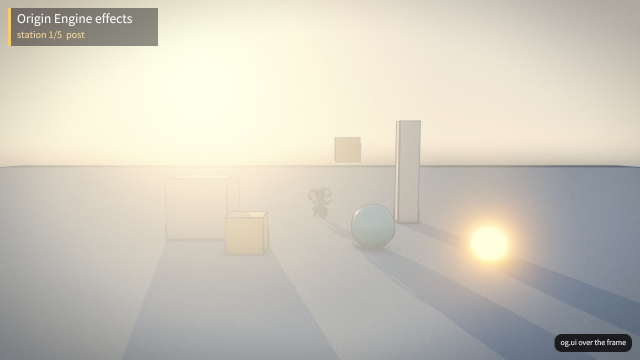
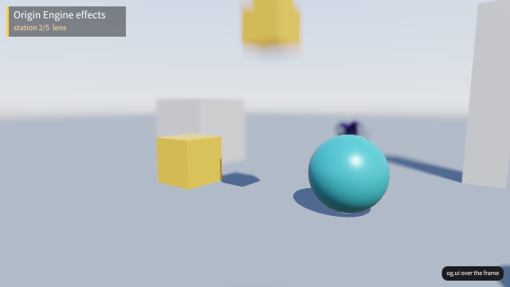
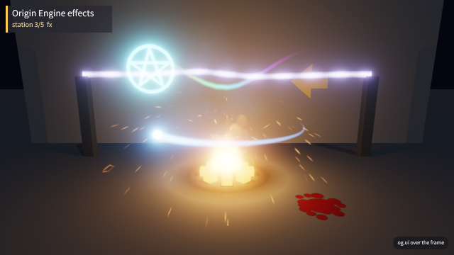
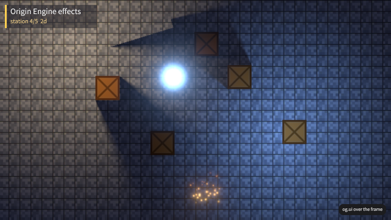
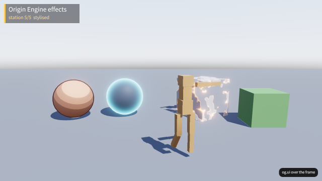

# og polish: fx-showcase

2026-10-18, 1 playtest(s) on metal. Mechanical measures of og-taste §10 and og-feel §13; a score is 0 to 100, n/a when nothing in the playtests exercises it. The measures cannot judge style: read the frames.

## Scores

| | Score | Measure |
|---|---|---|
| **Taste** | **100** | mean of the taste rows |
| Contrast | 100 | text boxes whose ink and ground reach 4.5:1 |
| Text size | 100 | text boxes whose tallest ink line reaches 9 CSS px (a 13 px face's capitals) |
| HUD occupancy | 100 | gameplay frames: HUD at most 15 % of the surface and 5 % of the central third |
| Screen transitions | n/a | screen changes with UI motion around them |
| UI sounds | n/a | UI presses answered on the ui bus |
| Locale keys | n/a | string tables without missing keys (og cook) |
| **Feel** | **100** | mean of the feel rows |
| Input latency | n/a | inputs answered, by the median ticks to the answer (0–1: 100) |
| Hit feedback | n/a | damage moments with hit stop, shake, floating text or a sound (three of four: 100) |
| Idle frames | 100 | ticks where nothing new is seen or heard (10 %: 100, 60 %: 0) |
| Frame time | 100 | p95 step + render (8.3 ms: 100, 33 ms: 0), worst playtest |
| Sound on input | n/a | inputs answered by a sound within 6 ticks |

## Fixes

No finding crossed a threshold.

## Playtests

### frames

every station matches its reference frame (432 ticks)

| Measure | Value |
|---|---|
| Text boxes | 5; 5 at 4.5:1; 5 of 5 at 9 px ink |
| Lowest contrast | 15.41:1 `BadgeText` (post); 15.41:1 `BadgeText` (lens); 15.41:1 `BadgeText` (fx) |
| Smallest ink | 16 px `BadgeText` (post); 16 px `BadgeText` (lens); 16 px `BadgeText` (fx) |
| HUD | 5 gameplay frame(s), up to 0.35 % of the surface, 0 % of the centre |
| UI | 0 screen change(s), 0 with motion; 0 ticks of UI motion; 0 press(es), 0 with a ui-bus sound |
| Inputs | 0, 0 answered, median 0 ticks, max 0; 0 with a sound; 100 % of input-free ticks also change something |
| Damage | 0 moment(s): hit stop 0, shake 0, floating text 0, sound 0, tween 0, particles 0 |
| Idle | 0 % of ticks |
| Particles | peak 4 system(s), 0 burst(s) |
| Frame (metal) | step 0.73 ms median, 1.86 p95; render 4.48 median, 5.01 p95; frame p95 6.14, max 923.64 |
| Audio | 7.2 s, peak 0, RMS 0, 0 clipped, 100 % silent ticks |

 
 
 
 
 

post (tick 60: HUD 0.35 %, 1 texts, 0 under 4.5:1, 0 small); lens (tick 120: HUD 0.35 %, 1 texts, 0 under 4.5:1, 0 small); fx (tick 240: HUD 0.35 %, 1 texts, 0 under 4.5:1, 0 small); 2d (tick 300: HUD 0.35 %, 1 texts, 0 under 4.5:1, 0 small); stylised (tick 420: HUD 0.35 %, 1 texts, 0 under 4.5:1, 0 small)

