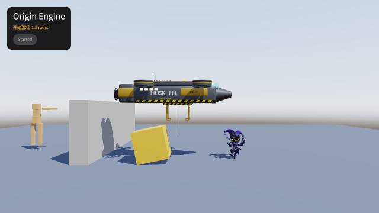

# og polish: game

2026-10-18, 2 playtest(s) on metal. Mechanical measures of og-taste §10 and og-feel §13; a score is 0 to 100, n/a when nothing in the playtests exercises it. The measures cannot judge style: read the frames.

## Scores

| | Score | Measure |
|---|---|---|
| **Taste** | **92** | mean of the taste rows |
| Contrast | 67 | text boxes whose ink and ground reach 4.5:1 |
| Text size | 100 | text boxes whose tallest ink line reaches 9 CSS px (a 13 px face's capitals) |
| HUD occupancy | 100 | gameplay frames: HUD at most 15 % of the surface and 5 % of the central third |
| Screen transitions | n/a | screen changes with UI motion around them |
| UI sounds | 100 | UI presses answered on the ui bus |
| Locale keys | n/a | string tables without missing keys (og cook) |
| **Feel** | **87** | mean of the feel rows |
| Input latency | 100 | inputs answered, by the median ticks to the answer (0–1: 100) |
| Hit feedback | n/a | damage moments with hit stop, shake, floating text or a sound (three of four: 100) |
| Idle frames | 49 | ticks where nothing new is seen or heard (10 %: 100, 60 %: 0) |
| Frame time | 100 | p95 step + render (8.3 ms: 100, 33 ms: 0), worst playtest |
| Sound on input | 100 | inputs answered by a sound within 6 ticks |

## Fixes

| Measure | Where | Found | Fix |
|---|---|---|---|
| idle frames | guard | 49.72 % of ticks show and play nothing new (nothing moves or animates, no UI motion, no sound, no tween, text or particle) | og-feel §9 (idle loops: breathing, a pickup's spin) and og-taste §5 (motion): something alive on every screen |
| contrast | smoke smoke: `Start` "Started" | 3.45:1 between ink and ground (body text wants 4.5:1) | og-taste §3 (value before hue): darken the ground or lighten the ink in the skin's palette, never per call |

## Playtests

### guard

the guard patrols, sees inside its cone and not through the wall, chases, searches and returns (366 ticks)

| Measure | Value |
|---|---|
| Text boxes | 0; 0 at 4.5:1; 0 of 0 at 9 px ink |
| HUD | 0 gameplay frame(s), up to 0 % of the surface, 0 % of the centre |
| UI | 0 screen change(s), 0 with motion; 0 ticks of UI motion; 0 press(es), 0 with a ui-bus sound |
| Inputs | 0, 0 answered, median 0 ticks, max 0; 0 with a sound; 15.45 % of input-free ticks also change something |
| Damage | 0 moment(s): hit stop 0, shake 0, floating text 0, sound 0, tween 0, particles 0 |
| Idle | 49.72 % of ticks |
| Particles | peak 0 system(s), 0 burst(s) |
| Frame (metal) | step 0.48 ms median, 0.68 p95; render 3.4 median, 3.65 p95; frame p95 4.29, max 5.56 |
| Audio | 6.1 s, peak 0, RMS 0, 0 clipped, 100 % silent ticks |

### smoke

A tap on Start spins the trickster and drops the crate; the run writes its frame, dumps and UI tree (150 ticks)

| Measure | Value |
|---|---|
| Text boxes | 3; 2 at 4.5:1; 3 of 3 at 9 px ink |
| Lowest contrast | 3.45:1 `Start` (smoke); 9.29:1 `Status` (smoke); 15.63:1 `Title` (smoke) |
| Smallest ink | 11 px `Start` (smoke); 15 px `Status` (smoke); 26 px `Title` (smoke) |
| HUD | 1 gameplay frame(s), up to 1.35 % of the surface, 0 % of the centre |
| UI | 0 screen change(s), 0 with motion; 1 ticks of UI motion; 1 press(es), 1 with a ui-bus sound |
| Inputs | 1, 1 answered, median 1 ticks, max 1; 1 with a sound; 65.05 % of input-free ticks also change something |
| Damage | 0 moment(s): hit stop 0, shake 0, floating text 0, sound 0, tween 0, particles 0 |
| Idle | 21.43 % of ticks |
| Particles | peak 0 system(s), 0 burst(s) |
| Frame (metal) | step 0.59 ms median, 0.79 p95; render 3.4 median, 3.73 p95; frame p95 4.45, max 128.2 |
| Audio | 2.5 s, peak 0.34, RMS 0.0152, 0 clipped, 78.67 % silent ticks |

 

smoke (tick 120: HUD 1.35 %, 3 texts, 1 under 4.5:1, 0 small)

