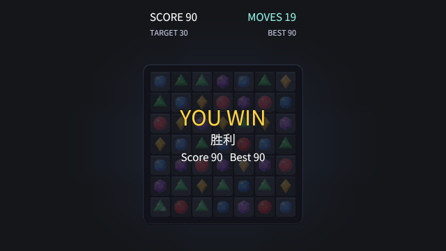
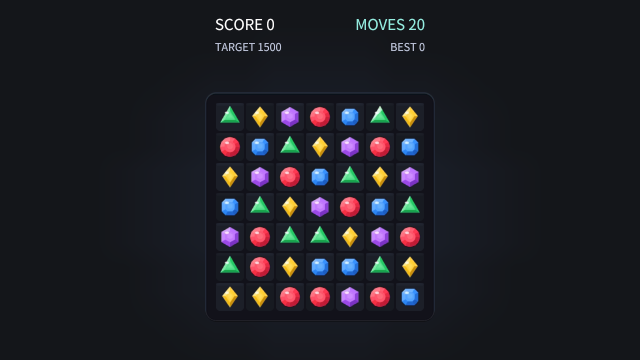
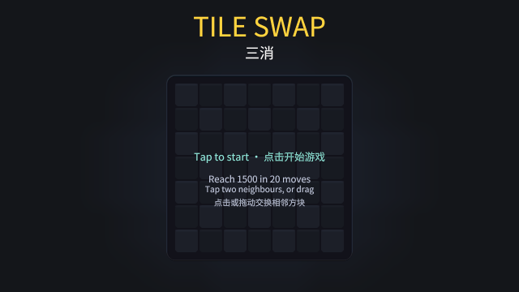

# og polish: match3

2026-10-18, 6 playtest(s) on metal. Mechanical measures of og-taste §10 and og-feel §13; a score is 0 to 100, n/a when nothing in the playtests exercises it. The measures cannot judge style: read the frames.

## Scores

| | Score | Measure |
|---|---|---|
| **Taste** | **n/a** | mean of the taste rows |
| Contrast | n/a | text boxes whose ink and ground reach 4.5:1 |
| Text size | n/a | text boxes whose tallest ink line reaches 9 CSS px (a 13 px face's capitals) |
| HUD occupancy | n/a | gameplay frames: HUD at most 15 % of the surface and 5 % of the central third |
| Screen transitions | n/a | screen changes with UI motion around them |
| UI sounds | n/a | UI presses answered on the ui bus |
| Locale keys | n/a | string tables without missing keys (og cook) |
| **Feel** | **88** | mean of the feel rows |
| Input latency | 100 | inputs answered, by the median ticks to the answer (0–1: 100) |
| Hit feedback | n/a | damage moments with hit stop, shake, floating text or a sound (three of four: 100) |
| Idle frames | 100 | ticks where nothing new is seen or heard (10 %: 100, 60 %: 0) |
| Frame time | 100 | p95 step + render (8.3 ms: 100, 33 ms: 0), worst playtest |
| Sound on input | 53 | inputs answered by a sound within 6 ticks |

## Fixes

No finding crossed a threshold.

## Playtests

### drag

a drag onto a neighbour swaps like two taps (186 ticks)

| Measure | Value |
|---|---|
| Text boxes | 0; 0 at 4.5:1; 0 of 0 at 9 px ink |
| HUD | 0 gameplay frame(s), up to 0 % of the surface, 0 % of the centre |
| UI | 0 screen change(s), 0 with motion; 0 ticks of UI motion; 0 press(es), 0 with a ui-bus sound |
| Inputs | 2, 2 answered, median 0 ticks, max 0; 1 with a sound; 88.66 % of input-free ticks also change something |
| Damage | 0 moment(s): hit stop 0, shake 0, floating text 0, sound 0, tween 0, particles 0 |
| Idle | 0 % of ticks |
| Particles | peak 0 system(s), 0 burst(s) |
| Frame (metal) | step 1.01 ms median, 1.6 p95; render 1.65 median, 2 p95; frame p95 3.4, max 5.52 |
| Audio | 3.1 s, peak 0.19, RMS 0.021, 0 clipped, 72.58 % silent ticks |

### endings

reaching the target wins, running out of moves loses, a press deals again (348 ticks)

| Measure | Value |
|---|---|
| Text boxes | 0; 0 at 4.5:1; 0 of 0 at 9 px ink |
| HUD | 0 gameplay frame(s), up to 0 % of the surface, 0 % of the centre |
| UI | 0 screen change(s), 0 with motion; 0 ticks of UI motion; 0 press(es), 0 with a ui-bus sound |
| Inputs | 2, 2 answered, median 0 ticks, max 0; 0 with a sound; 91.85 % of input-free ticks also change something |
| Damage | 0 moment(s): hit stop 0, shake 0, floating text 0, sound 0, tween 0, particles 0 |
| Idle | 0 % of ticks |
| Particles | peak 0 system(s), 0 burst(s) |
| Frame (metal) | step 1.01 ms median, 1.45 p95; render 1.66 median, 2.01 p95; frame p95 3.35, max 131.79 |
| Audio | 5.8 s, peak 0.19, RMS 0.0312, 0 clipped, 55.75 % silent ticks |

 

won (tick 180: HUD 0 %, 0 texts, 0 under 4.5:1, 0 small)

### frames

the dealt board, a clear and a cascade match their reference frames (132 ticks)

| Measure | Value |
|---|---|
| Text boxes | 0; 0 at 4.5:1; 0 of 0 at 9 px ink |
| HUD | 0 gameplay frame(s), up to 0 % of the surface, 0 % of the centre |
| UI | 0 screen change(s), 0 with motion; 0 ticks of UI motion; 0 press(es), 0 with a ui-bus sound |
| Inputs | 1, 1 answered, median 0 ticks, max 0; 0 with a sound; 93.18 % of input-free ticks also change something |
| Damage | 0 moment(s): hit stop 0, shake 0, floating text 0, sound 0, tween 0, particles 0 |
| Idle | 0 % of ticks |
| Particles | peak 0 system(s), 0 burst(s) |
| Frame (metal) | step 1 ms median, 2.22 p95; render 1.66 median, 2.01 p95; frame p95 3.95, max 150.93 |
| Audio | 2.2 s, peak 0.19, RMS 0.0219, 0 clipped, 74.24 % silent ticks |

 

dealt (tick 72: HUD 0 %, 0 texts, 0 under 4.5:1, 0 small)

### replay

a replay of swaps, clears and a cascade lands on the same world hash (165 ticks)

| Measure | Value |
|---|---|
| Text boxes | 0; 0 at 4.5:1; 0 of 0 at 9 px ink |
| HUD | 0 gameplay frame(s), up to 0 % of the surface, 0 % of the centre |
| UI | 0 screen change(s), 0 with motion; 0 ticks of UI motion; 0 press(es), 0 with a ui-bus sound |
| Inputs | 1, 1 answered, median 0 ticks, max 0; 0 with a sound; 90.91 % of input-free ticks also change something |
| Damage | 0 moment(s): hit stop 0, shake 0, floating text 0, sound 0, tween 0, particles 0 |
| Idle | 0 % of ticks |
| Particles | peak 0 system(s), 0 burst(s) |
| Frame (metal) | step 1.03 ms median, 1.69 p95; render 1.68 median, 1.99 p95; frame p95 3.53, max 5.09 |
| Audio | 2.75 s, peak 0.19, RMS 0.0226, 0 clipped, 64.85 % silent ticks |

### sounds

selections, swaps, clears, a cascade, the win and the loss each play their sound (438 ticks)

| Measure | Value |
|---|---|
| Text boxes | 0; 0 at 4.5:1; 0 of 0 at 9 px ink |
| HUD | 0 gameplay frame(s), up to 0 % of the surface, 0 % of the centre |
| UI | 0 screen change(s), 0 with motion; 0 ticks of UI motion; 0 press(es), 0 with a ui-bus sound |
| Inputs | 6, 6 answered, median 0 ticks, max 0; 4 with a sound; 88.6 % of input-free ticks also change something |
| Damage | 0 moment(s): hit stop 0, shake 0, floating text 0, sound 0, tween 0, particles 0 |
| Idle | 0 % of ticks |
| Particles | peak 0 system(s), 0 burst(s) |
| Frame (metal) | step 0.99 ms median, 1.5 p95; render 1.66 median, 1.98 p95; frame p95 3.39, max 7.05 |
| Audio | 7.3 s, peak 0.19, RMS 0.0283, 0 clipped, 59.82 % silent ticks |

### swap

a swap that makes a line clears, scores and cascades; one that makes nothing is free (246 ticks)

| Measure | Value |
|---|---|
| Text boxes | 0; 0 at 4.5:1; 0 of 0 at 9 px ink |
| HUD | 0 gameplay frame(s), up to 0 % of the surface, 0 % of the centre |
| UI | 0 screen change(s), 0 with motion; 0 ticks of UI motion; 0 press(es), 0 with a ui-bus sound |
| Inputs | 5, 5 answered, median 0 ticks, max 0; 4 with a sound; 85.09 % of input-free ticks also change something |
| Damage | 0 moment(s): hit stop 0, shake 0, floating text 0, sound 0, tween 0, particles 0 |
| Idle | 0 % of ticks |
| Particles | peak 0 system(s), 0 burst(s) |
| Frame (metal) | step 0.99 ms median, 1.95 p95; render 1.66 median, 2.04 p95; frame p95 3.96, max 147.56 |
| Audio | 4.1 s, peak 0.19, RMS 0.0192, 0 clipped, 72.36 % silent ticks |

 

title (tick 18: HUD 0 %, 0 texts, 0 under 4.5:1, 0 small)

