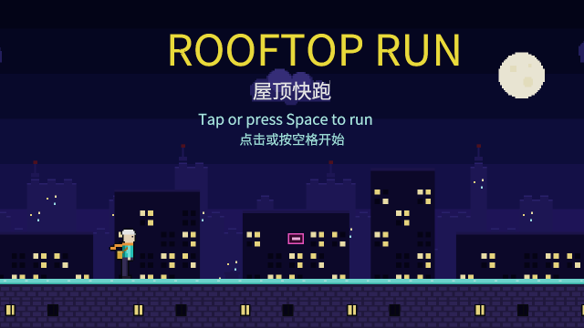
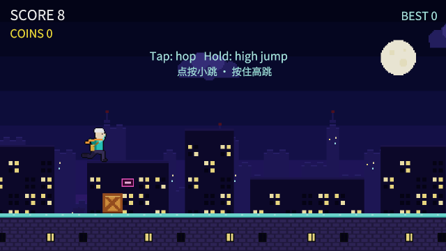

# og polish: runner

2026-10-18, 8 playtest(s) on metal. Mechanical measures of og-taste §10 and og-feel §13; a score is 0 to 100, n/a when nothing in the playtests exercises it. The measures cannot judge style: read the frames.

## Scores

| | Score | Measure |
|---|---|---|
| **Taste** | **n/a** | mean of the taste rows |
| Contrast | n/a | text boxes whose ink and ground reach 4.5:1 |
| Text size | n/a | text boxes whose tallest ink line reaches 9 CSS px (a 13 px face's capitals) |
| HUD occupancy | n/a | gameplay frames: HUD at most 15 % of the surface and 5 % of the central third |
| Screen transitions | n/a | screen changes with UI motion around them |
| UI sounds | n/a | UI presses answered on the ui bus |
| Locale keys | n/a | string tables without missing keys (og cook) |
| **Feel** | **99** | mean of the feel rows |
| Input latency | 100 | inputs answered, by the median ticks to the answer (0–1: 100) |
| Hit feedback | n/a | damage moments with hit stop, shake, floating text or a sound (three of four: 100) |
| Idle frames | 100 | ticks where nothing new is seen or heard (10 %: 100, 60 %: 0) |
| Frame time | 100 | p95 step + render (8.3 ms: 100, 33 ms: 0), worst playtest |
| Sound on input | 95 | inputs answered by a sound within 6 ticks |

## Fixes

No finding crossed a threshold.

## Playtests

### coins

a coin in reach is collected and scores; one out of reach is not (180 ticks)

| Measure | Value |
|---|---|
| Text boxes | 0; 0 at 4.5:1; 0 of 0 at 9 px ink |
| HUD | 0 gameplay frame(s), up to 0 % of the surface, 0 % of the centre |
| UI | 0 screen change(s), 0 with motion; 0 ticks of UI motion; 0 press(es), 0 with a ui-bus sound |
| Inputs | 1, 1 answered, median 0 ticks, max 0; 1 with a sound; 82.73 % of input-free ticks also change something |
| Damage | 0 moment(s): hit stop 0, shake 0, floating text 0, sound 0, tween 0, particles 0 |
| Idle | 0 % of ticks |
| Particles | peak 0 system(s), 0 burst(s) |
| Frame (metal) | step 1.1 ms median, 1.77 p95; render 1.37 median, 1.74 p95; frame p95 3.37, max 5.43 |
| Audio | 3 s, peak 0.14, RMS 0.0171, 0 clipped, 77.78 % silent ticks |

### flow

title, run, crash on a crate, game over, run again (306 ticks)

| Measure | Value |
|---|---|
| Text boxes | 0; 0 at 4.5:1; 0 of 0 at 9 px ink |
| HUD | 0 gameplay frame(s), up to 0 % of the surface, 0 % of the centre |
| UI | 0 screen change(s), 0 with motion; 0 ticks of UI motion; 0 press(es), 0 with a ui-bus sound |
| Inputs | 3, 3 answered, median 0 ticks, max 0; 2 with a sound; 72.41 % of input-free ticks also change something |
| Damage | 0 moment(s): hit stop 0, shake 0, floating text 0, sound 0, tween 0, particles 0 |
| Idle | 9.8 % of ticks |
| Particles | peak 0 system(s), 0 burst(s) |
| Frame (metal) | step 1.08 ms median, 1.54 p95; render 1.38 median, 1.71 p95; frame p95 3.15, max 82.18 |
| Audio | 5.1 s, peak 0.43, RMS 0.0269, 0 clipped, 76.14 % silent ticks |

 

title (tick 18: HUD 0 %, 0 texts, 0 under 4.5:1, 0 small)

### frames

reference frames: title, a coin's pickup, the crash (180 ticks)

| Measure | Value |
|---|---|
| Text boxes | 0; 0 at 4.5:1; 0 of 0 at 9 px ink |
| HUD | 0 gameplay frame(s), up to 0 % of the surface, 0 % of the centre |
| UI | 0 screen change(s), 0 with motion; 0 ticks of UI motion; 0 press(es), 0 with a ui-bus sound |
| Inputs | 1, 1 answered, median 0 ticks, max 0; 1 with a sound; 78.42 % of input-free ticks also change something |
| Damage | 0 moment(s): hit stop 0, shake 0, floating text 0, sound 0, tween 0, particles 0 |
| Idle | 0 % of ticks |
| Particles | peak 0 system(s), 0 burst(s) |
| Frame (metal) | step 1.1 ms median, 1.66 p95; render 1.39 median, 1.72 p95; frame p95 3.35, max 81.31 |
| Audio | 3 s, peak 0.43, RMS 0.03, 0 clipped, 73.33 % silent ticks |

 

title (tick 18: HUD 0 %, 0 texts, 0 under 4.5:1, 0 small)

### jump

a full jump clears a crate and a fence; a hop clears a crate, not a fence (522 ticks)

| Measure | Value |
|---|---|
| Text boxes | 0; 0 at 4.5:1; 0 of 0 at 9 px ink |
| HUD | 0 gameplay frame(s), up to 0 % of the surface, 0 % of the centre |
| UI | 0 screen change(s), 0 with motion; 0 ticks of UI motion; 0 press(es), 0 with a ui-bus sound |
| Inputs | 5, 5 answered, median 0 ticks, max 0; 5 with a sound; 89.08 % of input-free ticks also change something |
| Damage | 0 moment(s): hit stop 0, shake 0, floating text 0, sound 0, tween 0, particles 0 |
| Idle | 0 % of ticks |
| Particles | peak 0 system(s), 0 burst(s) |
| Frame (metal) | step 1.08 ms median, 1.51 p95; render 1.38 median, 1.73 p95; frame p95 3.18, max 75.27 |
| Audio | 8.7 s, peak 0.43, RMS 0.0197, 0 clipped, 81.99 % silent ticks |

 

jump (tick 114: HUD 0 %, 0 texts, 0 under 4.5:1, 0 small)

### records

the best score is read from the store, and a crash submits the score and saves the new best (228 ticks)

| Measure | Value |
|---|---|
| Text boxes | 0; 0 at 4.5:1; 0 of 0 at 9 px ink |
| HUD | 0 gameplay frame(s), up to 0 % of the surface, 0 % of the centre |
| UI | 0 screen change(s), 0 with motion; 0 ticks of UI motion; 0 press(es), 0 with a ui-bus sound |
| Inputs | 1, 1 answered, median 0 ticks, max 0; 1 with a sound; 83.96 % of input-free ticks also change something |
| Damage | 0 moment(s): hit stop 0, shake 0, floating text 0, sound 0, tween 0, particles 0 |
| Idle | 0 % of ticks |
| Particles | peak 0 system(s), 0 burst(s) |
| Frame (metal) | step 1.08 ms median, 1.48 p95; render 1.38 median, 1.72 p95; frame p95 3.15, max 4.01 |
| Audio | 3.8 s, peak 0.43, RMS 0.0278, 0 clipped, 78.95 % silent ticks |

### replay

replay: two runs of jumps, coins and a crash end on one hash (546 ticks)

| Measure | Value |
|---|---|
| Text boxes | 0; 0 at 4.5:1; 0 of 0 at 9 px ink |
| HUD | 0 gameplay frame(s), up to 0 % of the surface, 0 % of the centre |
| UI | 0 screen change(s), 0 with motion; 0 ticks of UI motion; 0 press(es), 0 with a ui-bus sound |
| Inputs | 5, 5 answered, median 0 ticks, max 0; 5 with a sound; 86.09 % of input-free ticks also change something |
| Damage | 0 moment(s): hit stop 0, shake 0, floating text 0, sound 0, tween 0, particles 0 |
| Idle | 2.99 % of ticks |
| Particles | peak 0 system(s), 0 burst(s) |
| Frame (metal) | step 1.06 ms median, 1.45 p95; render 1.35 median, 1.69 p95; frame p95 3.1, max 6.73 |
| Audio | 9.1 s, peak 0.43, RMS 0.0213, 0 clipped, 77.47 % silent ticks |

### sounds

a round's start, a jump, a coin and a crash each play their sound (180 ticks)

| Measure | Value |
|---|---|
| Text boxes | 0; 0 at 4.5:1; 0 of 0 at 9 px ink |
| HUD | 0 gameplay frame(s), up to 0 % of the surface, 0 % of the centre |
| UI | 0 screen change(s), 0 with motion; 0 ticks of UI motion; 0 press(es), 0 with a ui-bus sound |
| Inputs | 2, 2 answered, median 0 ticks, max 0; 2 with a sound; 75.93 % of input-free ticks also change something |
| Damage | 0 moment(s): hit stop 0, shake 0, floating text 0, sound 0, tween 0, particles 0 |
| Idle | 0 % of ticks |
| Particles | peak 0 system(s), 0 burst(s) |
| Frame (metal) | step 1.14 ms median, 1.65 p95; render 1.42 median, 1.74 p95; frame p95 3.31, max 4.54 |
| Audio | 3 s, peak 0.43, RMS 0.0326, 0 clipped, 58.33 % silent ticks |

### tune

set writes Tuning: start speed and gravity change the run (150 ticks)

| Measure | Value |
|---|---|
| Text boxes | 0; 0 at 4.5:1; 0 of 0 at 9 px ink |
| HUD | 0 gameplay frame(s), up to 0 % of the surface, 0 % of the centre |
| UI | 0 screen change(s), 0 with motion; 0 ticks of UI motion; 0 press(es), 0 with a ui-bus sound |
| Inputs | 2, 2 answered, median 0 ticks, max 0; 2 with a sound; 75.64 % of input-free ticks also change something |
| Damage | 0 moment(s): hit stop 0, shake 0, floating text 0, sound 0, tween 0, particles 0 |
| Idle | 0 % of ticks |
| Particles | peak 0 system(s), 0 burst(s) |
| Frame (metal) | step 1.1 ms median, 1.57 p95; render 1.38 median, 1.73 p95; frame p95 3.18, max 4.57 |
| Audio | 2.5 s, peak 0.14, RMS 0.0184, 0 clipped, 77.33 % silent ticks |

