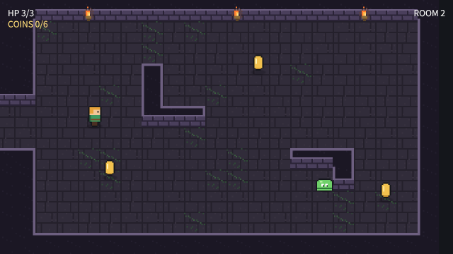
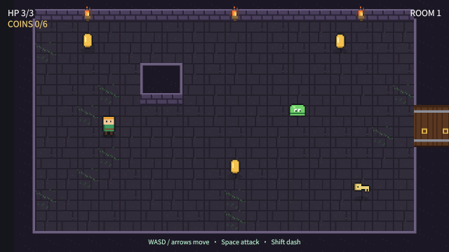
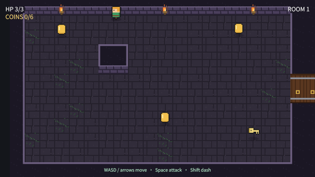

# og polish: topdown

2026-10-18, 7 playtest(s) on metal. Mechanical measures of og-taste §10 and og-feel §13; a score is 0 to 100, n/a when nothing in the playtests exercises it. The measures cannot judge style: read the frames.

## Scores

| | Score | Measure |
|---|---|---|
| **Taste** | **n/a** | mean of the taste rows |
| Contrast | n/a | text boxes whose ink and ground reach 4.5:1 |
| Text size | n/a | text boxes whose tallest ink line reaches 9 CSS px (a 13 px face's capitals) |
| HUD occupancy | n/a | gameplay frames: HUD at most 15 % of the surface and 5 % of the central third |
| Screen transitions | n/a | screen changes with UI motion around them |
| UI sounds | n/a | UI presses answered on the ui bus |
| Locale keys | n/a | string tables without missing keys (og cook) |
| **Feel** | **86** | mean of the feel rows |
| Input latency | 100 | inputs answered, by the median ticks to the answer (0–1: 100) |
| Hit feedback | 100 | damage moments with hit stop, shake, floating text or a sound (three of four: 100) |
| Idle frames | 100 | ticks where nothing new is seen or heard (10 %: 100, 60 %: 0) |
| Frame time | 100 | p95 step + render (8.3 ms: 100, 33 ms: 0), worst playtest |
| Sound on input | 28 | inputs answered by a sound within 6 ticks |

## Fixes

| Measure | Where | Found | Fix |
|---|---|---|---|
| hit feedback | ai | 2 of 2 damage moments (hp) had no hit stop within 8 ticks | og-feel §3 (hit stop by impact weight) |
| hit feedback | combat | 1 of 4 damage moments (hp, hits) had no hit stop within 8 ticks | og-feel §3 (hit stop by impact weight) |

## Playtests

### ai

the slime patrols its beat, chases the hero on sight and bites in reach (336 ticks)

| Measure | Value |
|---|---|
| Text boxes | 0; 0 at 4.5:1; 0 of 0 at 9 px ink |
| HUD | 0 gameplay frame(s), up to 0 % of the surface, 0 % of the centre |
| UI | 0 screen change(s), 0 with motion; 0 ticks of UI motion; 0 press(es), 0 with a ui-bus sound |
| Inputs | 0, 0 answered, median 0 ticks, max 0; 0 with a sound; 28.83 % of input-free ticks also change something |
| Damage | 2 moment(s) from `hp`: hit stop 0, shake 2, floating text 2, sound 2, tween 2, particles 0 |
| Idle | 0 % of ticks |
| Particles | peak 0 system(s), 0 burst(s) |
| Frame (metal) | step 1.25 ms median, 1.64 p95; render 1 median, 1.24 p95; frame p95 2.87, max 6.63 |
| Audio | 5.6 s, peak 0.08, RMS 0.0091, 0 clipped, 93.15 % silent ticks |

### combat

a bite hurts the hero; three sword hits kill the slime with hit stop, flash and a crit (186 ticks)

| Measure | Value |
|---|---|
| Text boxes | 0; 0 at 4.5:1; 0 of 0 at 9 px ink |
| HUD | 0 gameplay frame(s), up to 0 % of the surface, 0 % of the centre |
| UI | 0 screen change(s), 0 with motion; 0 ticks of UI motion; 0 press(es), 0 with a ui-bus sound |
| Inputs | 3, 3 answered, median 0 ticks, max 0; 3 with a sound; 56.63 % of input-free ticks also change something |
| Damage | 4 moment(s) from `hp`, `hits`: hit stop 3, shake 4, floating text 4, sound 4, tween 4, particles 0 |
| Idle | 0 % of ticks |
| Particles | peak 0 system(s), 0 burst(s) |
| Frame (metal) | step 1.27 ms median, 1.74 p95; render 1.02 median, 1.3 p95; frame p95 2.95, max 5.32 |
| Audio | 3.1 s, peak 0.26, RMS 0.0192, 0 clipped, 79.03 % silent ticks |

### door

the doorway blocks until the key, then opens and leads into room 2 (204 ticks)

| Measure | Value |
|---|---|
| Text boxes | 0; 0 at 4.5:1; 0 of 0 at 9 px ink |
| HUD | 0 gameplay frame(s), up to 0 % of the surface, 0 % of the centre |
| UI | 0 screen change(s), 0 with motion; 0 ticks of UI motion; 0 press(es), 0 with a ui-bus sound |
| Inputs | 3, 3 answered, median 0 ticks, max 0; 0 with a sound; 20.79 % of input-free ticks also change something |
| Damage | 0 moment(s): hit stop 0, shake 0, floating text 0, sound 0, tween 0, particles 0 |
| Idle | 0 % of ticks |
| Particles | peak 0 system(s), 0 burst(s) |
| Frame (metal) | step 1.26 ms median, 1.84 p95; render 1.03 median, 1.31 p95; frame p95 3.08, max 74.35 |
| Audio | 3.4 s, peak 0.32, RMS 0.0263, 0 clipped, 77.45 % silent ticks |

 

door (tick 198: HUD 0 %, 0 texts, 0 under 4.5:1, 0 small)

### flee

the pillar hides the hero from the slime, and a hurt slime flees (138 ticks)

| Measure | Value |
|---|---|
| Text boxes | 0; 0 at 4.5:1; 0 of 0 at 9 px ink |
| HUD | 0 gameplay frame(s), up to 0 % of the surface, 0 % of the centre |
| UI | 0 screen change(s), 0 with motion; 0 ticks of UI motion; 0 press(es), 0 with a ui-bus sound |
| Inputs | 0, 0 answered, median 0 ticks, max 0; 0 with a sound; 31.25 % of input-free ticks also change something |
| Damage | 0 moment(s): hit stop 0, shake 0, floating text 0, sound 0, tween 0, particles 0 |
| Idle | 0 % of ticks |
| Particles | peak 0 system(s), 0 burst(s) |
| Frame (metal) | step 1.22 ms median, 1.7 p95; render 0.99 median, 1.31 p95; frame p95 2.85, max 4.74 |
| Audio | 2.3 s, peak 0, RMS 0, 0 clipped, 100 % silent ticks |

### frames

the rooms, a crit's freeze frame and a dash match their reference frames (222 ticks)

| Measure | Value |
|---|---|
| Text boxes | 0; 0 at 4.5:1; 0 of 0 at 9 px ink |
| HUD | 0 gameplay frame(s), up to 0 % of the surface, 0 % of the centre |
| UI | 0 screen change(s), 0 with motion; 0 ticks of UI motion; 0 press(es), 0 with a ui-bus sound |
| Inputs | 5, 5 answered, median 0 ticks, max 0; 3 with a sound; 29.27 % of input-free ticks also change something |
| Damage | 3 moment(s) from `hits`: hit stop 3, shake 3, floating text 3, sound 3, tween 3, particles 0 |
| Idle | 0 % of ticks |
| Particles | peak 0 system(s), 0 burst(s) |
| Frame (metal) | step 1.2 ms median, 1.73 p95; render 1 median, 1.3 p95; frame p95 3.04, max 82.86 |
| Audio | 3.7 s, peak 0.32, RMS 0.0271, 0 clipped, 78.38 % silent ticks |

 

start (tick 30: HUD 0 %, 0 texts, 0 under 4.5:1, 0 small)

### replay

a whole visit replays to the same hash (456 ticks)

| Measure | Value |
|---|---|
| Text boxes | 0; 0 at 4.5:1; 0 of 0 at 9 px ink |
| HUD | 0 gameplay frame(s), up to 0 % of the surface, 0 % of the centre |
| UI | 0 screen change(s), 0 with motion; 0 ticks of UI motion; 0 press(es), 0 with a ui-bus sound |
| Inputs | 11, 11 answered, median 0 ticks, max 0; 1 with a sound; 26.02 % of input-free ticks also change something |
| Damage | 1 moment(s) from `hits`: hit stop 1, shake 1, floating text 1, sound 1, tween 1, particles 0 |
| Idle | 0 % of ticks |
| Particles | peak 0 system(s), 0 burst(s) |
| Frame (metal) | step 1.22 ms median, 1.67 p95; render 1 median, 1.27 p95; frame p95 2.88, max 6.38 |
| Audio | 7.6 s, peak 0.32, RMS 0.0193, 0 clipped, 85.09 % silent ticks |

### walk

the hero walks at its speed, steps on the walk frames and stops at walls (336 ticks)

| Measure | Value |
|---|---|
| Text boxes | 0; 0 at 4.5:1; 0 of 0 at 9 px ink |
| HUD | 0 gameplay frame(s), up to 0 % of the surface, 0 % of the centre |
| UI | 0 screen change(s), 0 with motion; 0 ticks of UI motion; 0 press(es), 0 with a ui-bus sound |
| Inputs | 3, 3 answered, median 0 ticks, max 0; 0 with a sound; 23.61 % of input-free ticks also change something |
| Damage | 0 moment(s): hit stop 0, shake 0, floating text 0, sound 0, tween 0, particles 0 |
| Idle | 0 % of ticks |
| Particles | peak 0 system(s), 0 burst(s) |
| Frame (metal) | step 1.26 ms median, 1.64 p95; render 1 median, 1.27 p95; frame p95 2.86, max 76.8 |
| Audio | 5.6 s, peak 0, RMS 0, 0 clipped, 100 % silent ticks |

 

walk (tick 216: HUD 0 %, 0 texts, 0 under 4.5:1, 0 small)

