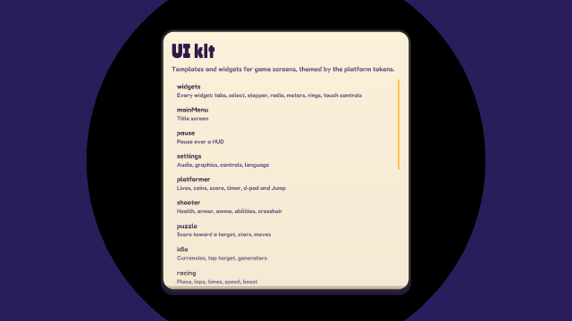
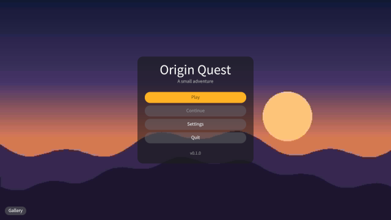
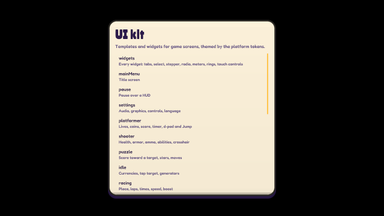
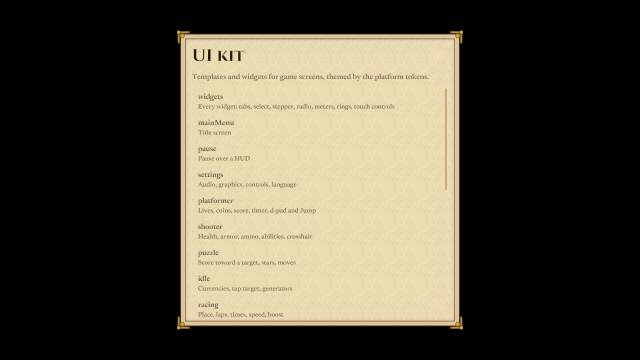

# og polish: ui-kit

2026-10-18, 19 playtest(s) on metal. Mechanical measures of og-taste §10 and og-feel §13; a score is 0 to 100, n/a when nothing in the playtests exercises it. The measures cannot judge style: read the frames.

## Scores

| | Score | Measure |
|---|---|---|
| **Taste** | **78** | mean of the taste rows |
| Contrast | 79 | text boxes whose ink and ground reach 4.5:1 |
| Text size | 98 | text boxes whose tallest ink line reaches 9 CSS px (a 13 px face's capitals) |
| HUD occupancy | 29 | gameplay frames: HUD at most 15 % of the surface and 5 % of the central third |
| Screen transitions | 98 | screen changes with UI motion around them |
| UI sounds | 62 | UI presses answered on the ui bus |
| Locale keys | 100 | string tables without missing keys (og cook) |
| **Feel** | **62** | mean of the feel rows |
| Input latency | 99 | inputs answered, by the median ticks to the answer (0–1: 100) |
| Hit feedback | 0 | damage moments with hit stop, shake, floating text or a sound (three of four: 100) |
| Idle frames | 75 | ticks where nothing new is seen or heard (10 %: 100, 60 %: 0) |
| Frame time | 100 | p95 step + render (8.3 ms: 100, 33 ms: 0), worst playtest |
| Sound on input | 38 | inputs answered by a sound within 6 ticks |

## Fixes

| Measure | Where | Found | Fix |
|---|---|---|---|
| contrast | frames-desktop tutorial: `Footer` "v0.1.0" | 1.37:1 between ink and ground (body text wants 4.5:1) | og-taste §3 (value before hue): darken the ground or lighten the ink in the skin's palette, never per call |
| contrast | frames-desktop mainMenu: `continue` "Continue" | 2.7:1 between ink and ground (body text wants 4.5:1) | og-taste §3 (value before hue): darken the ground or lighten the ink in the skin's palette, never per call |
| contrast | frames-desktop confirm: `Confirm` "Delete" | 2.91:1 between ink and ground (body text wants 4.5:1) | og-taste §3 (value before hue): darken the ground or lighten the ink in the skin's palette, never per call |
| text size | frames-desktop shop: `Name` "Iron sword" | ink lines 7 CSS px tall (a 13 px face's capitals and digits are about 9) | og-taste §4 and §9.6: use the ramp's body step or larger for anything read on a phone |
| text size | frames-desktop idle: `Name` "Farm" | ink lines 8 CSS px tall (a 13 px face's capitals and digits are about 9) | og-taste §4 and §9.6: use the ramp's body step or larger for anything read on a phone |
| HUD occupancy | frames-desktop | the HUD covers up to 23.08 % of the surface and 22.64 % of the central third | og-taste §2 (the play surface is the hero; HUD weight): capsules in the corners, the centre third free |
| idle frames | frames-desktop | 27.08 % of ticks show and play nothing new (nothing moves or animates, no UI motion, no sound, no tween, text or particle) | og-feel §9 (idle loops: breathing, a pickup's spin) and og-taste §5 (motion): something alive on every screen |
| contrast | frames-phone leaderboard: `Rank` "5" | 1.17:1 between ink and ground (body text wants 4.5:1) | og-taste §3 (value before hue): darken the ground or lighten the ink in the skin's palette, never per call |
| contrast | frames-phone leaderboard: `Name` "Moe62" | 1.17:1 between ink and ground (body text wants 4.5:1) | og-taste §3 (value before hue): darken the ground or lighten the ink in the skin's palette, never per call |
| contrast | frames-phone leaderboard: `Score` "92,760" | 1.17:1 between ink and ground (body text wants 4.5:1) | og-taste §3 (value before hue): darken the ground or lighten the ink in the skin's palette, never per call |
| text size | frames-phone widgets: `New` "New" | ink lines 4 CSS px tall (a 13 px face's capitals and digits are about 9) | og-taste §4 and §9.6: use the ramp's body step or larger for anything read on a phone |
| text size | frames-phone widgets: `Sale` "-20%" | ink lines 4 CSS px tall (a 13 px face's capitals and digits are about 9) | og-taste §4 and §9.6: use the ramp's body step or larger for anything read on a phone |
| text size | frames-phone widgets: `Rare` "Rare" | ink lines 4 CSS px tall (a 13 px face's capitals and digits are about 9) | og-taste §4 and §9.6: use the ramp's body step or larger for anything read on a phone |
| screen transitions | frames-phone | 2 of 24 screen changes had no motion in the 20 ticks around them | og-taste §5 (screens change through a transition): og.ui.screenTransition, one kind per game |
| idle frames | frames-phone | 31.04 % of ticks show and play nothing new (nothing moves or animates, no UI motion, no sound, no tween, text or particle) | og-feel §9 (idle loops: breathing, a pickup's spin) and og-taste §5 (motion): something alive on every screen |
| input response | gamepad | 1 of 18 inputs changed nothing seen or heard within 30 ticks | og-feel §1 (answer on the same tick) and og-taste §6: every press shows an answer, a refused one too |
| contrast | juice count-up: `Gallery` "Gallery" | 2.13:1 between ink and ground (body text wants 4.5:1) | og-taste §3 (value before hue): darken the ground or lighten the ink in the skin's palette, never per call |
| contrast | juice landed: `Gallery` "Gallery" | 2.13:1 between ink and ground (body text wants 4.5:1) | og-taste §3 (value before hue): darken the ground or lighten the ink in the skin's palette, never per call |
| contrast | juice iris-opening: `Best` "Best 12,840" | 2.52:1 between ink and ground (body text wants 4.5:1) | og-taste §3 (value before hue): darken the ground or lighten the ink in the skin's palette, never per call |
| contrast | locales mainMenu-zh-CN: `continue` "继续" | 2.34:1 between ink and ground (body text wants 4.5:1) | og-taste §3 (value before hue): darken the ground or lighten the ink in the skin's palette, never per call |
| contrast | locales mainMenu-ar: `continue` "متابعة" | 2.47:1 between ink and ground (body text wants 4.5:1) | og-taste §3 (value before hue): darken the ground or lighten the ink in the skin's palette, never per call |
| contrast | locales mainMenu-ar: `play` "العب" | 2.52:1 between ink and ground (body text wants 4.5:1) | og-taste §3 (value before hue): darken the ground or lighten the ink in the skin's palette, never per call |
| screen transitions | locales | 4 of 15 screen changes had no motion in the 20 ticks around them | og-taste §5 (screens change through a transition): og.ui.screenTransition, one kind per game |
| idle frames | locales | 57.12 % of ticks show and play nothing new (nothing moves or animates, no UI motion, no sound, no tween, text or particle) | og-feel §9 (idle loops: breathing, a pickup's spin) and og-taste §5 (motion): something alive on every screen |
| UI sounds | multitouch | 2 of 2 UI presses played no sound on the ui bus | og-taste §6 (feedback) and og-audio §3: give the skin or og.ui.configure its press and open sounds |
| hit feedback | multitouch | 1 of 1 damage moments (hp) had no hit stop within 8 ticks | og-feel §3 (hit stop by impact weight) |
| hit feedback | multitouch | 1 of 1 damage moments (hp) had no shake within 8 ticks | og-feel §4 (trauma, not offsets) |
| hit feedback | multitouch | 1 of 1 damage moments (hp) had no floating text within 8 ticks | og-feel §7 (floating text) |
| hit feedback | multitouch | 1 of 1 damage moments (hp) had no a sound within 8 ticks | og-audio §1 (every event sounds; a hit's sound on its tick) |
| UI sounds | phone | 1 of 1 UI presses played no sound on the ui bus | og-taste §6 (feedback) and og-audio §3: give the skin or og.ui.configure its press and open sounds |
| idle frames | phone | 96.43 % of ticks show and play nothing new (nothing moves or animates, no UI motion, no sound, no tween, text or particle) | og-feel §9 (idle loops: breathing, a pickup's spin) and og-taste §5 (motion): something alive on every screen |
| contrast | skin-cartoon pause: `Level` "1-2 Old mill" | 1.22:1 between ink and ground (body text wants 4.5:1) | og-taste §3 (value before hue): darken the ground or lighten the ink in the skin's palette, never per call |
| contrast | skin-cartoon shooter: `Zone` "Sector 4" | 1.62:1 between ink and ground (body text wants 4.5:1) | og-taste §3 (value before hue): darken the ground or lighten the ink in the skin's palette, never per call |
| contrast | skin-cartoon loading: `Percent` "100%" | 1.67:1 between ink and ground (body text wants 4.5:1) | og-taste §3 (value before hue): darken the ground or lighten the ink in the skin's palette, never per call |
| text size | skin-cartoon tutorial: `Footer` "v0.1.0" | ink lines 5 CSS px tall (a 13 px face's capitals and digits are about 9) | og-taste §4 and §9.6: use the ramp's body step or larger for anything read on a phone |
| text size | skin-cartoon shooter: `Gallery` "Gallery" | ink lines 6 CSS px tall (a 13 px face's capitals and digits are about 9) | og-taste §4 and §9.6: use the ramp's body step or larger for anything read on a phone |
| text size | skin-cartoon shop: `Name` "Iron sword" | ink lines 7 CSS px tall (a 13 px face's capitals and digits are about 9) | og-taste §4 and §9.6: use the ramp's body step or larger for anything read on a phone |
| HUD occupancy | skin-cartoon | the HUD covers up to 23.08 % of the surface and 22.64 % of the central third | og-taste §2 (the play surface is the hero; HUD weight): capsules in the corners, the centre third free |
| contrast | skin-fantasy cutscene: `Gallery` "Gallery" | 1.23:1 between ink and ground (body text wants 4.5:1) | og-taste §3 (value before hue): darken the ground or lighten the ink in the skin's palette, never per call |
| contrast | skin-fantasy shooter: `Zone` "Sector 4" | 1.36:1 between ink and ground (body text wants 4.5:1) | og-taste §3 (value before hue): darken the ground or lighten the ink in the skin's palette, never per call |
| contrast | skin-fantasy mainMenu: `continue` "Continue" | 1.64:1 between ink and ground (body text wants 4.5:1) | og-taste §3 (value before hue): darken the ground or lighten the ink in the skin's palette, never per call |
| text size | skin-fantasy shop: `Name` "Iron sword" | ink lines 6 CSS px tall (a 13 px face's capitals and digits are about 9) | og-taste §4 and §9.6: use the ramp's body step or larger for anything read on a phone |
| text size | skin-fantasy widgets: `New` "New" | ink lines 8 CSS px tall (a 13 px face's capitals and digits are about 9) | og-taste §4 and §9.6: use the ramp's body step or larger for anything read on a phone |
| HUD occupancy | skin-fantasy | the HUD covers up to 23.08 % of the surface and 22.64 % of the central third | og-taste §2 (the play surface is the hero; HUD weight): capsules in the corners, the centre third free |
| contrast | skin-neon cutscene: `Gallery` "Gallery" | 1.65:1 between ink and ground (body text wants 4.5:1) | og-taste §3 (value before hue): darken the ground or lighten the ink in the skin's palette, never per call |
| contrast | skin-neon confirm: `Confirm` "Delete" | 1.99:1 between ink and ground (body text wants 4.5:1) | og-taste §3 (value before hue): darken the ground or lighten the ink in the skin's palette, never per call |
| contrast | skin-neon shooter: `Armor` "35" | 2.05:1 between ink and ground (body text wants 4.5:1) | og-taste §3 (value before hue): darken the ground or lighten the ink in the skin's palette, never per call |
| text size | skin-neon shop: `Name` "Iron sword" | ink lines 7 CSS px tall (a 13 px face's capitals and digits are about 9) | og-taste §4 and §9.6: use the ramp's body step or larger for anything read on a phone |
| text size | skin-neon tutorial: `Footer` "v0.1.0" | ink lines 7 CSS px tall (a 13 px face's capitals and digits are about 9) | og-taste §4 and §9.6: use the ramp's body step or larger for anything read on a phone |
| text size | skin-neon widgets: `New` "New" | ink lines 8 CSS px tall (a 13 px face's capitals and digits are about 9) | og-taste §4 and §9.6: use the ramp's body step or larger for anything read on a phone |
| HUD occupancy | skin-neon | the HUD covers up to 23.08 % of the surface and 22.64 % of the central third | og-taste §2 (the play surface is the hero; HUD weight): capsules in the corners, the centre third free |
| contrast | skin-paper cutscene: `Gallery` "Gallery" | 1.47:1 between ink and ground (body text wants 4.5:1) | og-taste §3 (value before hue): darken the ground or lighten the ink in the skin's palette, never per call |
| contrast | skin-paper pause: `Level` "1-2 Old mill" | 1.53:1 between ink and ground (body text wants 4.5:1) | og-taste §3 (value before hue): darken the ground or lighten the ink in the skin's palette, never per call |
| contrast | skin-paper shooter: `Zone` "Sector 4" | 1.63:1 between ink and ground (body text wants 4.5:1) | og-taste §3 (value before hue): darken the ground or lighten the ink in the skin's palette, never per call |
| text size | skin-paper shop: `Name` "Iron sword" | ink lines 7 CSS px tall (a 13 px face's capitals and digits are about 9) | og-taste §4 and §9.6: use the ramp's body step or larger for anything read on a phone |
| text size | skin-paper idle: `Name` "Farm" | ink lines 8 CSS px tall (a 13 px face's capitals and digits are about 9) | og-taste §4 and §9.6: use the ramp's body step or larger for anything read on a phone |
| HUD occupancy | skin-paper | the HUD covers up to 23.08 % of the surface and 22.64 % of the central third | og-taste §2 (the play surface is the hero; HUD weight): capsules in the corners, the centre third free |
| contrast | skin-pixel tutorial: `Footer` "v0.1.0" | 1.2:1 between ink and ground (body text wants 4.5:1) | og-taste §3 (value before hue): darken the ground or lighten the ink in the skin's palette, never per call |
| contrast | skin-pixel tutorial: `continue` "Continue" | 1.65:1 between ink and ground (body text wants 4.5:1) | og-taste §3 (value before hue): darken the ground or lighten the ink in the skin's palette, never per call |
| contrast | skin-pixel shop: `Price` "2,400" | 2.05:1 between ink and ground (body text wants 4.5:1) | og-taste §3 (value before hue): darken the ground or lighten the ink in the skin's palette, never per call |
| text size | skin-pixel tutorial: `Footer` "v0.1.0" | ink lines 2 CSS px tall (a 13 px face's capitals and digits are about 9) | og-taste §4 and §9.6: use the ramp's body step or larger for anything read on a phone |
| text size | skin-pixel shop: `Name` "Iron sword" | ink lines 8 CSS px tall (a 13 px face's capitals and digits are about 9) | og-taste §4 and §9.6: use the ramp's body step or larger for anything read on a phone |
| HUD occupancy | skin-pixel | the HUD covers up to 22.52 % of the surface and 22.64 % of the central third | og-taste §2 (the play surface is the hero; HUD weight): capsules in the corners, the centre third free |
| idle frames | skin-pixel | 26.5 % of ticks show and play nothing new (nothing moves or animates, no UI motion, no sound, no tween, text or particle) | og-feel §9 (idle loops: breathing, a pickup's spin) and og-taste §5 (motion): something alive on every screen |
| contrast | skin-scifi shooter: `Armor` "35" | 1.59:1 between ink and ground (body text wants 4.5:1) | og-taste §3 (value before hue): darken the ground or lighten the ink in the skin's palette, never per call |
| contrast | skin-scifi cutscene: `Gallery` "Gallery" | 1.76:1 between ink and ground (body text wants 4.5:1) | og-taste §3 (value before hue): darken the ground or lighten the ink in the skin's palette, never per call |
| contrast | skin-scifi widgets: `Health` "72 / 100" | 1.9:1 between ink and ground (body text wants 4.5:1) | og-taste §3 (value before hue): darken the ground or lighten the ink in the skin's palette, never per call |
| text size | skin-scifi shop: `Name` "Iron sword" | ink lines 6 CSS px tall (a 13 px face's capitals and digits are about 9) | og-taste §4 and §9.6: use the ramp's body step or larger for anything read on a phone |
| text size | skin-scifi idle: `Name` "Farm" | ink lines 7 CSS px tall (a 13 px face's capitals and digits are about 9) | og-taste §4 and §9.6: use the ramp's body step or larger for anything read on a phone |
| HUD occupancy | skin-scifi | the HUD covers up to 23.06 % of the surface and 22.64 % of the central third | og-taste §2 (the play surface is the hero; HUD weight): capsules in the corners, the centre third free |
| UI sounds | sounds | 1 of 2 UI presses played no sound on the ui bus | og-taste §6 (feedback) and og-audio §3: give the skin or og.ui.configure its press and open sounds |
| UI sounds | touch | 3 of 9 UI presses played no sound on the ui bus | og-taste §6 (feedback) and og-audio §3: give the skin or og.ui.configure its press and open sounds |
| UI sounds | tutorial | 1 of 4 UI presses played no sound on the ui bus | og-taste §6 (feedback) and og-audio §3: give the skin or og.ui.configure its press and open sounds |

## Playtests

### drag

a drag from one inventory slot to another moves the item (108 ticks)

| Measure | Value |
|---|---|
| Text boxes | 0; 0 at 4.5:1; 0 of 0 at 9 px ink |
| HUD | 0 gameplay frame(s), up to 0 % of the surface, 0 % of the centre |
| UI | 3 screen change(s), 3 with motion; 107 ticks of UI motion; 2 press(es), 2 with a ui-bus sound |
| Inputs | 2, 2 answered, median 0 ticks, max 0; 2 with a sound; 100 % of input-free ticks also change something |
| Damage | 0 moment(s): hit stop 0, shake 0, floating text 0, sound 0, tween 0, particles 0 |
| Idle | 0 % of ticks |
| Particles | peak 0 system(s), 0 burst(s) |
| Frame (metal) | step 1.05 ms median, 1.43 p95; render 0.78 median, 1.02 p95; frame p95 2.36, max 3.87 |
| Audio | 1.8 s, peak 0.21, RMS 0.0243, 0 clipped, 77.78 % silent ticks |

### frames-desktop

every screen at desktop size matches its reference frame (1044 ticks)

| Measure | Value |
|---|---|
| Text boxes | 249; 214 at 4.5:1; 247 of 249 at 9 px ink |
| Lowest contrast | 1.37:1 `Footer` (tutorial); 2.7:1 `continue` (mainMenu); 2.91:1 `Confirm` (confirm) |
| Smallest ink | 7 px `Name` (shop); 8 px `Name` (idle); 9 px `New` (widgets) |
| HUD | 7 gameplay frame(s), up to 23.08 % of the surface, 22.64 % of the centre |
| UI | 24 screen change(s), 24 with motion; 701 ticks of UI motion; 0 press(es), 0 with a ui-bus sound |
| Inputs | 0, 0 answered, median 0 ticks, max 0; 0 with a sound; 72.15 % of input-free ticks also change something |
| Damage | 0 moment(s): hit stop 0, shake 0, floating text 0, sound 0, tween 0, particles 0 |
| Idle | 27.08 % of ticks |
| Particles | peak 0 system(s), 0 burst(s) |
| Frame (metal) | step 0.84 ms median, 1.73 p95; render 0.7 median, 0.94 p95; frame p95 2.54, max 89.8 |
| Audio | 17.4 s, peak 0.16, RMS 0.0156, 0 clipped, 90.42 % silent ticks |

 

gallery (tick 66, menu: HUD 8.56 %, 12 texts, 0 under 4.5:1, 0 small)

### frames-phone

every screen on a phone in portrait matches its reference frame (1044 ticks)

| Measure | Value |
|---|---|
| Text boxes | 24; 9 at 4.5:1; 17 of 24 at 9 px ink |
| Lowest contrast | 1.17:1 `Rank` (leaderboard); 1.17:1 `Name` (leaderboard); 1.17:1 `Score` (leaderboard) |
| Smallest ink | 4 px `New` (widgets); 4 px `Sale` (widgets); 4 px `Rare` (widgets) |
| HUD | 21 gameplay frame(s), up to 11.15 % of the surface, 0 % of the centre |
| UI | 24 screen change(s), 22 with motion; 661 ticks of UI motion; 0 press(es), 0 with a ui-bus sound |
| Inputs | 0, 0 answered, median 0 ticks, max 0; 0 with a sound; 68.18 % of input-free ticks also change something |
| Damage | 0 moment(s): hit stop 0, shake 0, floating text 0, sound 0, tween 0, particles 0 |
| Idle | 31.04 % of ticks |
| Particles | peak 0 system(s), 0 burst(s) |
| Frame (metal) | step 0.88 ms median, 1.76 p95; render 0.72 median, 0.97 p95; frame p95 2.61, max 279.81 |
| Audio | 17.4 s, peak 0.16, RMS 0.0156, 0 clipped, 90.42 % silent ticks |

 

gallery (tick 66: HUD 3.12 %, 5 texts, 0 under 4.5:1, 2 small)

### gamepad

a gamepad's d-pad, stick, A and B drive the gallery through og.Gamepad (168 ticks)

| Measure | Value |
|---|---|
| Text boxes | 0; 0 at 4.5:1; 0 of 0 at 9 px ink |
| HUD | 0 gameplay frame(s), up to 0 % of the surface, 0 % of the centre |
| UI | 3 screen change(s), 3 with motion; 133 ticks of UI motion; 0 press(es), 0 with a ui-bus sound |
| Inputs | 18, 17 answered, median 0 ticks, max 0; 2 with a sound; 87.5 % of input-free ticks also change something |
| Damage | 0 moment(s): hit stop 0, shake 0, floating text 0, sound 0, tween 0, particles 0 |
| Idle | 21.52 % of ticks |
| Particles | peak 0 system(s), 0 burst(s) |
| Frame (metal) | step 1.22 ms median, 1.56 p95; render 0.67 median, 0.91 p95; frame p95 2.46, max 2.75 |
| Audio | 2.8 s, peak 0.16, RMS 0.0123, 0 clipped, 94.05 % silent ticks |

### juice

an iris transition switches screens at full cover, the score counts up, UI events sound (210 ticks)

| Measure | Value |
|---|---|
| Text boxes | 46; 41 at 4.5:1; 46 of 46 at 9 px ink |
| Lowest contrast | 2.13:1 `Gallery` (count-up); 2.13:1 `Gallery` (landed); 2.52:1 `Best` (iris-opening) |
| Smallest ink | 9 px `Blurb` (iris-closing); 9 px `NewBest` (landed); 10 px `Blurb` (iris-closing) |
| HUD | 0 gameplay frame(s), up to 0 % of the surface, 0 % of the centre |
| UI | 5 screen change(s), 5 with motion; 185 ticks of UI motion; 1 press(es), 1 with a ui-bus sound |
| Inputs | 1, 1 answered, median 0 ticks, max 0; 1 with a sound; 87.5 % of input-free ticks also change something |
| Damage | 0 moment(s): hit stop 0, shake 0, floating text 0, sound 0, tween 0, particles 0 |
| Idle | 11.5 % of ticks |
| Particles | peak 0 system(s), 0 burst(s) |
| Frame (metal) | step 0.97 ms median, 2.93 p95; render 0.88 median, 1.16 p95; frame p95 3.91, max 95.82 |
| Audio | 3.5 s, peak 0.21, RMS 0.0182, 0 clipped, 87.62 % silent ticks |

 

iris-closing (tick 27, menu: HUD 8.06 %, 12 texts, 1 under 4.5:1, 0 small)

### keys

keyboard focus opens a screen, steps a slider and closes the settings with a save (204 ticks)

| Measure | Value |
|---|---|
| Text boxes | 0; 0 at 4.5:1; 0 of 0 at 9 px ink |
| HUD | 0 gameplay frame(s), up to 0 % of the surface, 0 % of the centre |
| UI | 4 screen change(s), 4 with motion; 175 ticks of UI motion; 0 press(es), 0 with a ui-bus sound |
| Inputs | 7, 7 answered, median 0 ticks, max 0; 1 with a sound; 100 % of input-free ticks also change something |
| Damage | 0 moment(s): hit stop 0, shake 0, floating text 0, sound 0, tween 0, particles 0 |
| Idle | 14.43 % of ticks |
| Particles | peak 0 system(s), 0 burst(s) |
| Frame (metal) | step 1.05 ms median, 1.55 p95; render 0.7 median, 0.95 p95; frame p95 2.43, max 3.86 |
| Audio | 3.4 s, peak 0.16, RMS 0.0193, 0 clipped, 85.78 % silent ticks |

### locales

the menu, pause and confirm screens in en, zh-CN, ja, ko and ar match their reference frames (768 ticks)

| Measure | Value |
|---|---|
| Text boxes | 115; 96 at 4.5:1; 115 of 115 at 9 px ink |
| Lowest contrast | 2.34:1 `continue` (mainMenu-zh-CN); 2.47:1 `continue` (mainMenu-ar); 2.52:1 `play` (mainMenu-ar) |
| Smallest ink | 10 px `Footer` (mainMenu-en); 11 px `Subtitle` (mainMenu-en); 11 px `continue` (mainMenu-en) |
| HUD | 0 gameplay frame(s), up to 0 % of the surface, 0 % of the centre |
| UI | 15 screen change(s), 11 with motion; 334 ticks of UI motion; 0 press(es), 0 with a ui-bus sound |
| Inputs | 0, 0 answered, median 0 ticks, max 0; 0 with a sound; 42.88 % of input-free ticks also change something |
| Damage | 0 moment(s): hit stop 0, shake 0, floating text 0, sound 0, tween 0, particles 0 |
| Idle | 57.12 % of ticks |
| Particles | peak 0 system(s), 0 burst(s) |
| Frame (metal) | step 0.83 ms median, 1.31 p95; render 0.7 median, 0.94 p95; frame p95 2.25, max 83.45 |
| Audio | 12.8 s, peak 0.16, RMS 0.0182, 0 clipped, 86.98 % silent ticks |

 

mainMenu-en (tick 60, menu: HUD 10.17 %, 8 texts, 2 under 4.5:1, 0 small)

### multitouch

a stick held by one touch and a button tapped by another work together (72 ticks)

| Measure | Value |
|---|---|
| Text boxes | 0; 0 at 4.5:1; 0 of 0 at 9 px ink |
| HUD | 0 gameplay frame(s), up to 0 % of the surface, 0 % of the centre |
| UI | 0 screen change(s), 0 with motion; 71 ticks of UI motion; 2 press(es), 0 with a ui-bus sound |
| Inputs | 2, 2 answered, median 0 ticks, max 0; 0 with a sound; 100 % of input-free ticks also change something |
| Damage | 1 moment(s) from `hp`: hit stop 0, shake 0, floating text 0, sound 0, tween 0, particles 0 |
| Idle | 0 % of ticks |
| Particles | peak 0 system(s), 0 burst(s) |
| Frame (metal) | step 1.25 ms median, 1.56 p95; render 0.75 median, 0.95 p95; frame p95 2.47, max 2.83 |
| Audio | 1.2 s, peak 0, RMS 0, 0 clipped, 100 % silent ticks |

### pad

gamepad navigation moves through the gallery, opens a screen and backs out (216 ticks)

| Measure | Value |
|---|---|
| Text boxes | 0; 0 at 4.5:1; 0 of 0 at 9 px ink |
| HUD | 0 gameplay frame(s), up to 0 % of the surface, 0 % of the centre |
| UI | 3 screen change(s), 3 with motion; 215 ticks of UI motion; 0 press(es), 0 with a ui-bus sound |
| Inputs | 0, 0 answered, median 0 ticks, max 0; 0 with a sound; 100 % of input-free ticks also change something |
| Damage | 0 moment(s): hit stop 0, shake 0, floating text 0, sound 0, tween 0, particles 0 |
| Idle | 0 % of ticks |
| Particles | peak 0 system(s), 0 burst(s) |
| Frame (metal) | step 1.23 ms median, 1.56 p95; render 0.72 median, 0.98 p95; frame p95 2.43, max 4.61 |
| Audio | 3.6 s, peak 0.16, RMS 0.0108, 0 clipped, 95.37 % silent ticks |

### phone

on a phone the HUD keeps to the safe area and its touch controls to 44 px (66 ticks)

| Measure | Value |
|---|---|
| Text boxes | 0; 0 at 4.5:1; 0 of 0 at 9 px ink |
| HUD | 0 gameplay frame(s), up to 0 % of the surface, 0 % of the centre |
| UI | 1 screen change(s), 1 with motion; 6 ticks of UI motion; 1 press(es), 0 with a ui-bus sound |
| Inputs | 1, 1 answered, median 1 ticks, max 1; 0 with a sound; 0 % of input-free ticks also change something |
| Damage | 0 moment(s): hit stop 0, shake 0, floating text 0, sound 0, tween 0, particles 0 |
| Idle | 96.43 % of ticks |
| Particles | peak 0 system(s), 0 burst(s) |
| Frame (metal) | step 0.93 ms median, 1.39 p95; render 0.75 median, 1 p95; frame p95 2.37, max 3.77 |
| Audio | 1.1 s, peak 0, RMS 0, 0 clipped, 100 % silent ticks |

### skin-cartoon

every screen in the cartoon style pack matches its cell of kit-skin-cartoon.png (1044 ticks)

| Measure | Value |
|---|---|
| Text boxes | 238; 187 at 4.5:1; 232 of 238 at 9 px ink |
| Lowest contrast | 1.22:1 `Level` (pause); 1.62:1 `Zone` (shooter); 1.67:1 `Percent` (loading) |
| Smallest ink | 5 px `Footer` (tutorial); 6 px `Gallery` (shooter); 7 px `Name` (shop) |
| HUD | 7 gameplay frame(s), up to 23.08 % of the surface, 22.64 % of the centre |
| UI | 29 screen change(s), 29 with motion; 770 ticks of UI motion; 0 press(es), 0 with a ui-bus sound |
| Inputs | 0, 0 answered, median 0 ticks, max 0; 0 with a sound; 77.85 % of input-free ticks also change something |
| Damage | 0 moment(s): hit stop 0, shake 0, floating text 0, sound 0, tween 0, particles 0 |
| Idle | 22.15 % of ticks |
| Particles | peak 0 system(s), 0 burst(s) |
| Frame (metal) | step 0.89 ms median, 1.8 p95; render 0.83 median, 1.1 p95; frame p95 2.86, max 97.88 |
| Audio | 17.4 s, peak 0.16, RMS 0.0156, 0 clipped, 90.42 % silent ticks |

 

gallery (tick 66, menu: HUD 8.06 %, 12 texts, 0 under 4.5:1, 0 small)

### skin-fantasy

every screen in the fantasy style pack matches its cell of kit-skin-fantasy.png (1044 ticks)

| Measure | Value |
|---|---|
| Text boxes | 239; 177 at 4.5:1; 237 of 239 at 9 px ink |
| Lowest contrast | 1.23:1 `Gallery` (cutscene); 1.36:1 `Zone` (shooter); 1.64:1 `continue` (mainMenu) |
| Smallest ink | 6 px `Name` (shop); 8 px `New` (widgets); 9 px `Blurb` (gallery) |
| HUD | 7 gameplay frame(s), up to 23.08 % of the surface, 22.64 % of the centre |
| UI | 27 screen change(s), 27 with motion; 771 ticks of UI motion; 0 press(es), 0 with a ui-bus sound |
| Inputs | 0, 0 answered, median 0 ticks, max 0; 0 with a sound; 77.76 % of input-free ticks also change something |
| Damage | 0 moment(s): hit stop 0, shake 0, floating text 0, sound 0, tween 0, particles 0 |
| Idle | 22.24 % of ticks |
| Particles | peak 0 system(s), 0 burst(s) |
| Frame (metal) | step 0.95 ms median, 1.93 p95; render 0.77 median, 1.05 p95; frame p95 2.87, max 132.05 |
| Audio | 17.4 s, peak 0.16, RMS 0.0156, 0 clipped, 90.42 % silent ticks |

 

gallery (tick 66, menu: HUD 8.49 %, 12 texts, 0 under 4.5:1, 0 small)

### skin-neon

every screen in the neon style pack matches its cell of kit-skin-neon.png (1044 ticks)

| Measure | Value |
|---|---|
| Text boxes | 248; 184 at 4.5:1; 239 of 248 at 9 px ink |
| Lowest contrast | 1.65:1 `Gallery` (cutscene); 1.99:1 `Confirm` (confirm); 2.05:1 `Armor` (shooter) |
| Smallest ink | 7 px `Name` (shop); 7 px `Footer` (tutorial); 8 px `New` (widgets) |
| HUD | 7 gameplay frame(s), up to 23.08 % of the surface, 22.64 % of the centre |
| UI | 28 screen change(s), 28 with motion; 757 ticks of UI motion; 0 press(es), 0 with a ui-bus sound |
| Inputs | 0, 0 answered, median 0 ticks, max 0; 0 with a sound; 76.79 % of input-free ticks also change something |
| Damage | 0 moment(s): hit stop 0, shake 0, floating text 0, sound 0, tween 0, particles 0 |
| Idle | 23.21 % of ticks |
| Particles | peak 0 system(s), 0 burst(s) |
| Frame (metal) | step 0.97 ms median, 2.2 p95; render 0.82 median, 1.1 p95; frame p95 3.2, max 110.99 |
| Audio | 17.4 s, peak 0.16, RMS 0.0156, 0 clipped, 90.42 % silent ticks |

### skin-paper

every screen in the paper style pack matches its cell of kit-skin-paper.png (1044 ticks)

| Measure | Value |
|---|---|
| Text boxes | 243; 189 at 4.5:1; 241 of 243 at 9 px ink |
| Lowest contrast | 1.47:1 `Gallery` (cutscene); 1.53:1 `Level` (pause); 1.63:1 `Zone` (shooter) |
| Smallest ink | 7 px `Name` (shop); 8 px `Name` (idle); 9 px `New` (widgets) |
| HUD | 7 gameplay frame(s), up to 23.08 % of the surface, 22.64 % of the centre |
| UI | 29 screen change(s), 29 with motion; 761 ticks of UI motion; 0 press(es), 0 with a ui-bus sound |
| Inputs | 0, 0 answered, median 0 ticks, max 0; 0 with a sound; 76.98 % of input-free ticks also change something |
| Damage | 0 moment(s): hit stop 0, shake 0, floating text 0, sound 0, tween 0, particles 0 |
| Idle | 23.02 % of ticks |
| Particles | peak 0 system(s), 0 burst(s) |
| Frame (metal) | step 0.97 ms median, 1.97 p95; render 0.79 median, 1.05 p95; frame p95 2.89, max 126.95 |
| Audio | 17.4 s, peak 0.16, RMS 0.0156, 0 clipped, 90.42 % silent ticks |

### skin-pixel

every screen in the pixel style pack matches its cell of kit-skin-pixel.png (1044 ticks)

| Measure | Value |
|---|---|
| Text boxes | 247; 191 at 4.5:1; 245 of 247 at 9 px ink |
| Lowest contrast | 1.2:1 `Footer` (tutorial); 1.65:1 `continue` (tutorial); 2.05:1 `Price` (shop) |
| Smallest ink | 2 px `Footer` (tutorial); 8 px `Name` (shop); 9 px `Up` (widgets) |
| HUD | 7 gameplay frame(s), up to 22.52 % of the surface, 22.64 % of the centre |
| UI | 24 screen change(s), 24 with motion; 708 ticks of UI motion; 0 press(es), 0 with a ui-bus sound |
| Inputs | 0, 0 answered, median 0 ticks, max 0; 0 with a sound; 72.34 % of input-free ticks also change something |
| Damage | 0 moment(s): hit stop 0, shake 0, floating text 0, sound 0, tween 0, particles 0 |
| Idle | 26.5 % of ticks |
| Particles | peak 0 system(s), 0 burst(s) |
| Frame (metal) | step 1.86 ms median, 6.63 p95; render 0.95 median, 1.31 p95; frame p95 7.93, max 92.07 |
| Audio | 17.4 s, peak 0.16, RMS 0.0156, 0 clipped, 90.42 % silent ticks |

### skin-scifi

every screen in the scifi style pack matches its cell of kit-skin-scifi.png (1044 ticks)

| Measure | Value |
|---|---|
| Text boxes | 248; 203 at 4.5:1; 246 of 248 at 9 px ink |
| Lowest contrast | 1.59:1 `Armor` (shooter); 1.76:1 `Gallery` (cutscene); 1.9:1 `Health` (widgets) |
| Smallest ink | 6 px `Name` (shop); 7 px `Name` (idle); 9 px `Blurb` (gallery) |
| HUD | 7 gameplay frame(s), up to 23.06 % of the surface, 22.64 % of the centre |
| UI | 28 screen change(s), 28 with motion; 743 ticks of UI motion; 0 press(es), 0 with a ui-bus sound |
| Inputs | 0, 0 answered, median 0 ticks, max 0; 0 with a sound; 76.02 % of input-free ticks also change something |
| Damage | 0 moment(s): hit stop 0, shake 0, floating text 0, sound 0, tween 0, particles 0 |
| Idle | 23.98 % of ticks |
| Particles | peak 0 system(s), 0 burst(s) |
| Frame (metal) | step 0.95 ms median, 1.99 p95; render 0.79 median, 1.06 p95; frame p95 2.93, max 93.47 |
| Audio | 17.4 s, peak 0.16, RMS 0.0156, 0 clipped, 90.42 % silent ticks |

### sounds

a press sounds on the ui bus by default, and not after sounds:off (90 ticks)

| Measure | Value |
|---|---|
| Text boxes | 0; 0 at 4.5:1; 0 of 0 at 9 px ink |
| HUD | 0 gameplay frame(s), up to 0 % of the surface, 0 % of the centre |
| UI | 5 screen change(s), 5 with motion; 89 ticks of UI motion; 2 press(es), 1 with a ui-bus sound |
| Inputs | 4, 4 answered, median 0 ticks, max 0; 2 with a sound; 100 % of input-free ticks also change something |
| Damage | 0 moment(s): hit stop 0, shake 0, floating text 0, sound 0, tween 0, particles 0 |
| Idle | 0 % of ticks |
| Particles | peak 0 system(s), 0 burst(s) |
| Frame (metal) | step 1.35 ms median, 1.69 p95; render 0.73 median, 1.02 p95; frame p95 2.64, max 4.15 |
| Audio | 1.5 s, peak 0.21, RMS 0.0229, 0 clipped, 75.56 % silent ticks |

### touch

touch_move_to and move_to_text drive the gallery, the shop, results, idle and the cutscene (450 ticks)

| Measure | Value |
|---|---|
| Text boxes | 0; 0 at 4.5:1; 0 of 0 at 9 px ink |
| HUD | 0 gameplay frame(s), up to 0 % of the surface, 0 % of the centre |
| UI | 8 screen change(s), 8 with motion; 384 ticks of UI motion; 9 press(es), 6 with a ui-bus sound |
| Inputs | 11, 11 answered, median 0 ticks, max 1; 8 with a sound; 98.85 % of input-free ticks also change something |
| Damage | 0 moment(s): hit stop 0, shake 0, floating text 0, sound 0, tween 0, particles 0 |
| Idle | 6.59 % of ticks |
| Particles | peak 0 system(s), 0 burst(s) |
| Frame (metal) | step 0.92 ms median, 1.49 p95; render 0.71 median, 0.98 p95; frame p95 2.29, max 4.82 |
| Audio | 7.5 s, peak 0.21, RMS 0.0219, 0 clipped, 82.22 % silent ticks |

### tutorial

the tutorial spotlights each target and Next walks to the end (150 ticks)

| Measure | Value |
|---|---|
| Text boxes | 0; 0 at 4.5:1; 0 of 0 at 9 px ink |
| HUD | 0 gameplay frame(s), up to 0 % of the surface, 0 % of the centre |
| UI | 3 screen change(s), 3 with motion; 149 ticks of UI motion; 4 press(es), 3 with a ui-bus sound |
| Inputs | 4, 4 answered, median 0 ticks, max 0; 3 with a sound; 100 % of input-free ticks also change something |
| Damage | 0 moment(s): hit stop 0, shake 0, floating text 0, sound 0, tween 0, particles 0 |
| Idle | 0 % of ticks |
| Particles | peak 0 system(s), 0 burst(s) |
| Frame (metal) | step 1.14 ms median, 1.48 p95; render 0.71 median, 0.95 p95; frame p95 2.37, max 3.59 |
| Audio | 2.5 s, peak 0.21, RMS 0.0193, 0 clipped, 88 % silent ticks |

