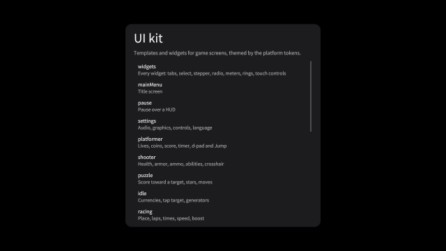
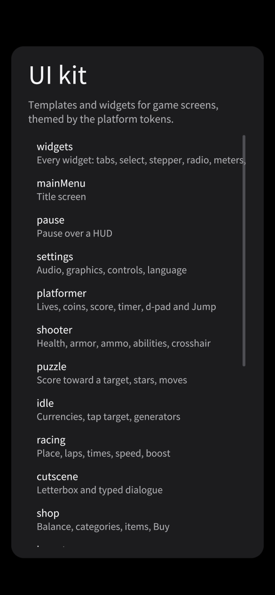

# og polish: ui-kit

2026-10-18, 25 playtest(s) on metal. Mechanical measures of og-taste and og-feel (og-build §5); a score is 0 to 100, n/a when nothing in the playtests exercises it. The measures cannot judge style: read the frames.

## Scores

| | Score | Measure |
|---|---|---|
| **Taste** | **90** | mean of the taste rows |
| Contrast | 85 | text boxes whose ink and ground reach 4.5:1 |
| Text size | 97 | text boxes whose tallest ink line reaches 9 CSS px (a 13 px face's capitals) |
| HUD occupancy | 100 | gameplay frames: HUD at most 15 % of the surface and 5 % of the central third |
| Screen transitions | 96 | screen changes with UI motion around them |
| UI sounds | 62 | UI presses answered on the ui bus |
| Locale keys | 100 | string tables without missing keys (og cook) |
| **Feel** | **62** | mean of the feel rows |
| Input latency | 99 | inputs answered, by the median ticks to the answer (0–1: 100) |
| Hit feedback | 0 | damage moments with hit stop, shake, floating text or a sound (three of four: 100) |
| Idle frames | 73 | ticks where nothing new is seen or heard (10 %: 100, 60 %: 0) |
| Frame time | 100 | p95 step + render (8.3 ms: 100, 33 ms: 0), worst playtest |
| Sound on input | 38 | inputs answered by a sound within 6 ticks |

## Fixes

| Measure | Where | Found | Fix |
|---|---|---|---|
| contrast | frames-desktop confirm: `Confirm` "Delete" | 2.91:1 between ink and ground (body text wants 4.5:1) | og-taste §3 (value before hue): darken the ground or lighten the ink in the skin's palette, never per call |
| contrast | frames-desktop mainMenu: `play` "Play" | 3.16:1 between ink and ground (body text wants 4.5:1) | og-taste §3 (value before hue): darken the ground or lighten the ink in the skin's palette, never per call |
| contrast | frames-desktop tutorial: `play` "Play" | 3.16:1 between ink and ground (body text wants 4.5:1) | og-taste §3 (value before hue): darken the ground or lighten the ink in the skin's palette, never per call |
| text size | frames-desktop shop: `Name` "Iron sword" | ink lines 7 CSS px tall (a 13 px face's capitals and digits are about 9) | og-taste §4 and §10.6: use the ramp's body step or larger for anything read on a phone |
| text size | frames-desktop idle: `Name` "Farm" | ink lines 8 CSS px tall (a 13 px face's capitals and digits are about 9) | og-taste §4 and §10.6: use the ramp's body step or larger for anything read on a phone |
| idle frames | frames-desktop | 27.08 % of ticks show and play nothing new (nothing moves or animates, no UI motion, no sound, no tween, text or particle) | og-feel §9 (idle loops: breathing, a pickup's spin) and og-taste §5 (motion): something alive on every screen |
| contrast | frames-phone widgets: `Gallery` "Gallery" | 1.46:1 between ink and ground (body text wants 4.5:1) | og-taste §3 (value before hue): darken the ground or lighten the ink in the skin's palette, never per call |
| contrast | frames-phone confirm: `Confirm` "Delete" | 2.96:1 between ink and ground (body text wants 4.5:1) | og-taste §3 (value before hue): darken the ground or lighten the ink in the skin's palette, never per call |
| contrast | frames-phone shop: `Price` "2,400" | 3.17:1 between ink and ground (body text wants 4.5:1) | og-taste §3 (value before hue): darken the ground or lighten the ink in the skin's palette, never per call |
| text size | frames-phone shop: `Unit` "coins" | ink lines 7.67 CSS px tall (a 13 px face's capitals and digits are about 9) | og-taste §4 and §10.6: use the ramp's body step or larger for anything read on a phone |
| text size | frames-phone shop: `Name` "Iron sword" | ink lines 7.67 CSS px tall (a 13 px face's capitals and digits are about 9) | og-taste §4 and §10.6: use the ramp's body step or larger for anything read on a phone |
| text size | frames-phone idle: `Name` "Farm" | ink lines 8.33 CSS px tall (a 13 px face's capitals and digits are about 9) | og-taste §4 and §10.6: use the ramp's body step or larger for anything read on a phone |
| screen transitions | frames-phone | 2 of 24 screen changes had no motion in the 20 ticks around them | og-taste §5 (screens change through a transition): og.ui.screenTransition, one kind per game |
| idle frames | frames-phone | 31.04 % of ticks show and play nothing new (nothing moves or animates, no UI motion, no sound, no tween, text or particle) | og-feel §9 (idle loops: breathing, a pickup's spin) and og-taste §5 (motion): something alive on every screen |
| input response | gamepad | 1 of 18 inputs changed nothing seen or heard within 30 ticks | og-feel §1 (answer on the same tick) and og-taste §6: every press shows an answer, a refused one too |
| contrast | juice iris-opening: `Best` "Best 12,840" | 2.52:1 between ink and ground (body text wants 4.5:1) | og-taste §3 (value before hue): darken the ground or lighten the ink in the skin's palette, never per call |
| contrast | juice landed: `NewBest` "New best" | 4.17:1 between ink and ground (body text wants 4.5:1) | og-taste §3 (value before hue): darken the ground or lighten the ink in the skin's palette, never per call |
| contrast | locales mainMenu-ar: `play` "العب" | 2.52:1 between ink and ground (body text wants 4.5:1) | og-taste §3 (value before hue): darken the ground or lighten the ink in the skin's palette, never per call |
| contrast | locales mainMenu-ja: `play` "プレイ" | 2.67:1 between ink and ground (body text wants 4.5:1) | og-taste §3 (value before hue): darken the ground or lighten the ink in the skin's palette, never per call |
| contrast | locales confirm-ja: `Confirm` "削除" | 2.75:1 between ink and ground (body text wants 4.5:1) | og-taste §3 (value before hue): darken the ground or lighten the ink in the skin's palette, never per call |
| screen transitions | locales | 4 of 15 screen changes had no motion in the 20 ticks around them | og-taste §5 (screens change through a transition): og.ui.screenTransition, one kind per game |
| idle frames | locales | 57.12 % of ticks show and play nothing new (nothing moves or animates, no UI motion, no sound, no tween, text or particle) | og-feel §9 (idle loops: breathing, a pickup's spin) and og-taste §5 (motion): something alive on every screen |
| UI sounds | multitouch | 2 of 2 UI presses played no sound on the ui bus | og-taste §6 (feedback) and og-audio §3: give the skin or og.ui.configure its press and open sounds |
| hit feedback | multitouch | 1 of 1 damage moments (hp) had no hit stop within 8 ticks | og-feel §3 (hit stop by impact weight) |
| hit feedback | multitouch | 1 of 1 damage moments (hp) had no shake within 8 ticks | og-feel §4 (trauma, not offsets) |
| hit feedback | multitouch | 1 of 1 damage moments (hp) had no floating text within 8 ticks | og-feel §7 (floating text) |
| hit feedback | multitouch | 1 of 1 damage moments (hp) had no a sound within 8 ticks | og-audio §1 (every event sounds; a hit's sound on its tick) |
| UI sounds | phone | 1 of 1 UI presses played no sound on the ui bus | og-taste §6 (feedback) and og-audio §3: give the skin or og.ui.configure its press and open sounds |
| idle frames | phone | 96.43 % of ticks show and play nothing new (nothing moves or animates, no UI motion, no sound, no tween, text or particle) | og-feel §9 (idle loops: breathing, a pickup's spin) and og-taste §5 (motion): something alive on every screen |
| contrast | skin-cartoon-phone widgets: `Gallery` "Gallery" | 1.13:1 between ink and ground (body text wants 4.5:1) | og-taste §3 (value before hue): darken the ground or lighten the ink in the skin's palette, never per call |
| contrast | skin-cartoon-phone racing: `Value` "234" | 1.16:1 between ink and ground (body text wants 4.5:1) | og-taste §3 (value before hue): darken the ground or lighten the ink in the skin's palette, never per call |
| contrast | skin-cartoon-phone shooter: `Weapon` "Carbine" | 1.75:1 between ink and ground (body text wants 4.5:1) | og-taste §3 (value before hue): darken the ground or lighten the ink in the skin's palette, never per call |
| text size | skin-cartoon-phone shop: `Unit` "coins" | ink lines 7 CSS px tall (a 13 px face's capitals and digits are about 9) | og-taste §4 and §10.6: use the ramp's body step or larger for anything read on a phone |
| text size | skin-cartoon-phone shop: `Name` "Iron sword" | ink lines 7 CSS px tall (a 13 px face's capitals and digits are about 9) | og-taste §4 and §10.6: use the ramp's body step or larger for anything read on a phone |
| text size | skin-cartoon-phone widgets: `New` "New" | ink lines 8.67 CSS px tall (a 13 px face's capitals and digits are about 9) | og-taste §4 and §10.6: use the ramp's body step or larger for anything read on a phone |
| screen transitions | skin-cartoon-phone | 2 of 24 screen changes had no motion in the 20 ticks around them | og-taste §5 (screens change through a transition): og.ui.screenTransition, one kind per game |
| idle frames | skin-cartoon-phone | 26.11 % of ticks show and play nothing new (nothing moves or animates, no UI motion, no sound, no tween, text or particle) | og-feel §9 (idle loops: breathing, a pickup's spin) and og-taste §5 (motion): something alive on every screen |
| contrast | skin-cartoon shooter: `Zone` "Sector 4" | 1.62:1 between ink and ground (body text wants 4.5:1) | og-taste §3 (value before hue): darken the ground or lighten the ink in the skin's palette, never per call |
| contrast | skin-cartoon loading: `Percent` "100%" | 1.67:1 between ink and ground (body text wants 4.5:1) | og-taste §3 (value before hue): darken the ground or lighten the ink in the skin's palette, never per call |
| contrast | skin-cartoon leaderboard: `Rank` "1" | 1.79:1 between ink and ground (body text wants 4.5:1) | og-taste §3 (value before hue): darken the ground or lighten the ink in the skin's palette, never per call |
| text size | skin-cartoon shooter: `Gallery` "Gallery" | ink lines 6 CSS px tall (a 13 px face's capitals and digits are about 9) | og-taste §4 and §10.6: use the ramp's body step or larger for anything read on a phone |
| text size | skin-cartoon shop: `Name` "Iron sword" | ink lines 7 CSS px tall (a 13 px face's capitals and digits are about 9) | og-taste §4 and §10.6: use the ramp's body step or larger for anything read on a phone |
| text size | skin-cartoon idle: `Name` "Farm" | ink lines 8 CSS px tall (a 13 px face's capitals and digits are about 9) | og-taste §4 and §10.6: use the ramp's body step or larger for anything read on a phone |
| contrast | skin-fantasy-phone cutscene: `Skip` "Skip" | 1.2:1 between ink and ground (body text wants 4.5:1) | og-taste §3 (value before hue): darken the ground or lighten the ink in the skin's palette, never per call |
| contrast | skin-fantasy-phone racing: `Value` "234" | 1.25:1 between ink and ground (body text wants 4.5:1) | og-taste §3 (value before hue): darken the ground or lighten the ink in the skin's palette, never per call |
| contrast | skin-fantasy-phone widgets: `Gallery` "Gallery" | 1.34:1 between ink and ground (body text wants 4.5:1) | og-taste §3 (value before hue): darken the ground or lighten the ink in the skin's palette, never per call |
| text size | skin-fantasy-phone shop: `Unit` "coins" | ink lines 6.33 CSS px tall (a 13 px face's capitals and digits are about 9) | og-taste §4 and §10.6: use the ramp's body step or larger for anything read on a phone |
| text size | skin-fantasy-phone shop: `Name` "Iron sword" | ink lines 6.33 CSS px tall (a 13 px face's capitals and digits are about 9) | og-taste §4 and §10.6: use the ramp's body step or larger for anything read on a phone |
| text size | skin-fantasy-phone gallery: `Name` "cutscene" | ink lines 8.33 CSS px tall (a 13 px face's capitals and digits are about 9) | og-taste §4 and §10.6: use the ramp's body step or larger for anything read on a phone |
| screen transitions | skin-fantasy-phone | 2 of 25 screen changes had no motion in the 20 ticks around them | og-taste §5 (screens change through a transition): og.ui.screenTransition, one kind per game |
| idle frames | skin-fantasy-phone | 26.21 % of ticks show and play nothing new (nothing moves or animates, no UI motion, no sound, no tween, text or particle) | og-feel §9 (idle loops: breathing, a pickup's spin) and og-taste §5 (motion): something alive on every screen |
| contrast | skin-fantasy cutscene: `Gallery` "Gallery" | 1.23:1 between ink and ground (body text wants 4.5:1) | og-taste §3 (value before hue): darken the ground or lighten the ink in the skin's palette, never per call |
| contrast | skin-fantasy shooter: `Zone` "Sector 4" | 1.36:1 between ink and ground (body text wants 4.5:1) | og-taste §3 (value before hue): darken the ground or lighten the ink in the skin's palette, never per call |
| contrast | skin-fantasy puzzle: `Caption` "moves left" | 1.65:1 between ink and ground (body text wants 4.5:1) | og-taste §3 (value before hue): darken the ground or lighten the ink in the skin's palette, never per call |
| text size | skin-fantasy shop: `Name` "Iron sword" | ink lines 6 CSS px tall (a 13 px face's capitals and digits are about 9) | og-taste §4 and §10.6: use the ramp's body step or larger for anything read on a phone |
| text size | skin-fantasy widgets: `New` "New" | ink lines 8 CSS px tall (a 13 px face's capitals and digits are about 9) | og-taste §4 and §10.6: use the ramp's body step or larger for anything read on a phone |
| contrast | skin-neon-phone shop: `Price` "2,400" | 1.88:1 between ink and ground (body text wants 4.5:1) | og-taste §3 (value before hue): darken the ground or lighten the ink in the skin's palette, never per call |
| contrast | skin-neon-phone shooter: `Armor` "35" | 2.05:1 between ink and ground (body text wants 4.5:1) | og-taste §3 (value before hue): darken the ground or lighten the ink in the skin's palette, never per call |
| contrast | skin-neon-phone widgets: `Tab#1` "Stats" | 2.27:1 between ink and ground (body text wants 4.5:1) | og-taste §3 (value before hue): darken the ground or lighten the ink in the skin's palette, never per call |
| text size | skin-neon-phone shop: `Unit` "coins" | ink lines 6.67 CSS px tall (a 13 px face's capitals and digits are about 9) | og-taste §4 and §10.6: use the ramp's body step or larger for anything read on a phone |
| text size | skin-neon-phone shop: `Name` "Iron sword" | ink lines 6.67 CSS px tall (a 13 px face's capitals and digits are about 9) | og-taste §4 and §10.6: use the ramp's body step or larger for anything read on a phone |
| text size | skin-neon-phone widgets: `New` "New" | ink lines 7.67 CSS px tall (a 13 px face's capitals and digits are about 9) | og-taste §4 and §10.6: use the ramp's body step or larger for anything read on a phone |
| screen transitions | skin-neon-phone | 2 of 25 screen changes had no motion in the 20 ticks around them | og-taste §5 (screens change through a transition): og.ui.screenTransition, one kind per game |
| idle frames | skin-neon-phone | 27.18 % of ticks show and play nothing new (nothing moves or animates, no UI motion, no sound, no tween, text or particle) | og-feel §9 (idle loops: breathing, a pickup's spin) and og-taste §5 (motion): something alive on every screen |
| contrast | skin-neon cutscene: `Gallery` "Gallery" | 1.65:1 between ink and ground (body text wants 4.5:1) | og-taste §3 (value before hue): darken the ground or lighten the ink in the skin's palette, never per call |
| contrast | skin-neon confirm: `Confirm` "Delete" | 1.99:1 between ink and ground (body text wants 4.5:1) | og-taste §3 (value before hue): darken the ground or lighten the ink in the skin's palette, never per call |
| contrast | skin-neon shooter: `Armor` "35" | 2.05:1 between ink and ground (body text wants 4.5:1) | og-taste §3 (value before hue): darken the ground or lighten the ink in the skin's palette, never per call |
| text size | skin-neon shop: `Name` "Iron sword" | ink lines 7 CSS px tall (a 13 px face's capitals and digits are about 9) | og-taste §4 and §10.6: use the ramp's body step or larger for anything read on a phone |
| text size | skin-neon widgets: `New` "New" | ink lines 8 CSS px tall (a 13 px face's capitals and digits are about 9) | og-taste §4 and §10.6: use the ramp's body step or larger for anything read on a phone |
| text size | skin-neon widgets: `Sale` "-20%" | ink lines 8 CSS px tall (a 13 px face's capitals and digits are about 9) | og-taste §4 and §10.6: use the ramp's body step or larger for anything read on a phone |
| contrast | skin-paper-phone widgets: `Gallery` "Gallery" | 1.12:1 between ink and ground (body text wants 4.5:1) | og-taste §3 (value before hue): darken the ground or lighten the ink in the skin's palette, never per call |
| contrast | skin-paper-phone shooter: `Ammo` "18" | 1.2:1 between ink and ground (body text wants 4.5:1) | og-taste §3 (value before hue): darken the ground or lighten the ink in the skin's palette, never per call |
| contrast | skin-paper-phone cutscene: `Skip` "Skip" | 1.25:1 between ink and ground (body text wants 4.5:1) | og-taste §3 (value before hue): darken the ground or lighten the ink in the skin's palette, never per call |
| text size | skin-paper-phone shop: `Unit` "coins" | ink lines 7.33 CSS px tall (a 13 px face's capitals and digits are about 9) | og-taste §4 and §10.6: use the ramp's body step or larger for anything read on a phone |
| text size | skin-paper-phone shop: `Name` "Iron sword" | ink lines 7.33 CSS px tall (a 13 px face's capitals and digits are about 9) | og-taste §4 and §10.6: use the ramp's body step or larger for anything read on a phone |
| text size | skin-paper-phone idle: `Name` "Farm" | ink lines 8.33 CSS px tall (a 13 px face's capitals and digits are about 9) | og-taste §4 and §10.6: use the ramp's body step or larger for anything read on a phone |
| screen transitions | skin-paper-phone | 2 of 25 screen changes had no motion in the 20 ticks around them | og-taste §5 (screens change through a transition): og.ui.screenTransition, one kind per game |
| idle frames | skin-paper-phone | 26.98 % of ticks show and play nothing new (nothing moves or animates, no UI motion, no sound, no tween, text or particle) | og-feel §9 (idle loops: breathing, a pickup's spin) and og-taste §5 (motion): something alive on every screen |
| contrast | skin-paper cutscene: `Gallery` "Gallery" | 1.47:1 between ink and ground (body text wants 4.5:1) | og-taste §3 (value before hue): darken the ground or lighten the ink in the skin's palette, never per call |
| contrast | skin-paper shooter: `Zone` "Sector 4" | 1.63:1 between ink and ground (body text wants 4.5:1) | og-taste §3 (value before hue): darken the ground or lighten the ink in the skin's palette, never per call |
| contrast | skin-paper idle: `Tap` "Tap" | 1.75:1 between ink and ground (body text wants 4.5:1) | og-taste §3 (value before hue): darken the ground or lighten the ink in the skin's palette, never per call |
| text size | skin-paper shop: `Name` "Iron sword" | ink lines 7 CSS px tall (a 13 px face's capitals and digits are about 9) | og-taste §4 and §10.6: use the ramp's body step or larger for anything read on a phone |
| text size | skin-paper idle: `Name` "Farm" | ink lines 8 CSS px tall (a 13 px face's capitals and digits are about 9) | og-taste §4 and §10.6: use the ramp's body step or larger for anything read on a phone |
| contrast | skin-pixel-phone widgets: `Health` "72 / 100" | 1.66:1 between ink and ground (body text wants 4.5:1) | og-taste §3 (value before hue): darken the ground or lighten the ink in the skin's palette, never per call |
| contrast | skin-pixel-phone racing: `Boost` "Boost" | 1.74:1 between ink and ground (body text wants 4.5:1) | og-taste §3 (value before hue): darken the ground or lighten the ink in the skin's palette, never per call |
| contrast | skin-pixel-phone widgets: `Gallery` "Gallery" | 2.17:1 between ink and ground (body text wants 4.5:1) | og-taste §3 (value before hue): darken the ground or lighten the ink in the skin's palette, never per call |
| text size | skin-pixel-phone shop: `Unit` "coins" | ink lines 7.33 CSS px tall (a 13 px face's capitals and digits are about 9) | og-taste §4 and §10.6: use the ramp's body step or larger for anything read on a phone |
| text size | skin-pixel-phone shop: `Name` "Iron sword" | ink lines 7.33 CSS px tall (a 13 px face's capitals and digits are about 9) | og-taste §4 and §10.6: use the ramp's body step or larger for anything read on a phone |
| screen transitions | skin-pixel-phone | 2 of 24 screen changes had no motion in the 20 ticks around them | og-taste §5 (screens change through a transition): og.ui.screenTransition, one kind per game |
| idle frames | skin-pixel-phone | 30.46 % of ticks show and play nothing new (nothing moves or animates, no UI motion, no sound, no tween, text or particle) | og-feel §9 (idle loops: breathing, a pickup's spin) and og-taste §5 (motion): something alive on every screen |
| contrast | skin-pixel shop: `Price` "2,400" | 2.05:1 between ink and ground (body text wants 4.5:1) | og-taste §3 (value before hue): darken the ground or lighten the ink in the skin's palette, never per call |
| contrast | skin-pixel inventory: `Count` "20" | 2.2:1 between ink and ground (body text wants 4.5:1) | og-taste §3 (value before hue): darken the ground or lighten the ink in the skin's palette, never per call |
| contrast | skin-pixel inventory: `Count` "2" | 2.21:1 between ink and ground (body text wants 4.5:1) | og-taste §3 (value before hue): darken the ground or lighten the ink in the skin's palette, never per call |
| text size | skin-pixel shop: `Name` "Iron sword" | ink lines 8 CSS px tall (a 13 px face's capitals and digits are about 9) | og-taste §4 and §10.6: use the ramp's body step or larger for anything read on a phone |
| idle frames | skin-pixel | 26.5 % of ticks show and play nothing new (nothing moves or animates, no UI motion, no sound, no tween, text or particle) | og-feel §9 (idle loops: breathing, a pickup's spin) and og-taste §5 (motion): something alive on every screen |
| contrast | skin-scifi-phone shooter: `Armor` "35" | 1.59:1 between ink and ground (body text wants 4.5:1) | og-taste §3 (value before hue): darken the ground or lighten the ink in the skin's palette, never per call |
| contrast | skin-scifi-phone widgets: `Health` "72 / 100" | 1.9:1 between ink and ground (body text wants 4.5:1) | og-taste §3 (value before hue): darken the ground or lighten the ink in the skin's palette, never per call |
| contrast | skin-scifi-phone shooter: `Health` "72" | 1.9:1 between ink and ground (body text wants 4.5:1) | og-taste §3 (value before hue): darken the ground or lighten the ink in the skin's palette, never per call |
| text size | skin-scifi-phone shop: `Unit` "coins" | ink lines 6 CSS px tall (a 13 px face's capitals and digits are about 9) | og-taste §4 and §10.6: use the ramp's body step or larger for anything read on a phone |
| text size | skin-scifi-phone shop: `Name` "Iron sword" | ink lines 6 CSS px tall (a 13 px face's capitals and digits are about 9) | og-taste §4 and §10.6: use the ramp's body step or larger for anything read on a phone |
| text size | skin-scifi-phone idle: `Name` "Farm" | ink lines 7 CSS px tall (a 13 px face's capitals and digits are about 9) | og-taste §4 and §10.6: use the ramp's body step or larger for anything read on a phone |
| screen transitions | skin-scifi-phone | 2 of 25 screen changes had no motion in the 20 ticks around them | og-taste §5 (screens change through a transition): og.ui.screenTransition, one kind per game |
| idle frames | skin-scifi-phone | 27.95 % of ticks show and play nothing new (nothing moves or animates, no UI motion, no sound, no tween, text or particle) | og-feel §9 (idle loops: breathing, a pickup's spin) and og-taste §5 (motion): something alive on every screen |
| contrast | skin-scifi shooter: `Armor` "35" | 1.59:1 between ink and ground (body text wants 4.5:1) | og-taste §3 (value before hue): darken the ground or lighten the ink in the skin's palette, never per call |
| contrast | skin-scifi cutscene: `Gallery` "Gallery" | 1.76:1 between ink and ground (body text wants 4.5:1) | og-taste §3 (value before hue): darken the ground or lighten the ink in the skin's palette, never per call |
| contrast | skin-scifi widgets: `Health` "72 / 100" | 1.9:1 between ink and ground (body text wants 4.5:1) | og-taste §3 (value before hue): darken the ground or lighten the ink in the skin's palette, never per call |
| text size | skin-scifi shop: `Name` "Iron sword" | ink lines 6 CSS px tall (a 13 px face's capitals and digits are about 9) | og-taste §4 and §10.6: use the ramp's body step or larger for anything read on a phone |
| text size | skin-scifi idle: `Name` "Farm" | ink lines 7 CSS px tall (a 13 px face's capitals and digits are about 9) | og-taste §4 and §10.6: use the ramp's body step or larger for anything read on a phone |
| UI sounds | sounds | 1 of 2 UI presses played no sound on the ui bus | og-taste §6 (feedback) and og-audio §3: give the skin or og.ui.configure its press and open sounds |
| UI sounds | touch | 3 of 9 UI presses played no sound on the ui bus | og-taste §6 (feedback) and og-audio §3: give the skin or og.ui.configure its press and open sounds |
| UI sounds | tutorial | 1 of 4 UI presses played no sound on the ui bus | og-taste §6 (feedback) and og-audio §3: give the skin or og.ui.configure its press and open sounds |

## Playtests

### drag

a drag from one inventory slot to another moves the item (108 ticks)

| Measure | Value |
|---|---|
| Text boxes | 0; 0 at 4.5:1; 0 of 0 at 9 px ink |
| HUD | 0 gameplay frame(s), up to 0 % of the surface, 0 % of the centre |
| UI | 3 screen change(s), 3 with motion; 107 ticks of UI motion; 2 press(es), 2 with a ui-bus sound |
| Inputs | 2, 2 answered, median 0 ticks, max 0; 2 with a sound; 100 % of input-free ticks also change something |
| Damage | 0 moment(s): hit stop 0, shake 0, floating text 0, sound 0, tween 0, particles 0 |
| Idle | 0 % of ticks |
| Particles | peak 0 system(s), 0 burst(s) |
| Frame (metal) | step 1.05 ms median, 1.37 p95; render 0.83 median, 1.08 p95; frame p95 2.45, max 4.07 |
| Audio | 1.8 s, peak 0.21, RMS 0.0243, 0 clipped, 77.78 % silent ticks |

### frames-desktop

every screen at desktop size matches its reference frame (1044 ticks)

| Measure | Value |
|---|---|
| Text boxes | 236; 206 at 4.5:1; 234 of 236 at 9 px ink |
| Lowest contrast | 2.91:1 `Confirm` (confirm); 3.16:1 `play` (mainMenu); 3.16:1 `play` (tutorial) |
| Smallest ink | 7 px `Name` (shop); 8 px `Name` (idle); 9 px `New` (widgets) |
| HUD | 5 gameplay frame(s), up to 4.24 % of the surface, 0.75 % of the centre |
| UI | 24 screen change(s), 24 with motion; 701 ticks of UI motion; 0 press(es), 0 with a ui-bus sound |
| Inputs | 0, 0 answered, median 0 ticks, max 0; 0 with a sound; 72.15 % of input-free ticks also change something |
| Damage | 0 moment(s): hit stop 0, shake 0, floating text 0, sound 0, tween 0, particles 0 |
| Idle | 27.08 % of ticks |
| Particles | peak 0 system(s), 0 burst(s) |
| Frame (metal) | step 0.89 ms median, 1.87 p95; render 0.76 median, 1.02 p95; frame p95 2.75, max 91.75 |
| Audio | 17.4 s, peak 0.16, RMS 0.0156, 0 clipped, 90.42 % silent ticks |

 

gallery (tick 66, menu: HUD 8.56 %, 19 texts, 0 under 4.5:1, 0 small)

### frames-phone

every screen on a phone in portrait matches its reference frame (1044 ticks)

| Measure | Value |
|---|---|
| Text boxes | 230; 210 at 4.5:1; 227 of 230 at 9 px ink |
| Lowest contrast | 1.46:1 `Gallery` (widgets); 2.96:1 `Confirm` (confirm); 3.17:1 `Price` (shop) |
| Smallest ink | 7.67 px `Unit` (shop); 7.67 px `Name` (shop); 8.33 px `Name` (idle) |
| HUD | 5 gameplay frame(s), up to 12.73 % of the surface, 1.43 % of the centre |
| UI | 24 screen change(s), 22 with motion; 661 ticks of UI motion; 0 press(es), 0 with a ui-bus sound |
| Inputs | 0, 0 answered, median 0 ticks, max 0; 0 with a sound; 68.18 % of input-free ticks also change something |
| Damage | 0 moment(s): hit stop 0, shake 0, floating text 0, sound 0, tween 0, particles 0 |
| Idle | 31.04 % of ticks |
| Particles | peak 0 system(s), 0 burst(s) |
| Frame (metal) | step 0.95 ms median, 1.89 p95; render 0.78 median, 1.05 p95; frame p95 2.87, max 281.58 |
| Audio | 17.4 s, peak 0.16, RMS 0.0156, 0 clipped, 90.42 % silent ticks |

 

gallery (tick 66, menu: HUD 28.01 %, 23 texts, 0 under 4.5:1, 0 small)

### gamepad

a gamepad's d-pad, stick, A and B drive the gallery through og.Gamepad (168 ticks)

| Measure | Value |
|---|---|
| Text boxes | 0; 0 at 4.5:1; 0 of 0 at 9 px ink |
| HUD | 0 gameplay frame(s), up to 0 % of the surface, 0 % of the centre |
| UI | 3 screen change(s), 3 with motion; 133 ticks of UI motion; 0 press(es), 0 with a ui-bus sound |
| Inputs | 18, 17 answered, median 0 ticks, max 0; 2 with a sound; 87.5 % of input-free ticks also change something |
| Damage | 0 moment(s): hit stop 0, shake 0, floating text 0, sound 0, tween 0, particles 0 |
| Idle | 21.52 % of ticks |
| Particles | peak 0 system(s), 0 burst(s) |
| Frame (metal) | step 1.33 ms median, 1.64 p95; render 0.76 median, 1.01 p95; frame p95 2.58, max 3.68 |
| Audio | 2.8 s, peak 0.16, RMS 0.0123, 0 clipped, 94.05 % silent ticks |

### juice

an iris transition switches screens at full cover, the score counts up, UI events sound (210 ticks)

| Measure | Value |
|---|---|
| Text boxes | 51; 49 at 4.5:1; 51 of 51 at 9 px ink |
| Lowest contrast | 2.52:1 `Best` (iris-opening); 4.17:1 `NewBest` (landed); 4.79:1 `retry` (count-up) |
| Smallest ink | 9 px `Blurb` (iris-closing); 9 px `NewBest` (landed); 10 px `Blurb` (iris-closing) |
| HUD | 0 gameplay frame(s), up to 0 % of the surface, 0 % of the centre |
| UI | 5 screen change(s), 5 with motion; 185 ticks of UI motion; 1 press(es), 1 with a ui-bus sound |
| Inputs | 1, 1 answered, median 0 ticks, max 0; 1 with a sound; 87.5 % of input-free ticks also change something |
| Damage | 0 moment(s): hit stop 0, shake 0, floating text 0, sound 0, tween 0, particles 0 |
| Idle | 11.5 % of ticks |
| Particles | peak 0 system(s), 0 burst(s) |
| Frame (metal) | step 1.02 ms median, 2.95 p95; render 0.97 median, 1.3 p95; frame p95 4.21, max 95.85 |
| Audio | 3.5 s, peak 0.21, RMS 0.0182, 0 clipped, 87.62 % silent ticks |

### keys

keyboard focus opens a screen, steps a slider and closes the settings with a save (204 ticks)

| Measure | Value |
|---|---|
| Text boxes | 0; 0 at 4.5:1; 0 of 0 at 9 px ink |
| HUD | 0 gameplay frame(s), up to 0 % of the surface, 0 % of the centre |
| UI | 4 screen change(s), 4 with motion; 175 ticks of UI motion; 0 press(es), 0 with a ui-bus sound |
| Inputs | 7, 7 answered, median 0 ticks, max 0; 1 with a sound; 100 % of input-free ticks also change something |
| Damage | 0 moment(s): hit stop 0, shake 0, floating text 0, sound 0, tween 0, particles 0 |
| Idle | 14.43 % of ticks |
| Particles | peak 0 system(s), 0 burst(s) |
| Frame (metal) | step 1.08 ms median, 1.63 p95; render 0.76 median, 1.02 p95; frame p95 2.57, max 3.5 |
| Audio | 3.4 s, peak 0.16, RMS 0.0193, 0 clipped, 85.78 % silent ticks |

### locales

the menu, pause and confirm screens in en, zh-CN, ja, ko and ar match their reference frames (768 ticks)

| Measure | Value |
|---|---|
| Text boxes | 75; 61 at 4.5:1; 75 of 75 at 9 px ink |
| Lowest contrast | 2.52:1 `play` (mainMenu-ar); 2.67:1 `play` (mainMenu-ja); 2.75:1 `Confirm` (confirm-ja) |
| Smallest ink | 10 px `Footer` (mainMenu-en); 11 px `Subtitle` (mainMenu-en); 11 px `resume` (pause-en) |
| HUD | 0 gameplay frame(s), up to 0 % of the surface, 0 % of the centre |
| UI | 15 screen change(s), 11 with motion; 334 ticks of UI motion; 0 press(es), 0 with a ui-bus sound |
| Inputs | 0, 0 answered, median 0 ticks, max 0; 0 with a sound; 42.88 % of input-free ticks also change something |
| Damage | 0 moment(s): hit stop 0, shake 0, floating text 0, sound 0, tween 0, particles 0 |
| Idle | 57.12 % of ticks |
| Particles | peak 0 system(s), 0 burst(s) |
| Frame (metal) | step 0.89 ms median, 1.35 p95; render 0.75 median, 0.99 p95; frame p95 2.3, max 83.37 |
| Audio | 12.8 s, peak 0.16, RMS 0.0182, 0 clipped, 86.98 % silent ticks |

### multitouch

a stick held by one touch and a button tapped by another work together (72 ticks)

| Measure | Value |
|---|---|
| Text boxes | 0; 0 at 4.5:1; 0 of 0 at 9 px ink |
| HUD | 0 gameplay frame(s), up to 0 % of the surface, 0 % of the centre |
| UI | 0 screen change(s), 0 with motion; 71 ticks of UI motion; 2 press(es), 0 with a ui-bus sound |
| Inputs | 2, 2 answered, median 0 ticks, max 0; 0 with a sound; 100 % of input-free ticks also change something |
| Damage | 1 moment(s) from `hp`: hit stop 0, shake 0, floating text 0, sound 0, tween 0, particles 0 |
| Idle | 0 % of ticks |
| Particles | peak 0 system(s), 0 burst(s) |
| Frame (metal) | step 1.26 ms median, 1.6 p95; render 0.82 median, 1.09 p95; frame p95 2.57, max 2.91 |
| Audio | 1.2 s, peak 0, RMS 0, 0 clipped, 100 % silent ticks |

### pad

gamepad navigation moves through the gallery, opens a screen and backs out (216 ticks)

| Measure | Value |
|---|---|
| Text boxes | 0; 0 at 4.5:1; 0 of 0 at 9 px ink |
| HUD | 0 gameplay frame(s), up to 0 % of the surface, 0 % of the centre |
| UI | 3 screen change(s), 3 with motion; 215 ticks of UI motion; 0 press(es), 0 with a ui-bus sound |
| Inputs | 0, 0 answered, median 0 ticks, max 0; 0 with a sound; 100 % of input-free ticks also change something |
| Damage | 0 moment(s): hit stop 0, shake 0, floating text 0, sound 0, tween 0, particles 0 |
| Idle | 0 % of ticks |
| Particles | peak 0 system(s), 0 burst(s) |
| Frame (metal) | step 1.34 ms median, 1.68 p95; render 0.79 median, 1.08 p95; frame p95 2.76, max 5.81 |
| Audio | 3.6 s, peak 0.16, RMS 0.0108, 0 clipped, 95.37 % silent ticks |

### phone

on a phone the HUD keeps to the safe area and its touch controls to 44 px (66 ticks)

| Measure | Value |
|---|---|
| Text boxes | 0; 0 at 4.5:1; 0 of 0 at 9 px ink |
| HUD | 0 gameplay frame(s), up to 0 % of the surface, 0 % of the centre |
| UI | 1 screen change(s), 1 with motion; 6 ticks of UI motion; 1 press(es), 0 with a ui-bus sound |
| Inputs | 1, 1 answered, median 1 ticks, max 1; 0 with a sound; 0 % of input-free ticks also change something |
| Damage | 0 moment(s): hit stop 0, shake 0, floating text 0, sound 0, tween 0, particles 0 |
| Idle | 96.43 % of ticks |
| Particles | peak 0 system(s), 0 burst(s) |
| Frame (metal) | step 1.05 ms median, 1.47 p95; render 0.85 median, 1.21 p95; frame p95 2.59, max 3.05 |
| Audio | 1.1 s, peak 0, RMS 0, 0 clipped, 100 % silent ticks |

### skin-cartoon-phone

every screen in the cartoon style pack on a phone matches its cell of kit-skin-cartoon-phone.png (1044 ticks)

| Measure | Value |
|---|---|
| Text boxes | 223; 192 at 4.5:1; 214 of 223 at 9 px ink |
| Lowest contrast | 1.13:1 `Gallery` (widgets); 1.16:1 `Value` (racing); 1.75:1 `Weapon` (shooter) |
| Smallest ink | 7 px `Unit` (shop); 7 px `Name` (shop); 8.67 px `New` (widgets) |
| HUD | 5 gameplay frame(s), up to 13.03 % of the surface, 1.43 % of the centre |
| UI | 24 screen change(s), 22 with motion; 730 ticks of UI motion; 0 press(es), 0 with a ui-bus sound |
| Inputs | 0, 0 answered, median 0 ticks, max 0; 0 with a sound; 73.89 % of input-free ticks also change something |
| Damage | 0 moment(s): hit stop 0, shake 0, floating text 0, sound 0, tween 0, particles 0 |
| Idle | 26.11 % of ticks |
| Particles | peak 0 system(s), 0 burst(s) |
| Frame (metal) | step 0.99 ms median, 2.01 p95; render 0.91 median, 1.2 p95; frame p95 3.09, max 307.41 |
| Audio | 17.4 s, peak 0.16, RMS 0.0156, 0 clipped, 90.42 % silent ticks |

### skin-cartoon

every screen in the cartoon style pack matches its cell of kit-skin-cartoon.png (1044 ticks)

| Measure | Value |
|---|---|
| Text boxes | 227; 192 at 4.5:1; 224 of 227 at 9 px ink |
| Lowest contrast | 1.62:1 `Zone` (shooter); 1.67:1 `Percent` (loading); 1.79:1 `Rank` (leaderboard) |
| Smallest ink | 6 px `Gallery` (shooter); 7 px `Name` (shop); 8 px `Name` (idle) |
| HUD | 5 gameplay frame(s), up to 4.28 % of the surface, 0.75 % of the centre |
| UI | 29 screen change(s), 29 with motion; 770 ticks of UI motion; 0 press(es), 0 with a ui-bus sound |
| Inputs | 0, 0 answered, median 0 ticks, max 0; 0 with a sound; 77.85 % of input-free ticks also change something |
| Damage | 0 moment(s): hit stop 0, shake 0, floating text 0, sound 0, tween 0, particles 0 |
| Idle | 22.15 % of ticks |
| Particles | peak 0 system(s), 0 burst(s) |
| Frame (metal) | step 0.96 ms median, 1.87 p95; render 0.89 median, 1.19 p95; frame p95 2.91, max 95.43 |
| Audio | 17.4 s, peak 0.16, RMS 0.0156, 0 clipped, 90.42 % silent ticks |

### skin-fantasy-phone

every screen in the fantasy style pack on a phone matches its cell of kit-skin-fantasy-phone.png (1044 ticks)

| Measure | Value |
|---|---|
| Text boxes | 225; 192 at 4.5:1; 214 of 225 at 9 px ink |
| Lowest contrast | 1.2:1 `Skip` (cutscene); 1.25:1 `Value` (racing); 1.34:1 `Gallery` (widgets) |
| Smallest ink | 6.33 px `Unit` (shop); 6.33 px `Name` (shop); 8.33 px `Name` (gallery) |
| HUD | 5 gameplay frame(s), up to 12.96 % of the surface, 1.43 % of the centre |
| UI | 25 screen change(s), 23 with motion; 730 ticks of UI motion; 0 press(es), 0 with a ui-bus sound |
| Inputs | 0, 0 answered, median 0 ticks, max 0; 0 with a sound; 73.79 % of input-free ticks also change something |
| Damage | 0 moment(s): hit stop 0, shake 0, floating text 0, sound 0, tween 0, particles 0 |
| Idle | 26.21 % of ticks |
| Particles | peak 0 system(s), 0 burst(s) |
| Frame (metal) | step 1.07 ms median, 2.05 p95; render 0.87 median, 1.12 p95; frame p95 3.12, max 848.09 |
| Audio | 17.4 s, peak 0.16, RMS 0.0156, 0 clipped, 90.42 % silent ticks |

### skin-fantasy

every screen in the fantasy style pack matches its cell of kit-skin-fantasy.png (1044 ticks)

| Measure | Value |
|---|---|
| Text boxes | 229; 182 at 4.5:1; 227 of 229 at 9 px ink |
| Lowest contrast | 1.23:1 `Gallery` (cutscene); 1.36:1 `Zone` (shooter); 1.65:1 `Caption` (puzzle) |
| Smallest ink | 6 px `Name` (shop); 8 px `New` (widgets); 9 px `Blurb` (gallery) |
| HUD | 5 gameplay frame(s), up to 4.27 % of the surface, 0.75 % of the centre |
| UI | 27 screen change(s), 27 with motion; 771 ticks of UI motion; 0 press(es), 0 with a ui-bus sound |
| Inputs | 0, 0 answered, median 0 ticks, max 0; 0 with a sound; 77.76 % of input-free ticks also change something |
| Damage | 0 moment(s): hit stop 0, shake 0, floating text 0, sound 0, tween 0, particles 0 |
| Idle | 22.24 % of ticks |
| Particles | peak 0 system(s), 0 burst(s) |
| Frame (metal) | step 1.02 ms median, 1.93 p95; render 0.84 median, 1.12 p95; frame p95 2.93, max 133.08 |
| Audio | 17.4 s, peak 0.16, RMS 0.0156, 0 clipped, 90.42 % silent ticks |

### skin-neon-phone

every screen in the neon style pack on a phone matches its cell of kit-skin-neon-phone.png (1044 ticks)

| Measure | Value |
|---|---|
| Text boxes | 231; 189 at 4.5:1; 212 of 231 at 9 px ink |
| Lowest contrast | 1.88:1 `Price` (shop); 2.05:1 `Armor` (shooter); 2.27:1 `Tab#1` (widgets) |
| Smallest ink | 6.67 px `Unit` (shop); 6.67 px `Name` (shop); 7.67 px `New` (widgets) |
| HUD | 5 gameplay frame(s), up to 12.96 % of the surface, 1.43 % of the centre |
| UI | 25 screen change(s), 23 with motion; 718 ticks of UI motion; 0 press(es), 0 with a ui-bus sound |
| Inputs | 0, 0 answered, median 0 ticks, max 0; 0 with a sound; 72.82 % of input-free ticks also change something |
| Damage | 0 moment(s): hit stop 0, shake 0, floating text 0, sound 0, tween 0, particles 0 |
| Idle | 27.18 % of ticks |
| Particles | peak 0 system(s), 0 burst(s) |
| Frame (metal) | step 1.1 ms median, 2.08 p95; render 0.9 median, 1.2 p95; frame p95 3.17, max 354.97 |
| Audio | 17.4 s, peak 0.16, RMS 0.0156, 0 clipped, 90.42 % silent ticks |

### skin-neon

every screen in the neon style pack matches its cell of kit-skin-neon.png (1044 ticks)

| Measure | Value |
|---|---|
| Text boxes | 237; 190 at 4.5:1; 229 of 237 at 9 px ink |
| Lowest contrast | 1.65:1 `Gallery` (cutscene); 1.99:1 `Confirm` (confirm); 2.05:1 `Armor` (shooter) |
| Smallest ink | 7 px `Name` (shop); 8 px `New` (widgets); 8 px `Sale` (widgets) |
| HUD | 5 gameplay frame(s), up to 4.23 % of the surface, 0.75 % of the centre |
| UI | 28 screen change(s), 28 with motion; 757 ticks of UI motion; 0 press(es), 0 with a ui-bus sound |
| Inputs | 0, 0 answered, median 0 ticks, max 0; 0 with a sound; 76.79 % of input-free ticks also change something |
| Damage | 0 moment(s): hit stop 0, shake 0, floating text 0, sound 0, tween 0, particles 0 |
| Idle | 23.21 % of ticks |
| Particles | peak 0 system(s), 0 burst(s) |
| Frame (metal) | step 1.05 ms median, 2.18 p95; render 0.9 median, 1.17 p95; frame p95 3.28, max 118.17 |
| Audio | 17.4 s, peak 0.16, RMS 0.0156, 0 clipped, 90.42 % silent ticks |

### skin-paper-phone

every screen in the paper style pack on a phone matches its cell of kit-skin-paper-phone.png (1044 ticks)

| Measure | Value |
|---|---|
| Text boxes | 226; 197 at 4.5:1; 218 of 226 at 9 px ink |
| Lowest contrast | 1.12:1 `Gallery` (widgets); 1.2:1 `Ammo` (shooter); 1.25:1 `Skip` (cutscene) |
| Smallest ink | 7.33 px `Unit` (shop); 7.33 px `Name` (shop); 8.33 px `Name` (idle) |
| HUD | 5 gameplay frame(s), up to 13.03 % of the surface, 1.43 % of the centre |
| UI | 25 screen change(s), 23 with motion; 720 ticks of UI motion; 0 press(es), 0 with a ui-bus sound |
| Inputs | 0, 0 answered, median 0 ticks, max 0; 0 with a sound; 73.02 % of input-free ticks also change something |
| Damage | 0 moment(s): hit stop 0, shake 0, floating text 0, sound 0, tween 0, particles 0 |
| Idle | 26.98 % of ticks |
| Particles | peak 0 system(s), 0 burst(s) |
| Frame (metal) | step 1.07 ms median, 2.06 p95; render 0.88 median, 1.16 p95; frame p95 3.1, max 719.2 |
| Audio | 17.4 s, peak 0.16, RMS 0.0156, 0 clipped, 90.42 % silent ticks |

### skin-paper

every screen in the paper style pack matches its cell of kit-skin-paper.png (1044 ticks)

| Measure | Value |
|---|---|
| Text boxes | 229; 178 at 4.5:1; 227 of 229 at 9 px ink |
| Lowest contrast | 1.47:1 `Gallery` (cutscene); 1.63:1 `Zone` (shooter); 1.75:1 `Tap` (idle) |
| Smallest ink | 7 px `Name` (shop); 8 px `Name` (idle); 9 px `New` (widgets) |
| HUD | 5 gameplay frame(s), up to 4.25 % of the surface, 0.75 % of the centre |
| UI | 29 screen change(s), 29 with motion; 761 ticks of UI motion; 0 press(es), 0 with a ui-bus sound |
| Inputs | 0, 0 answered, median 0 ticks, max 0; 0 with a sound; 76.98 % of input-free ticks also change something |
| Damage | 0 moment(s): hit stop 0, shake 0, floating text 0, sound 0, tween 0, particles 0 |
| Idle | 23.02 % of ticks |
| Particles | peak 0 system(s), 0 burst(s) |
| Frame (metal) | step 1.02 ms median, 1.94 p95; render 0.85 median, 1.11 p95; frame p95 2.97, max 125.81 |
| Audio | 17.4 s, peak 0.16, RMS 0.0156, 0 clipped, 90.42 % silent ticks |

### skin-pixel-phone

every screen in the pixel style pack on a phone matches its cell of kit-skin-pixel-phone.png (1044 ticks)

| Measure | Value |
|---|---|
| Text boxes | 231; 208 at 4.5:1; 229 of 231 at 9 px ink |
| Lowest contrast | 1.66:1 `Health` (widgets); 1.74:1 `Boost` (racing); 2.17:1 `Gallery` (widgets) |
| Smallest ink | 7.33 px `Unit` (shop); 7.33 px `Name` (shop); 9.33 px `Up` (platformer) |
| HUD | 5 gameplay frame(s), up to 13.03 % of the surface, 1.43 % of the centre |
| UI | 24 screen change(s), 22 with motion; 668 ticks of UI motion; 0 press(es), 0 with a ui-bus sound |
| Inputs | 0, 0 answered, median 0 ticks, max 0; 0 with a sound; 68.38 % of input-free ticks also change something |
| Damage | 0 moment(s): hit stop 0, shake 0, floating text 0, sound 0, tween 0, particles 0 |
| Idle | 30.46 % of ticks |
| Particles | peak 0 system(s), 0 burst(s) |
| Frame (metal) | step 1.83 ms median, 4.75 p95; render 1.01 median, 1.35 p95; frame p95 6.05, max 343.04 |
| Audio | 17.4 s, peak 0.16, RMS 0.0156, 0 clipped, 90.42 % silent ticks |

### skin-pixel

every screen in the pixel style pack matches its cell of kit-skin-pixel.png (1044 ticks)

| Measure | Value |
|---|---|
| Text boxes | 236; 196 at 4.5:1; 235 of 236 at 9 px ink |
| Lowest contrast | 2.05:1 `Price` (shop); 2.2:1 `Count` (inventory); 2.21:1 `Count` (inventory) |
| Smallest ink | 8 px `Name` (shop); 9 px `Up` (widgets); 9 px `Down` (widgets) |
| HUD | 5 gameplay frame(s), up to 4.23 % of the surface, 0.75 % of the centre |
| UI | 24 screen change(s), 24 with motion; 708 ticks of UI motion; 0 press(es), 0 with a ui-bus sound |
| Inputs | 0, 0 answered, median 0 ticks, max 0; 0 with a sound; 72.34 % of input-free ticks also change something |
| Damage | 0 moment(s): hit stop 0, shake 0, floating text 0, sound 0, tween 0, particles 0 |
| Idle | 26.5 % of ticks |
| Particles | peak 0 system(s), 0 burst(s) |
| Frame (metal) | step 1.94 ms median, 6.63 p95; render 1.01 median, 1.37 p95; frame p95 7.93, max 93.86 |
| Audio | 17.4 s, peak 0.16, RMS 0.0156, 0 clipped, 90.42 % silent ticks |

### skin-scifi-phone

every screen in the scifi style pack on a phone matches its cell of kit-skin-scifi-phone.png (1044 ticks)

| Measure | Value |
|---|---|
| Text boxes | 230; 208 at 4.5:1; 206 of 230 at 9 px ink |
| Lowest contrast | 1.59:1 `Armor` (shooter); 1.9:1 `Health` (widgets); 1.9:1 `Health` (shooter) |
| Smallest ink | 6 px `Unit` (shop); 6 px `Name` (shop); 7 px `Name` (idle) |
| HUD | 5 gameplay frame(s), up to 12.84 % of the surface, 1.43 % of the centre |
| UI | 25 screen change(s), 23 with motion; 703 ticks of UI motion; 0 press(es), 0 with a ui-bus sound |
| Inputs | 0, 0 answered, median 0 ticks, max 0; 0 with a sound; 72.05 % of input-free ticks also change something |
| Damage | 0 moment(s): hit stop 0, shake 0, floating text 0, sound 0, tween 0, particles 0 |
| Idle | 27.95 % of ticks |
| Particles | peak 0 system(s), 0 burst(s) |
| Frame (metal) | step 1.07 ms median, 2.06 p95; render 0.87 median, 1.15 p95; frame p95 3.1, max 334.15 |
| Audio | 17.4 s, peak 0.16, RMS 0.0156, 0 clipped, 90.42 % silent ticks |

### skin-scifi

every screen in the scifi style pack matches its cell of kit-skin-scifi.png (1044 ticks)

| Measure | Value |
|---|---|
| Text boxes | 238; 211 at 4.5:1; 236 of 238 at 9 px ink |
| Lowest contrast | 1.59:1 `Armor` (shooter); 1.76:1 `Gallery` (cutscene); 1.9:1 `Health` (widgets) |
| Smallest ink | 6 px `Name` (shop); 7 px `Name` (idle); 9 px `Blurb` (gallery) |
| HUD | 5 gameplay frame(s), up to 4.17 % of the surface, 0.75 % of the centre |
| UI | 28 screen change(s), 28 with motion; 743 ticks of UI motion; 0 press(es), 0 with a ui-bus sound |
| Inputs | 0, 0 answered, median 0 ticks, max 0; 0 with a sound; 76.02 % of input-free ticks also change something |
| Damage | 0 moment(s): hit stop 0, shake 0, floating text 0, sound 0, tween 0, particles 0 |
| Idle | 23.98 % of ticks |
| Particles | peak 0 system(s), 0 burst(s) |
| Frame (metal) | step 1.02 ms median, 1.95 p95; render 0.85 median, 1.13 p95; frame p95 2.98, max 96.82 |
| Audio | 17.4 s, peak 0.16, RMS 0.0156, 0 clipped, 90.42 % silent ticks |

### sounds

a press sounds on the ui bus by default, and not after sounds:off (90 ticks)

| Measure | Value |
|---|---|
| Text boxes | 0; 0 at 4.5:1; 0 of 0 at 9 px ink |
| HUD | 0 gameplay frame(s), up to 0 % of the surface, 0 % of the centre |
| UI | 5 screen change(s), 5 with motion; 89 ticks of UI motion; 2 press(es), 1 with a ui-bus sound |
| Inputs | 4, 4 answered, median 0 ticks, max 0; 2 with a sound; 100 % of input-free ticks also change something |
| Damage | 0 moment(s): hit stop 0, shake 0, floating text 0, sound 0, tween 0, particles 0 |
| Idle | 0 % of ticks |
| Particles | peak 0 system(s), 0 burst(s) |
| Frame (metal) | step 1.4 ms median, 1.73 p95; render 0.79 median, 1.04 p95; frame p95 2.66, max 3.79 |
| Audio | 1.5 s, peak 0.21, RMS 0.0229, 0 clipped, 75.56 % silent ticks |

### touch

touch_move_to and move_to_text drive the gallery, the shop, results, idle and the cutscene (450 ticks)

| Measure | Value |
|---|---|
| Text boxes | 0; 0 at 4.5:1; 0 of 0 at 9 px ink |
| HUD | 0 gameplay frame(s), up to 0 % of the surface, 0 % of the centre |
| UI | 8 screen change(s), 8 with motion; 384 ticks of UI motion; 9 press(es), 6 with a ui-bus sound |
| Inputs | 11, 11 answered, median 0 ticks, max 1; 8 with a sound; 98.85 % of input-free ticks also change something |
| Damage | 0 moment(s): hit stop 0, shake 0, floating text 0, sound 0, tween 0, particles 0 |
| Idle | 6.59 % of ticks |
| Particles | peak 0 system(s), 0 burst(s) |
| Frame (metal) | step 0.99 ms median, 1.67 p95; render 0.79 median, 1.06 p95; frame p95 2.64, max 14.53 |
| Audio | 7.5 s, peak 0.21, RMS 0.0219, 0 clipped, 82.22 % silent ticks |

### tutorial

the tutorial spotlights each target and Next walks to the end (150 ticks)

| Measure | Value |
|---|---|
| Text boxes | 0; 0 at 4.5:1; 0 of 0 at 9 px ink |
| HUD | 0 gameplay frame(s), up to 0 % of the surface, 0 % of the centre |
| UI | 3 screen change(s), 3 with motion; 149 ticks of UI motion; 4 press(es), 3 with a ui-bus sound |
| Inputs | 4, 4 answered, median 0 ticks, max 0; 3 with a sound; 100 % of input-free ticks also change something |
| Damage | 0 moment(s): hit stop 0, shake 0, floating text 0, sound 0, tween 0, particles 0 |
| Idle | 0 % of ticks |
| Particles | peak 0 system(s), 0 burst(s) |
| Frame (metal) | step 1.19 ms median, 1.6 p95; render 0.78 median, 1.03 p95; frame p95 2.6, max 3.98 |
| Audio | 2.5 s, peak 0.21, RMS 0.0193, 0 clipped, 88 % silent ticks |

