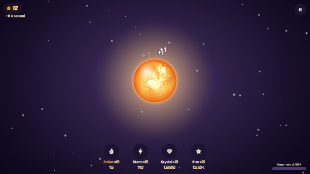
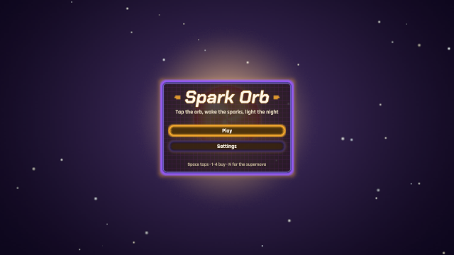
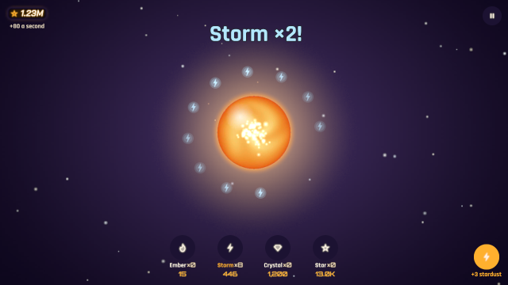
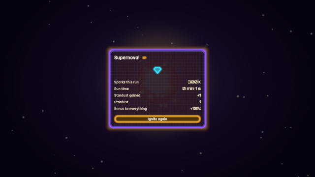
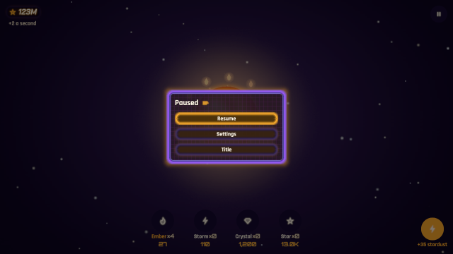
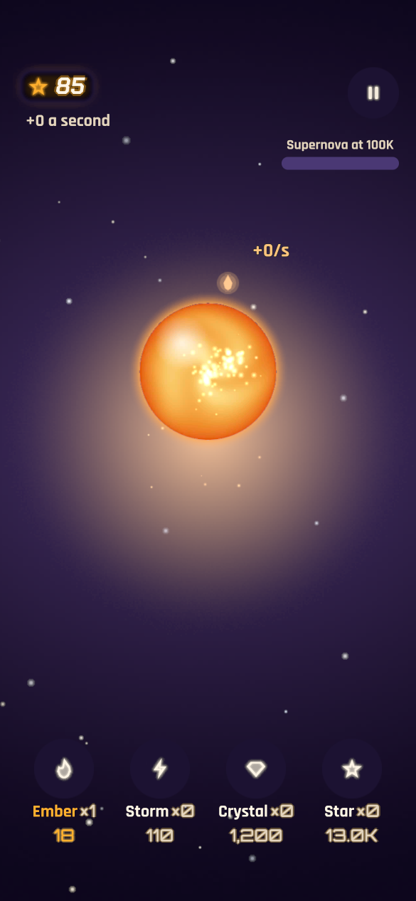

# og polish: idle

2026-10-19, 9 playtest(s) on metal. Mechanical measures of og-taste and og-feel (og-build §5); a score is 0 to 100, n/a when nothing in the playtests exercises it. The measures cannot judge style: read the frames.

## Scores

| | Score | Measure |
|---|---|---|
| **Taste** | **97** | mean of the taste rows |
| Contrast | 91 | text boxes whose ink and ground reach 4.5:1 |
| Text size | 100 | text boxes whose tallest ink line reaches 9 CSS px (a 13 px face's capitals) |
| HUD occupancy | 100 | gameplay frames: HUD at most 15 % of the surface and 5 % of the central third |
| Screen transitions | 100 | screen changes with UI motion around them |
| UI sounds | 92 | UI presses answered on the ui bus |
| Locale keys | 100 | string tables without missing keys (og cook) |
| **Feel** | **94** | mean of the feel rows |
| Input latency | 100 | inputs answered, by the median ticks to the answer (0–1: 100) |
| Hit feedback | n/a | damage moments with hit stop, shake, floating text or a sound (three of four: 100) |
| Idle frames | 100 | ticks where nothing new is seen or heard (10 %: 100, 60 %: 0) |
| Frame time | 81 | p95 step + render (8.3 ms: 100, 33 ms: 0), worst playtest |
| Sound on input | 95 | inputs answered by a sound within 6 ticks |

## Fixes

| Measure | Where | Found | Fix |
|---|---|---|---|
| UI sounds | flow | 2 of 13 UI presses played no sound on the ui bus | og-taste §6 (feedback) and og-audio §3: give the skin or og.ui.configure its press and open sounds |
| contrast | frames orbit: `Cost` "81" | 3.98:1 between ink and ground (body text wants 4.5:1) | og-taste §3 (value before hue): darken the ground or lighten the ink in the skin's palette, never per call |
| contrast | frames orbit: `Cost` "19.8K" | 4.44:1 between ink and ground (body text wants 4.5:1) | og-taste §3 (value before hue): darken the ground or lighten the ink in the skin's palette, never per call |
| contrast | milestone milestone: `Cost` "1,200" | 3.68:1 between ink and ground (body text wants 4.5:1) | og-taste §3 (value before hue): darken the ground or lighten the ink in the skin's palette, never per call |
| contrast | milestone milestone: `Cost` "15" | 4.1:1 between ink and ground (body text wants 4.5:1) | og-taste §3 (value before hue): darken the ground or lighten the ink in the skin's palette, never per call |
| contrast | offline welcome: `Collect` "Collect" | 3.05:1 between ink and ground (body text wants 4.5:1) | og-taste §3 (value before hue): darken the ground or lighten the ink in the skin's palette, never per call |
| contrast | pause settings-zh: `Done` "完成" | 2.97:1 between ink and ground (body text wants 4.5:1) | og-taste §3 (value before hue): darken the ground or lighten the ink in the skin's palette, never per call |
| contrast | pause play-zh: `Name` "晶簇" | 3.1:1 between ink and ground (body text wants 4.5:1) | og-taste §3 (value before hue): darken the ground or lighten the ink in the skin's palette, never per call |
| contrast | pause play-zh: `Cost` "1,200" | 3.68:1 between ink and ground (body text wants 4.5:1) | og-taste §3 (value before hue): darken the ground or lighten the ink in the skin's palette, never per call |
| contrast | phone play: `Cost` "18" | 4.13:1 between ink and ground (body text wants 4.5:1) | og-taste §3 (value before hue): darken the ground or lighten the ink in the skin's palette, never per call |
| contrast | phone play: `Amount` "85" | 4.3:1 between ink and ground (body text wants 4.5:1) | og-taste §3 (value before hue): darken the ground or lighten the ink in the skin's palette, never per call |
| UI sounds | phone | 1 of 4 UI presses played no sound on the ui bus | og-taste §6 (feedback) and og-audio §3: give the skin or og.ui.configure its press and open sounds |

## Playtests

### flow

taps make sparks, sparks buy embers, embers make sparks, a purchase too dear is refused (390 ticks)

| Measure | Value |
|---|---|
| Text boxes | 20; 20 at 4.5:1; 20 of 20 at 9 px ink |
| Lowest contrast | 4.61:1 `Cost` (tapped); 4.73:1 `Amount` (tapped); 4.9:1 `Owned` (tapped) |
| Smallest ink | 11 px `Rate` (tapped); 11 px `Name` (tapped); 11 px `Name` (tapped) |
| HUD | 1 gameplay frame(s), up to 2.08 % of the surface, 0 % of the centre |
| UI | 1 screen change(s), 1 with motion; 388 ticks of UI motion; 13 press(es), 11 with a ui-bus sound |
| Inputs | 17, 17 answered, median 0 ticks, max 0; 16 with a sound; 100 % of input-free ticks also change something |
| Damage | 0 moment(s): hit stop 0, shake 0, floating text 0, sound 0, tween 0, particles 0 |
| Idle | 0 % of ticks |
| Particles | peak 8 system(s), 6 burst(s) |
| Frame (metal) | step 2.08 ms median, 6.92 p95; render 1.57 median, 4.7 p95; frame p95 10.74, max 61.96 |
| Audio | 6.5 s, peak 0.21, RMS 0.035, 0 clipped, 0 % silent ticks |

 

tapped (tick 213: HUD 2.08 %, 20 texts, 0 under 4.5:1, 0 small)

### frames

the title, the orb with its motes and the supernova's card match their reference frames (246 ticks)

| Measure | Value |
|---|---|
| Text boxes | 38; 36 at 4.5:1; 38 of 38 at 9 px ink |
| Lowest contrast | 3.98:1 `Cost` (orbit); 4.44:1 `Cost` (orbit); 4.71:1 `Cost` (orbit) |
| Smallest ink | 11 px `Footer` (title); 11 px `Rate` (orbit); 11 px `Name` (orbit) |
| HUD | 1 gameplay frame(s), up to 2.04 % of the surface, 0 % of the centre |
| UI | 3 screen change(s), 3 with motion; 244 ticks of UI motion; 0 press(es), 0 with a ui-bus sound |
| Inputs | 0, 0 answered, median 0 ticks, max 0; 0 with a sound; 100 % of input-free ticks also change something |
| Damage | 0 moment(s): hit stop 0, shake 0, floating text 0, sound 0, tween 0, particles 0 |
| Idle | 0 % of ticks |
| Particles | peak 3 system(s), 1 burst(s) |
| Frame (metal) | step 1.27 ms median, 5.5 p95; render 1.15 median, 4.88 p95; frame p95 9.23, max 132.48 |
| Audio | 4.1 s, peak 0.53, RMS 0.0638, 0 clipped, 0 % silent ticks |

 

title (tick 54, menu: HUD 5.25 %, 5 texts, 0 under 4.5:1, 0 small)

### milestone

the tenth of a kind doubles it; big numbers read 1.23M (90 ticks)

| Measure | Value |
|---|---|
| Text boxes | 21; 19 at 4.5:1; 21 of 21 at 9 px ink |
| Lowest contrast | 3.68:1 `Cost` (milestone); 4.1:1 `Cost` (milestone); 4.5:1 `Cost` (milestone) |
| Smallest ink | 11 px `Rate` (milestone); 11 px `Name` (milestone); 11 px `Name` (milestone) |
| HUD | 1 gameplay frame(s), up to 1.99 % of the surface, 0 % of the centre |
| UI | 2 screen change(s), 2 with motion; 88 ticks of UI motion; 0 press(es), 0 with a ui-bus sound |
| Inputs | 1, 1 answered, median 0 ticks, max 0; 1 with a sound; 100 % of input-free ticks also change something |
| Damage | 0 moment(s): hit stop 0, shake 0, floating text 0, sound 0, tween 0, particles 0 |
| Idle | 0 % of ticks |
| Particles | peak 3 system(s), 1 burst(s) |
| Frame (metal) | step 1.05 ms median, 2.15 p95; render 0.82 median, 1.52 p95; frame p95 3.23, max 38.15 |
| Audio | 1.5 s, peak 0.25, RMS 0.0291, 0 clipped, 0 % silent ticks |

 

milestone (tick 87: HUD 1.99 %, 21 texts, 2 under 4.5:1, 0 small)

### nova

a supernova: asked, declined, collapsed, the run's card, the next run stronger (282 ticks)

| Measure | Value |
|---|---|
| Text boxes | 12; 12 at 4.5:1; 12 of 12 at 9 px ink |
| Lowest contrast | 5.89:1 `Value` (card); 5.89:1 `Again` (card); 7.13:1 `Value` (card) |
| Smallest ink | 11 px `Key` (card); 11 px `Key` (card); 12 px `Value` (card) |
| HUD | 0 gameplay frame(s), up to 0 % of the surface, 0 % of the centre |
| UI | 10 screen change(s), 10 with motion; 275 ticks of UI motion; 4 press(es), 4 with a ui-bus sound |
| Inputs | 6, 6 answered, median 0 ticks, max 0; 6 with a sound; 100 % of input-free ticks also change something |
| Damage | 0 moment(s): hit stop 0, shake 0, floating text 0, sound 0, tween 0, particles 0 |
| Idle | 0 % of ticks |
| Particles | peak 3 system(s), 1 burst(s) |
| Frame (metal) | step 1.86 ms median, 6.56 p95; render 1.38 median, 4.38 p95; frame p95 11.15, max 63.52 |
| Audio | 4.7 s, peak 0.74, RMS 0.068, 0 clipped, 0 % silent ticks |

 

card (tick 201, menu: HUD 4.28 %, 12 texts, 0 under 4.5:1, 0 small)

### offline

the save, two hours away credited at half the rate, a stale write merged (264 ticks)

| Measure | Value |
|---|---|
| Text boxes | 3; 2 at 4.5:1; 3 of 3 at 9 px ink |
| Lowest contrast | 3.05:1 `Collect` (welcome); 14.39:1 `Title` (welcome); 14.81:1 `Body` (welcome) |
| Smallest ink | 13 px `Body` (welcome); 16 px `Title` (welcome); 26 px `Collect` (welcome) |
| HUD | 0 gameplay frame(s), up to 0 % of the surface, 0 % of the centre |
| UI | 8 screen change(s), 8 with motion; 262 ticks of UI motion; 2 press(es), 2 with a ui-bus sound |
| Inputs | 4, 4 answered, median 0 ticks, max 0; 4 with a sound; 100 % of input-free ticks also change something |
| Damage | 0 moment(s): hit stop 0, shake 0, floating text 0, sound 0, tween 0, particles 0 |
| Idle | 0 % of ticks |
| Particles | peak 2 system(s), 0 burst(s) |
| Frame (metal) | step 2.32 ms median, 6.93 p95; render 1.9 median, 5.08 p95; frame p95 10.58, max 60.27 |
| Audio | 4.4 s, peak 0.36, RMS 0.0475, 0 clipped, 0 % silent ticks |

 

welcome (tick 195, menu: HUD 5.4 %, 3 texts, 1 under 4.5:1, 0 small)

### pad

A, the d-pad, X, Y, Start and B play the orb (294 ticks)

| Measure | Value |
|---|---|
| Text boxes | 0; 0 at 4.5:1; 0 of 0 at 9 px ink |
| HUD | 0 gameplay frame(s), up to 0 % of the surface, 0 % of the centre |
| UI | 6 screen change(s), 6 with motion; 292 ticks of UI motion; 0 press(es), 0 with a ui-bus sound |
| Inputs | 14, 14 answered, median 0 ticks, max 0; 12 with a sound; 100 % of input-free ticks also change something |
| Damage | 0 moment(s): hit stop 0, shake 0, floating text 0, sound 0, tween 0, particles 0 |
| Idle | 0 % of ticks |
| Particles | peak 5 system(s), 3 burst(s) |
| Frame (metal) | step 1.61 ms median, 4.46 p95; render 1.29 median, 4.14 p95; frame p95 7.88, max 17.07 |
| Audio | 4.9 s, peak 0.23, RMS 0.0462, 0 clipped, 0 % silent ticks |

### pause

Escape pauses, settings switch to 简体中文 and save, numbers read in 万 and 亿 (330 ticks)

| Measure | Value |
|---|---|
| Text boxes | 37; 30 at 4.5:1; 37 of 37 at 9 px ink |
| Lowest contrast | 2.97:1 `Done` (settings-zh); 3.1:1 `Name` (play-zh); 3.68:1 `Cost` (play-zh) |
| Smallest ink | 11 px `resume` (pause); 12 px `quit` (pause); 12 px `Value` (settings-zh) |
| HUD | 1 gameplay frame(s), up to 1.83 % of the surface, 0 % of the centre |
| UI | 8 screen change(s), 8 with motion; 328 ticks of UI motion; 5 press(es), 5 with a ui-bus sound |
| Inputs | 6, 6 answered, median 0 ticks, max 0; 6 with a sound; 100 % of input-free ticks also change something |
| Damage | 0 moment(s): hit stop 0, shake 0, floating text 0, sound 0, tween 0, particles 0 |
| Idle | 0 % of ticks |
| Particles | peak 2 system(s), 0 burst(s) |
| Frame (metal) | step 1.78 ms median, 7.06 p95; render 1.44 median, 6.11 p95; frame p95 12.98, max 63.62 |
| Audio | 5.5 s, peak 0.41, RMS 0.0367, 0 clipped, 0 % silent ticks |

 

pause (tick 120, menu: HUD 6.8 %, 4 texts, 0 under 4.5:1, 0 small)

### phone

the phone layout: a HUD inside the safe area, the orb tapped, a card bought (168 ticks)

| Measure | Value |
|---|---|
| Text boxes | 20; 18 at 4.5:1; 20 of 20 at 9 px ink |
| Lowest contrast | 4.13:1 `Cost` (play); 4.3:1 `Amount` (play); 5.11:1 `Owned` (play) |
| Smallest ink | 10.33 px `Rate` (play); 10.33 px `Name` (play); 10.33 px `Name` (play) |
| HUD | 1 gameplay frame(s), up to 6.62 % of the surface, 0 % of the centre |
| UI | 1 screen change(s), 1 with motion; 166 ticks of UI motion; 4 press(es), 3 with a ui-bus sound |
| Inputs | 4, 4 answered, median 0 ticks, max 0; 4 with a sound; 100 % of input-free ticks also change something |
| Damage | 0 moment(s): hit stop 0, shake 0, floating text 0, sound 0, tween 0, particles 0 |
| Idle | 0 % of ticks |
| Particles | peak 4 system(s), 2 burst(s) |
| Frame (metal) | step 1.63 ms median, 4.99 p95; render 1.26 median, 4.26 p95; frame p95 7.48, max 116.48 |
| Audio | 2.8 s, peak 0.23, RMS 0.0239, 0 clipped, 0 % silent ticks |

 

play (tick 165: HUD 6.62 %, 20 texts, 2 under 4.5:1, 0 small)

### replay

a run with taps, purchases and a milestone replays to the same hash (216 ticks)

| Measure | Value |
|---|---|
| Text boxes | 0; 0 at 4.5:1; 0 of 0 at 9 px ink |
| HUD | 0 gameplay frame(s), up to 0 % of the surface, 0 % of the centre |
| UI | 1 screen change(s), 1 with motion; 214 ticks of UI motion; 9 press(es), 9 with a ui-bus sound |
| Inputs | 13, 13 answered, median 0 ticks, max 0; 13 with a sound; 100 % of input-free ticks also change something |
| Damage | 0 moment(s): hit stop 0, shake 0, floating text 0, sound 0, tween 0, particles 0 |
| Idle | 0 % of ticks |
| Particles | peak 9 system(s), 7 burst(s) |
| Frame (metal) | step 2.19 ms median, 8.49 p95; render 1.37 median, 5.77 p95; frame p95 12.55, max 25.43 |
| Audio | 3.6 s, peak 0.22, RMS 0.0376, 0 clipped, 0 % silent ticks |

