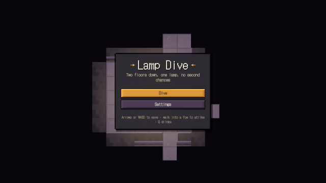
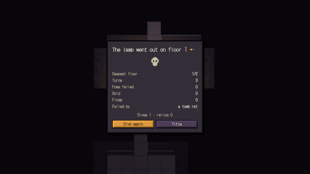
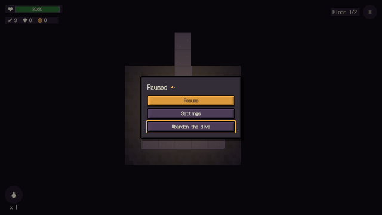
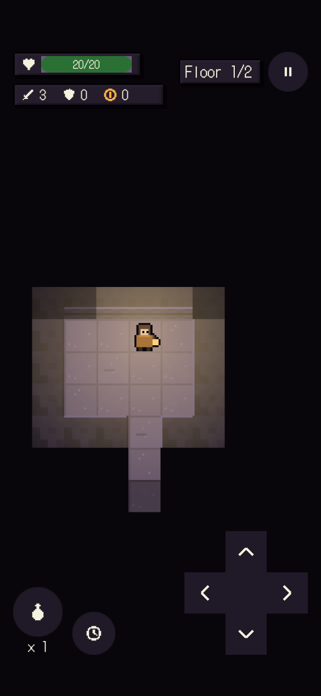
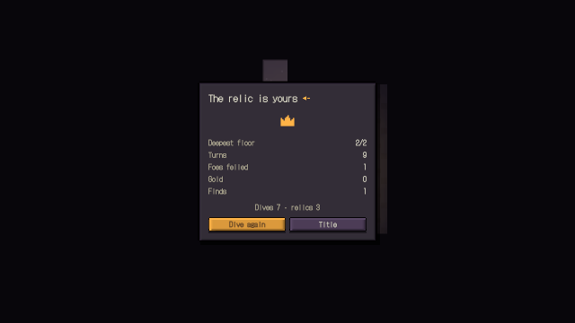

# og polish: roguelike

2026-10-19, 9 playtest(s) on metal. Mechanical measures of og-taste and og-feel (og-build §5); a score is 0 to 100, n/a when nothing in the playtests exercises it. The measures cannot judge style: read the frames.

## Scores

| | Score | Measure |
|---|---|---|
| **Taste** | **99** | mean of the taste rows |
| Contrast | 96 | text boxes whose ink and ground reach 4.5:1 |
| Text size | 100 | text boxes whose tallest ink line reaches 9 CSS px (a 13 px face's capitals) |
| HUD occupancy | 100 | gameplay frames: HUD at most 15 % of the surface and 5 % of the central third |
| Screen transitions | 96 | screen changes with UI motion around them |
| UI sounds | 100 | UI presses answered on the ui bus |
| Locale keys | 100 | string tables without missing keys (og cook) |
| **Feel** | **100** | mean of the feel rows |
| Input latency | 100 | inputs answered, by the median ticks to the answer (0–1: 100) |
| Hit feedback | 100 | damage moments with hit stop, shake, floating text or a sound (three of four: 100) |
| Idle frames | 100 | ticks where nothing new is seen or heard (10 %: 100, 60 %: 0) |
| Frame time | 100 | p95 step + render (8.3 ms: 100, 33 ms: 0), worst playtest |
| Sound on input | 100 | inputs answered by a sound within 6 ticks |

## Fixes

| Measure | Where | Found | Fix |
|---|---|---|---|
| contrast | flow title: `play` "Dive" | 3.62:1 between ink and ground (body text wants 4.5:1) | og-taste §3 (value before hue): darken the ground or lighten the ink in the skin's palette, never per call |
| contrast | flow fought: `Bar` "17/20" | 4.33:1 between ink and ground (body text wants 4.5:1) | og-taste §3 (value before hue): darken the ground or lighten the ink in the skin's palette, never per call |
| contrast | frames title: `play` "Dive" | 3.62:1 between ink and ground (body text wants 4.5:1) | og-taste §3 (value before hue): darken the ground or lighten the ink in the skin's palette, never per call |
| screen transitions | lose | 1 of 4 screen changes had no motion in the 20 ticks around them | og-taste §5 (screens change through a transition): og.ui.screenTransition, one kind per game |
| contrast | pause pause: `resume` "Resume" | 3.95:1 between ink and ground (body text wants 4.5:1) | og-taste §3 (value before hue): darken the ground or lighten the ink in the skin's palette, never per call |

## Playtests

### flow

a dive from the title: steps, a bump, the lamp's light, strikes and a draught (408 ticks)

| Measure | Value |
|---|---|
| Text boxes | 13; 11 at 4.5:1; 13 of 13 at 9 px ink |
| Lowest contrast | 3.62:1 `play` (title); 4.33:1 `Bar` (fought); 4.91:1 `Footer` (title) |
| Smallest ink | 11 px `Footer` (title); 12 px `Bar` (fought); 12 px `Pause` (fought) |
| HUD | 1 gameplay frame(s), up to 1.44 % of the surface, 0 % of the centre |
| UI | 1 screen change(s), 1 with motion; 80 ticks of UI motion; 1 press(es), 1 with a ui-bus sound |
| Inputs | 19, 19 answered, median 0 ticks, max 0; 19 with a sound; 96.15 % of input-free ticks also change something |
| Damage | 5 moment(s) from `hp`, `hits`, `kills`: hit stop 5, shake 5, floating text 5, sound 5, tween 5, particles 0 |
| Idle | 0 % of ticks |
| Particles | peak 0 system(s), 0 burst(s) |
| Frame (metal) | step 0.67 ms median, 1.95 p95; render 0.33 median, 0.66 p95; frame p95 2.67, max 15.43 |
| Audio | 6.8 s, peak 0.29, RMS 0.0245, 0 clipped, 0 % silent ticks |

 

title (tick 54, menu: HUD 6.13 %, 5 texts, 1 under 4.5:1, 0 small)

### foes

a rat hunts and strikes; two strikes fell it (222 ticks)

| Measure | Value |
|---|---|
| Text boxes | 0; 0 at 4.5:1; 0 of 0 at 9 px ink |
| HUD | 0 gameplay frame(s), up to 0 % of the surface, 0 % of the centre |
| UI | 1 screen change(s), 1 with motion; 34 ticks of UI motion; 0 press(es), 0 with a ui-bus sound |
| Inputs | 7, 7 answered, median 0 ticks, max 0; 7 with a sound; 50 % of input-free ticks also change something |
| Damage | 4 moment(s) from `hp`, `hits`, `kills`: hit stop 4, shake 4, floating text 4, sound 4, tween 4, particles 0 |
| Idle | 0 % of ticks |
| Particles | peak 0 system(s), 0 burst(s) |
| Frame (metal) | step 0.68 ms median, 2.11 p95; render 0.32 median, 0.68 p95; frame p95 2.76, max 4.73 |
| Audio | 3.7 s, peak 0.27, RMS 0.0235, 0 clipped, 0 % silent ticks |

### frames

the title, the lamp in the tomb and the summary match their reference frames (366 ticks)

| Measure | Value |
|---|---|
| Text boxes | 29; 28 at 4.5:1; 29 of 29 at 9 px ink |
| Lowest contrast | 3.62:1 `play` (title); 4.51:1 `Bar` (dive); 4.56:1 `Again` (over) |
| Smallest ink | 11 px `Footer` (title); 12 px `Bar` (dive); 12 px `Pause` (dive) |
| HUD | 1 gameplay frame(s), up to 1.44 % of the surface, 0 % of the centre |
| UI | 2 screen change(s), 2 with motion; 140 ticks of UI motion; 0 press(es), 0 with a ui-bus sound |
| Inputs | 8, 8 answered, median 0 ticks, max 0; 8 with a sound; 62.75 % of input-free ticks also change something |
| Damage | 2 moment(s) from `hp`: hit stop 2, shake 2, floating text 2, sound 2, tween 2, particles 0 |
| Idle | 0 % of ticks |
| Particles | peak 0 system(s), 0 burst(s) |
| Frame (metal) | step 0.73 ms median, 2.36 p95; render 0.37 median, 0.68 p95; frame p95 3.03, max 17.15 |
| Audio | 6.1 s, peak 0.3, RMS 0.0354, 0 clipped, 0 % silent ticks |

 

title (tick 54, menu: HUD 6.13 %, 5 texts, 1 under 4.5:1, 0 small)

### lose

the lamp goes out: the summary, and the next dive starts from nothing (222 ticks)

| Measure | Value |
|---|---|
| Text boxes | 16; 16 at 4.5:1; 16 of 16 at 9 px ink |
| Lowest contrast | 4.56:1 `Again` (lost); 5.47:1 `Record` (lost); 5.66:1 `Key` (lost) |
| Smallest ink | 13 px `Key` (lost); 13 px `Key` (lost); 13 px `Value` (lost) |
| HUD | 0 gameplay frame(s), up to 0 % of the surface, 0 % of the centre |
| UI | 4 screen change(s), 3 with motion; 99 ticks of UI motion; 1 press(es), 1 with a ui-bus sound |
| Inputs | 4, 4 answered, median 0 ticks, max 0; 4 with a sound; 65.29 % of input-free ticks also change something |
| Damage | 3 moment(s) from `hp`: hit stop 3, shake 3, floating text 3, sound 3, tween 3, particles 0 |
| Idle | 0 % of ticks |
| Particles | peak 0 system(s), 0 burst(s) |
| Frame (metal) | step 1.07 ms median, 3.15 p95; render 0.46 median, 0.96 p95; frame p95 4.33, max 14.98 |
| Audio | 3.7 s, peak 0.29, RMS 0.0491, 0 clipped, 0 % silent ticks |

 

lost (tick 183, menu: HUD 5.75 %, 16 texts, 0 under 4.5:1, 0 small)

### pad

the d-pad, A, X, Start and B play a dive (318 ticks)

| Measure | Value |
|---|---|
| Text boxes | 0; 0 at 4.5:1; 0 of 0 at 9 px ink |
| HUD | 0 gameplay frame(s), up to 0 % of the surface, 0 % of the centre |
| UI | 3 screen change(s), 3 with motion; 86 ticks of UI motion; 0 press(es), 0 with a ui-bus sound |
| Inputs | 10, 10 answered, median 0 ticks, max 1; 10 with a sound; 59.04 % of input-free ticks also change something |
| Damage | 6 moment(s) from `hp`, `hits`, `kills`: hit stop 6, shake 6, floating text 6, sound 6, tween 6, particles 0 |
| Idle | 0 % of ticks |
| Particles | peak 0 system(s), 0 burst(s) |
| Frame (metal) | step 0.75 ms median, 2.17 p95; render 0.36 median, 0.73 p95; frame p95 2.99, max 6.25 |
| Audio | 5.3 s, peak 0.27, RMS 0.0441, 0 clipped, 0 % silent ticks |

### pause

Escape pauses, settings switch the language and save, Resume gives the turn back (312 ticks)

| Measure | Value |
|---|---|
| Text boxes | 24; 23 at 4.5:1; 24 of 24 at 9 px ink |
| Lowest contrast | 3.95:1 `resume` (pause); 4.51:1 `Bar` (play-zh); 5.46:1 `LanguageLabel` (settings-zh) |
| Smallest ink | 12 px `Bar` (play-zh); 12 px `Pause` (play-zh); 14 px `resume` (pause) |
| HUD | 1 gameplay frame(s), up to 1.41 % of the surface, 0 % of the centre |
| UI | 7 screen change(s), 7 with motion; 227 ticks of UI motion; 5 press(es), 5 with a ui-bus sound |
| Inputs | 9, 9 answered, median 0 ticks, max 1; 9 with a sound; 83.33 % of input-free ticks also change something |
| Damage | 0 moment(s): hit stop 0, shake 0, floating text 0, sound 0, tween 0, particles 0 |
| Idle | 0 % of ticks |
| Particles | peak 0 system(s), 0 burst(s) |
| Frame (metal) | step 0.94 ms median, 3.06 p95; render 0.45 median, 1.07 p95; frame p95 3.87, max 19.1 |
| Audio | 5.2 s, peak 0.41, RMS 0.0366, 0 clipped, 0 % silent ticks |

 

pause (tick 102, menu: HUD 6.24 %, 4 texts, 1 under 4.5:1, 0 small)

### phone

the phone layout: a HUD inside the safe area and a d-pad that steps (180 ticks)

| Measure | Value |
|---|---|
| Text boxes | 13; 13 at 4.5:1; 13 of 13 at 9 px ink |
| Lowest contrast | 5.33:1 `Bar` (play); 14.34:1 `Attack` (play); 14.34:1 `Armour` (play) |
| Smallest ink | 10.33 px `Up` (play); 10.33 px `Down` (play); 10.67 px `Pause` (play) |
| HUD | 1 gameplay frame(s), up to 3.41 % of the surface, 0 % of the centre |
| UI | 1 screen change(s), 1 with motion; 80 ticks of UI motion; 1 press(es), 1 with a ui-bus sound |
| Inputs | 3, 3 answered, median 0 ticks, max 0; 3 with a sound; 67.57 % of input-free ticks also change something |
| Damage | 0 moment(s): hit stop 0, shake 0, floating text 0, sound 0, tween 0, particles 0 |
| Idle | 0 % of ticks |
| Particles | peak 0 system(s), 0 burst(s) |
| Frame (metal) | step 0.85 ms median, 2.12 p95; render 0.4 median, 0.88 p95; frame p95 3.11, max 40.91 |
| Audio | 3 s, peak 0.19, RMS 0.0126, 0 clipped, 0 % silent ticks |

 

play (tick 174: HUD 3.41 %, 13 texts, 0 under 4.5:1, 0 small)

### replay

a dive with steps, strikes and the foes' turns replays to the same hash (246 ticks)

| Measure | Value |
|---|---|
| Text boxes | 0; 0 at 4.5:1; 0 of 0 at 9 px ink |
| HUD | 0 gameplay frame(s), up to 0 % of the surface, 0 % of the centre |
| UI | 1 screen change(s), 1 with motion; 58 ticks of UI motion; 1 press(es), 1 with a ui-bus sound |
| Inputs | 12, 12 answered, median 0 ticks, max 0; 12 with a sound; 50 % of input-free ticks also change something |
| Damage | 0 moment(s): hit stop 0, shake 0, floating text 0, sound 0, tween 0, particles 0 |
| Idle | 0 % of ticks |
| Particles | peak 0 system(s), 0 burst(s) |
| Frame (metal) | step 0.92 ms median, 2.37 p95; render 0.44 median, 0.85 p95; frame p95 3.05, max 7.26 |
| Audio | 4.1 s, peak 0.2, RMS 0.0368, 0 clipped, 0 % silent ticks |

### win

down the stairs, past the guardian, the relic, a merged record and the summary (354 ticks)

| Measure | Value |
|---|---|
| Text boxes | 14; 14 at 4.5:1; 14 of 14 at 9 px ink |
| Lowest contrast | 4.56:1 `Again` (won); 5.46:1 `Record` (won); 5.66:1 `Key` (won) |
| Smallest ink | 13 px `Key` (won); 13 px `Menu` (won); 14 px `Key` (won) |
| HUD | 0 gameplay frame(s), up to 0 % of the surface, 0 % of the centre |
| UI | 4 screen change(s), 4 with motion; 129 ticks of UI motion; 1 press(es), 1 with a ui-bus sound |
| Inputs | 10, 10 answered, median 0 ticks, max 0; 10 with a sound; 68.75 % of input-free ticks also change something |
| Damage | 6 moment(s) from `hits`, `hp`, `kills`: hit stop 6, shake 6, floating text 6, sound 6, tween 6, particles 0 |
| Idle | 0 % of ticks |
| Particles | peak 0 system(s), 0 burst(s) |
| Frame (metal) | step 0.98 ms median, 2.61 p95; render 0.46 median, 0.83 p95; frame p95 3.3, max 8.48 |
| Audio | 5.9 s, peak 0.38, RMS 0.048, 0 clipped, 0 % silent ticks |

 

won (tick 303, menu: HUD 4.62 %, 14 texts, 0 under 4.5:1, 0 small)

