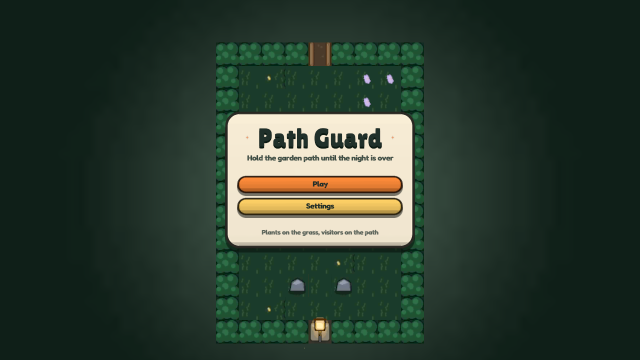
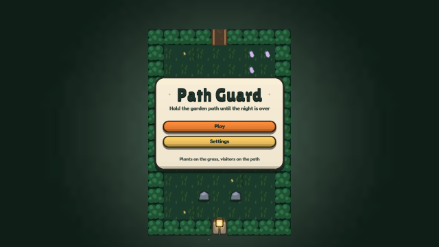
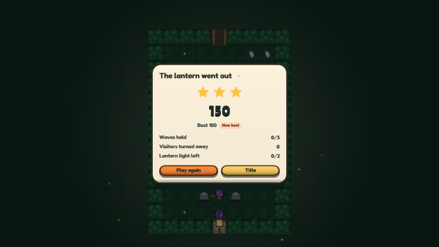
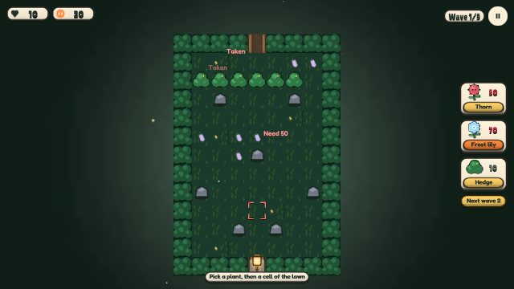
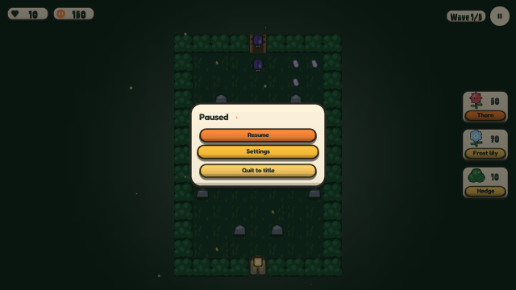
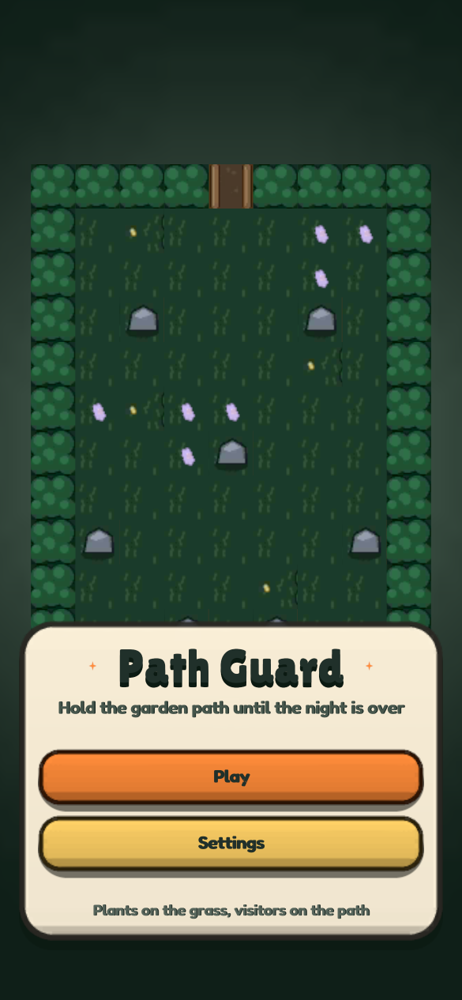
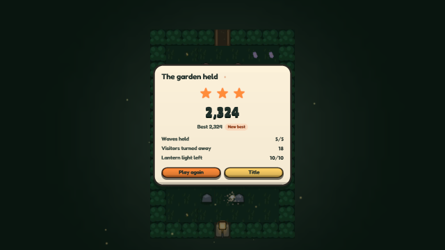

# og polish: tower-defense

2026-10-19, 9 playtest(s) on metal. Mechanical measures of og-taste and og-feel (og-build §5); a score is 0 to 100, n/a when nothing in the playtests exercises it. The measures cannot judge style: read the frames.

## Scores

| | Score | Measure |
|---|---|---|
| **Taste** | **99** | mean of the taste rows |
| Contrast | 96 | text boxes whose ink and ground reach 4.5:1 |
| Text size | 100 | text boxes whose tallest ink line reaches 9 CSS px (a 13 px face's capitals) |
| HUD occupancy | 100 | gameplay frames: HUD at most 15 % of the surface and 5 % of the central third |
| Screen transitions | 100 | screen changes with UI motion around them |
| UI sounds | 100 | UI presses answered on the ui bus |
| Locale keys | 100 | string tables without missing keys (og cook) |
| **Feel** | **80** | mean of the feel rows |
| Input latency | 100 | inputs answered, by the median ticks to the answer (0–1: 100) |
| Hit feedback | 100 | damage moments with hit stop, shake, floating text or a sound (three of four: 100) |
| Idle frames | 100 | ticks where nothing new is seen or heard (10 %: 100, 60 %: 0) |
| Frame time | 0 | p95 step + render (8.3 ms: 100, 33 ms: 0), worst playtest |
| Sound on input | 98 | inputs answered by a sound within 6 ticks |

## Fixes

| Measure | Where | Found | Fix |
|---|---|---|---|
| hit feedback | flow | 5 of 5 damage moments (kills) had no shake within 8 ticks | og-feel §4 (trauma, not offsets) |
| contrast | frames wave: `Pick` "Frost lily" | 4.08:1 between ink and ground (body text wants 4.5:1) | og-taste §3 (value before hue): darken the ground or lighten the ink in the skin's palette, never per call |
| contrast | maze maze: `Pick` "Frost lily" | 4.08:1 between ink and ground (body text wants 4.5:1) | og-taste §3 (value before hue): darken the ground or lighten the ink in the skin's palette, never per call |
| contrast | pause settings-zh: `Done` "完成" | 3.46:1 between ink and ground (body text wants 4.5:1) | og-taste §3 (value before hue): darken the ground or lighten the ink in the skin's palette, never per call |
| contrast | pause pause-zh: `resume` "继续" | 3.51:1 between ink and ground (body text wants 4.5:1) | og-taste §3 (value before hue): darken the ground or lighten the ink in the skin's palette, never per call |
| contrast | pause play-zh: `Pick` "荆棘" | 4.2:1 between ink and ground (body text wants 4.5:1) | og-taste §3 (value before hue): darken the ground or lighten the ink in the skin's palette, never per call |
| contrast | phone play: `Pick` "Hedge" | 2.51:1 between ink and ground (body text wants 4.5:1) | og-taste §3 (value before hue): darken the ground or lighten the ink in the skin's palette, never per call |
| frame time | phone | p95 step + render 25.3 ms on metal (the frame is 16.7 ms) | og-game §14 (performance): fewer draws and particles, cheaper systems; og run --json measures |
| hit feedback | replay | 3 of 3 damage moments (kills) had no shake within 8 ticks | og-feel §4 (trauma, not offsets) |
| frame time | replay | p95 step + render 40.47 ms on metal (the frame is 16.7 ms) | og-game §14 (performance): fewer draws and particles, cheaper systems; og run --json measures |
| hit feedback | win | 18 of 18 damage moments (kills) had no shake within 8 ticks | og-feel §4 (trauma, not offsets) |
| frame time | win | p95 step + render 44.42 ms on metal (the frame is 16.7 ms) | og-game §14 (performance): fewer draws and particles, cheaper systems; og run --json measures |

## Playtests

### flow

title, plants set by tap and by keys, the first wave walks in and is shot down (786 ticks)

| Measure | Value |
|---|---|
| Text boxes | 27; 27 at 4.5:1; 27 of 27 at 9 px ink |
| Lowest contrast | 4.7:1 `Pick` (play); 4.7:1 `Pick` (wave); 4.84:1 `play` (title) |
| Smallest ink | 10 px `Next` (play); 13 px `Footer` (title); 15 px `Subtitle` (title) |
| HUD | 2 gameplay frame(s), up to 4.4 % of the surface, 0 % of the centre |
| UI | 2 screen change(s), 2 with motion; 784 ticks of UI motion; 3 press(es), 3 with a ui-bus sound |
| Inputs | 9, 9 answered, median 0 ticks, max 0; 9 with a sound; 100 % of input-free ticks also change something |
| Damage | 5 moment(s) from `kills`: hit stop 5, shake 0, floating text 5, sound 5, tween 5, particles 5 |
| Idle | 0 % of ticks |
| Particles | peak 2 system(s), 5 burst(s) |
| Frame (metal) | step 4.6 ms median, 7.82 p95; render 3.84 median, 6.16 p95; frame p95 13.53, max 397.98 |
| Audio | 13.1 s, peak 0.38, RMS 0.026, 0 clipped, 0 % silent ticks |

 

title (tick 18, menu: HUD 4.96 %, 5 texts, 0 under 4.5:1, 0 small)

### frames

the title, a wave in the maze and the end card match their reference frames (486 ticks)

| Measure | Value |
|---|---|
| Text boxes | 27; 26 at 4.5:1; 27 of 27 at 9 px ink |
| Lowest contrast | 4.08:1 `Pick` (wave); 4.7:1 `Retry` (end); 4.84:1 `play` (title) |
| Smallest ink | 10 px `Badge` (end); 11 px `Best` (end); 11 px `Value` (end) |
| HUD | 1 gameplay frame(s), up to 3.31 % of the surface, 0 % of the centre |
| UI | 3 screen change(s), 3 with motion; 484 ticks of UI motion; 0 press(es), 0 with a ui-bus sound |
| Inputs | 0, 0 answered, median 0 ticks, max 0; 0 with a sound; 100 % of input-free ticks also change something |
| Damage | 0 moment(s): hit stop 0, shake 0, floating text 0, sound 0, tween 0, particles 0 |
| Idle | 0 % of ticks |
| Particles | peak 1 system(s), 0 burst(s) |
| Frame (metal) | step 4.26 ms median, 5.9 p95; render 3.61 median, 4.12 p95; frame p95 9.93, max 246.42 |
| Audio | 8.1 s, peak 0.37, RMS 0.0351, 0 clipped, 0 % silent ticks |

 

title (tick 30, menu: HUD 5.25 %, 5 texts, 0 under 4.5:1, 0 small)

### lose

unguarded, visitors reach the doorstep, the lantern goes out, the end card offers another round (1074 ticks)

| Measure | Value |
|---|---|
| Text boxes | 12; 12 at 4.5:1; 12 of 12 at 9 px ink |
| Lowest contrast | 4.7:1 `Retry` (lost); 7.65:1 `Menu` (lost); 7.83:1 `Badge` (lost) |
| Smallest ink | 10 px `Badge` (lost); 11 px `Value` (lost); 12 px `Best` (lost) |
| HUD | 0 gameplay frame(s), up to 0 % of the surface, 0 % of the centre |
| UI | 4 screen change(s), 4 with motion; 1072 ticks of UI motion; 2 press(es), 2 with a ui-bus sound |
| Inputs | 2, 2 answered, median 0 ticks, max 0; 2 with a sound; 100 % of input-free ticks also change something |
| Damage | 2 moment(s) from `lives`: hit stop 2, shake 2, floating text 2, sound 2, tween 2, particles 0 |
| Idle | 0 % of ticks |
| Particles | peak 1 system(s), 0 burst(s) |
| Frame (metal) | step 4.36 ms median, 8.29 p95; render 3.71 median, 6.68 p95; frame p95 14.64, max 166.12 |
| Audio | 17.9 s, peak 0.44, RMS 0.0556, 0 clipped, 0 % silent ticks |

 

lost (tick 996, menu: HUD 6.44 %, 12 texts, 0 under 4.5:1, 0 small)

### maze

hedges route the visitors through the gap; a closed path, a stone, a taken cell and an empty purse are refused (486 ticks)

| Measure | Value |
|---|---|
| Text boxes | 12; 11 at 4.5:1; 12 of 12 at 9 px ink |
| Lowest contrast | 4.08:1 `Pick` (maze); 5.44:1 `Next` (maze); 6.74:1 `Pick` (maze) |
| Smallest ink | 11 px `Next` (maze); 15 px `Text` (maze); 16 px `Label` (maze) |
| HUD | 1 gameplay frame(s), up to 4.4 % of the surface, 0 % of the centre |
| UI | 2 screen change(s), 2 with motion; 484 ticks of UI motion; 0 press(es), 0 with a ui-bus sound |
| Inputs | 0, 0 answered, median 0 ticks, max 0; 0 with a sound; 100 % of input-free ticks also change something |
| Damage | 0 moment(s): hit stop 0, shake 0, floating text 0, sound 0, tween 0, particles 0 |
| Idle | 0 % of ticks |
| Particles | peak 1 system(s), 0 burst(s) |
| Frame (metal) | step 4.21 ms median, 6.11 p95; render 3.6 median, 4.36 p95; frame p95 10.23, max 249.33 |
| Audio | 8.1 s, peak 0.4, RMS 0.0566, 0 clipped, 0 % silent ticks |

 

maze (tick 96: HUD 4.4 %, 12 texts, 1 under 4.5:1, 0 small)

### pad

the d-pad, A, X, Y, Start and B play a round (186 ticks)

| Measure | Value |
|---|---|
| Text boxes | 0; 0 at 4.5:1; 0 of 0 at 9 px ink |
| HUD | 0 gameplay frame(s), up to 0 % of the surface, 0 % of the centre |
| UI | 4 screen change(s), 4 with motion; 184 ticks of UI motion; 0 press(es), 0 with a ui-bus sound |
| Inputs | 11, 11 answered, median 0 ticks, max 0; 10 with a sound; 100 % of input-free ticks also change something |
| Damage | 0 moment(s): hit stop 0, shake 0, floating text 0, sound 0, tween 0, particles 0 |
| Idle | 0 % of ticks |
| Particles | peak 1 system(s), 0 burst(s) |
| Frame (metal) | step 4.24 ms median, 6.08 p95; render 3.52 median, 4.01 p95; frame p95 9.87, max 11.25 |
| Audio | 3.1 s, peak 0.36, RMS 0.0429, 0 clipped, 0 % silent ticks |

### pause

Escape pauses, settings switch the language and save, Resume runs the garden again (528 ticks)

| Measure | Value |
|---|---|
| Text boxes | 30; 27 at 4.5:1; 30 of 30 at 9 px ink |
| Lowest contrast | 3.46:1 `Done` (settings-zh); 3.51:1 `resume` (pause-zh); 4.2:1 `Pick` (play-zh) |
| Smallest ink | 11 px `Value` (settings-zh); 11 px `Value` (settings-zh); 11 px `Value` (settings-zh) |
| HUD | 1 gameplay frame(s), up to 3.28 % of the surface, 0 % of the centre |
| UI | 8 screen change(s), 8 with motion; 526 ticks of UI motion; 6 press(es), 6 with a ui-bus sound |
| Inputs | 7, 7 answered, median 0 ticks, max 0; 7 with a sound; 100 % of input-free ticks also change something |
| Damage | 0 moment(s): hit stop 0, shake 0, floating text 0, sound 0, tween 0, particles 0 |
| Idle | 0 % of ticks |
| Particles | peak 1 system(s), 0 burst(s) |
| Frame (metal) | step 4.34 ms median, 6.88 p95; render 3.65 median, 5.44 p95; frame p95 12.35, max 420.16 |
| Audio | 8.8 s, peak 0.42, RMS 0.0348, 0 clipped, 0 % silent ticks |

 

pause (tick 318, menu: HUD 8.14 %, 4 texts, 0 under 4.5:1, 0 small)

### phone

the phone layout: title, HUD and a bottom tray of touch-sized buttons inside the safe area (114 ticks)

| Measure | Value |
|---|---|
| Text boxes | 16; 15 at 4.5:1; 16 of 16 at 9 px ink |
| Lowest contrast | 2.51:1 `Pick` (play); 5.31:1 `play` (title); 8.13:1 `settings` (title) |
| Smallest ink | 12.33 px `Footer` (title); 14.33 px `Subtitle` (title); 15 px `Pick` (play) |
| HUD | 2 gameplay frame(s), up to 14.21 % of the surface, 0 % of the centre |
| UI | 1 screen change(s), 1 with motion; 112 ticks of UI motion; 2 press(es), 2 with a ui-bus sound |
| Inputs | 2, 2 answered, median 0 ticks, max 0; 2 with a sound; 100 % of input-free ticks also change something |
| Damage | 0 moment(s): hit stop 0, shake 0, floating text 0, sound 0, tween 0, particles 0 |
| Idle | 0 % of ticks |
| Particles | peak 1 system(s), 0 burst(s) |
| Frame (metal) | step 6.59 ms median, 15.49 p95; render 4.7 median, 10.98 p95; frame p95 25.3, max 1470.57 |
| Audio | 1.9 s, peak 0.34, RMS 0.0307, 0 clipped, 0 % silent ticks |

 

title (tick 24: HUD 14.21 %, 5 texts, 0 under 4.5:1, 0 small)

### replay

a round with plants, shots, pops and frost replays to the same hash (546 ticks)

| Measure | Value |
|---|---|
| Text boxes | 0; 0 at 4.5:1; 0 of 0 at 9 px ink |
| HUD | 0 gameplay frame(s), up to 0 % of the surface, 0 % of the centre |
| UI | 2 screen change(s), 2 with motion; 544 ticks of UI motion; 2 press(es), 2 with a ui-bus sound |
| Inputs | 7, 7 answered, median 0 ticks, max 0; 7 with a sound; 100 % of input-free ticks also change something |
| Damage | 3 moment(s) from `kills`: hit stop 3, shake 0, floating text 3, sound 3, tween 3, particles 3 |
| Idle | 0 % of ticks |
| Particles | peak 2 system(s), 3 burst(s) |
| Frame (metal) | step 5.28 ms median, 22.22 p95; render 4.28 median, 20.86 p95; frame p95 40.47, max 136.77 |
| Audio | 9.1 s, peak 0.4, RMS 0.0264, 0 clipped, 0 % silent ticks |

### win

a strong stand holds the last wave, the end card shows the win, the best is saved and submitted (1470 ticks)

| Measure | Value |
|---|---|
| Text boxes | 12; 12 at 4.5:1; 12 of 12 at 9 px ink |
| Lowest contrast | 4.7:1 `Retry` (won); 7.65:1 `Menu` (won); 7.83:1 `Badge` (won) |
| Smallest ink | 10 px `Badge` (won); 11 px `Value` (won); 12 px `Key` (won) |
| HUD | 0 gameplay frame(s), up to 0 % of the surface, 0 % of the centre |
| UI | 3 screen change(s), 3 with motion; 1468 ticks of UI motion; 1 press(es), 1 with a ui-bus sound |
| Inputs | 2, 2 answered, median 0 ticks, max 0; 2 with a sound; 100 % of input-free ticks also change something |
| Damage | 18 moment(s) from `kills`: hit stop 18, shake 0, floating text 18, sound 18, tween 18, particles 18 |
| Idle | 0 % of ticks |
| Particles | peak 3 system(s), 18 burst(s) |
| Frame (metal) | step 6.16 ms median, 27.43 p95; render 4.76 median, 21.35 p95; frame p95 44.42, max 250.03 |
| Audio | 24.5 s, peak 0.45, RMS 0.0301, 0 clipped, 0 % silent ticks |

 

won (tick 1380, menu: HUD 6.32 %, 12 texts, 0 under 4.5:1, 0 small)

