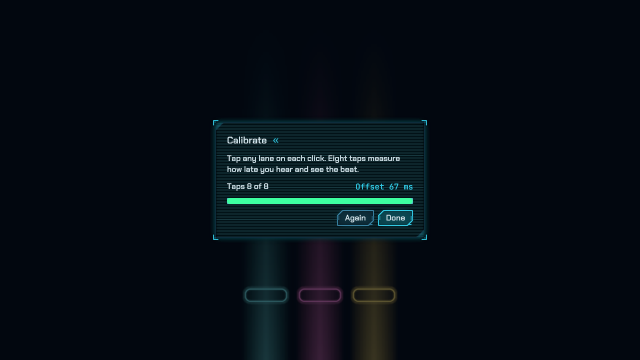
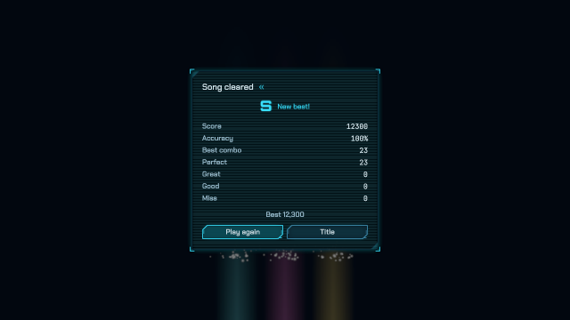
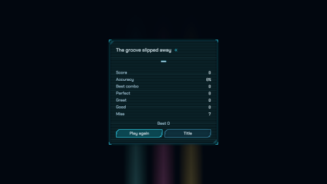
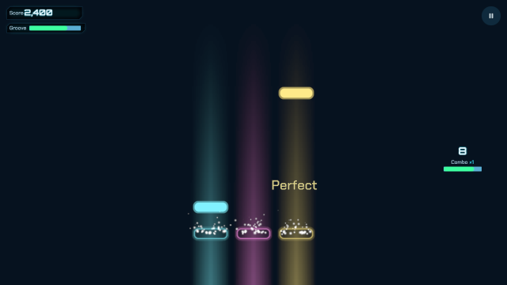
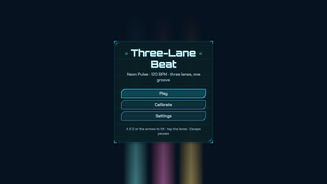
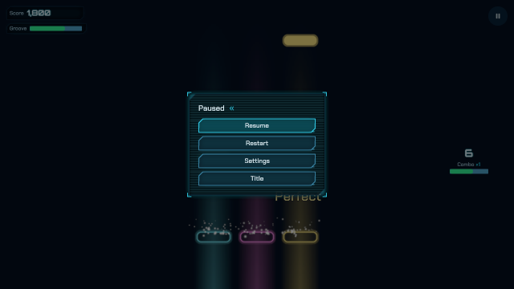
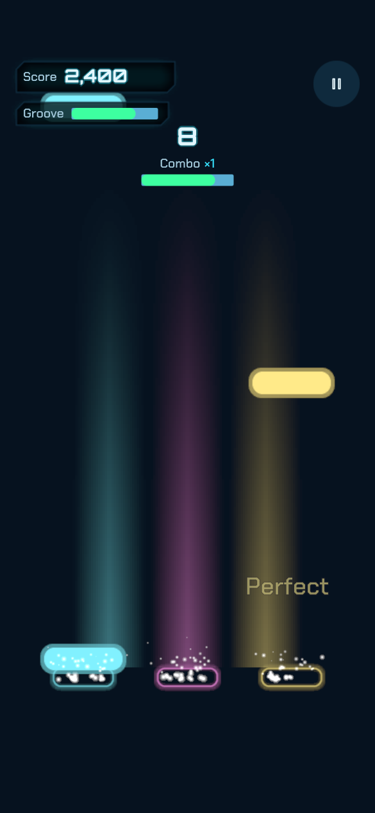

# og polish: rhythm

2026-10-19, 11 playtest(s) on metal. Mechanical measures of og-taste and og-feel (og-build §5); a score is 0 to 100, n/a when nothing in the playtests exercises it. The measures cannot judge style: read the frames.

## Scores

| | Score | Measure |
|---|---|---|
| **Taste** | **99** | mean of the taste rows |
| Contrast | 97 | text boxes whose ink and ground reach 4.5:1 |
| Text size | 97 | text boxes whose tallest ink line reaches 9 CSS px (a 13 px face's capitals) |
| HUD occupancy | 100 | gameplay frames: HUD at most 15 % of the surface and 5 % of the central third |
| Screen transitions | 100 | screen changes with UI motion around them |
| UI sounds | 100 | UI presses answered on the ui bus |
| Locale keys | 100 | string tables without missing keys (og cook) |
| **Feel** | **74** | mean of the feel rows |
| Input latency | 100 | inputs answered, by the median ticks to the answer (0–1: 100) |
| Hit feedback | n/a | damage moments with hit stop, shake, floating text or a sound (three of four: 100) |
| Idle frames | 97 | ticks where nothing new is seen or heard (10 %: 100, 60 %: 0) |
| Frame time | 0 | p95 step + render (8.3 ms: 100, 33 ms: 0), worst playtest |
| Sound on input | 98 | inputs answered by a sound within 6 ticks |

## Fixes

| Measure | Where | Found | Fix |
|---|---|---|---|
| frame time | band | p95 step + render 43.9 ms on metal (the frame is 16.7 ms) | og-game §14 (performance): fewer draws and particles, cheaper systems; og run --json measures |
| frame time | calibrate | p95 step + render 35.49 ms on metal (the frame is 16.7 ms) | og-game §14 (performance): fewer draws and particles, cheaper systems; og run --json measures |
| contrast | clear results: `Letter` "S" | 3.6:1 between ink and ground (body text wants 4.5:1) | og-taste §3 (value before hue): darken the ground or lighten the ink in the skin's palette, never per call |
| text size | clear results: `Key` "Accuracy" | ink lines 8 CSS px tall (a 13 px face's capitals and digits are about 9) | og-taste §4 and §10.6: use the ramp's body step or larger for anything read on a phone |
| frame time | clear | p95 step + render 40.71 ms on metal (the frame is 16.7 ms) | og-game §14 (performance): fewer draws and particles, cheaper systems; og run --json measures |
| text size | fail failed: `Key` "Accuracy" | ink lines 8 CSS px tall (a 13 px face's capitals and digits are about 9) | og-taste §4 and §10.6: use the ramp's body step or larger for anything read on a phone |
| frame time | flow | p95 step + render 49.1 ms on metal (the frame is 16.7 ms) | og-game §14 (performance): fewer draws and particles, cheaper systems; og run --json measures |
| contrast | frames results: `Letter` "S" | 3.6:1 between ink and ground (body text wants 4.5:1) | og-taste §3 (value before hue): darken the ground or lighten the ink in the skin's palette, never per call |
| text size | frames results: `Key` "Accuracy" | ink lines 8 CSS px tall (a 13 px face's capitals and digits are about 9) | og-taste §4 and §10.6: use the ramp's body step or larger for anything read on a phone |
| frame time | frames | p95 step + render 53.61 ms on metal (the frame is 16.7 ms) | og-game §14 (performance): fewer draws and particles, cheaper systems; og run --json measures |
| frame time | pad | p95 step + render 32.16 ms on metal (the frame is 16.7 ms) | og-game §14 (performance): fewer draws and particles, cheaper systems; og run --json measures |
| contrast | pause play-zh: `Label` "律动" | 3.85:1 between ink and ground (body text wants 4.5:1) | og-taste §3 (value before hue): darken the ground or lighten the ink in the skin's palette, never per call |
| frame time | pause | p95 step + render 45.95 ms on metal (the frame is 16.7 ms) | og-game §14 (performance): fewer draws and particles, cheaper systems; og run --json measures |
| frame time | phone | p95 step + render 50.09 ms on metal (the frame is 16.7 ms) | og-game §14 (performance): fewer draws and particles, cheaper systems; og run --json measures |
| frame time | replay | p95 step + render 84.51 ms on metal (the frame is 16.7 ms) | og-game §14 (performance): fewer draws and particles, cheaper systems; og run --json measures |
| frame time | timing | p95 step + render 56.68 ms on metal (the frame is 16.7 ms) | og-game §14 (performance): fewer draws and particles, cheaper systems; og run --json measures |

## Playtests

### band

the clicks, the drums and every stem start on their beats and bar lines (1167 ticks)

| Measure | Value |
|---|---|
| Text boxes | 0; 0 at 4.5:1; 0 of 0 at 9 px ink |
| HUD | 0 gameplay frame(s), up to 0 % of the surface, 0 % of the centre |
| UI | 1 screen change(s), 1 with motion; 1165 ticks of UI motion; 0 press(es), 0 with a ui-bus sound |
| Inputs | 0, 0 answered, median 0 ticks, max 0; 0 with a sound; 100 % of input-free ticks also change something |
| Damage | 0 moment(s): hit stop 0, shake 0, floating text 0, sound 0, tween 0, particles 0 |
| Idle | 0 % of ticks |
| Particles | peak 0 system(s), 0 burst(s) |
| Frame (metal) | step 6.86 ms median, 34.96 p95; render 2.84 median, 21.78 p95; frame p95 43.9, max 132.65 |
| Audio | 19.45 s, peak 0.51, RMS 0.0539, 0 clipped, 34.36 % silent ticks |

### calibrate

eight taps 67 ms late calibrate a 67 ms offset, and a late play is judged Perfect (795 ticks)

| Measure | Value |
|---|---|
| Text boxes | 6; 6 at 4.5:1; 6 of 6 at 9 px ink |
| Lowest contrast | 8.1:1 `Offset` (calibrate); 9.59:1 `Done` (calibrate); 11.49:1 `Title` (calibrate) |
| Smallest ink | 12 px `Offset` (calibrate); 14 px `Title` (calibrate); 15 px `Body` (calibrate) |
| HUD | 0 gameplay frame(s), up to 0 % of the surface, 0 % of the centre |
| UI | 3 screen change(s), 3 with motion; 521 ticks of UI motion; 1 press(es), 1 with a ui-bus sound |
| Inputs | 17, 17 answered, median 0 ticks, max 0; 17 with a sound; 90.49 % of input-free ticks also change something |
| Damage | 0 moment(s): hit stop 0, shake 0, floating text 0, sound 0, tween 0, particles 0 |
| Idle | 24.97 % of ticks |
| Particles | peak 3 system(s), 3 burst(s) |
| Frame (metal) | step 5.69 ms median, 22.1 p95; render 2.74 median, 11.32 p95; frame p95 35.49, max 166.28 |
| Audio | 13.25 s, peak 0.45, RMS 0.0291, 0 clipped, 76.86 % silent ticks |

 

calibrate (tick 348, menu: HUD 4.67 %, 6 texts, 0 under 4.5:1, 0 small)

### clear

bar 21 to the end hit on time: cleared, grade S, the best kept and submitted, Play again (873 ticks)

| Measure | Value |
|---|---|
| Text boxes | 20; 19 at 4.5:1; 19 of 20 at 9 px ink |
| Lowest contrast | 3.6:1 `Letter` (results); 7.52:1 `Key` (results); 7.52:1 `Key` (results) |
| Smallest ink | 8 px `Key` (results); 11 px `Key` (results); 11 px `Key` (results) |
| HUD | 0 gameplay frame(s), up to 0 % of the surface, 0 % of the centre |
| UI | 3 screen change(s), 3 with motion; 871 ticks of UI motion; 1 press(es), 1 with a ui-bus sound |
| Inputs | 24, 24 answered, median 0 ticks, max 0; 24 with a sound; 100 % of input-free ticks also change something |
| Damage | 0 moment(s): hit stop 0, shake 0, floating text 0, sound 0, tween 0, particles 0 |
| Idle | 0 % of ticks |
| Particles | peak 3 system(s), 2 burst(s) |
| Frame (metal) | step 5.06 ms median, 27.62 p95; render 2.49 median, 10.78 p95; frame p95 40.71, max 221.81 |
| Audio | 14.55 s, peak 0.57, RMS 0.0455, 0 clipped, 38.6 % silent ticks |

 

results (tick 822, menu: HUD 5.58 %, 20 texts, 1 under 4.5:1, 1 small)

### fail

five notes let pass empty the groove: the song fails and the results say so (453 ticks)

| Measure | Value |
|---|---|
| Text boxes | 18; 18 at 4.5:1; 17 of 18 at 9 px ink |
| Lowest contrast | 7.52:1 `Key` (failed); 7.52:1 `Key` (failed); 7.52:1 `Key` (failed) |
| Smallest ink | 8 px `Key` (failed); 11 px `Key` (failed); 11 px `Key` (failed) |
| HUD | 0 gameplay frame(s), up to 0 % of the surface, 0 % of the centre |
| UI | 2 screen change(s), 2 with motion; 451 ticks of UI motion; 0 press(es), 0 with a ui-bus sound |
| Inputs | 0, 0 answered, median 0 ticks, max 0; 0 with a sound; 100 % of input-free ticks also change something |
| Damage | 0 moment(s): hit stop 0, shake 0, floating text 0, sound 0, tween 0, particles 0 |
| Idle | 0 % of ticks |
| Particles | peak 0 system(s), 0 burst(s) |
| Frame (metal) | step 4.15 ms median, 8.09 p95; render 1.98 median, 3.75 p95; frame p95 10.91, max 107.8 |
| Audio | 7.55 s, peak 0.45, RMS 0.0424, 0 clipped, 60.26 % silent ticks |

 

failed (tick 450, menu: HUD 5.48 %, 18 texts, 0 under 4.5:1, 1 small)

### flow

Play, the count-in, perfect hits, a late Great, an early Good, misses and an empty press (549 ticks)

| Measure | Value |
|---|---|
| Text boxes | 7; 7 at 4.5:1; 7 of 7 at 9 px ink |
| Lowest contrast | 10.4:1 `Pause` (play); 10.79:1 `Label` (play); 10.79:1 `Label` (play) |
| Smallest ink | 9 px `Label` (play); 9 px `Label` (play); 9 px `Multiplier` (play) |
| HUD | 1 gameplay frame(s), up to 1.75 % of the surface, 0 % of the centre |
| UI | 1 screen change(s), 1 with motion; 547 ticks of UI motion; 1 press(es), 1 with a ui-bus sound |
| Inputs | 12, 12 answered, median 0 ticks, max 0; 12 with a sound; 100 % of input-free ticks also change something |
| Damage | 0 moment(s): hit stop 0, shake 0, floating text 0, sound 0, tween 0, particles 0 |
| Idle | 0 % of ticks |
| Particles | peak 3 system(s), 3 burst(s) |
| Frame (metal) | step 7.08 ms median, 39.5 p95; render 3.22 median, 20.6 p95; frame p95 49.1, max 315.02 |
| Audio | 9.15 s, peak 0.46, RMS 0.0472, 0 clipped, 65.03 % silent ticks |

 

play (tick 432: HUD 1.75 %, 7 texts, 0 under 4.5:1, 0 small)

### frames

the title, the highway and the results match their reference frames (1065 ticks)

| Measure | Value |
|---|---|
| Text boxes | 33; 32 at 4.5:1; 32 of 33 at 9 px ink |
| Lowest contrast | 3.6:1 `Letter` (results); 7.52:1 `Key` (results); 7.52:1 `Key` (results) |
| Smallest ink | 8 px `Key` (results); 9 px `Label` (highway); 9 px `Label` (highway) |
| HUD | 1 gameplay frame(s), up to 1.78 % of the surface, 0 % of the centre |
| UI | 2 screen change(s), 2 with motion; 1063 ticks of UI motion; 0 press(es), 0 with a ui-bus sound |
| Inputs | 23, 23 answered, median 0 ticks, max 0; 23 with a sound; 100 % of input-free ticks also change something |
| Damage | 0 moment(s): hit stop 0, shake 0, floating text 0, sound 0, tween 0, particles 0 |
| Idle | 0 % of ticks |
| Particles | peak 3 system(s), 3 burst(s) |
| Frame (metal) | step 6.78 ms median, 41.05 p95; render 3.04 median, 17.18 p95; frame p95 53.61, max 424.58 |
| Audio | 17.75 s, peak 0.52, RMS 0.0483, 0 clipped, 40.47 % silent ticks |

 

title (tick 60, menu: HUD 7.58 %, 6 texts, 0 under 4.5:1, 0 small)

### pad

the d-pad and the face buttons hit the lanes; Start pauses, A resumes (507 ticks)

| Measure | Value |
|---|---|
| Text boxes | 0; 0 at 4.5:1; 0 of 0 at 9 px ink |
| HUD | 0 gameplay frame(s), up to 0 % of the surface, 0 % of the centre |
| UI | 4 screen change(s), 4 with motion; 504 ticks of UI motion; 0 press(es), 0 with a ui-bus sound |
| Inputs | 14, 14 answered, median 0 ticks, max 0; 12 with a sound; 100 % of input-free ticks also change something |
| Damage | 0 moment(s): hit stop 0, shake 0, floating text 0, sound 0, tween 0, particles 0 |
| Idle | 0 % of ticks |
| Particles | peak 3 system(s), 3 burst(s) |
| Frame (metal) | step 5.95 ms median, 23.86 p95; render 2.85 median, 16.32 p95; frame p95 32.16, max 148.37 |
| Audio | 8.45 s, peak 0.46, RMS 0.0422, 0 clipped, 73.37 % silent ticks |

### pause

Escape freezes the clock and stops the band; 简体中文 is saved; Resume counts in and continues from the beat it paused on (816 ticks)

| Measure | Value |
|---|---|
| Text boxes | 26; 25 at 4.5:1; 26 of 26 at 9 px ink |
| Lowest contrast | 3.85:1 `Label` (play-zh); 6.08:1 `Label` (play-zh); 6.41:1 `Label` (play-zh) |
| Smallest ink | 9 px `Multiplier` (play-zh); 11 px `resume` (pause); 11 px `restart` (pause) |
| HUD | 1 gameplay frame(s), up to 1.63 % of the surface, 0 % of the centre |
| UI | 7 screen change(s), 7 with motion; 814 ticks of UI motion; 3 press(es), 3 with a ui-bus sound |
| Inputs | 12, 12 answered, median 0 ticks, max 0; 12 with a sound; 100 % of input-free ticks also change something |
| Damage | 0 moment(s): hit stop 0, shake 0, floating text 0, sound 0, tween 0, particles 0 |
| Idle | 0 % of ticks |
| Particles | peak 3 system(s), 3 burst(s) |
| Frame (metal) | step 5.52 ms median, 28.04 p95; render 2.62 median, 17.59 p95; frame p95 45.95, max 247.21 |
| Audio | 13.6 s, peak 0.5, RMS 0.0377, 0 clipped, 77.08 % silent ticks |

 

pause (tick 378, menu: HUD 7.77 %, 5 texts, 0 under 4.5:1, 0 small)

### phone

the phone layout: a HUD inside the safe area, three lanes across, fingers hit the notes (435 ticks)

| Measure | Value |
|---|---|
| Text boxes | 7; 7 at 4.5:1; 7 of 7 at 9 px ink |
| Lowest contrast | 6.93:1 `Label` (play); 10.79:1 `Label` (play); 11.16:1 `Label` (play) |
| Smallest ink | 9.33 px `Label` (play); 9.33 px `Label` (play); 9.33 px `Label` (play) |
| HUD | 1 gameplay frame(s), up to 4.52 % of the surface, 0 % of the centre |
| UI | 1 screen change(s), 1 with motion; 433 ticks of UI motion; 8 press(es), 8 with a ui-bus sound |
| Inputs | 8, 8 answered, median 0 ticks, max 0; 8 with a sound; 100 % of input-free ticks also change something |
| Damage | 0 moment(s): hit stop 0, shake 0, floating text 0, sound 0, tween 0, particles 0 |
| Idle | 0 % of ticks |
| Particles | peak 3 system(s), 3 burst(s) |
| Frame (metal) | step 7.46 ms median, 36.37 p95; render 3.52 median, 23.01 p95; frame p95 50.09, max 476.72 |
| Audio | 7.25 s, peak 0.46, RMS 0.0375, 0 clipped, 75.63 % silent ticks |

 

play (tick 434: HUD 4.52 %, 7 texts, 0 under 4.5:1, 0 small)

### replay

a play with hits, misses and the band replays to the same hash (588 ticks)

| Measure | Value |
|---|---|
| Text boxes | 0; 0 at 4.5:1; 0 of 0 at 9 px ink |
| HUD | 0 gameplay frame(s), up to 0 % of the surface, 0 % of the centre |
| UI | 1 screen change(s), 1 with motion; 586 ticks of UI motion; 0 press(es), 0 with a ui-bus sound |
| Inputs | 10, 10 answered, median 0 ticks, max 0; 10 with a sound; 100 % of input-free ticks also change something |
| Damage | 0 moment(s): hit stop 0, shake 0, floating text 0, sound 0, tween 0, particles 0 |
| Idle | 0 % of ticks |
| Particles | peak 3 system(s), 3 burst(s) |
| Frame (metal) | step 5.97 ms median, 53.45 p95; render 2.8 median, 33.53 p95; frame p95 84.51, max 240.16 |
| Audio | 9.8 s, peak 0.46, RMS 0.0455, 0 clipped, 64.8 % silent ticks |

### timing

a press is judged at the millisecond it happened within its tick (438 ticks)

| Measure | Value |
|---|---|
| Text boxes | 0; 0 at 4.5:1; 0 of 0 at 9 px ink |
| HUD | 0 gameplay frame(s), up to 0 % of the surface, 0 % of the centre |
| UI | 1 screen change(s), 1 with motion; 436 ticks of UI motion; 1 press(es), 1 with a ui-bus sound |
| Inputs | 9, 9 answered, median 0 ticks, max 0; 9 with a sound; 100 % of input-free ticks also change something |
| Damage | 0 moment(s): hit stop 0, shake 0, floating text 0, sound 0, tween 0, particles 0 |
| Idle | 0 % of ticks |
| Particles | peak 3 system(s), 3 burst(s) |
| Frame (metal) | step 6.44 ms median, 35 p95; render 2.91 median, 19.64 p95; frame p95 56.68, max 209.31 |
| Audio | 7.3 s, peak 0.46, RMS 0.0375, 0 clipped, 74.89 % silent ticks |

