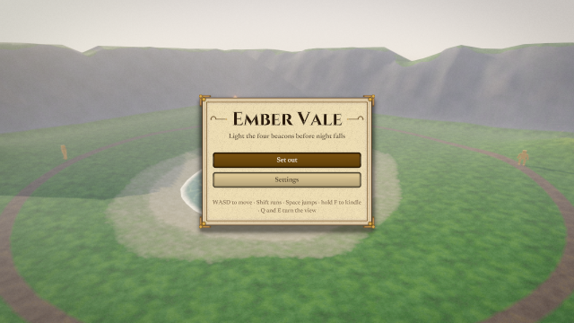
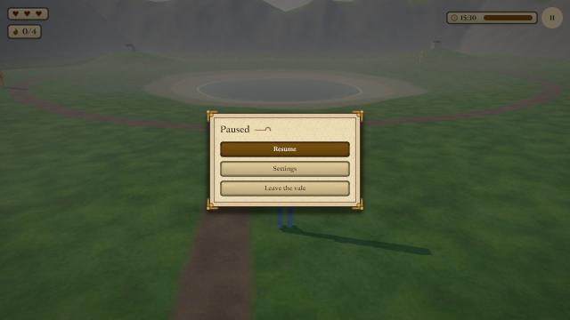
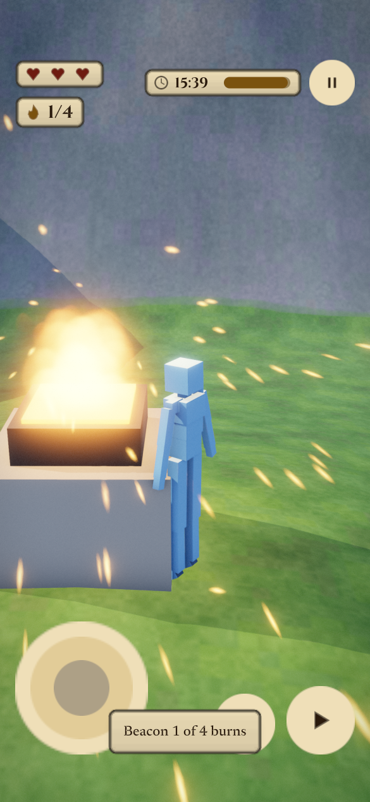
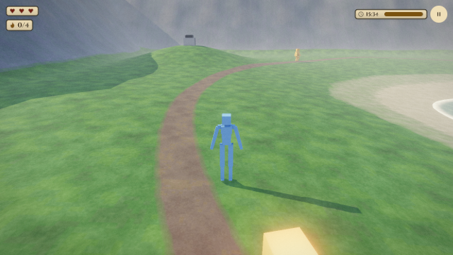

# og polish: third-person

2026-10-20, 10 playtest(s) on metal. Mechanical measures of og-taste and og-feel (og-build §5); a score is 0 to 100, n/a when nothing in the playtests exercises it. The measures cannot judge style: read the frames.

## Scores

| | Score | Measure |
|---|---|---|
| **Taste** | **97** | mean of the taste rows |
| Contrast | 87 | text boxes whose ink and ground reach 4.5:1 |
| Text size | 100 | text boxes whose tallest ink line reaches 9 CSS px (a 13 px face's capitals) |
| HUD occupancy | 100 | gameplay frames: HUD at most 15 % of the surface and 5 % of the central third |
| Screen transitions | 100 | screen changes with UI motion around them |
| UI sounds | 92 | UI presses answered on the ui bus |
| Locale keys | 100 | string tables without missing keys (og cook) |
| **Feel** | **68** | mean of the feel rows |
| Input latency | 100 | inputs answered, by the median ticks to the answer (0–1: 100) |
| Hit feedback | n/a | damage moments with hit stop, shake, floating text or a sound (three of four: 100) |
| Idle frames | 100 | ticks where nothing new is seen or heard (10 %: 100, 60 %: 0) |
| Frame time | 0 | p95 step + render (8.3 ms: 100, 33 ms: 0), worst playtest |
| Sound on input | 72 | inputs answered by a sound within 6 ticks |

## Fixes

| Measure | Where | Found | Fix |
|---|---|---|---|
| frame time | flow | p95 step + render 34.02 ms on metal (the frame is 16.7 ms) | og-game §14 (performance): fewer draws and particles, cheaper systems; og run --json measures |
| contrast | frames title: `play` "Set out" | 3.36:1 between ink and ground (body text wants 4.5:1) | og-taste §3 (value before hue): darken the ground or lighten the ink in the skin's palette, never per call |
| contrast | frames title: `Footer` "WASD to move · Shift runs · Space jumps " | 3.5:1 between ink and ground (body text wants 4.5:1) | og-taste §3 (value before hue): darken the ground or lighten the ink in the skin's palette, never per call |
| contrast | frames dawn: `Again` "Again" | 3.99:1 between ink and ground (body text wants 4.5:1) | og-taste §3 (value before hue): darken the ground or lighten the ink in the skin's palette, never per call |
| frame time | frames | p95 step + render 28.79 ms on metal (the frame is 16.7 ms) | og-game §14 (performance): fewer draws and particles, cheaper systems; og run --json measures |
| frame time | hitstop | p95 step + render 18.82 ms on metal (the frame is 16.7 ms) | og-game §14 (performance): fewer draws and particles, cheaper systems; og run --json measures |
| frame time | lose | p95 step + render 36.92 ms on metal (the frame is 16.7 ms) | og-game §14 (performance): fewer draws and particles, cheaper systems; og run --json measures |
| contrast | pause pause: `resume` "Resume" | 3.84:1 between ink and ground (body text wants 4.5:1) | og-taste §3 (value before hue): darken the ground or lighten the ink in the skin's palette, never per call |
| contrast | pause settings-zh: `Done` "完成" | 4.41:1 between ink and ground (body text wants 4.5:1) | og-taste §3 (value before hue): darken the ground or lighten the ink in the skin's palette, never per call |
| contrast | pause settings-zh: `LanguageLabel` "语言" | 4.43:1 between ink and ground (body text wants 4.5:1) | og-taste §3 (value before hue): darken the ground or lighten the ink in the skin's palette, never per call |
| frame time | pause | p95 step + render 27 ms on metal (the frame is 16.7 ms) | og-game §14 (performance): fewer draws and particles, cheaper systems; og run --json measures |
| UI sounds | phone | 1 of 3 UI presses played no sound on the ui bus | og-taste §6 (feedback) and og-audio §3: give the skin or og.ui.configure its press and open sounds |
| frame time | phone | p95 step + render 20.99 ms on metal (the frame is 16.7 ms) | og-game §14 (performance): fewer draws and particles, cheaper systems; og run --json measures |
| frame time | replay | p95 step + render 24.17 ms on metal (the frame is 16.7 ms) | og-game §14 (performance): fewer draws and particles, cheaper systems; og run --json measures |
| frame time | restart | p95 step + render 22.21 ms on metal (the frame is 16.7 ms) | og-game §14 (performance): fewer draws and particles, cheaper systems; og run --json measures |
| frame time | sentinels | p95 step + render 18.13 ms on metal (the frame is 16.7 ms) | og-game §14 (performance): fewer draws and particles, cheaper systems; og run --json measures |
| frame time | win | p95 step + render 19.45 ms on metal (the frame is 16.7 ms) | og-game §14 (performance): fewer draws and particles, cheaper systems; og run --json measures |

## Playtests

### flow

Set out, walk, run and wade on the terrain, kindle a beacon with the hand in the bowl (636 ticks)

| Measure | Value |
|---|---|
| Text boxes | 0; 0 at 4.5:1; 0 of 0 at 9 px ink |
| HUD | 0 gameplay frame(s), up to 0 % of the surface, 0 % of the centre |
| UI | 3 screen change(s), 3 with motion; 182 ticks of UI motion; 1 press(es), 1 with a ui-bus sound |
| Inputs | 4, 4 answered, median 0 ticks, max 0; 2 with a sound; 33.91 % of input-free ticks also change something |
| Damage | 0 moment(s): hit stop 0, shake 0, floating text 0, sound 0, tween 0, particles 0 |
| Idle | 0 % of ticks |
| Particles | peak 12 system(s), 2 burst(s) |
| Frame (metal) | step 8.06 ms median, 17.35 p95; render 11.24 median, 19.14 p95; frame p95 34.02, max 127.25 |
| Audio | 10.6 s, peak 0.32, RMS 0.023, 0 clipped, 0 % silent ticks |

### frames

the title, a beacon catching and the dawn summary match their reference frames (438 ticks)

| Measure | Value |
|---|---|
| Text boxes | 22; 18 at 4.5:1; 22 of 22 at 9 px ink |
| Lowest contrast | 3.36:1 `play` (title); 3.5:1 `Footer` (title); 3.99:1 `Again` (dawn) |
| Smallest ink | 11 px `Toast#1` (beacon); 11 px `Text` (beacon); 11 px `Value` (dawn) |
| HUD | 1 gameplay frame(s), up to 1.44 % of the surface, 0 % of the centre |
| UI | 4 screen change(s), 4 with motion; 407 ticks of UI motion; 0 press(es), 0 with a ui-bus sound |
| Inputs | 1, 1 answered, median 0 ticks, max 0; 0 with a sound; 93.45 % of input-free ticks also change something |
| Damage | 0 moment(s): hit stop 0, shake 0, floating text 0, sound 0, tween 0, particles 0 |
| Idle | 0 % of ticks |
| Particles | peak 12 system(s), 4 burst(s) |
| Frame (metal) | step 6.98 ms median, 17.07 p95; render 10.72 median, 15.37 p95; frame p95 28.79, max 1777.1 |
| Audio | 7.3 s, peak 0.44, RMS 0.0493, 0 clipped, 0 % silent ticks |

 

title (tick 54, menu: HUD 5.83 %, 5 texts, 3 under 4.5:1, 0 small)

### hitstop

Escape pressed during a grab's hit-stop pauses the run (66 ticks)

| Measure | Value |
|---|---|
| Text boxes | 0; 0 at 4.5:1; 0 of 0 at 9 px ink |
| HUD | 0 gameplay frame(s), up to 0 % of the surface, 0 % of the centre |
| UI | 2 screen change(s), 2 with motion; 60 ticks of UI motion; 0 press(es), 0 with a ui-bus sound |
| Inputs | 1, 1 answered, median 1 ticks, max 1; 1 with a sound; 92.86 % of input-free ticks also change something |
| Damage | 0 moment(s): hit stop 0, shake 0, floating text 0, sound 0, tween 0, particles 0 |
| Idle | 0 % of ticks |
| Particles | peak 12 system(s), 0 burst(s) |
| Frame (metal) | step 4.92 ms median, 11.64 p95; render 6.8 median, 7.87 p95; frame p95 18.82, max 21.55 |
| Audio | 1.1 s, peak 0.31, RMS 0.042, 0 clipped, 0 % silent ticks |

### lose

caught with no hearts left, night at dusk's end, Again and Title (522 ticks)

| Measure | Value |
|---|---|
| Text boxes | 0; 0 at 4.5:1; 0 of 0 at 9 px ink |
| HUD | 0 gameplay frame(s), up to 0 % of the surface, 0 % of the centre |
| UI | 5 screen change(s), 5 with motion; 288 ticks of UI motion; 2 press(es), 2 with a ui-bus sound |
| Inputs | 2, 2 answered, median 0 ticks, max 0; 2 with a sound; 54.26 % of input-free ticks also change something |
| Damage | 0 moment(s): hit stop 0, shake 0, floating text 0, sound 0, tween 0, particles 0 |
| Idle | 0 % of ticks |
| Particles | peak 12 system(s), 1 burst(s) |
| Frame (metal) | step 6.44 ms median, 18.46 p95; render 8.47 median, 18.59 p95; frame p95 36.92, max 105.13 |
| Audio | 8.7 s, peak 0.23, RMS 0.0371, 0 clipped, 0 % silent ticks |

### pause

Escape pauses, settings switch the language and save, Resume gives the run back (312 ticks)

| Measure | Value |
|---|---|
| Text boxes | 20; 17 at 4.5:1; 20 of 20 at 9 px ink |
| Lowest contrast | 3.84:1 `resume` (pause); 4.41:1 `Done` (settings-zh); 4.43:1 `LanguageLabel` (settings-zh) |
| Smallest ink | 11 px `resume` (pause); 11 px `Value` (settings-zh); 12 px `quit` (pause) |
| HUD | 1 gameplay frame(s), up to 1.42 % of the surface, 0 % of the centre |
| UI | 8 screen change(s), 8 with motion; 297 ticks of UI motion; 5 press(es), 5 with a ui-bus sound |
| Inputs | 7, 7 answered, median 0 ticks, max 1; 6 with a sound; 89.62 % of input-free ticks also change something |
| Damage | 0 moment(s): hit stop 0, shake 0, floating text 0, sound 0, tween 0, particles 0 |
| Idle | 0 % of ticks |
| Particles | peak 12 system(s), 0 burst(s) |
| Frame (metal) | step 5.68 ms median, 13.35 p95; render 8.68 median, 15.65 p95; frame p95 27, max 1726.56 |
| Audio | 5.2 s, peak 0.42, RMS 0.0363, 0 clipped, 0 % silent ticks |

 

pause (tick 105, menu: HUD 5.81 %, 4 texts, 1 under 4.5:1, 0 small)

### phone

the phone layout: a HUD inside the safe area, a joystick that walks, Jump and Kindle (408 ticks)

| Measure | Value |
|---|---|
| Text boxes | 7; 7 at 4.5:1; 7 of 7 at 9 px ink |
| Lowest contrast | 10.67:1 `Count` (play); 10.67:1 `Hour` (play); 10.67:1 `Toast#1` (play) |
| Smallest ink | 11 px `Toast#1` (play); 11 px `Text` (play); 12 px `Hour` (play) |
| HUD | 1 gameplay frame(s), up to 3.7 % of the surface, 0 % of the centre |
| UI | 2 screen change(s), 2 with motion; 201 ticks of UI motion; 3 press(es), 2 with a ui-bus sound |
| Inputs | 4, 4 answered, median 0 ticks, max 5; 3 with a sound; 78.99 % of input-free ticks also change something |
| Damage | 0 moment(s): hit stop 0, shake 0, floating text 0, sound 0, tween 0, particles 0 |
| Idle | 0 % of ticks |
| Particles | peak 12 system(s), 1 burst(s) |
| Frame (metal) | step 5.52 ms median, 8.71 p95; render 7.11 median, 11.77 p95; frame p95 20.99, max 3276.85 |
| Audio | 6.8 s, peak 0.32, RMS 0.0241, 0 clipped, 0 % silent ticks |

 

play (tick 405: HUD 3.7 %, 7 texts, 0 under 4.5:1, 0 small)

### replay

a run with movement, a jump, kindling and a sentinel's grab replays to the same hash (486 ticks)

| Measure | Value |
|---|---|
| Text boxes | 0; 0 at 4.5:1; 0 of 0 at 9 px ink |
| HUD | 0 gameplay frame(s), up to 0 % of the surface, 0 % of the centre |
| UI | 4 screen change(s), 4 with motion; 193 ticks of UI motion; 1 press(es), 1 with a ui-bus sound |
| Inputs | 5, 5 answered, median 0 ticks, max 0; 3 with a sound; 60.94 % of input-free ticks also change something |
| Damage | 0 moment(s): hit stop 0, shake 0, floating text 0, sound 0, tween 0, particles 0 |
| Idle | 0 % of ticks |
| Particles | peak 12 system(s), 1 burst(s) |
| Frame (metal) | step 5.62 ms median, 12.57 p95; render 7.93 median, 14.67 p95; frame p95 24.17, max 170.42 |
| Audio | 8.1 s, peak 0.32, RMS 0.0277, 0 clipped, 0 % silent ticks |

### restart

a sentinel chasing when the run restarts is back on patrol (222 ticks)

| Measure | Value |
|---|---|
| Text boxes | 0; 0 at 4.5:1; 0 of 0 at 9 px ink |
| HUD | 0 gameplay frame(s), up to 0 % of the surface, 0 % of the centre |
| UI | 1 screen change(s), 1 with motion; 34 ticks of UI motion; 0 press(es), 0 with a ui-bus sound |
| Inputs | 0, 0 answered, median 0 ticks, max 0; 0 with a sound; 31.13 % of input-free ticks also change something |
| Damage | 0 moment(s): hit stop 0, shake 0, floating text 0, sound 0, tween 0, particles 0 |
| Idle | 0 % of ticks |
| Particles | peak 12 system(s), 0 burst(s) |
| Frame (metal) | step 5.11 ms median, 13.28 p95; render 7.31 median, 10.59 p95; frame p95 22.21, max 29.27 |
| Audio | 3.7 s, peak 0.07, RMS 0.0123, 0 clipped, 0 % silent ticks |

### sentinels

a sentinel on its round sees the hero, raises the alarm, chases and grabs a heart (462 ticks)

| Measure | Value |
|---|---|
| Text boxes | 3; 3 at 4.5:1; 3 of 3 at 9 px ink |
| Lowest contrast | 7.54:1 `Pause` (alarm); 10.14:1 `Count` (alarm); 10.53:1 `Hour` (alarm) |
| Smallest ink | 12 px `Hour` (alarm); 15 px `Count` (alarm); 38 px `Pause` (alarm) |
| HUD | 1 gameplay frame(s), up to 0.97 % of the surface, 0 % of the centre |
| UI | 1 screen change(s), 1 with motion; 34 ticks of UI motion; 0 press(es), 0 with a ui-bus sound |
| Inputs | 0, 0 answered, median 0 ticks, max 0; 0 with a sound; 29.2 % of input-free ticks also change something |
| Damage | 0 moment(s): hit stop 0, shake 0, floating text 0, sound 0, tween 0, particles 0 |
| Idle | 0 % of ticks |
| Particles | peak 12 system(s), 0 burst(s) |
| Frame (metal) | step 4.93 ms median, 8.33 p95; render 6.92 median, 9.38 p95; frame p95 18.13, max 1217.32 |
| Audio | 7.7 s, peak 0.26, RMS 0.0184, 0 clipped, 0 % silent ticks |

 

alarm (tick 195: HUD 0.97 %, 3 texts, 0 under 4.5:1, 0 small)

### win

four beacons lit: dawn, a merged record, the summary, then Again from nothing (263 ticks)

| Measure | Value |
|---|---|
| Text boxes | 0; 0 at 4.5:1; 0 of 0 at 9 px ink |
| HUD | 0 gameplay frame(s), up to 0 % of the surface, 0 % of the centre |
| UI | 5 screen change(s), 5 with motion; 250 ticks of UI motion; 1 press(es), 1 with a ui-bus sound |
| Inputs | 1, 1 answered, median 0 ticks, max 0; 1 with a sound; 97.32 % of input-free ticks also change something |
| Damage | 0 moment(s): hit stop 0, shake 0, floating text 0, sound 0, tween 0, particles 0 |
| Idle | 0 % of ticks |
| Particles | peak 12 system(s), 4 burst(s) |
| Frame (metal) | step 4.81 ms median, 12.11 p95; render 7.16 median, 8.49 p95; frame p95 19.45, max 21.98 |
| Audio | 4.4 s, peak 0.44, RMS 0.0615, 0 clipped, 0 % silent ticks |

