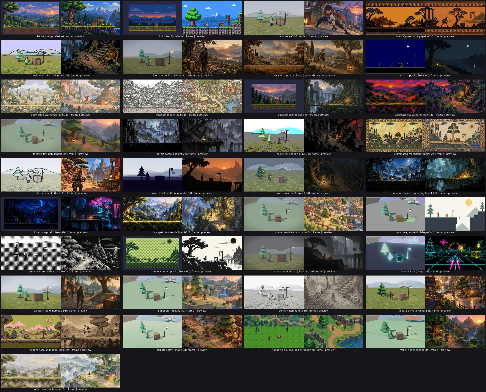

# A7 `art/samples`: one scene per family, one frame per style

Stream A7 of docs/art.md (§2.6, the A7 row of §3, §6), branch `art/samples`
from `a0fc69f5`, rebased onto `68c8597b` (origin/main with the decimation
fix `dda9b360`) before the final frames. Every frame below was taken after
the rebase, with this branch's dev `og` and addon (`OG_NATIVE_ADDON`,
`OG_ENGINE_PACKAGE`), on lavapipe at 1280x720 and read at 640x360 beside
its preview.

## What landed

| Commit | What |
|---|---|
| `807e8deb` | og-cook: voxels answer to the face budget when the source is within it (below), with `conform_mesh::a_model_within_its_budget_still_holds_its_voxels_to_it`, which fails on the old code (71,738 faces at 0.1 m against propFaces 300) |
| `ef6e9d77` | `examples/art-<family>` (the eight scenes, their sources and per-style sources) and `tools/art-samples/` (capture, prepare, slice, make3d, neon, catalogue, verdicts; README) |
| `d939449f` | the catalogue's `look.support` and `missing` per style, og-taste §12's table, one validator test made data-independent |
| this commit | these notes, `frames/` (37 frames at 640x360), `contact-sheet.jpg`, `style-check.json` |

## Examples, not a station

One example project per family (`examples/art-<family>`), not a new
fx-showcase station. The point of the stream is that the cook conforms the
assets to the look `project.ogt` names, and that is per project: one
project can hold one contract, so a station inside fx-showcase (one
project, one look line, runtime geometry the cook never sees, as A3's
notes found) cannot show 37 contracts. A game on the platform is one
project with one look, so an example per family is also the honest shape.
`tools/art-samples/capture.ts` copies the family's project per style,
points its look at the style, cooks, runs one frame and `og style check`.
The examples sit outside every gate lane (no `package.json`, no `tests/`),
so they cost the gate nothing; each still passes `og check` (tsrs) when it
runs.

## How the assets were made

- **Through the brief.** `beats.json` in each example names every asset's
  `artBrief` kind, subject and size; `prepare.ts` briefs them under the
  style's look on every run (`<slug>.briefs.txt` beside each capture) and
  writes the image's import settings from the brief's grid (`conform {
  size N }`) and the sprite sizes (`src/cells.ts`). Images were generated
  from those prompts with the style's preview as the reference image.
- **Generator: Painter (Amp's image tool), not the origin MCP.** The origin
  `generate_image` answered `Downstream HTTP 503 ... model_not_found` ("no
  channel") for its default model and for `gpt-image-2.5-flare` and
  `-sunburst` (the only values it accepts) with OG_PLATFORM_DEVELOPMENT_KEY,
  every try on 2026-10-28, so no image came from it. 56 images were made
  with Painter: per family a base set (hero, tree, crate, lantern, ground,
  far layer), then per style whose direction differs a 2 x 2 sheet of the
  four props (cut by `slice.py`), a far layer and a ground (the paint
  styles' ground is the far layer's own floor band).
- **3D props** are og-model §5 generators as `type model` text (the hero of
  capsules, a sphere and a cone; the stepped tree of a cylinder and three
  cones; the lantern; the far hills and village), the same for every 3D
  style, so the cook's conformance makes the difference; the crate and the
  ground are glbs around a Painter texture (`make3d.py`). pixel-3d stands
  the hero and the tree as billboarded pixel sprites (the 16bit set);
  shape-3d takes an untextured field; neon-vector its own black-and-glow
  models (`neon.py`). `generate_3d` was not used.
- **Bytes:** the eight examples' sources are 4,544,446 bytes (2D families
  carry per-style sets: paint-2d 2.37 MB, pixel-side 1.10 MB; each 3D
  family about 0.17 MB). `.gitattributes` has no LFS rule, so they are
  ordinary blobs. This evidence is 2.7 MB.

## The table

Read at 640x360 beside `packages/knowledge/previews/<slug>.webp`; the
check is `og style check --no-frames` on the style's copy of the scene
(`style-check.json`). Support: `content` where the style needs authored
art, `full` where it reads and the check passes, else `partial`.

| Style | Family | Frame | Reads as the style | og style check | Support |
|---|---|---|---|---|---|
| `expressionist-painting` | paint-2d | [expressionist-painting.jpg](frames/expressionist-painting.jpg) | yes: clashing violet and orange brush masses, broken edges, the figures painted into the scene | pass | content |
| `bold-comic-illustration` | ink-3d | [bold-comic-illustration.jpg](frames/bold-comic-illustration.jpg) | yes: thick black outlines on every form, flat posterised fills, a printed-colour sky | pass | full |
| `watercolor-wash` | paint-2d | [watercolor-wash.jpg](frames/watercolor-wash.jpg) | yes: translucent washes with pooled rims on white paper, the cook's texel-space paint on every sprite | pass | full |
| `pixel-3d-hybrid` | pixel-3d | [pixel-3d-hybrid.jpg](frames/pixel-3d-hybrid.jpg) | yes: conformed pixel sprites (hero, tree) stand as billboards with drop shadows among low-detail 3D props, dithered and depth-blurred | pass | full |
| `faceted-low-poly` | shape-3d | [faceted-low-poly.jpg](frames/faceted-low-poly.jpg) | no: the tree's facets read, but the hero is kept whole at 332 faces (over propFaces 200) and stays round, and the crate keeps its wood texture | off: models/hero.ogt: faces 332 against <= 200 (ArtShape.propFaces); models/hills.ogt: faces 500 against <= 200 (ArtShape.propFaces) | partial |
| `sculpted-clay` | shape-3d | [sculpted-clay.jpg](frames/sculpted-clay.jpg) | no: the 2 cm bevel is too small to see at this distance and the surfaces are plain PBR: nothing reads as clay | pass | partial |
| `8bit-pixel` | pixel-side | [8bit-pixel.jpg](frames/8bit-pixel.jpg) | yes: flat 4-step blocks, tiny sprites on an exact grid, a banded sky: the early-console language of the preview | pass | full |
| `voxel-worlds` | shape-3d | [voxel-worlds.jpg](frames/voxel-worlds.jpg) | yes: the tree, hero and hills are stepped cubes on one grid, single-colour faces | pass | full |
| `illuminated-manuscript` | paint-2d | [illuminated-manuscript.jpg](frames/illuminated-manuscript.jpg) | yes: parchment, gold sun, ink-outlined flat figures, an ornamental border and floral frieze | pass | content |
| `rubber-hose-animation` | paint-2d | [rubber-hose-animation.jpg](frames/rubber-hose-animation.jpg) | no: the hose figure and inked props are there, but Stylise.posterize 4 turns the sepia print into olive and pink bands, and the inked line measures 5 to 7 px against ArtLine.width 3 | off: art/crate.png: line 6 px against 3 px (ArtLine.width); art/hero.png: line 7 px against 3 px (ArtLine.width); art/lantern.png: line 5 px against 3 px (ArtLine.width); art/tree.png: line 6 px against 3 px (ArtLine.width) | content |
| `pencil-hatching` | ink-3d | [pencil-hatching.jpg](frames/pencil-hatching.jpg) | yes: grey graphite hatching over every surface, contour lines, paper white | pass | full |
| `gothic-contour` | paint-2d | [gothic-contour.jpg](frames/gothic-contour.jpg) | no: Stylise.posterize 5 crushes the misty blue-grey architecture into five flat grey bands; without it the frame reads | pass | content |
| `lush-painted-worlds` | paint-2d | [lush-painted-worlds.jpg](frames/lush-painted-worlds.jpg) | yes: opaque warm-lit masses with cool shadow, brushwork in the foliage | pass | content |
| `decorative-storybook` | paint-2d | [decorative-storybook.jpg](frames/decorative-storybook.jpg) | yes: flat patterned planes, ornamental trees and flowers, coloured line | pass | content |
| `classical-painting-collage` | paint-2d | [classical-painting-collage.jpg](frames/classical-painting-collage.jpg) | yes: old-master fragments with cut seams under one varnish tone, cut-out figures | pass | content |
| `detailed-doodle` | paint-2d | [detailed-doodle.jpg](frames/detailed-doodle.jpg) | yes: fine irregular line over everything, tiny houses and mills, very little colour | pass | content |
| `black-figure-pottery` | paint-2d | [black-figure-pottery.jpg](frames/black-figure-pottery.jpg) | yes: black silhouettes with incised detail on ochre, meander bands top and bottom | pass | content |
| `heavy-ink-shadows` | ink-3d | [heavy-ink-shadows.jpg](frames/heavy-ink-shadows.jpg) | no: outlines and posterised fills draw, but the shadows stay coloured: no solid black masses as in the preview | pass | partial |
| `monochrome-pixel` | pixel-side | [monochrome-pixel.jpg](frames/monochrome-pixel.jpg) | yes: the handheld greens in Bayer dither, silhouettes on pale ground, one ink on one paper | off: art/ground.png: grid 1x2 texels per pixel, half pixels at rows 2 4 against 1 texel(s) per pixel, no half pixels (ArtPixels) | partial |
| `16bit-pixel` | pixel-side | [16bit-pixel.jpg](frames/16bit-pixel.jpg) | yes: ramped shading, the cook's 1-px inside line on every sprite, parallax far layer, saturated keeper against calmer scenery | pass | full |
| `detailed-pixel` | pixel-side | [detailed-pixel.jpg](frames/detailed-pixel.jpg) | yes: dense hue-shifted clusters at 32 px per metre, the grid still visible, scenery rich but quieter | pass | full |
| `luminous-pixel` | pixel-side | [luminous-pixel.jpg](frames/luminous-pixel.jpg) | yes: near-black masses, cyan rim light, the lantern and windows the only warm glows | pass | full |
| `topdown-tile-pixel` | pixel-topdown | [topdown-tile-pixel.jpg](frames/topdown-tile-pixel.jpg) | no: upright three-quarter sprites on one repeated grass tile: no tile grid of walls, cliffs and paths, so height and paths do not read as in the preview | pass | partial |
| `low-resolution-3d` | pixel-3d | [low-resolution-3d.jpg](frames/low-resolution-3d.jpg) | no: nearest textures and a slight pixel grid draw, but at this distance the scene reads as plain 3D, not early console; the far hills stay over the face budget | off: models/hills.ogt: faces 596 against <= 300 (ArtShape.propFaces) | partial |
| `coarse-pixel` | pixel-side | [coarse-pixel.jpg](frames/coarse-pixel.jpg) | yes: a few huge pixels per figure, one dominant night-blue mass, the lamp the only warm point | pass | full |
| `anime-cel-3d` | toon-3d | [anime-cel-3d.jpg](frames/anime-cel-3d.jpg) | yes: two-tone cel bands, dark outlines on every model, a clean sky | pass | full |
| `inked-comic-3d` | toon-3d | [inked-comic-3d.jpg](frames/inked-comic-3d.jpg) | yes: heavy ink contours and hatched fills over the whole frame | pass | full |
| `paper-craft` | shape-3d | [paper-craft.jpg](frames/paper-craft.jpg) | no: flat facets and outlines draw, but there is no paper grain, fold or layered card | pass | partial |
| `miniature-diorama` | shape-3d | [miniature-diorama.jpg](frames/miniature-diorama.jpg) | no: the tilt-shift blur reads as miniature, but the props are plain PBR, not toy-like or bevelled | pass | partial |
| `painterly-3d` | cinematic-3d | [painterly-3d.jpg](frames/painterly-3d.jpg) | no: no brush marks: the textures and primitives draw as plain lit 3D | pass | partial |
| `cinematic-realism` | cinematic-3d | [cinematic-realism.jpg](frames/cinematic-realism.jpg) | no: primitive blockouts with photo textures under a filmic grade: not realistic assets | off: models/crate.glb: density 213.3 texels/m (p10 213.3, p90 213.3) against 256.0 to 1024.0 (ArtTexels.density 512 within x2); models/ground.glb: density 128.0 texels/m (p10 128.0, p90 128.0) against 256.0 to 1024.0 (ArtTexels.density 512 within x2) | partial |
| `muted-cinematic-3d` | cinematic-3d | [muted-cinematic-3d.jpg](frames/muted-cinematic-3d.jpg) | no: the muted grade draws, but the primitives read as a blockout | pass | partial |
| `layered-silhouette` | cinematic-3d | [layered-silhouette.jpg](frames/layered-silhouette.jpg) | yes: every form a flat dark silhouette in depth bands against a pale sky | pass | full |
| `minimal-geometric` | shape-3d | [minimal-geometric.jpg](frames/minimal-geometric.jpg) | yes: flat untextured colour planes, baked one colour per face, no texture anywhere | pass | full |
| `neon-vector` | shape-3d | [neon-vector.jpg](frames/neon-vector.jpg) | yes: black faces under glowing cyan lines on a dark field, bloom on the lantern (neon-vector's own sources, tools/art-samples/neon.py) | pass | full |
| `monochrome-dither-3d` | pixel-3d | [monochrome-dither-3d.jpg](frames/monochrome-dither-3d.jpg) | no: the dither cell is so coarse that the tree, hero and crate dissolve into a checkerboard | pass | partial |
| `luminous-layered-painting` | paint-2d | [luminous-layered-painting.jpg](frames/luminous-layered-painting.jpg) | yes: dark cool painted layers, the lantern and village the luminous focal points, mist into depth | pass | content |

**15 full, 12 partial, 10 content.** Of the 10 content styles, 8 read as
their style on the sample; the authored assets that carry each are its own
Painter set in `examples/art-paint-2d/styles/<slug>/art/` (watercolor-wash,
also paint-2d, is not content: its set is the family's base in
`assets/art/`).

Reference names: the frame of `<slug>` is
`examples/art-<family>/references/<tier>/<slug>.png` (1280x720). No
`metal` file is committed: `bun tools/art-samples/capture.ts --only
<family> --out examples/art-<family>/references/metal` on macrunner
records a family's. No existing reference frame moves (the og-cook fix
changes only voxelised models past their budget, and no shipped project
voxelises).

## Findings

1. **Fixed (`807e8deb`): voxels ignored the face budget for a model within
   it.** The decimation plan is made from the source's triangles, so a
   model under its budget before voxelising had no target and kept its
   voxels at the first edge that fit the 256-cell grid: the 40 m ground
   cooked to 147,318 faces against voxel-worlds' propFaces 5000. Each
   primitive's voxels now answer to its share of the budget.
2. **Fixed (branch `art/flat-normals`): flat share under `normals flat`.**
   The hero measured 95.4 % (faceted), 98.0 % (paper, minimal) and 92.6 %
   (voxel) flat against 99 %. The check was right: every off corner was
   1.7° to 90° from its face (none near the 1° tolerance; 16-bit
   octahedral normals err by under 0.01°), and two cook faults made
   them. (a) A lathe's pole triangles (og-model's sphere, capsule and
   cone: two corners at the pole, area about 1e-8 m²) have no normal of
   their own; quantised to the 16-bit grid they decode as slivers facing
   any way. They draw nothing (thinner than one grid step) except through
   the outline hull, where their arbitrary hull normals drew a brown band
   across the hero's neck. `shade` now drops every face thinner than one
   grid step. (b) Voxels are made in model space and brought back under
   the part's node; their normals went back through the inverse's
   transpose, which is the inverse transpose of the placement, not of its
   inverse. A part turned 45° (the arm, the hills' turned blocks) got
   normals turned 90° off their faces. They now go back through the
   placement's transpose. Every model of the four styles measures 100 %
   flat; voxel-worlds and minimal-geometric are `full`. Frames move (read
   at 640x360 on lavapipe): voxel-worlds on the turned parts (909 px),
   paper-craft and minimal-geometric under the hero's head (70 and 29 px,
   the neck band gone), faceted-low-poly and sculpted-clay by a level on
   12 and 10 px; `references/metal` of those styles wants recording again.
3. **Preset frames that work against their own style** (A1's files, the
   coordinator's call): `rubber-hose-animation`'s `Stylise.posterize 4`
   and `gothic-contour`'s `posterize 5` band the frame into olive/pink and
   flat greys (with `posterize 0` both read, checked by frame);
   `monochrome-dither-3d`'s dither cell swallows every form.
4. **Decimation within the silhouette bound cannot reach small budgets on
   round models:** the hero stops at 332 faces against faceted-low-poly's
   200, the hills at 596 against low-resolution-3d's 300 and 500 against
   faceted-low-poly's 200; the cook keeps them whole
   and the check reports them (the honest off of `dda9b360`).
5. **Samples' own limits,** named in `missing`: top-down needs a real tile
   set (walls, cliffs, paths); monochrome-pixel's generated ground tile is
   off its grid (half rows, an asset fault); cinematic-realism's crate and
   ground are below its density 512; the cinematic, painterly, clay,
   paper and diorama styles need assets built for them (realistic scans,
   painted textures, clay surfaces, paper sheets, toy materials) that one
   shared set of 3D primitives cannot stand in for.
6. `rubber-hose-animation`'s inked line measures 5 to 7 px against
   ArtLine.width 3: the generated art's ink is thicker than the contract.
7. docs/art.md §2.6 says the families are "§3 stream A10"; it is A7.

## Verification

- `cargo test -p og-cook --test tests conform`: 20 passed, the new test
  among them (and failing with the fix stashed);
  `cargo clippy -p og-cook --tests -D warnings`, `cargo fmt --check`: clean.
- `packages/knowledge`: `bun run test` (validator + 60 tests) passed;
  `packages/create`: `bun run test` (18) passed.
- `capture.ts` over all 37 styles: 37 frames, every run exit 0; 8 checks
  off (table).
- Not run, per the stream rules: scripts/check.sh, test lanes, `og test`,
  web-reference, wasm or release builds.
