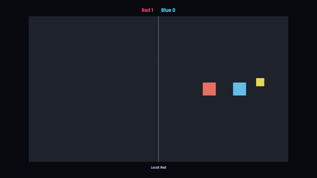

# og polish: arena

2026-10-23, 2 playtest(s) on vulkan-cpu. Mechanical measures of og-taste and og-feel (og-build §5); a score is 0 to 100, n/a when nothing in the playtests exercises it. The measures cannot judge style: read the frames.

## Scores

| | Score | Measure |
|---|---|---|
| **Taste** | **100** | mean of the taste rows |
| Contrast | 100 | text boxes whose ink and ground reach 4.5:1 |
| Text size | 100 | text boxes whose tallest ink line reaches 9 CSS px (a 13 px face's capitals) |
| HUD occupancy | 100 | gameplay frames: HUD at most 15 % of the surface and 5 % of the central third |
| Screen transitions | n/a | screen changes with UI motion around them |
| UI sounds | n/a | UI presses answered on the ui bus |
| Locale keys | n/a | string tables without missing keys (og cook) |
| **Feel** | **66** | mean of the feel rows |
| Input latency | 100 | inputs answered, by the median ticks to the answer (0–1: 100) |
| Hit feedback | n/a | damage moments with hit stop, shake, floating text or a sound (three of four: 100) |
| Idle frames | 100 | ticks where nothing new is seen or heard (10 %: 100, 60 %: 0) |
| Frame time | 14 | p95 step + render (8.3 ms: 100, 33 ms: 0), worst playtest |
| Sound on input | 50 | inputs answered by a sound within 6 ticks |

## Fixes

| Measure | Where | Found | Fix |
|---|---|---|---|
| frame time | duel | p95 step + render 29.83 ms on vulkan-cpu (the frame is 16.7 ms) | og-game §14 (performance): fewer draws and particles, cheaper systems; og run --json measures |
| frame time | solo | p95 step + render 29.15 ms on vulkan-cpu (the frame is 16.7 ms) | og-game §14 (performance): fewer draws and particles, cheaper systems; og run --json measures |

## Playtests

### duel

two processes in one room play the same duel to tick 600 (600 ticks)

| Measure | Value |
|---|---|
| Text boxes | 0; 0 at 4.5:1; 0 of 0 at 9 px ink |
| HUD | 0 gameplay frame(s), up to 0 % of the surface, 0 % of the centre |
| UI | 0 screen change(s), 0 with motion; 7 ticks of UI motion; 0 press(es), 0 with a ui-bus sound |
| Inputs | 0, 0 answered, median 0 ticks, max 0; 0 with a sound; 65.25 % of input-free ticks also change something |
| Damage | 0 moment(s): hit stop 0, shake 0, floating text 0, sound 0, tween 0, particles 0 |
| Idle | 0 % of ticks |
| Particles | peak 1 system(s), 1 burst(s) |
| Frame (vulkan-cpu) | step 2.25 ms median, 3.16 p95; render 24.06 median, 27.41 p95; frame p95 29.83, max 51 |
| Audio | 10 s, peak 0.35, RMS 0.0481, 0 clipped, 69.33 % silent ticks |

### solo

alone, the keys walk Red through the coin and dash it, and the HUD shows the scores (132 ticks)

| Measure | Value |
|---|---|
| Text boxes | 3; 3 at 4.5:1; 3 of 3 at 9 px ink |
| Lowest contrast | 5.82:1 `P1` (solo); 10.87:1 `Line` (solo); 13.4:1 `P2` (solo) |
| Smallest ink | 11 px `Line` (solo); 16 px `P1` (solo); 16 px `P2` (solo) |
| HUD | 1 gameplay frame(s), up to 0.58 % of the surface, 0 % of the centre |
| UI | 0 screen change(s), 0 with motion; 1 ticks of UI motion; 0 press(es), 0 with a ui-bus sound |
| Inputs | 2, 2 answered, median 1 ticks, max 1; 1 with a sound; 5 % of input-free ticks also change something |
| Damage | 0 moment(s): hit stop 0, shake 0, floating text 0, sound 0, tween 0, particles 0 |
| Idle | 2.46 % of ticks |
| Particles | peak 1 system(s), 1 burst(s) |
| Frame (vulkan-cpu) | step 2.36 ms median, 3.11 p95; render 23.57 median, 26.65 p95; frame p95 29.15, max 47.76 |
| Audio | 2.2 s, peak 0.22, RMS 0.0315, 0 clipped, 78.79 % silent ticks |

 

solo (tick 120: HUD 0.58 %, 3 texts, 0 under 4.5:1, 0 small)

