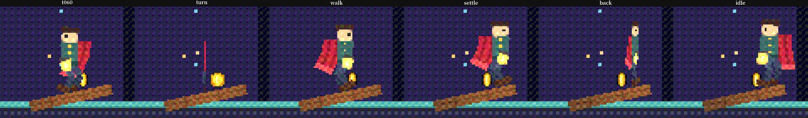

# Debt round 2, `anim-2d-2`: evidence

Branch `debt2/anim-2d-2`, from main `87e9f534`. It pays the "Left out, and
why" of `tests/evidence/debt/two-d-math/NOTES.md`. The frames were rendered
on lavapipe (`vulkan-cpu`, this orb) by `og run --headless --commands`. The
native addon was a dev build of this branch (`cargo build -p og-host-node`,
through `OG_NATIVE_ADDON`). The playtest was run by
`packages/engine/src/node/playtest-run.ts` on that addon, not by `og test`
(as briefed).

## Commits

| Commit | Item | What |
|---|---|---|
| `06f67c0e` | 1 | A `rotate` key takes `clockwise <n>` or `counterclockwise <n>`: it turns that way through n more whole turns (`og_anim::Turn`, `turn_delta`). The DragonBones import accumulates rotate frames as `_parseBoneRotateFrame` does and writes each turn. The cook note is gone. |
| `a38e81de` | 2 | `tweenEasing` above 1 becomes a `curve` ease of equal cubic Hermite segments through DragonBones' sine in-out (blended by e - 1, in hundredths, unclamped, as its parser keeps it). There are enough segments for an error under 1e-7 of the key's change (34 at e = 2). The cook note is gone. |
| `9b941c71` | 3 | `path` attachments, `transform` constraints and `along` (path) constraints, in the grammar, the pose and the import. |
| `72d709fe` | 4 | Every skin: `skin` blocks of swaps, `og.Skeleton2D.skin`, `Rig2DInfo.skins`, and the import of every DragonBones skin. |
| `b06c7a3f` | 5 | A child armature's events fire as `og.Skeleton2DEvent`, with the new field `armature` set to its name. |
| `9b447851` | 6 | The lamp keeper's paper turn, foot-speed limit and settle. |

## The test that fails on the old code, per item

Each was checked against the old code, either by reverting the change under test or because the old code cannot express the case.

- **Item 1.** og-anim `rotate_keys_turn_the_asked_way_through_whole_turns` covers a 1 s turn from 0 to 30 degrees, sampled at 0.1, 0.25 and 0.6 s:
  - shorter way and `counterclockwise 0`: 30 degrees in total;
  - `counterclockwise 2`: 750;
  - `clockwise 0`: -330;
  - `clockwise 1`: -690.

  og-cook `a_dragonbones_clockwise_turn_plays_its_whole_turns` uses DragonBones frames 0 (`clockwise` 2), 30 (`clockwise` -1) and -60. Worked by hand from the parser's rule, they give 390 degrees clockwise on screen and then 450 counter-clockwise: keys `(0, Clockwise(1))` and `(-30, Counterclockwise(1))`, and an angle of -97.5 at 0.25 s. With the turn ignored (the old shorter way), both fail: the cook test reads -7.5 at 0.25 s.
- **Item 2.** og-cook `a_dragonbones_sine_ease_plays_the_sine_at_every_tick` samples a 90-degree turn (e 2) and a 10-degree turn (e 2.5) at every 60 Hz tick over 2 s. It compares them with `s + a(0.5(1 - cos πs) - s)`, written out in the test. The worst error is **1.27e-5 degrees** (under 1e-4). The old smoothstep was off by **0.90 degrees** (the change stashed, same test).
- **Item 3.** All expected numbers are worked by hand from the Bernstein form or plain geometry:
  - og-anim `a_transform_constraint_moves_its_bones_by_the_mix_towards_the_target`, with mix 0.5 / 0.5 / 1 / 0: 45 degrees, origin (5, 4.5), x axis length 2, and the child at (5 + 20/√2, 4.5 + 20/√2).
  - og-anim `a_path_constraint_places_its_bones_along_the_curve`:
    - by curve parameter: B(0.25) = (1.5625, 5.625) at a tangent of 53.13 degrees, B(0.5) = (5, 7.5) level;
    - by arc length on a line turned 30 degrees: places 3 and 13;
    - chain: the next bone starts at the tip, 11;
    - chainscale: a stretch of 1.25;
    - translate mix 0.5;
    - no effect when its slot hides the path.
  - og-cook `a_dragonbones_path_constraint_places_its_bones_on_the_path_display`: the same curve with y down.

  The old parser refuses `path`, `transform` and `along`, and the old import noted the display as not imported.
- **Item 4.**
  - og-anim `a_skin_swaps_the_default_attachments_wherever_they_show`: the setup pose, clip keys and a skin index past the end.
  - og-anim `tests/skeleton2d.rs` `the_skin_a_skeleton_wears_is_what_its_pose_shows`: through the system, the box grows from (1, 1) to (2, 2).
  - og-cook `every_dragonbones_skin_is_imported_and_the_default_comes_first`: `default` second in the file; swaps index by index, null swaps to none.
- **Item 5.** og-anim `skeleton2d::tests::a_child_armatures_events_fire_tagged_with_its_name` uses rig2d's nested-armature fixture (`NEST`) with events added to the flame's `burn`. Over 128 ticks at 64 Hz:
  - spark at ticks 1, 64 and 128, and flick at 32 and 96, all tagged `flame`, clip 0, at the flame's own times;
  - the parent's beat (tick 64) has no tag.

  It fails with the child-event call disabled.
- **Item 6.** The new checks in `templates/game-2d/tests/keeper.og.ts`, run against main's `src/main.ts`, fail:
  - a foot moves **0.408937 m** in one tick (tick 133, the swap);
  - both turns take 0 ticks;
  - idle returns on the arrival tick.

## Item decisions

- **Path display: geometry the constraint reads, drawn as nothing.** In DragonBones (`PathDisplayData`, `_parsePath`, `PathConstraint`), a path display is a weighted cubic spline: three points per knot, `closed`, `constantSpeed` and `lengths`. Its runtime never draws it: the spline exists for path constraints, as in Spine. So it became a `path` attachment that draws nothing, is deformable, and is placed in the pose like a mesh. `along` reads it only while its slot shows it, as DragonBones checks `pathSlot._displayFrame`.
- **Path placement follows DragonBones' `_computeBezierCurve`.**
  - Arc length uses its forward differences (four steps per curve, then ten within the curve).
  - Without `constantSpeed`, a position goes through `lengths` to the curve's parameter.
  - An open path extends past its ends along its end handles (Spine). DragonBones skips such bones and leaves them at the last tick's value, which is not deterministic state.
  - Each constrained bone starts from its pose before the constraint, as in both runtimes, and its children follow.
- **Transform constraint: Spine's absolute world mode.** DragonBones has none (its parser knows IK and path), so the import never writes one. The text and the pose are there for hand-written rigs and Spine converters (module docs).
- **Skins follow DragonBones' replaceSkin.** The skin named `default`, else the first, is the rig's own attachments. Every other skin swaps the default's displays slot by slot and index by index, `null` meaning none. A child armature wears its default skin; the import notes any other skins it has. The API follows `Skeleton2D.clip` and `Rig2DInfo.clips`: a `skin` index on the component, and `Rig2DInfo.skins` as names with `default` first.
- **Child events.** Each forward span the parent's clip played this tick is split where the child's clip wraps (held at the end of a one-shot), nested children included. The child's clip is the one its pose plays. Backward play fires the parent's events only.
- **Keeper (item 6).**
  - **Turn: a paper turn, not a turn clip.** The rig has one mirrored body and no side view. The turn eases `og.Transform` scale x by `cos(π(k - 0.5)/11.5)` over 12 ticks: never 0 (scale 0 would make the frame singular), at most 0.5 of the width per tick, then flipX.
  - **Feet: limited to the gait's own swing speed.** The limit `FOOT_SPEED` is 1.42316 m/s: forward 1 m/s, and up the slope plus the lift's steepest rise, 1.01256 m/s. A foot with ground left to cover is lifted (a step's height at half a stride), so setting off, turning and stopping are steps.
  - **Each leg keeps its role.** Each leg hangs from its own hip (±2 px), so leg-f stays the front foot. A first version swapped the roles at a turn; the trailing foot then went out of reach.

## Frames read

All crops are 240×200 at 2× from 1280×720 frames of the game-2d template. The script was `keeper:7` at 2.2 s, with screenshots at 1.0, 2.3, 2.85, 4.45, 4.6 and 5.0 s.

- **t060 (tick 60).** The keeper faces left with both boots on the plank. This frame is byte-identical (`cmp`) to the frame from main's `src/main.ts` on the same addon. The world hash differs only because `Plant` and `KeeperWalk` have new fields.
- **turn (tick 138).** Scale x 0.068: the rig is a thin vertical strip mid-turn and stands in place. IK error 0.008 m at the edge-on ticks.
- **walk (2.85 s, `walk.png`).** The keeper faces right mid-stride, cape trailing; the back foot is planted.
- **settle (tick 267).** The keeper is at x 7 and the feet are coming down: both landed by tick 270.
- **back (tick 276).** Scale -0.20 as it turns to face the spawn.
- **idle (5.0 s).** It faces left with both boots on the plank and breathes.

Playtest numbers (dumps every tick from 130 to 300, 38 checks, all passing):

| What | New code | Old code (main's `src/main.ts`) |
|---|---|---|
| Worst per-tick foot move | 0.023719 m (tick 285), equal to the hand-worked bound | 0.408937 m (tick 133) |
| Narrowed ticks per turn | 11 (133–143 and 272–282) | 0 |
| Flips | ticks 144 and 283 | ticks 133 and 253 |
| Arrival at x 7 | tick 265 | tick 253 |
| Idle returns | tick 288, both feet on the ramp at 7 ∓ 0.15 | tick 253, the arrival tick |

Game counts are unchanged: 2 breaths before the walk, then 5 steps and a third breath.

The largest IK error over the walk is 0.024 m, the trailing planted foot at the back of its range. It is the same on the old code (0.024028 at the same gait phase): the gait's, not this change's.

## Shared files touched

- `crates/og-api/api.ogt`, in the anim module only:
  - `Skeleton2D.skin`;
  - `Rig2DInfo.skins`;
  - `Skeleton2DEvent.armature` and its doc.

  The outputs were regenerated with `og api gen` and `og api gen --wiki`, and `og api check` is clean. The wiki pass rewrote line numbers in many `packages/knowledge/wiki/*.md` files (as the last stream's did). Expect conflicts there with `debt2/ui-prose`: regenerate rather than merge by hand.
- `crates/og-api/src/generated/host.rs`, `packages/engine/schema/api.schema.json`, `packages/engine/types/{bindings.json,index.d.ts}`: generated.
- `crates/og-runtime/src/skeleton2d.rs`: `skins` in the info. Extraction poses through `og_anim::skeleton_pose`, which now wears the skin.
- og-anim (`rig2d.rs`, `skeleton2d.rs`, `lib.rs`, `tests/skeleton2d.rs`), og-cook (`cook/rig2d.rs`, `tests/rig2d.rs`).
- `docs/design.md` §2.7, and the og-game skill's "2D skeletons: the rig2d grammar".
- `templates/game-2d`: `src/main.ts`, `tests/keeper.og.ts`, `README.md`.
- Not touched: `CHANGELOG.md`, og-render, og-physics, og-ui.

## Metal references the coordinator owes

- `crates/og-tests/references/metal/skeleton-2d.png`: none expected to move. Rigs without the new lines pose with the same arithmetic: the shorter-way formula is unchanged, and the IK numbers are held to the bit by `one_and_two_bone_ik_give_the_poses_they_always_gave`. It was not re-rendered here; the coordinator's functional lane confirms it.
- templates/game-2d:
  - `keeper.png` (tick 60) is byte-identical on lavapipe.
  - `walk.png` is now taken at 2.85 s instead of 2.6 s: the walk starts after the 12-tick turn. It has no committed reference (`t.frame` checks the size only).

## Left out, and why

- **Not run (as briefed):** `og test`, `scripts/check.sh`, web-reference, wasm and release builds, and og-tests' gfx scenes. `packages/engine/native/` was not rebuilt; a dev addon in `/tmp` was used.
- **A child armature's events when the parent plays backwards** are not fired; the parent's own are. DragonBones' children do not play backwards with their parent either.
- **A child armature's skins beyond its default** are noted, not imported. Only the top armature takes `Skeleton2D.skin`.
- **The IK during the paper turn** can miss by up to 0.008 m at the edge-on tick: the narrowed rig cannot quite reach the feet.
- **Open paths** are extended along their end handles. DragonBones leaves such bones where the last tick put them.
