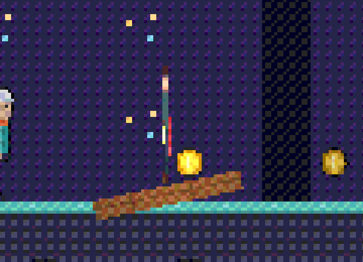
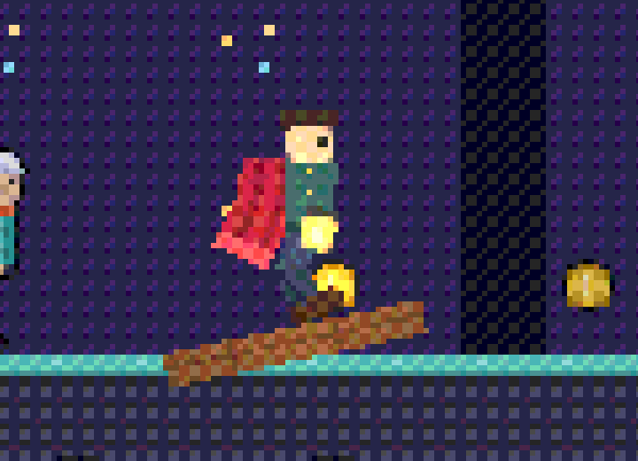
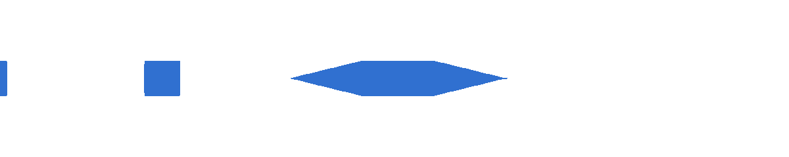
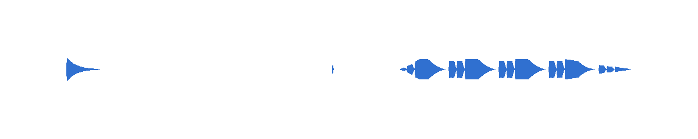

# Debt round 3, `anim-import`: evidence

Branch `debt/anim-import`, from main `87b9563d`. Everything was run in an
orb (lavapipe, CPU only). As briefed, this stream did not run
`scripts/check.sh`, `og test`, web-reference, a reference capture sweep,
or a wasm or release build. Rust checks were `cargo check`, `cargo
clippy -D warnings` and the tests of the crates edited, one at a time.

## Commits

| Commit | Item | What |
|---|---|---|
| `10dec3f3` | 1 (row 56) | og-anim `Samples`: a loaded channel keeps the cooked f32, constant or quantised keys, and sampling reads the keys where they lie. |
| `eb83e091` | 2 (row 63) | A `.vox` frame that never moves has no joint. The frame rate stays `voxFps`, with the reason in the README. The model cook's bounds leave out nodes hidden at rest. Cooker `r6`. |
| `db4a294d` | 3 | 2D child armatures: events fire when the parent plays backwards; armature `skin` blocks are worn by the name of the rig's skin; DragonBones child skins are imported. The rig2d docs say why open paths extend. |
| `e95c4b78` | 3 | game-2d: the keeper's turn is paced by its feet (21 ticks), so the IK reaches them on every tick of the turn. |
| `35b6089a` | 4 | og-runtime `tests/timeline_sound.rs`: a timeline's sound, captured and checked; docs rows closed. |

## 1. Resident clips cost what their cooked form costs (row 56)

Before, the loader rebuilt every frame of a quantised channel to f32. Now
a channel holds `og_anim::Samples`:

- `F32`: frames × lanes;
- `Constant`: one sample;
- `Quantized`: the kept frames' u16 indices, the u16 words and the
  per-lane ranges, as the blob stores them.

To read a frame, og-anim finds its key by binary search and rebuilds it
there with the cook's own arithmetic: a hold for STEP, a lerp per lane,
or an nlerp on the shorter arc. `unpack_quat`, `dequantize` and `nlerp4`
moved from og-cook to og-anim. The cook's encoder now measures its
tolerance against those same functions.

**Same poses.** A rebuilt frame has the same bits the old decoder wrote,
so poses are unchanged bit for bit. The blob format did not change, so
neither the blob version nor the cooker version moved for this item.

**The test** is og-cook `anim_compress.rs`
`resident_quantised_clips_cost_their_cooked_bytes_and_pose_as_their_frames`.
For every committed compressed model it checks:

- the loaded clips take exactly the blob's `samples` + `packed` bytes,
  and less than their frames as f32;
- every frame read from the keys has the same bits as the frames written
  out independently from the format's description;
- og.anim plays every clip at speeds 1, 0.37 and −1 to the same
  `world_hash`, tick for tick, from the keys and from those f32 frames.

The test does not compile on the old code: there is no `Samples` and no
`sample_bytes`.

**Hashes against the old code.** A scratch test, since deleted, played
every clip of each compressed model at three speeds for 300 ticks and
folded the world hashes. Run on this branch, then with the change stashed
(the old loader), it printed the same values:

```
HASH models/walker.glb 8f7f14aa3b91cf5d          (both)
HASH models/trickster.glb e909de8e08be9f3b       (both)
HASH models/strider.glb 50d4965a738fd7b5         (both)
HASH models/puppet2d.glb a032e432b234bf7c        (both)
HASH anims/humanoid-clips.glb 047c4356a5cc8761   (both)
```

Resident sample bytes, before (every frame as f32) → now (as cooked):

| Model | Before | Now |
|---|---:|---:|
| walker | 4,892 | 2,028 |
| trickster | 25,200 | 2,012 |
| strider | 15,940 | 4,448 |
| puppet2d | 4,836 | 2,132 |
| humanoid-clips | 11,636 | 4,150 |
| **total** | **62,504** | **14,770** |

**Cost.** Each sample of a quantised channel costs one binary search and
one key decode. Only quantised channels pay this; f32 and constant ones
read as before. Optimisation is deferred (2026-10-22), so this was not
measured.

## 2. `.vox` (row 63) and the r4/anim-visibility decisions

- **The frame rate stays `voxFps`.** The file has no rate to read.
  ephtracy's format documents (`MagicaVoxel-file-format-vox.txt` and the
  extension) define none. `nTRN` and `nSHP` frames carry only `_f`.
  MagicaVoxel 0.99.7.2's notes name the playback range as the one
  animation setting it saves (`META`'s `_anim_range`, which the cook
  already reads). ogt_vox, whose reading the cook follows, reads no rate
  either. The editor's time step is an editor setting. This is written in
  og-cook's README §What phase 2 owes and in `cook/vox.rs`'s module docs.
- **A frame that never moves has no joint.** Such a frame is a plain mesh
  node at scale 1. It is hidden at rest (`KHR_node_visibility`) unless it
  is frame 0, and its visibility track swaps it in and out. og-runtime's
  posed draw draws an unskinned part at its rest place when the pose shows
  it, as a static instance: no palette matrix and no skinning. A model
  that a keyed transform moves keeps its joint and its STEP translation
  channel, as before.
- **Bounds.** The rest-scale-0 trick is gone for unskinned frames, so the
  model cook's bounds now leave out nodes hidden at rest and their
  subtrees. The bind-pose bounds stay frame 0's.
- **Cooker version.** The cooked bytes for the same input change (`.vox`,
  and bounds of glTFs with hidden nodes), so `COOKER_VERSION` is now `r6`.
  No model blob schema changed.
- **Tests that fail on the old code:**
  - og-runtime `model_clips.rs` `an_animated_vox_plays_one_frame_at_a_time`
    now expects one plain draw a tick and no palette matrix. The old cook
    drew a skinned instance through three matrices.
  - og-cook `tests/vox.rs` and the `cook::vox` unit tests now expect: no
    skin for a pack of frames; the unmoved bar run unskinned beside two
    joints; nodes at scale 1; bounds of frame 0.
- **Already landed on main before this branch.** These items were still
  open in the notes and are now pointed at from r4's NOTES:
  - **`KHR_animation_pointer`:** b470ea2f. The cook rewrites a
    `pointer` channel onto `KHR_node_visibility/visible` as
    `OG_animation_visibility` before the gltf crate validates it.
  - **The static `.vox` NodeRow flag:** 595dd0e4. The model blob's node
    rows carry the rest flag, and the static draw honours it.

## 3. 2D armatures

- **Child events on backward play.** The skeleton passes its backward
  spans, each `[lo, hi)` in the parent's clip time, to
  `Rig2dAsset::child_events(.., backward, ..)`. `wrap_span_back` splits
  each span where the child's looping clip wraps, or clamps it to a
  one-shot. An event fires at the time the playhead lands on, not the one
  it leaves.
  - Test: `skeleton2d::tests::a_child_armatures_events_fire_when_its_parent_plays_backwards`.
    Played from 2 s at speed −1, the flame's flick fires at ticks 32 and
    96 and its spark at 64 and 128 (not at 2 s, where play started), and
    the parent's beat at 64.
  - On the old code no child event fires backwards.
- **Child skins.** An `armature` block takes `skin` blocks of its own, in
  both the text and the canonical text. A child wears its skin of the name
  the rig wears, else its default, the same way it plays its parent's clip
  by name. No new API field was needed. The DragonBones import keeps a
  child's other skins instead of noting and dropping them.
  - Tests: og-anim `a_child_armature_wears_its_skin_of_the_name_the_rig_wears`
    (gold → ember, default and silver → fire, round trip, a bad swap
    refused naming the armature); og-cook
    `a_child_armatures_skins_are_imported_and_worn_by_name`.
  - Both fail on the old code: the parser refused `skin` inside an
    armature, and the import dropped the skins.
- **The 0.008 m IK miss.** The cause was the game template's turn, not
  the solver. The 12-tick paper turn narrowed the legs faster than
  `FOOT_SPEED` lets a foot move (0.041 m a tick against 0.0237). Near the
  edge-on tick a foot lagged its leg and went out of reach in rig space.
  - Fix: `TURN_TICKS` is now derived from `FOOT_SPEED`, the stance and the
    slope, which gives 21 ticks. `keeper.og.ts` checks the worst IK error
    over each turn.
  - Run with `playtest-run.ts` on a dev addon (`cargo build -p
    og-host-node`), `OG_RENDERER=none`:
    - new code: PASS, worst error **0.000000 m** through both turns;
    - main's `src/main.ts` against the new test: FAIL, **0.008320 m**
      (ticks 132–144) and **0.006738 m** (271–283).
    - With the renderer on lavapipe it passed with 40 checks.
  - The walk's dumps moved 9 ticks later (3.0 and 3.3 s), and the run
    now ends at 5.6 s.
- **Open paths stay extended along their end handles**, as in Spine.
  DragonBones' `_computeBezierCurve` `continue`s past an open path's end
  (a TODO in its source). That leaves the bone on whatever its reused
  positions array held from an earlier frame: state outside the pose, so
  not deterministic. The two agree within the path. This is stated in
  `rig2d.rs`'s module docs.

Keeper frames from this branch (lavapipe, crops at 2×):

:::gallery side-by-side


:::

## 4. Timeline

- **Already landed on main.** These items were still open in the timeline
  NOTES and are now pointed at from there:
  - **Tube geometry from a path:** 81ed13f1 (`TubeGeometryDesc.path`,
    og-runtime `tests/tube_path.rs`).
  - **Hot reload with a playing timeline:** d1576245 (og-runtime
    `tests/timeline.rs`
    `a_hot_reload_keeps_playing_from_the_same_time_with_the_edited_keys`).
- **The sound, heard.** og-runtime `tests/timeline_sound.rs` captures a
  timeline's voices with og-audio's `HeadlessSink` (capture mode). Times
  are read from the click at 0 s. RMS per 0.1 s:

  ```
  0.0:0.1768 0.1..0.8:0 1.0:0.2500 1.1:0.2500 1.2:0.1768 1.3..1.9:0
  2.0:0.0242 2.1:0.0710 2.2:0.1204 2.3:0.1701 2.4:0.2200 2.5:0.2498
  2.6..2.9:0.2500 3.0:0.2307 3.1:0.1811 3.2:0.1313 3.3:0.0818 3.4:0.0337
  3.5:0.0036 3.6..:0
  ```

  - The tone sounds from 1 s for 0.25 s at full gain. The music fades in
    linearly over 2–2.5 s, holds, and fades out to its `end` at 3.5 s.
  - With 61c31247's fix undone (the music voice written with `looping`)
    the test fails.
  - It is a file of its own because og-audio's link registry is per
    process while engine ids are per thread. Run beside other tests'
    engines in one process, the sink attached to another test's link.
    That is a test-harness hazard, not changed here.
  - The test writes its capture to `$OG_EVIDENCE_DIR/timeline-sound.wav`.

  

- **The template intro, heard.** `bun src/node/run.ts --entry <bundle>
  --root <copy of templates/game> --commands "0:timeline:play:intro;10.5:quit"
  --audio intro.wav`, on a dev addon with `OG_RENDERER=none`, captured
  140 audio commands (wav sha256 `466d3233…`). RMS per 0.25 s:
  - the blip at 1.00 s (0.105);
  - the click at 5.00 s (0.021);
  - the sting looping from 6.00 s (0.04–0.14);
  - fading out to 9.5 s (0.0004), then silent.

  

## Verification

| Command | Result |
|---|---|
| `cargo test -p og-anim` | all pass (lib 24, 13 test binaries) |
| `cargo test -p og-cook` | 177 pass, including lavapipe frame comparisons (`cooked_models_render_the_gltf_reference_scene`, the anim-compress frames) |
| `cargo test -p og-runtime` | 80 pass |
| `cargo clippy -p og-anim -p og-cook -p og-runtime --all-targets -- -D warnings` | clean |
| `cargo check -p og-host-web -p og-host-node -p og-cli -p og-tests` | clean (native check only) |
| `cargo fmt --all --check` | clean |
| `og api check` | "the generated files match crates/og-api/api.ogt" (`api.ogt` untouched: no new author-facing field) |
| `bun scripts/validate.ts` and `bun test tests/` in packages/knowledge | valid; 49 pass |
| game-2d `keeper` and `smoke` through `playtest-run.ts` (dev addon) | PASS (keeper 40 checks with the renderer, smoke 10) |

## Frames the Mac lane must check on metal

None was re-recorded. None is expected to move:

- `crates/og-tests/references/metal/vox-keyframes.png`: the block moves,
  so it keeps its joint; the slab is static. Its glTF changed only in what
  is unchanged for it. Cooker r6 re-cooks it.
- `crates/og-tests/references/metal/skeleton-2d.png`: no armature skin and
  no backward play in that scene.
- `templates/game-2d` `keeper.png` (tick 60, before the turn). `walk.png`
  is now taken at 3.0 s, and it has no committed reference.
- Every frame posing a compressed clip: poses are bit-identical. Today no
  committed reference cooks with `compress true`.
- Cooker r6 re-cooks everything. Only `.vox` output and the bounds of a
  glTF with nodes hidden at rest change bytes, and no committed glTF has
  one.

Mac commands, on the merged tree:

```
scripts/check.sh functional
scripts/check.sh --only test        # og-tests gfx: vox-keyframes, skeleton-2d
scripts/check.sh --only bun-test    # template playtests: game-2d keeper (keeper.png), game intro
og test templates/game-2d
```

## Not verified in the orb

- Metal frames and the og-tests gfx scenes (not run, as briefed).
- The wasm host: `og-host-web` was checked natively only.
- A device listening to the sound. The capture sink renders what a device
  would play.

## Shared files touched

- og-anim: `samples.rs` (new), `asset.rs`, `lib.rs`, `retarget.rs`
  (`.into()` only), `rig2d.rs`, `skeleton2d.rs`, and tests.
- og-cook: `anim_codec.rs`, `runtime.rs`, `cook/anim.rs` (one line),
  `cook/vox.rs`, `cook/model.rs` (bounds), `cook/rig2d.rs`, `format.rs`
  (`r6`), and tests.
- og-runtime: tests only (`model_clips.rs`, `timeline_sound.rs`).
- `templates/game-2d`: `src/main.ts`, `tests/keeper.og.ts`, `README.md`.
- Docs: `docs/design.md` §2.7, `docs/phase-1.md` (rows 56 and 63, the
  anim-2d-2 row, the timeline line), og-anim and og-cook READMEs, the
  og-game skill, and the r4/anim-visibility, debt2/anim-2d-2 and
  depth/timeline NOTES ("Since" pointers).
- Not touched: `api.ogt` and the generated outputs, `CHANGELOG.md`.
