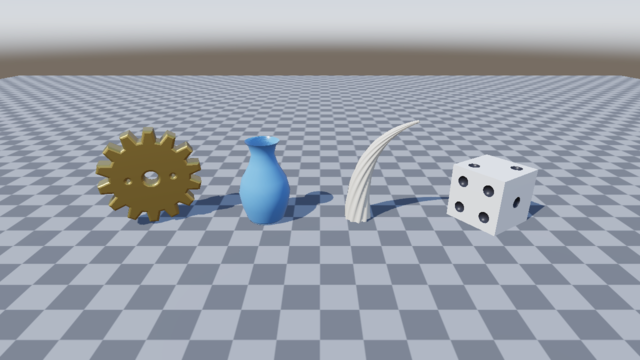
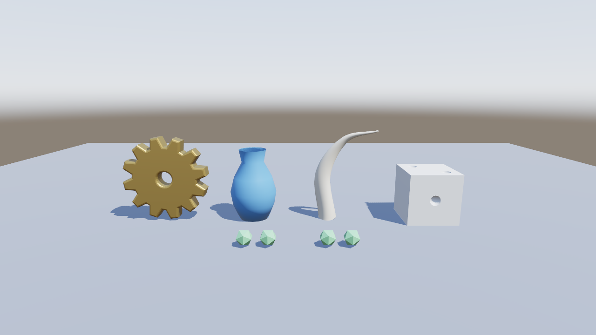

# geom-1: procedural modelling (round 3, plan C)

Branch `r3/geom-1`, cut from `5cc1275d` (origin/main). The brief is the
`geom-1` row of docs/phase-1.md, "Plan 2026-10-24, round 3".

## What landed

| Commit | What |
|---|---|
| `38e1c7b` og-geom | A new crate `crates/og-geom` (glam, `robust` 1.2 for Shewchuk's predicates, `spade` 2.15 for a constrained Delaunay of each cut face; never og-render or wgpu). It has three.js's shape (earcut, a port of mapbox earcut 3.0.2 as three.js carries it), extrude (steps, bevel, extrudePath with Frenet frames), lathe, polyhedron with icosa, dodeca, octa and tetrahedron, a sweep (section along a path, scale and twist keyed over t, caps), merge (placed parts, mirror axis) and CSG (union, subtract, intersect). Trig is series-based (`trig.rs`), evaluated on integer segment indices; no libm transcendental functions. The CSG decides every plane side with exact orient3d and every crossing inside a face with orient2d, classifies pieces by winding number, and keeps coplanar faces once or drops them, as the operation says. |
| `5d2c3a7` og-idl | Adds a `This` primitive (TypeScript `this`, for chainable methods), treats a value whose interface has `new` as a class (PascalCase name), adds `prop … { host false }` (a property the TS runtime holds), and fixes the parentheses around `readonly` in a list of lists. |
| `22dc879` render API | api.ogt: shapeGeometry, extrudeGeometry, latheGeometry, polyhedronGeometry, icosahedronGeometry, dodecahedronGeometry, octahedronGeometry, tetrahedronGeometry, sweepGeometry, csgGeometry and mergeGeometries in `render`, next to tubeGeometry. Their descs keep three.js's names and defaults. A new root module `shapes` declares og.Shape and og.Path2. og-runtime `geometry.rs` decodes the descs and converts og-geom's mesh into MeshData through the same `make()` as bufferGeometry, so the BVH, `physics`, `dynamic` and geometryInfo all hold. Both hosts' `host.rs` are wired. TS: `packages/engine/src/geom.ts` (Path2 and Shape, flattened to points on the wire) and `index.ts`. Generated outputs were regenerated (`og api gen`, `og api gen --wiki`; `og api check` passes). |
| `ea63614` og-tests | The gfx scene `geometry-shapes`: an extruded gear with three holes and a bevel, a lathed vase, a tapered horn swept along a path, and a dice (a cube minus spheres, chained CSG). Its test is `geometry_shapes_matches_its_reference` in `tests/geometry.rs`. |
| `39db710` docs | og-game skill §18 (og.Shape and og.Path2, every generator, an example, the determinism note, a link to `reference/shapes.md`). docs/design.md gains a paragraph on og-geom under "Runtime geometry and debug draw". |
| (this commit) | These notes and two lavapipe frames for reading, not references. |

## Tests, and how each fails on the old code

- `crates/og-geom/tests/geom.rs`, 12 tests. On 5cc1275d the crate does not
  exist, so the tests cannot build. They check:
  - vertex and triangle counts equal to three.js's formulas for lathe, the
    polyhedra at detail 0, 1 and 2, and extrude with and without a bevel;
  - extrude, sweep, merge and every CSG result are closed manifolds: every
    edge is used twice with opposite orientation, and the Euler
    characteristic is right;
  - box minus box has volume 8 − 0.336;
  - a lathed circle (a torus) matches Pappus's volume within 2e-3;
  - union + intersect has the volume of A + B;
  - coincident faces work: a union of two face-sharing boxes has volume 2,
    and a flush notch leaves 7.0;
  - two builds are byte-identical, and FNV hashes of six results are
    pinned, so a change in any decision on any host shows.
- `packages/engine/tests/geom.test.ts`, 13 tests on the native host. They
  cover Shape and Path2 flattening against three.js's points (absarc either
  way, arc after a line, ellipse, quadratic and cubic curves, splineThru,
  holes) and one geometry of each kind through the API, read back with
  geometryInfo. With the changes stashed, the first test fails with
  "og.Path2 is not a constructor". I checked this by stashing.
- `packages/engine/tests/api-surface.test.ts` gains the Path2 and Shape
  owners. Its 4 tests pass.
- `og-tests` `geometry_shapes_matches_its_reference`: there is no scene on
  the old code, and on this branch it fails with "no reference … record one
  with OG_GFX_CAPTURE" until the coordinator records one.
- `packages/knowledge`: `bun scripts/validate.ts` is valid, and its 43
  tests pass. Before the skill named `reference/shapes.md`, the validator
  refused the new module.
- The failures in `packages/engine/tests/hosts.test.ts` are missing
  `dist/web` (no wasm build here, as the rules require). They were there on
  5cc1275d too.

## Frames read (lavapipe, llvmpipe LLVM 15, in the orb)

`XDG_RUNTIME_DIR=/tmp ./target/debug/og-gfx geometry-shapes`: draws 18,
batches 5, 12,276 triangles.

- Gear: gold, mean (112.7, 94.3, 46.5) over 24,427 px. The centre hole
  shows the floor (169, 176, 189) through it, inside a gold ring (108, 89,
  41). Both small holes show the floor too.
- Vase: blue, mean (95, 148, 196). Its mouth (the inside) is darker (73,
  133, 194) than its lit belly (120, 180, 219).
- Horn: ivory, mean (188, 193, 200), tapering to a point along a curve.
  The rings show as faint long facets.
- Dice: white (217, 220, 223), turned 0.6 rad round y. 1,092 dark pixels
  form 7 pip blobs: the front face's four and two on top. The side face's
  pips are partly hidden.

`og run` end to end (the dev addon through `OG_NATIVE_ADDON`), on a project
using og.Shape and Path2 holes, extrude with a bevel, lathe, a sweep along
og.path.create, chained CSG of a box minus an icosahedron, and
mergeGeometries with a mirror. It ran `--commands "0.5:screenshot:shapes.png"
--ticks 40 --size 1280x720` and ended at hash 94f10cae5063d19e with 6
entities.

- The gear's hole shows the floor (190, 198, 212); the face is (139, 118,
  64).
- The vase's mouth is (65, 119, 180) against its belly (140, 194, 226).
- The front pip's pit is (149, 162, 182) against the face (206, 209, 213).
- Four green icosahedra are in mirrored pairs, symmetric about x = 640:
  (169, 211, 186) on the left and (124, 178, 151) on the right, since the
  light falls from one side.

## Metal references owed

- `geometry-shapes` (og-tests gfx) on metal; webgl2 too if the
  coordinator's tiers want it. No reference was recorded here.

## Shared files touched

- `crates/og-api/api.ogt`, and the generated outputs:
  - `crates/og-api/src/generated/host.rs`
  - both hosts' `generated/glue.rs`
  - `packages/engine/src/generated/abi.ts`, `types/index.d.ts`,
    `types/bindings.json` and `schema/api.schema.json`
  - `packages/knowledge/wiki/*`; most of these diffs are only api.ogt line
    numbers moving.
- og-idl: `gen/mod.rs`, `gen/ts.rs`, `index.rs`, `load.rs`, `model.rs` and
  `validate.rs`.
- og-runtime: `geometry.rs`, `lib.rs` and `Cargo.toml`.
- `og-host-node/src/host.rs` and `og-host-web/src/host.rs`.
- packages/engine: `src/index.ts`, the new `src/geom.ts`, and
  `tests/api-surface.test.ts`.
- `packages/knowledge/skills/og-game/SKILL.md` §18 and `docs/design.md`.
- The root `Cargo.toml` (a workspace member) and `Cargo.lock`.
- `scripts/wasm-crates.txt` was not touched. It lists only og-render and
  og-host-web, whose dependencies (now og-geom, through og-runtime) build
  transitively.

## Left out, or for the coordinator to decide

- `og.Shape` and `og.Path2` sit in a new root module `shapes`, so they are
  `og.Shape`, not `og.render.Shape`. `holes` is a plain array declared
  through `PathList`.
- The new IDL primitive `This` and `prop { host false }` are a change to
  the IDL language, and they want a review.
- CSG operands must be closed meshes. The coplanar handling is tested on
  axis-aligned boxes only.
- The CSG pairs every triangle whose boxes overlap, O(n·m), with no BVH
  between the operands. That is fine at load for low-poly operands, but
  not every tick.
- A cube minus an ellipsoid that pokes out through two faces is genus 1
  (Euler characteristic 0). That is correct, and noted so nobody reads it
  as a bug.
- `bevelSize`'s IDL default is 0.1. As in three.js, it is
  bevelThickness − 0.1 when it is not given, which equals 0.1 only at the
  default thickness. The runtime follows three.js; the IDL states the
  default value.
- None of the new descs has a `uvRepeat`.
- There is no fx-showcase or template station for the new generators.
- Wasm sizes were not measured (wave end).
