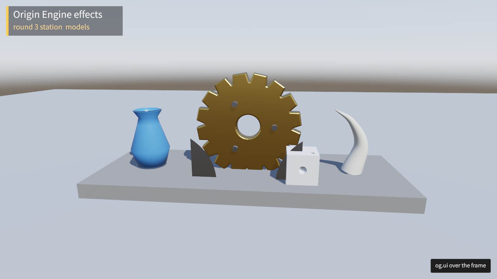

# geom-2: `type model` (round 3, plan C)

Branch `r3/geom-2`, cut from `b86bcb91` (origin/main). The brief is the
`geom-2` row of docs/phase-1.md, "Plan 2026-10-24, round 3", plus what
geom-1 left (tests/evidence/r3/geom-1/NOTES.md): `uvRepeat` on the new
descs, a showcase station, and the `bevelSize` doc.

## What landed

| Commit | What |
|---|---|
| `8d6f5eab` og-geom | `path2.rs`: three.js's Path and Shape (og.Path2, og.Shape) in Rust, with geom.ts's formulas in f64, so a shape written in `.ogt` flattens to the TypeScript runtime's points bit for bit. `trig::sincos` now rounds its quadrant as JavaScript's `Math.round` does (a tie towards +∞). With Rust's `round`, angles at a quadrant tie (−π/4, a full circle's ends) reduced differently from the TypeScript `sincos`. geom-1's six pinned hashes did not move. |
| `fdb63f0c` og-cook | `type model` (`cook/model_text.rs`): parts named by their og.render call and desc fields (og-render's primitives, plus og-geom's shape, extrude with `extrudePath`, lathe, polyhedron, the four solids, sweep, csg and merge). Shapes are og.Shape calls with `hole { }`, and paths are og.path's lines. Parts are placed as mergeGeometries places them (`position`, `quaternion`, `scale`, `mirror`, or `at { }` blocks), each with a `material`, hung from `pivot`s, which are nodes. The cook writes the text as a glTF binary (vox.rs's writer, `Bin::finish`, now shared) before the model path, so it is the same blob: meshopt, the LOD chain with measured errors, the raycast BVH, the nodes, and the proxy for streaming. A part with several placements is one mesh under several nodes, drawn instanced. A mirrored placement is baked into its own mesh. Past project.ogt's `budgets.triangles` or `budgets.vertices` the cook refuses the model, and the budgets are part of its stamp. The navmesh bake (`e6.rs`) reads it as any model. |
| `015edd09` og-cook | `og cook --report`: every model gains `parts` (the placed primitives of its default scene) and `draws` (the distinct ones among them), beside `triangles`, `lods`, `lodErrors`, `bvhBytes` and `bvhShare`. |
| `33358cf3` og-runtime | Test only: a `type model` hot-reloads (edit, cook, then the probe's `reload`, which is og dev's step) under its handle. The runtime's `assets::refresh` already reloads any model whose outputs changed. |
| `c72a1eef` render | `uvRepeat` on ShapeGeometryDesc, ExtrudeGeometryDesc, LatheGeometryDesc, PolyhedronGeometryDesc, SolidGeometryDesc, SweepGeometryDesc, CsgGeometryDesc and MergeGeometriesDesc, applied in og-runtime's `generated()` through `uv_repeat`. Generated outputs regenerated. |
| `bf71ec39` render | `bevelSize` becomes `Option.f32` with no fixed default. Null or unset gives bevelThickness − 0.1, as the run time already did. |
| `64e4ee4a` fx-showcase | The `models` station, appended after `islands` at x 7000, past the islands' sea (x 3,464 to 6,536). It uses `assets/models/clockwork.ogt` (10 parts, 8 draws, 4,574 triangles) and a system `ModelsProbe` that rays the gear. Files: `src/models.ts`, `tests/models.og.ts`, a README row. |
| `2fe33005` docs | og-game SKILL.md §18 documents `type model` with a whole example, and §5 points to it. api.ogt's `shapes` module doc becomes `reference/shapes.md`. |
| `acebed4a` docs | docs/design.md: a paragraph on `type model` under procedural modelling. |
| (this commit) | These notes and the lavapipe frame. |

## Tests, and how each fails on the old code

All of these were run here and pass.

- **og-geom** `path2_flattens_to_the_typescript_runtime_s_points` pins the counts and FNV hashes of five paths' f64 points. The pins are what bun printed for the same calls through `packages/engine/src/geom.ts`. On the old code `og_geom::Path2` does not exist. With only `trig.rs` stashed (the old rounding), 3 of the 5 hashes differ (checked).
- **og-cook** `tests/model_text.rs`, 8 tests. On b86bcb91 every one fails: the cook answers "an .ogt of type 'model' is not a cookable asset". I checked by stashing `crates/og-cook/src` and running the 5 that build without `to_glb`.
  - `a_model_cooked_twice_is_byte_identical`: two projects, every cooked file equal.
  - `a_cooked_gear_raycasts_where_its_triangles_are`: a ray down onto the centre of every front-facing triangle (more than 40) of a 12-tooth gear hits that face at z 0.2. Rays through the hole and the 12 gaps miss, the 12 teeth hit, and a ray from below hits the back face.
  - `its_lod_errors_are_measured_as_a_gltf_s_are`: the same parts cooked as a `.glb` give equal `lods` rows (triangles and measured errors) and an equal LOD 0 mesh. The vase's errors are 0, then above 0 and growing, and under 0.07.
  - `a_part_placed_three_times_is_one_mesh_under_three_nodes_of_its_pivot`.
  - `past_the_project_s_budgets_it_is_refused_and_a_scene_names_it`: refused at `triangles 500`, and no blob is written. A scene's `model` line takes it.
  - `a_bad_model_says_where`: an unknown material, a misspelt field, a missing geometry and an unknown shape call.
  - `the_report_counts_its_triangles_draws_and_bvh`: 5 parts and 3 draws. Without the stats change, `parts` is null (checked).
  - `the_skill_s_example_cooks`: the §18 example cooks as written. With the skill stashed, "§18 has a type model example" panics (checked).
- **og-cook**, all 167 tests (nextest) after the cook commit. That includes vox, unchanged by the shared writer, and the template's determinism tests.
- **og-runtime** `model_reload`: on b86bcb91 its first cook refuses `type model`. `geometry_uv_repeat`: with `geometry.rs` stashed, the shape's uv comes back unscaled (checked). og-runtime and og-geom with nextest: 83 passed, 3 skipped.
- **packages/engine** (native host, a dev addon via `OG_NATIVE_ADDON`): `geom.test.ts` gains "extrude's bevelSize is bevelThickness − 0.1 when not given". It reads the schema's declaration (`0.1` at HEAD~1, `null` now) and the widths at bevelThickness 0.3: 0.7 unset and null, 0.55 given 0.05, 0.6 at the defaults. geom and api-surface: 18 pass.
- **packages/knowledge**: `bun scripts/validate.ts` is valid, and its 43 tests pass.
- `og api gen`, `og api gen --wiki` and `og api check` pass. `cargo fmt --all --check` and clippy `-D warnings` on og-geom, og-cook and og-runtime are clean.

## Frame read (lavapipe, in the orb)

`og run templates/fx-showcase --commands "0.5:station:models;1.5:screenshot:models.png;…" --size 1280x720` ran with `OG_NATIVE_ADDON` set to the dev addon. It ended at tick 102, hash a3ed1b862941763d, 52 entities.

- The brass gear is centred: 41,893 brass pixels in (440..840, 120..520). Its face is (121, 102, 62), with a lit bevel round every tooth. The hole shows the sky behind: (191, 199, 211) at its centre. Three steel bolt heads sit on the axle circle.
- The blue vase is on the left: (94, 164, 211) on its body, with a darker mouth.
- The ivory horn is on the right: (200, 202, 203). It tapers to a point and curves back.
- The white dice (209, 211, 215) has a pit on its front face. The dark steel fins are mirrored about the model's yz plane, the second behind the dice.
- The stone plinth carries the shadows.
- The dumped `Models` component: geometries 8, ringHits 2 (front and back faces), ringZ 0.09999943, holeHits 0.

## Metal references owed

- fx-showcase `references/metal/models.png`, and `vulkan-cpu` (and the browser tiers if wanted). `tests/models.og.ts` fails with "record it with OG_FX_CAPTURE" until then. I recorded no reference, per the rules.
- geom-1's `geometry-shapes` is unaffected (the og-geom hashes did not move).

## Shared files touched

- `crates/og-api/api.ogt` and every generated output: `packages/engine/types/index.d.ts`, `schema/api.schema.json` and `packages/knowledge/wiki/*`. Most wiki diffs are api.ogt line numbers moving.
- `crates/og-runtime/src/geometry.rs` (`generated` applies `uvRepeat`).
- og-cook: `cook/mod.rs` (classification, the budgets read once per cook, the model stamp and refusal), `cook/model.rs` (`ModelNotes` carries triangles and vertices), `cook/vox.rs` (`Bin` shared, `finish`), `cook/e6.rs` (the navmesh reads a text model), `cook/stats.rs`, `Cargo.toml` (og-geom under the `cook` feature), and `Cargo.lock`.
- og-geom: `lib.rs`, `trig.rs`, the new `path2.rs`.
- `templates/fx-showcase/src/main.ts` (STATIONS, reset, show, the systems list, command help).
- `packages/knowledge/skills/og-game/SKILL.md`, `docs/design.md`.

## Left out, or for the coordinator to decide

- **A convex hull per part is not cooked.** A loaded model's geometries are registered as physics meshes under their Geometry handles at load (og-runtime `assets.rs`). So `og.Collider { shape: SHAPE_CONVEX, mesh: gltfInfo.geometries[i] }` is a hull per part at run time, built by rapier at load. Cooking hulls into the blob would need a new model section and a schema bump. I left that for a decision.
- **Instancing** relies on the renderer batching instances of one mesh and material (`draws` counts distinct primitives). A mirrored placement is baked into a mesh of its own, so it is not instanced with its original. That keeps every node's scale positive.
- **The refusal covers only `type model`.** glTFs and `.vox` are still flagged in the report, as before. Turning the flags into refusals for every model is a policy change.
- The showcase model's BVH is 36.6 % of its blob, so the report warns past `bvhShare` 30. The station raycasts at it, so it stays.
- `sincos`'s rounding moved for ties only, and geom-1's pinned hashes are unchanged. Any other caller of `og_geom::trig::sincos` at an exact tie now matches the TypeScript.
- The new fx-showcase system `ModelsProbe` iterates only `Models` archetypes (empty until the station is shown). I did not sweep other stations' frames (the rules), so the functional lane should confirm none moved.
- Hot reload is tested through the probe's `reload` after a cook, the step `og dev` drives, not by spawning `og dev`. The existing `reload-asset.test.ts` covers the og dev process for a glTF.
- `emissiveIntensity` above 1 writes `KHR_materials_emissive_strength`, which the model cook reads. It has no test of its own.
- Wasm sizes were not measured (wave end).
