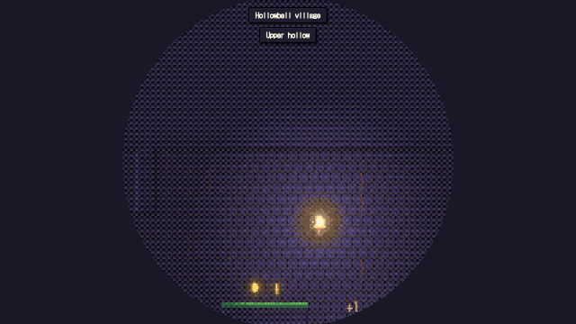
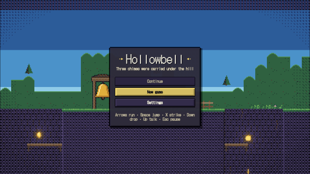
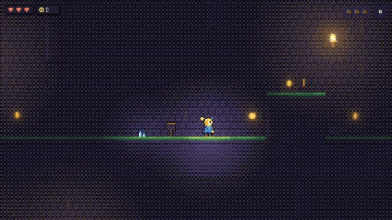
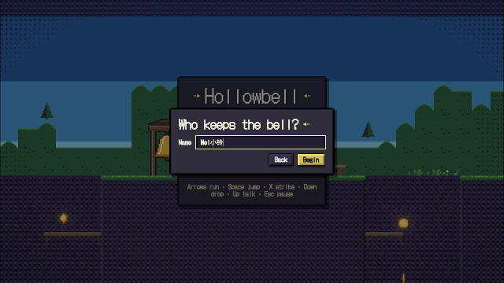

# og polish: hollowbell

2026-10-25, 13 playtest(s) on metal. Mechanical measures of og-taste and og-feel (og-build §5); a score is 0 to 100, n/a when nothing in the playtests exercises it. The measures cannot judge style: read the frames.

## Scores

| | Score | Measure |
|---|---|---|
| **Taste** | **99** | mean of the taste rows |
| Contrast | 94 | text boxes whose ink and ground reach 4.5:1 |
| Text size | 100 | text boxes whose tallest ink line reaches 9 CSS px (a 13 px face's capitals) |
| HUD occupancy | 100 | gameplay frames: HUD at most 15 % of the surface and 5 % of the central third |
| Screen transitions | 99 | screen changes with UI motion around them |
| UI sounds | 100 | UI presses answered on the ui bus |
| Locale keys | 100 | string tables without missing keys (og cook) |
| **Feel** | **96** | mean of the feel rows |
| Input latency | 100 | inputs answered, by the median ticks to the answer (0–1: 100) |
| Hit feedback | 100 | damage moments with hit stop, shake, floating text or a sound (three of four: 100) |
| Idle frames | 100 | ticks where nothing new is seen or heard (10 %: 100, 60 %: 0) |
| Frame time | 93 | p95 step + render (8.3 ms: 100, 33 ms: 0), worst playtest |
| Sound on input | 85 | inputs answered by a sound within 6 ticks |

## Fixes

| Measure | Where | Found | Fix |
|---|---|---|---|
| contrast | frames settings-zh: `LanguageLabel` "语言" | 2.55:1 between ink and ground (body text wants 4.5:1) | og-taste §3 (value before hue): darken the ground or lighten the ink in the style's palette, never per call |
| contrast | frames results: `NewBest` "New best" | 3.8:1 between ink and ground (body text wants 4.5:1) | og-taste §3 (value before hue): darken the ground or lighten the ink in the style's palette, never per call |
| contrast | frames shop: `Price` "16" | 3.96:1 between ink and ground (body text wants 4.5:1) | og-taste §3 (value before hue): darken the ground or lighten the ink in the style's palette, never per call |
| contrast | name name: `Label` "Name" | 3.01:1 between ink and ground (body text wants 4.5:1) | og-taste §3 (value before hue): darken the ground or lighten the ink in the style's palette, never per call |
| screen transitions | win | 1 of 11 screen changes had no motion in the 20 ticks around them | og-taste §5 (screens change through a transition): og.ui.screenTransition, one kind per game |

## Playtests

### combat

two strikes beat a beetle with hit stop, flash, shake and a number; a beetle's touch costs a heart and knocks Wren back (186 ticks)

| Measure | Value |
|---|---|
| Text boxes | 4; 4 at 4.5:1; 4 of 4 at 9 px ink |
| Lowest contrast | 7.78:1 `Text` (hit); 9.27:1 `Text` (hit); 14.68:1 `Toast#1` (hit) |
| Smallest ink | 14 px `Text` (hit); 14 px `Text` (hit); 15 px `Toast#1` (hit) |
| HUD | 1 gameplay frame(s), up to 1.58 % of the surface, 0 % of the centre |
| UI | 3 screen change(s), 3 with motion; 141 ticks of UI motion; 0 press(es), 0 with a ui-bus sound |
| Inputs | 2, 2 answered, median 0 ticks, max 0; 2 with a sound; 92.98 % of input-free ticks also change something |
| Damage | 3 moment(s) from `hits`, `kills`, `hp`: hit stop 3, shake 3, floating text 3, sound 3, tween 3, particles 1 |
| Idle | 0 % of ticks |
| Particles | peak 16 system(s), 2 burst(s) |
| Frame (metal) | step 2.83 ms median, 6.16 p95; render 2.1 median, 2.53 p95; frame p95 8.69, max 11.67 |
| Audio | 3.1 s, peak 0.5, RMS 0.0485, 0 clipped, 0 % silent ticks |

 

hit (tick 45: HUD 1.58 %, 4 texts, 0 under 4.5:1, 0 small)

### frames

the title, play, a strike, the talk, the shop, pause, the Chinese settings, the gloam and the dawn results match their reference frames (1056 ticks)

| Measure | Value |
|---|---|
| Text boxes | 69; 65 at 4.5:1; 69 of 69 at 9 px ink |
| Lowest contrast | 2.55:1 `LanguageLabel` (settings-zh); 3.8:1 `NewBest` (results); 3.96:1 `Price` (shop) |
| Smallest ink | 10 px `Pause` (play); 10 px `Pause` (combat); 10 px `Pause` (gloam) |
| HUD | 3 gameplay frame(s), up to 1.7 % of the surface, 0 % of the centre |
| UI | 21 screen change(s), 21 with motion; 736 ticks of UI motion; 3 press(es), 3 with a ui-bus sound |
| Inputs | 17, 17 answered, median 0 ticks, max 0; 15 with a sound; 80.2 % of input-free ticks also change something |
| Damage | 1 moment(s) from `hits`: hit stop 1, shake 1, floating text 1, sound 1, tween 1, particles 1 |
| Idle | 0 % of ticks |
| Particles | peak 16 system(s), 2 burst(s) |
| Frame (metal) | step 3.21 ms median, 6.6 p95; render 2.17 median, 2.59 p95; frame p95 9.11, max 18.11 |
| Audio | 17.6 s, peak 0.55, RMS 0.0755, 0 clipped, 0 % silent ticks |

 

title (tick 60, menu: HUD 7.29 %, 5 texts, 0 under 4.5:1, 0 small)

### gloam

the hall holds the camera, the gloam telegraphs and charges, falls in slow motion and leaves the third chime (462 ticks)

| Measure | Value |
|---|---|
| Text boxes | 0; 0 at 4.5:1; 0 of 0 at 9 px ink |
| HUD | 0 gameplay frame(s), up to 0 % of the surface, 0 % of the centre |
| UI | 2 screen change(s), 2 with motion; 271 ticks of UI motion; 0 press(es), 0 with a ui-bus sound |
| Inputs | 7, 7 answered, median 0 ticks, max 0; 4 with a sound; 68.95 % of input-free ticks also change something |
| Damage | 5 moment(s) from `hp`, `hits`, `kills`: hit stop 5, shake 5, floating text 5, sound 5, tween 5, particles 2 |
| Idle | 0 % of ticks |
| Particles | peak 18 system(s), 3 burst(s) |
| Frame (metal) | step 2.74 ms median, 4.53 p95; render 2.05 median, 2.39 p95; frame p95 6.78, max 13.64 |
| Audio | 7.7 s, peak 0.96, RMS 0.0718, 0 clipped, 0 % silent ticks |

### lighting

daylight in the village, the dark hollow, the map lit round the lantern and a torch, the wick's wider light (366 ticks)

| Measure | Value |
|---|---|
| Text boxes | 2; 2 at 4.5:1; 2 of 2 at 9 px ink |
| Lowest contrast | 9.93:1 `Count` (dark); 14.16:1 `Pause` (dark) |
| Smallest ink | 10 px `Pause` (dark); 14 px `Count` (dark) |
| HUD | 1 gameplay frame(s), up to 0.95 % of the surface, 0 % of the centre |
| UI | 3 screen change(s), 3 with motion; 110 ticks of UI motion; 0 press(es), 0 with a ui-bus sound |
| Inputs | 0, 0 answered, median 0 ticks, max 0; 0 with a sound; 35.11 % of input-free ticks also change something |
| Damage | 0 moment(s): hit stop 0, shake 0, floating text 0, sound 0, tween 0, particles 0 |
| Idle | 0 % of ticks |
| Particles | peak 15 system(s), 1 burst(s) |
| Frame (metal) | step 2.67 ms median, 4.72 p95; render 2.07 median, 2.42 p95; frame p95 7.13, max 13.72 |
| Audio | 6.1 s, peak 0.24, RMS 0.0391, 0 clipped, 0 % silent ticks |

 

dark (tick 216: HUD 0.95 %, 2 texts, 0 under 4.5:1, 0 small)

### locales

the title, HUD, pause, talk, shop and results in Chinese, then English (582 ticks)

| Measure | Value |
|---|---|
| Text boxes | 0; 0 at 4.5:1; 0 of 0 at 9 px ink |
| HUD | 0 gameplay frame(s), up to 0 % of the surface, 0 % of the centre |
| UI | 14 screen change(s), 14 with motion; 393 ticks of UI motion; 0 press(es), 0 with a ui-bus sound |
| Inputs | 6, 6 answered, median 0 ticks, max 0; 4 with a sound; 72.25 % of input-free ticks also change something |
| Damage | 0 moment(s): hit stop 0, shake 0, floating text 0, sound 0, tween 0, particles 0 |
| Idle | 0 % of ticks |
| Particles | peak 15 system(s), 1 burst(s) |
| Frame (metal) | step 3.63 ms median, 6.64 p95; render 2.17 median, 2.55 p95; frame p95 8.97, max 13.5 |
| Audio | 9.7 s, peak 0.57, RMS 0.0891, 0 clipped, 0 % silent ticks |

### move

running, a jump to its height, one-way planks up and down, the lift's ride (516 ticks)

| Measure | Value |
|---|---|
| Text boxes | 0; 0 at 4.5:1; 0 of 0 at 9 px ink |
| HUD | 0 gameplay frame(s), up to 0 % of the surface, 0 % of the centre |
| UI | 7 screen change(s), 7 with motion; 170 ticks of UI motion; 0 press(es), 0 with a ui-bus sound |
| Inputs | 8, 8 answered, median 0 ticks, max 0; 8 with a sound; 82.79 % of input-free ticks also change something |
| Damage | 0 moment(s): hit stop 0, shake 0, floating text 0, sound 0, tween 0, particles 0 |
| Idle | 0 % of ticks |
| Particles | peak 15 system(s), 1 burst(s) |
| Frame (metal) | step 2.67 ms median, 4.32 p95; render 2.03 median, 2.37 p95; frame p95 6.77, max 11.44 |
| Audio | 8.6 s, peak 0.29, RMS 0.0386, 0 clipped, 0 % silent ticks |

### music

the streamed music is cooked in chunks and heard from the title (282 ticks)

| Measure | Value |
|---|---|
| Text boxes | 0; 0 at 4.5:1; 0 of 0 at 9 px ink |
| HUD | 0 gameplay frame(s), up to 0 % of the surface, 0 % of the centre |
| UI | 2 screen change(s), 2 with motion; 281 ticks of UI motion; 0 press(es), 0 with a ui-bus sound |
| Inputs | 0, 0 answered, median 0 ticks, max 0; 0 with a sound; 100 % of input-free ticks also change something |
| Damage | 0 moment(s): hit stop 0, shake 0, floating text 0, sound 0, tween 0, particles 0 |
| Idle | 0 % of ticks |
| Particles | peak 15 system(s), 1 burst(s) |
| Frame (metal) | step 3.55 ms median, 6.08 p95; render 2.22 median, 2.5 p95; frame p95 8.59, max 16.37 |
| Audio | 4.7 s, peak 0.24, RMS 0.042, 0 clipped, 0 % silent ticks |

### name

New game's name dialog: typed and composed text, a named accessibility tree, Begin (198 ticks)

| Measure | Value |
|---|---|
| Text boxes | 5; 4 at 4.5:1; 5 of 5 at 9 px ink |
| Lowest contrast | 3.01:1 `Label` (name); 10.35:1 `Begin` (name); 11.79:1 `Back` (name) |
| Smallest ink | 14 px `Label` (name); 14 px `Back` (name); 20 px `Name` (name) |
| HUD | 0 gameplay frame(s), up to 0 % of the surface, 0 % of the centre |
| UI | 4 screen change(s), 4 with motion; 176 ticks of UI motion; 3 press(es), 3 with a ui-bus sound |
| Inputs | 4, 4 answered, median 0 ticks, max 0; 3 with a sound; 98.75 % of input-free ticks also change something |
| Damage | 0 moment(s): hit stop 0, shake 0, floating text 0, sound 0, tween 0, particles 0 |
| Idle | 0 % of ticks |
| Particles | peak 15 system(s), 1 burst(s) |
| Frame (metal) | step 5.02 ms median, 7.52 p95; render 2.36 median, 2.67 p95; frame p95 9.95, max 12.12 |
| Audio | 3.3 s, peak 0.31, RMS 0.0462, 0 clipped, 0 % silent ticks |

 

name (tick 150, menu: HUD 6.1 %, 5 texts, 1 under 4.5:1, 0 small)

### replay

a session with strikes, a touch, the lift, the gloam's slow motion, a save and the bell replays to the same hash (642 ticks)

| Measure | Value |
|---|---|
| Text boxes | 0; 0 at 4.5:1; 0 of 0 at 9 px ink |
| HUD | 0 gameplay frame(s), up to 0 % of the surface, 0 % of the centre |
| UI | 7 screen change(s), 7 with motion; 448 ticks of UI motion; 0 press(es), 0 with a ui-bus sound |
| Inputs | 9, 9 answered, median 0 ticks, max 0; 7 with a sound; 84.78 % of input-free ticks also change something |
| Damage | 5 moment(s) from `hits`, `kills`, `hp`: hit stop 5, shake 5, floating text 5, sound 5, tween 5, particles 2 |
| Idle | 0 % of ticks |
| Particles | peak 18 system(s), 4 burst(s) |
| Frame (metal) | step 2.77 ms median, 5.57 p95; render 2.07 median, 2.47 p95; frame p95 7.99, max 18.71 |
| Audio | 10.7 s, peak 0.88, RMS 0.0932, 0 clipped, 0 % silent ticks |

### save

a lantern saves the run, Save and quit, and a relaunch continues it by the lantern (222 ticks)

| Measure | Value |
|---|---|
| Text boxes | 0; 0 at 4.5:1; 0 of 0 at 9 px ink |
| HUD | 0 gameplay frame(s), up to 0 % of the surface, 0 % of the centre |
| UI | 5 screen change(s), 5 with motion; 178 ticks of UI motion; 1 press(es), 1 with a ui-bus sound |
| Inputs | 3, 3 answered, median 0 ticks, max 0; 3 with a sound; 93.5 % of input-free ticks also change something |
| Damage | 1 moment(s) from `hp`: hit stop 1, shake 1, floating text 1, sound 1, tween 1, particles 0 |
| Idle | 0 % of ticks |
| Particles | peak 16 system(s), 2 burst(s) |
| Frame (metal) | step 3.31 ms median, 6.65 p95; render 2.21 median, 2.63 p95; frame p95 9.22, max 11.98 |
| Audio | 3.7 s, peak 0.31, RMS 0.0518, 0 clipped, 0 % silent ticks |

### settings

Escape pauses; the settings: a slider, Chinese, reduced motion, a named accessibility tree, saved; Resume (258 ticks)

| Measure | Value |
|---|---|
| Text boxes | 0; 0 at 4.5:1; 0 of 0 at 9 px ink |
| HUD | 0 gameplay frame(s), up to 0 % of the surface, 0 % of the centre |
| UI | 9 screen change(s), 9 with motion; 222 ticks of UI motion; 6 press(es), 6 with a ui-bus sound |
| Inputs | 7, 7 answered, median 0 ticks, max 0; 7 with a sound; 94.23 % of input-free ticks also change something |
| Damage | 0 moment(s): hit stop 0, shake 0, floating text 0, sound 0, tween 0, particles 0 |
| Idle | 0 % of ticks |
| Particles | peak 15 system(s), 1 burst(s) |
| Frame (metal) | step 4.83 ms median, 7 p95; render 2.35 median, 2.6 p95; frame p95 9.57, max 13.17 |
| Audio | 4.3 s, peak 0.47, RMS 0.0511, 0 clipped, 0 % silent ticks |

### shop

the mole's talk walked by Enter, a refused and a bought ware, the cloak's air jump (414 ticks)

| Measure | Value |
|---|---|
| Text boxes | 0; 0 at 4.5:1; 0 of 0 at 9 px ink |
| HUD | 0 gameplay frame(s), up to 0 % of the surface, 0 % of the centre |
| UI | 10 screen change(s), 10 with motion; 314 ticks of UI motion; 3 press(es), 3 with a ui-bus sound |
| Inputs | 16, 16 answered, median 0 ticks, max 0; 14 with a sound; 100 % of input-free ticks also change something |
| Damage | 0 moment(s): hit stop 0, shake 0, floating text 0, sound 0, tween 0, particles 0 |
| Idle | 0 % of ticks |
| Particles | peak 15 system(s), 1 burst(s) |
| Frame (metal) | step 4.13 ms median, 5.91 p95; render 2.37 median, 2.67 p95; frame p95 8.5, max 14.22 |
| Audio | 6.9 s, peak 0.41, RMS 0.0519, 0 clipped, 0 % silent ticks |

### win

the bell refuses two chimes, rings with three, and the results under the dawn look keep a best; Play again (402 ticks)

| Measure | Value |
|---|---|
| Text boxes | 0; 0 at 4.5:1; 0 of 0 at 9 px ink |
| HUD | 0 gameplay frame(s), up to 0 % of the surface, 0 % of the centre |
| UI | 11 screen change(s), 10 with motion; 214 ticks of UI motion; 1 press(es), 1 with a ui-bus sound |
| Inputs | 3, 3 answered, median 0 ticks, max 0; 3 with a sound; 58.92 % of input-free ticks also change something |
| Damage | 0 moment(s): hit stop 0, shake 0, floating text 0, sound 0, tween 0, particles 0 |
| Idle | 0 % of ticks |
| Particles | peak 15 system(s), 1 burst(s) |
| Frame (metal) | step 3.03 ms median, 6.84 p95; render 2.17 median, 2.6 p95; frame p95 9.44, max 12.12 |
| Audio | 6.7 s, peak 0.58, RMS 0.0994, 0 clipped, 0 % silent ticks |

