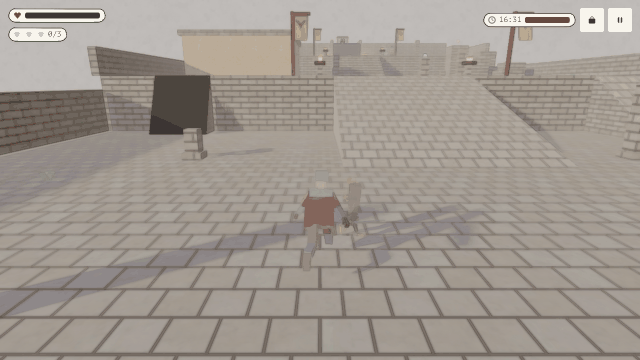
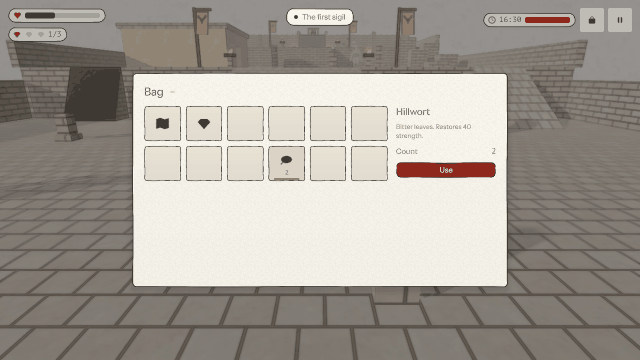
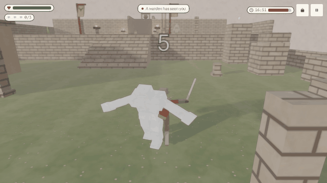
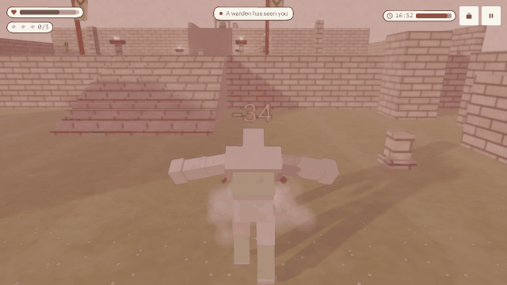
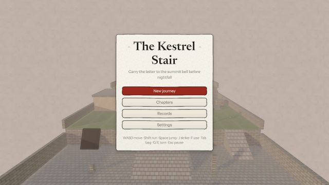
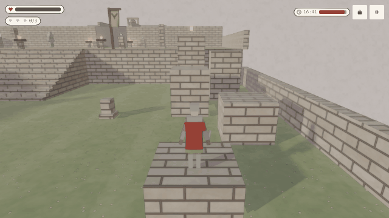
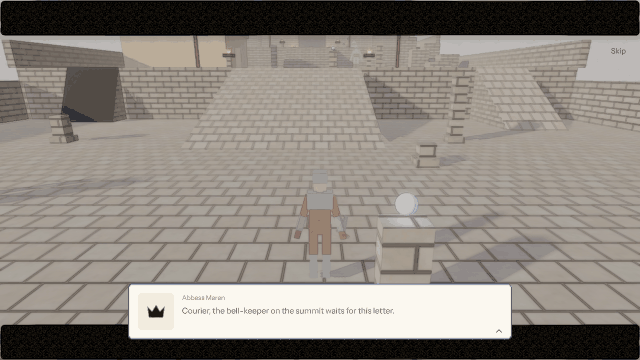
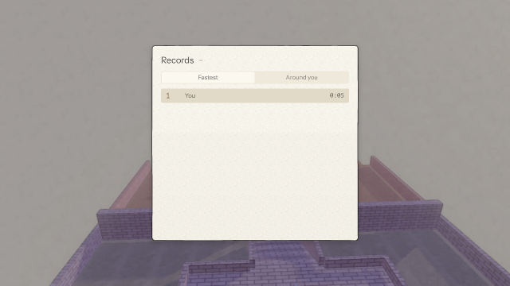

# og polish: kestrel-stair

2026-10-25, 13 playtest(s) on metal. Mechanical measures of og-taste and og-feel (og-build §5); a score is 0 to 100, n/a when nothing in the playtests exercises it. The measures cannot judge style: read the frames.

## Scores

| | Score | Measure |
|---|---|---|
| **Taste** | **99** | mean of the taste rows |
| Contrast | 98 | text boxes whose ink and ground reach 4.5:1 |
| Text size | 100 | text boxes whose tallest ink line reaches 9 CSS px (a 13 px face's capitals) |
| HUD occupancy | 100 | gameplay frames: HUD at most 15 % of the surface and 5 % of the central third |
| Screen transitions | 98 | screen changes with UI motion around them |
| UI sounds | 100 | UI presses answered on the ui bus |
| Locale keys | 100 | string tables without missing keys (og cook) |
| **Feel** | **99** | mean of the feel rows |
| Input latency | 100 | inputs answered, by the median ticks to the answer (0–1: 100) |
| Hit feedback | 100 | damage moments with hit stop, shake, floating text or a sound (three of four: 100) |
| Idle frames | 100 | ticks where nothing new is seen or heard (10 %: 100, 60 %: 0) |
| Frame time | 100 | p95 step + render (8.3 ms: 100, 33 ms: 0), worst playtest |
| Sound on input | 94 | inputs answered by a sound within 6 ticks |

## Fixes

| Measure | Where | Found | Fix |
|---|---|---|---|
| contrast | bag bag: `Count` "2" | 4.04:1 between ink and ground (body text wants 4.5:1) | og-taste §3 (value before hue): darken the ground or lighten the ink in the style's palette, never per call |
| contrast | frames bag: `Count` "3" | 3.36:1 between ink and ground (body text wants 4.5:1) | og-taste §3 (value before hue): darken the ground or lighten the ink in the style's palette, never per call |
| screen transitions | replay | 1 of 13 screen changes had no motion in the 20 ticks around them | og-taste §5 (screens change through a transition): og.ui.screenTransition, one kind per game |
| screen transitions | win | 1 of 15 screen changes had no motion in the 20 ticks around them | og-taste §5 (screens change through a transition): og.ui.screenTransition, one kind per game |

## Playtests

### anim

retargeted clips on three skeletons through blend trees; the cape hangs and trails, a banner stirs, the lamp hangs on its chain (390 ticks)

| Measure | Value |
|---|---|
| Text boxes | 4; 4 at 4.5:1; 4 of 4 at 9 px ink |
| Lowest contrast | 10.83:1 `Pause` (cape); 15.66:1 `Count` (cape); 15.66:1 `Hour` (cape) |
| Smallest ink | 11 px `Hour` (cape); 12 px `Pause` (cape); 13 px `Count` (cape) |
| HUD | 1 gameplay frame(s), up to 1.06 % of the surface, 0 % of the centre |
| UI | 1 screen change(s), 1 with motion; 37 ticks of UI motion; 0 press(es), 0 with a ui-bus sound |
| Inputs | 3, 3 answered, median 0 ticks, max 0; 3 with a sound; 38.68 % of input-free ticks also change something |
| Damage | 0 moment(s): hit stop 0, shake 0, floating text 0, sound 0, tween 0, particles 0 |
| Idle | 0 % of ticks |
| Particles | peak 6 system(s), 0 burst(s) |
| Frame (metal) | step 3.34 ms median, 4.21 p95; render 2.31 median, 2.58 p95; frame p95 6.68, max 9.7 |
| Audio | 6.5 s, peak 0.21, RMS 0.0162, 0 clipped, 0 % silent ticks |

 

cape (tick 195: HUD 1.06 %, 4 texts, 0 under 4.5:1, 0 small)

### audio

the streamed music loops unclipped; a brazier is heard from where the camera is; the crypt's drip is muffled by its walls; the crypt is a reverb zone (396 ticks)

| Measure | Value |
|---|---|
| Text boxes | 0; 0 at 4.5:1; 0 of 0 at 9 px ink |
| HUD | 0 gameplay frame(s), up to 0 % of the surface, 0 % of the centre |
| UI | 3 screen change(s), 3 with motion; 151 ticks of UI motion; 0 press(es), 0 with a ui-bus sound |
| Inputs | 0, 0 answered, median 0 ticks, max 0; 0 with a sound; 50.78 % of input-free ticks also change something |
| Damage | 0 moment(s): hit stop 0, shake 0, floating text 0, sound 0, tween 0, particles 0 |
| Idle | 0 % of ticks |
| Particles | peak 6 system(s), 0 burst(s) |
| Frame (metal) | step 3.46 ms median, 4.45 p95; render 2.3 median, 2.57 p95; frame p95 6.91, max 15.27 |
| Audio | 6.6 s, peak 0.21, RMS 0.0159, 0 clipped, 0 % silent ticks |

### bag

the bag opens with Tab, drags an item to another slot, shows its details and eats a hillwort with Use; H eats one; pause opens it (324 ticks)

| Measure | Value |
|---|---|
| Text boxes | 9; 8 at 4.5:1; 9 of 9 at 9 px ink |
| Lowest contrast | 4.04:1 `Count` (bag); 5.56:1 `Description` (bag); 6.92:1 `Key` (bag) |
| Smallest ink | 9 px `Count` (bag); 11 px `Description` (bag); 11 px `Key` (bag) |
| HUD | 0 gameplay frame(s), up to 0 % of the surface, 0 % of the centre |
| UI | 10 screen change(s), 10 with motion; 323 ticks of UI motion; 4 press(es), 4 with a ui-bus sound |
| Inputs | 9, 9 answered, median 0 ticks, max 0; 8 with a sound; 100 % of input-free ticks also change something |
| Damage | 1 moment(s) from `hp`: hit stop 1, shake 1, floating text 1, sound 1, tween 0, particles 1 |
| Idle | 0 % of ticks |
| Particles | peak 7 system(s), 1 burst(s) |
| Frame (metal) | step 3.8 ms median, 4.74 p95; render 2.49 median, 2.8 p95; frame p95 7.4, max 10.48 |
| Audio | 5.4 s, peak 0.5, RMS 0.0597, 0 clipped, 0 % silent ticks |

 

bag (tick 141, menu: HUD 11.19 %, 9 texts, 1 under 4.5:1, 0 small)

### combat

strikes land on the clip's marker with hit stop, shake, a flinch, a number and a sound; the warden falls and drops a sigil the courier takes; a slam hurts (606 ticks)

| Measure | Value |
|---|---|
| Text boxes | 6; 6 at 4.5:1; 6 of 6 at 9 px ink |
| Lowest contrast | 10.83:1 `Pause` (strike); 12.63:1 `Text` (strike); 12.97:1 `Toast#1` (strike) |
| Smallest ink | 11 px `Hour` (strike); 12 px `Pause` (strike); 13 px `Count` (strike) |
| HUD | 1 gameplay frame(s), up to 1.62 % of the surface, 0 % of the centre |
| UI | 7 screen change(s), 7 with motion; 386 ticks of UI motion; 0 press(es), 0 with a ui-bus sound |
| Inputs | 10, 10 answered, median 0 ticks, max 0; 10 with a sound; 97.53 % of input-free ticks also change something |
| Damage | 7 moment(s) from `foes.warden-0.hp`, `hits`, `kills`, `hp`: hit stop 7, shake 7, floating text 7, sound 7, tween 6, particles 2 |
| Idle | 0 % of ticks |
| Particles | peak 9 system(s), 3 burst(s) |
| Frame (metal) | step 3.47 ms median, 4.47 p95; render 2.39 median, 2.69 p95; frame p95 6.91, max 10.19 |
| Audio | 10.1 s, peak 0.6, RMS 0.0616, 0 clipped, 0 % silent ticks |

 

strike (tick 75: HUD 1.62 %, 6 texts, 0 under 4.5:1, 0 small)

### foes

imps patrol, chase, bite and flee on the navmesh; a warden alerts, lunges by root motion and slams (570 ticks)

| Measure | Value |
|---|---|
| Text boxes | 6; 6 at 4.5:1; 6 of 6 at 9 px ink |
| Lowest contrast | 10.76:1 `Pause` (slam); 12.63:1 `Text` (slam); 12.97:1 `Toast#1` (slam) |
| Smallest ink | 11 px `Hour` (slam); 12 px `Pause` (slam); 13 px `Count` (slam) |
| HUD | 1 gameplay frame(s), up to 1.62 % of the surface, 0 % of the centre |
| UI | 4 screen change(s), 4 with motion; 65 ticks of UI motion; 0 press(es), 0 with a ui-bus sound |
| Inputs | 2, 2 answered, median 0 ticks, max 0; 2 with a sound; 48.39 % of input-free ticks also change something |
| Damage | 4 moment(s) from `hp`, `foes.imp-0.hp`, `hits`: hit stop 4, shake 4, floating text 4, sound 4, tween 3, particles 2 |
| Idle | 0 % of ticks |
| Particles | peak 8 system(s), 2 burst(s) |
| Frame (metal) | step 3.39 ms median, 4.23 p95; render 2.28 median, 2.59 p95; frame p95 6.66, max 12.13 |
| Audio | 9.5 s, peak 0.59, RMS 0.0425, 0 clipped, 0 % silent ticks |

 

slam (tick 522: HUD 1.62 %, 6 texts, 0 under 4.5:1, 0 small)

### frames

the title, the intro, the court, a strike, the crypt, the bag, the chapters, the records and the results match their reference frames (1158 ticks)

| Measure | Value |
|---|---|
| Text boxes | 59; 58 at 4.5:1; 59 of 59 at 9 px ink |
| Lowest contrast | 3.36:1 `Count` (bag); 5.25:1 `Best` (results); 5.28:1 `Key` (results) |
| Smallest ink | 9 px `Count` (bag); 10 px `Speaker` (intro); 11 px `records` (title) |
| HUD | 3 gameplay frame(s), up to 1.06 % of the surface, 0 % of the centre |
| UI | 24 screen change(s), 24 with motion; 749 ticks of UI motion; 6 press(es), 6 with a ui-bus sound |
| Inputs | 12, 12 answered, median 0 ticks, max 21; 10 with a sound; 71.15 % of input-free ticks also change something |
| Damage | 1 moment(s) from `foes.warden-0.hp`, `hits`: hit stop 1, shake 1, floating text 1, sound 1, tween 1, particles 1 |
| Idle | 0 % of ticks |
| Particles | peak 8 system(s), 2 burst(s) |
| Frame (metal) | step 3.49 ms median, 4.42 p95; render 2.37 median, 2.63 p95; frame p95 6.89, max 12.06 |
| Audio | 19.3 s, peak 0.75, RMS 0.056, 0 clipped, 0 % silent ticks |

 

title (tick 72, menu: HUD 9.04 %, 7 texts, 0 under 4.5:1, 0 small)

### locales

the title, intro, HUD, bag, pause, settings and results in Japanese, then English; no unnamed control in the accessibility tree (642 ticks)

| Measure | Value |
|---|---|
| Text boxes | 0; 0 at 4.5:1; 0 of 0 at 9 px ink |
| HUD | 0 gameplay frame(s), up to 0 % of the surface, 0 % of the centre |
| UI | 26 screen change(s), 26 with motion; 537 ticks of UI motion; 8 press(es), 8 with a ui-bus sound |
| Inputs | 11, 11 answered, median 0 ticks, max 1; 10 with a sound; 94.5 % of input-free ticks also change something |
| Damage | 0 moment(s): hit stop 0, shake 0, floating text 0, sound 0, tween 0, particles 0 |
| Idle | 0 % of ticks |
| Particles | peak 6 system(s), 0 burst(s) |
| Frame (metal) | step 3.61 ms median, 4.52 p95; render 2.39 median, 2.65 p95; frame p95 7, max 11.73 |
| Audio | 10.7 s, peak 0.8, RMS 0.0645, 0 clipped, 0 % silent ticks |

### lose

night at 19:30 ends the climb; strength gone, the courier falls; the results say which, and Title goes back (606 ticks)

| Measure | Value |
|---|---|
| Text boxes | 0; 0 at 4.5:1; 0 of 0 at 9 px ink |
| HUD | 0 gameplay frame(s), up to 0 % of the surface, 0 % of the centre |
| UI | 11 screen change(s), 11 with motion; 253 ticks of UI motion; 1 press(es), 1 with a ui-bus sound |
| Inputs | 1, 1 answered, median 0 ticks, max 0; 1 with a sound; 59.33 % of input-free ticks also change something |
| Damage | 2 moment(s) from `hp`: hit stop 2, shake 2, floating text 2, sound 2, tween 0, particles 0 |
| Idle | 0 % of ticks |
| Particles | peak 6 system(s), 0 burst(s) |
| Frame (metal) | step 3.41 ms median, 4.26 p95; render 2.34 median, 2.56 p95; frame p95 6.65, max 9.9 |
| Audio | 10.1 s, peak 0.52, RMS 0.0744, 0 clipped, 0 % silent ticks |

### move

the courier walks and runs, climbs the ramp, the steep path and the stairs, slides off the scree and jumps onto a ledge (1182 ticks)

| Measure | Value |
|---|---|
| Text boxes | 4; 4 at 4.5:1; 4 of 4 at 9 px ink |
| Lowest contrast | 10.83:1 `Pause` (ledge); 14.54:1 `Hour` (ledge); 15.66:1 `Count` (ledge) |
| Smallest ink | 11 px `Hour` (ledge); 12 px `Pause` (ledge); 13 px `Count` (ledge) |
| HUD | 1 gameplay frame(s), up to 1.06 % of the surface, 0 % of the centre |
| UI | 1 screen change(s), 1 with motion; 37 ticks of UI motion; 0 press(es), 0 with a ui-bus sound |
| Inputs | 9, 9 answered, median 0 ticks, max 0; 9 with a sound; 43.9 % of input-free ticks also change something |
| Damage | 0 moment(s): hit stop 0, shake 0, floating text 0, sound 0, tween 0, particles 0 |
| Idle | 0 % of ticks |
| Particles | peak 6 system(s), 0 burst(s) |
| Frame (metal) | step 3.24 ms median, 4.06 p95; render 2.25 median, 2.55 p95; frame p95 6.42, max 16.9 |
| Audio | 19.7 s, peak 0.23, RMS 0.0181, 0 clipped, 0 % silent ticks |

 

ledge (tick 1176: HUD 1.06 %, 4 texts, 0 under 4.5:1, 0 small)

### replay

a session of chases, bites, strikes, a slam, a rest, the gate and the bell replays to the same hash (762 ticks)

| Measure | Value |
|---|---|
| Text boxes | 0; 0 at 4.5:1; 0 of 0 at 9 px ink |
| HUD | 0 gameplay frame(s), up to 0 % of the surface, 0 % of the centre |
| UI | 13 screen change(s), 12 with motion; 562 ticks of UI motion; 0 press(es), 0 with a ui-bus sound |
| Inputs | 17, 17 answered, median 0 ticks, max 0; 16 with a sound; 100 % of input-free ticks also change something |
| Damage | 5 moment(s) from `foes.imp-0.hp`, `hits`, `foes.warden-0.hp`, `hp`: hit stop 5, shake 5, floating text 5, sound 5, tween 4, particles 3 |
| Idle | 0 % of ticks |
| Particles | peak 9 system(s), 3 burst(s) |
| Frame (metal) | step 3.58 ms median, 4.53 p95; render 2.28 median, 2.58 p95; frame p95 6.92, max 12.34 |
| Audio | 12.7 s, peak 0.66, RMS 0.074, 0 clipped, 0 % silent ticks |

### save

a waystone saves the whole world in the store; a relaunch continues it there, and chapter II is unlocked (162 ticks)

| Measure | Value |
|---|---|
| Text boxes | 0; 0 at 4.5:1; 0 of 0 at 9 px ink |
| HUD | 0 gameplay frame(s), up to 0 % of the surface, 0 % of the centre |
| UI | 6 screen change(s), 6 with motion; 161 ticks of UI motion; 1 press(es), 1 with a ui-bus sound |
| Inputs | 3, 3 answered, median 0 ticks, max 0; 3 with a sound; 100 % of input-free ticks also change something |
| Damage | 1 moment(s) from `hp`: hit stop 1, shake 1, floating text 1, sound 1, tween 0, particles 1 |
| Idle | 0 % of ticks |
| Particles | peak 7 system(s), 1 burst(s) |
| Frame (metal) | step 3.74 ms median, 5.01 p95; render 2.54 median, 2.87 p95; frame p95 7.68, max 12.18 |
| Audio | 2.7 s, peak 0.5, RMS 0.0672, 0 clipped, 0 % silent ticks |

### story

the intro cutscene walks with Enter, the tutorial spotlights the HUD step by step, and the progress keeps it seen (444 ticks)

| Measure | Value |
|---|---|
| Text boxes | 4; 4 at 4.5:1; 4 of 4 at 9 px ink |
| Lowest contrast | 6.09:1 `Speaker` (intro); 9.02:1 `Skip` (intro); 16.36:1 `Dialogue` (intro) |
| Smallest ink | 10 px `Speaker` (intro); 14 px `Skip` (intro); 16 px `Line` (intro) |
| HUD | 0 gameplay frame(s), up to 0 % of the surface, 0 % of the centre |
| UI | 6 screen change(s), 6 with motion; 210 ticks of UI motion; 4 press(es), 4 with a ui-bus sound |
| Inputs | 12, 12 answered, median 0 ticks, max 0; 12 with a sound; 58.94 % of input-free ticks also change something |
| Damage | 0 moment(s): hit stop 0, shake 0, floating text 0, sound 0, tween 0, particles 0 |
| Idle | 0 % of ticks |
| Particles | peak 6 system(s), 0 burst(s) |
| Frame (metal) | step 2.85 ms median, 3.99 p95; render 2.34 median, 2.62 p95; frame p95 6.37, max 8.24 |
| Audio | 7.4 s, peak 0.21, RMS 0.0156, 0 clipped, 0 % silent ticks |

 

intro (tick 72, menu: HUD 23.25 %, 4 texts, 0 under 4.5:1, 0 small)

### win

the gate refuses two sigils and rises for three; the bell ends the climb under the summit look; the results, the leaderboard and Again (894 ticks)

| Measure | Value |
|---|---|
| Text boxes | 6; 6 at 4.5:1; 6 of 6 at 9 px ink |
| Lowest contrast | 5.4:1 `Rank` (records); 5.95:1 `Tab#1` (records); 9.94:1 `Name` (records) |
| Smallest ink | 9 px `Name` (records); 11 px `Tab#0` (records); 11 px `Score` (records) |
| HUD | 0 gameplay frame(s), up to 0 % of the surface, 0 % of the centre |
| UI | 15 screen change(s), 14 with motion; 540 ticks of UI motion; 2 press(es), 2 with a ui-bus sound |
| Inputs | 13, 13 answered, median 0 ticks, max 1; 12 with a sound; 82.85 % of input-free ticks also change something |
| Damage | 0 moment(s): hit stop 0, shake 0, floating text 0, sound 0, tween 0, particles 0 |
| Idle | 0 % of ticks |
| Particles | peak 7 system(s), 1 burst(s) |
| Frame (metal) | step 3.4 ms median, 4.31 p95; render 2.26 median, 2.62 p95; frame p95 6.75, max 9.99 |
| Audio | 14.9 s, peak 0.56, RMS 0.0665, 0 clipped, 0 % silent ticks |

 

records (tick 744, menu: HUD 3.92 %, 6 texts, 0 under 4.5:1, 0 small)

