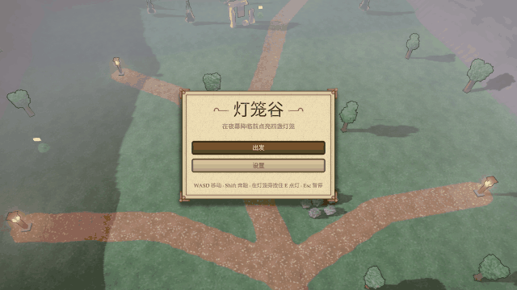

# og polish: lantern-vale

2026-10-25, 11 playtest(s) on metal. Mechanical measures of og-taste and og-feel (og-build §5); a score is 0 to 100, n/a when nothing in the playtests exercises it. The measures cannot judge style: read the frames.

## Scores

| | Score | Measure |
|---|---|---|
| **Taste** | **100** | mean of the taste rows |
| Contrast | 100 | text boxes whose ink and ground reach 4.5:1 |
| Text size | 100 | text boxes whose tallest ink line reaches 9 CSS px (a 13 px face's capitals) |
| HUD occupancy | 100 | gameplay frames: HUD at most 15 % of the surface and 5 % of the central third |
| Screen transitions | 100 | screen changes with UI motion around them |
| UI sounds | 100 | UI presses answered on the ui bus |
| Locale keys | 100 | string tables without missing keys (og cook) |
| **Feel** | **99** | mean of the feel rows |
| Input latency | 100 | inputs answered, by the median ticks to the answer (0–1: 100) |
| Hit feedback | 100 | damage moments with hit stop, shake, floating text or a sound (three of four: 100) |
| Idle frames | 100 | ticks where nothing new is seen or heard (10 %: 100, 60 %: 0) |
| Frame time | 100 | p95 step + render (8.3 ms: 100, 33 ms: 0), worst playtest |
| Sound on input | 96 | inputs answered by a sound within 6 ticks |

## Fixes

No finding crossed a threshold.

## Playtests

### flow

Set out, walk and run on the terrain, find a lantern by an overlap query, light it with E (342 ticks)

| Measure | Value |
|---|---|
| Text boxes | 0; 0 at 4.5:1; 0 of 0 at 9 px ink |
| HUD | 0 gameplay frame(s), up to 0 % of the surface, 0 % of the centre |
| UI | 3 screen change(s), 3 with motion; 158 ticks of UI motion; 1 press(es), 1 with a ui-bus sound |
| Inputs | 4, 4 answered, median 0 ticks, max 0; 4 with a sound; 74.32 % of input-free ticks also change something |
| Damage | 0 moment(s): hit stop 0, shake 0, floating text 0, sound 0, tween 0, particles 0 |
| Idle | 0 % of ticks |
| Particles | peak 1 system(s), 1 burst(s) |
| Frame (metal) | step 0.59 ms median, 1.3 p95; render 1.21 median, 1.64 p95; frame p95 2.58, max 3.73 |
| Audio | 5.7 s, peak 0.24, RMS 0.0354, 0 clipped, 0 % silent ticks |

### frames

the title, a run, a lantern, a slime, the far side, the Chinese settings and the dawn results match their reference frames (684 ticks)

| Measure | Value |
|---|---|
| Text boxes | 54; 54 at 4.5:1; 54 of 54 at 9 px ink |
| Lowest contrast | 4.65:1 `NewBest` (results); 5.51:1 `LanguageLabel` (settings-zh); 6.04:1 `Name` (settings-zh) |
| Smallest ink | 9 px `NewBest` (results); 11 px `play` (title); 11 px `Toast#2` (far) |
| HUD | 4 gameplay frame(s), up to 2.14 % of the surface, 0 % of the centre |
| UI | 9 screen change(s), 9 with motion; 572 ticks of UI motion; 1 press(es), 1 with a ui-bus sound |
| Inputs | 2, 2 answered, median 0 ticks, max 0; 2 with a sound; 86.56 % of input-free ticks also change something |
| Damage | 2 moment(s) from `hits`, `hp`: hit stop 2, shake 2, floating text 2, sound 2, tween 0, particles 1 |
| Idle | 0 % of ticks |
| Particles | peak 4 system(s), 4 burst(s) |
| Frame (metal) | step 0.61 ms median, 1.23 p95; render 1.11 median, 1.47 p95; frame p95 2.48, max 437.23 |
| Audio | 11.4 s, peak 0.62, RMS 0.0628, 0 clipped, 0 % silent ticks |

 

title (tick 60, menu: HUD 5.83 %, 5 texts, 0 under 4.5:1, 0 small)

### locales

the title, the HUD, the pause menu and the results in Chinese, then English (402 ticks)

| Measure | Value |
|---|---|
| Text boxes | 5; 5 at 4.5:1; 5 of 5 at 9 px ink |
| Lowest contrast | 4.56:1 `settings` (title-zh); 7.48:1 `play` (title-zh); 8.13:1 `Footer` (title-zh) |
| Smallest ink | 12 px `Footer` (title-zh); 15 px `Subtitle` (title-zh); 15 px `play` (title-zh) |
| HUD | 0 gameplay frame(s), up to 0 % of the surface, 0 % of the centre |
| UI | 7 screen change(s), 7 with motion; 363 ticks of UI motion; 0 press(es), 0 with a ui-bus sound |
| Inputs | 2, 2 answered, median 1 ticks, max 1; 2 with a sound; 89.39 % of input-free ticks also change something |
| Damage | 0 moment(s): hit stop 0, shake 0, floating text 0, sound 0, tween 0, particles 0 |
| Idle | 0 % of ticks |
| Particles | peak 4 system(s), 4 burst(s) |
| Frame (metal) | step 0.61 ms median, 1.43 p95; render 1.08 median, 1.42 p95; frame p95 2.61, max 12.29 |
| Audio | 6.7 s, peak 0.44, RMS 0.0689, 0 clipped, 0 % silent ticks |

 

title-zh (tick 54, menu: HUD 5.25 %, 5 texts, 0 under 4.5:1, 0 small)

### lose

no hearts left, night at dusk's end, Again and Title (462 ticks)

| Measure | Value |
|---|---|
| Text boxes | 0; 0 at 4.5:1; 0 of 0 at 9 px ink |
| HUD | 0 gameplay frame(s), up to 0 % of the surface, 0 % of the centre |
| UI | 7 screen change(s), 7 with motion; 231 ticks of UI motion; 2 press(es), 2 with a ui-bus sound |
| Inputs | 2, 2 answered, median 0 ticks, max 0; 2 with a sound; 50 % of input-free ticks also change something |
| Damage | 1 moment(s) from `hits`, `hp`: hit stop 1, shake 1, floating text 1, sound 1, tween 0, particles 0 |
| Idle | 0 % of ticks |
| Particles | peak 0 system(s), 0 burst(s) |
| Frame (metal) | step 0.61 ms median, 1.53 p95; render 1.04 median, 1.37 p95; frame p95 2.71, max 12.83 |
| Audio | 7.7 s, peak 0.6, RMS 0.0616, 0 clipped, 0 % silent ticks |

### music

the chunked music plays from the title, its chunks streamed (192 ticks)

| Measure | Value |
|---|---|
| Text boxes | 0; 0 at 4.5:1; 0 of 0 at 9 px ink |
| HUD | 0 gameplay frame(s), up to 0 % of the surface, 0 % of the centre |
| UI | 0 screen change(s), 0 with motion; 191 ticks of UI motion; 0 press(es), 0 with a ui-bus sound |
| Inputs | 0, 0 answered, median 0 ticks, max 0; 0 with a sound; 100 % of input-free ticks also change something |
| Damage | 0 moment(s): hit stop 0, shake 0, floating text 0, sound 0, tween 0, particles 0 |
| Idle | 0 % of ticks |
| Particles | peak 0 system(s), 0 burst(s) |
| Frame (metal) | step 0.55 ms median, 0.84 p95; render 1.32 median, 1.68 p95; frame p95 2.33, max 3.42 |
| Audio | 3.2 s, peak 0.04, RMS 0.0092, 0 clipped, 0 % silent ticks |

### physics

the character controller shoves the pile of rocks and is stopped by a trunk (270 ticks)

| Measure | Value |
|---|---|
| Text boxes | 0; 0 at 4.5:1; 0 of 0 at 9 px ink |
| HUD | 0 gameplay frame(s), up to 0 % of the surface, 0 % of the centre |
| UI | 1 screen change(s), 1 with motion; 34 ticks of UI motion; 0 press(es), 0 with a ui-bus sound |
| Inputs | 2, 2 answered, median 0 ticks, max 0; 2 with a sound; 88.38 % of input-free ticks also change something |
| Damage | 0 moment(s): hit stop 0, shake 0, floating text 0, sound 0, tween 0, particles 0 |
| Idle | 0 % of ticks |
| Particles | peak 0 system(s), 0 burst(s) |
| Frame (metal) | step 0.66 ms median, 1.56 p95; render 1.21 median, 1.52 p95; frame p95 2.88, max 4.69 |
| Audio | 4.5 s, peak 0.05, RMS 0.0072, 0 clipped, 0 % silent ticks |

### replay

a session with the pile, a lantern, a slime's touch, the far side and the results replays to the same hash (576 ticks)

| Measure | Value |
|---|---|
| Text boxes | 0; 0 at 4.5:1; 0 of 0 at 9 px ink |
| HUD | 0 gameplay frame(s), up to 0 % of the surface, 0 % of the centre |
| UI | 5 screen change(s), 5 with motion; 338 ticks of UI motion; 0 press(es), 0 with a ui-bus sound |
| Inputs | 3, 3 answered, median 0 ticks, max 0; 3 with a sound; 84.57 % of input-free ticks also change something |
| Damage | 2 moment(s) from `hits`, `hp`: hit stop 2, shake 2, floating text 2, sound 2, tween 0, particles 1 |
| Idle | 0 % of ticks |
| Particles | peak 4 system(s), 4 burst(s) |
| Frame (metal) | step 0.65 ms median, 1.45 p95; render 1.21 median, 1.64 p95; frame p95 2.88, max 12.16 |
| Audio | 9.6 s, peak 0.6, RMS 0.0655, 0 clipped, 0 % silent ticks |

### settings

pause, then the settings: a slider, a typed name with an input method, a mixed-script label, Chinese, saved (282 ticks)

| Measure | Value |
|---|---|
| Text boxes | 26; 26 at 4.5:1; 26 of 26 at 9 px ink |
| Lowest contrast | 5.51:1 `LanguageLabel` (settings-zh); 7.35:1 `Done` (settings-zh); 7.47:1 `Label` (settings-zh) |
| Smallest ink | 11 px `Value` (settings); 12 px `Label` (settings); 12 px `Value` (settings) |
| HUD | 0 gameplay frame(s), up to 0 % of the surface, 0 % of the centre |
| UI | 6 screen change(s), 6 with motion; 279 ticks of UI motion; 5 press(es), 5 with a ui-bus sound |
| Inputs | 7, 7 answered, median 0 ticks, max 1; 6 with a sound; 100 % of input-free ticks also change something |
| Damage | 0 moment(s): hit stop 0, shake 0, floating text 0, sound 0, tween 0, particles 0 |
| Idle | 0 % of ticks |
| Particles | peak 0 system(s), 0 burst(s) |
| Frame (metal) | step 0.62 ms median, 1.52 p95; render 0.97 median, 1.41 p95; frame p95 2.6, max 14.91 |
| Audio | 4.7 s, peak 0.51, RMS 0.0438, 0 clipped, 0 % silent ticks |

 

settings (tick 198, menu: HUD 8.87 %, 13 texts, 0 under 4.5:1, 0 small)

### slimes

a slime sees the hero, turns alert and chases on twos, and its touch lands with weight (150 ticks)

| Measure | Value |
|---|---|
| Text boxes | 0; 0 at 4.5:1; 0 of 0 at 9 px ink |
| HUD | 0 gameplay frame(s), up to 0 % of the surface, 0 % of the centre |
| UI | 1 screen change(s), 1 with motion; 34 ticks of UI motion; 0 press(es), 0 with a ui-bus sound |
| Inputs | 0, 0 answered, median 0 ticks, max 0; 0 with a sound; 40 % of input-free ticks also change something |
| Damage | 1 moment(s) from `hits`, `hp`: hit stop 1, shake 1, floating text 1, sound 1, tween 0, particles 0 |
| Idle | 0 % of ticks |
| Particles | peak 0 system(s), 0 burst(s) |
| Frame (metal) | step 0.6 ms median, 1.56 p95; render 1.25 median, 1.57 p95; frame p95 2.82, max 3.31 |
| Audio | 2.5 s, peak 0.47, RMS 0.0326, 0 clipped, 0 % silent ticks |

### stream

the far side's streaming group loads as the camera nears it and unloads as it leaves, replaying the same (270 ticks)

| Measure | Value |
|---|---|
| Text boxes | 0; 0 at 4.5:1; 0 of 0 at 9 px ink |
| HUD | 0 gameplay frame(s), up to 0 % of the surface, 0 % of the centre |
| UI | 2 screen change(s), 2 with motion; 46 ticks of UI motion; 0 press(es), 0 with a ui-bus sound |
| Inputs | 2, 2 answered, median 0 ticks, max 0; 2 with a sound; 56.33 % of input-free ticks also change something |
| Damage | 0 moment(s): hit stop 0, shake 0, floating text 0, sound 0, tween 0, particles 0 |
| Idle | 0 % of ticks |
| Particles | peak 0 system(s), 0 burst(s) |
| Frame (metal) | step 0.56 ms median, 1.47 p95; render 1.19 median, 1.53 p95; frame p95 2.44, max 3.12 |
| Audio | 4.5 s, peak 0.06, RMS 0.0077, 0 clipped, 0 % silent ticks |

### win

four lanterns lit: the results under the dawn look, then Again under the dusk look (263 ticks)

| Measure | Value |
|---|---|
| Text boxes | 0; 0 at 4.5:1; 0 of 0 at 9 px ink |
| HUD | 0 gameplay frame(s), up to 0 % of the surface, 0 % of the centre |
| UI | 6 screen change(s), 6 with motion; 250 ticks of UI motion; 1 press(es), 1 with a ui-bus sound |
| Inputs | 1, 1 answered, median 0 ticks, max 0; 1 with a sound; 99.09 % of input-free ticks also change something |
| Damage | 0 moment(s): hit stop 0, shake 0, floating text 0, sound 0, tween 0, particles 0 |
| Idle | 0 % of ticks |
| Particles | peak 4 system(s), 4 burst(s) |
| Frame (metal) | step 0.67 ms median, 1.67 p95; render 1.06 median, 1.4 p95; frame p95 2.87, max 12.3 |
| Audio | 4.4 s, peak 0.43, RMS 0.0862, 0 clipped, 0 % silent ticks |

