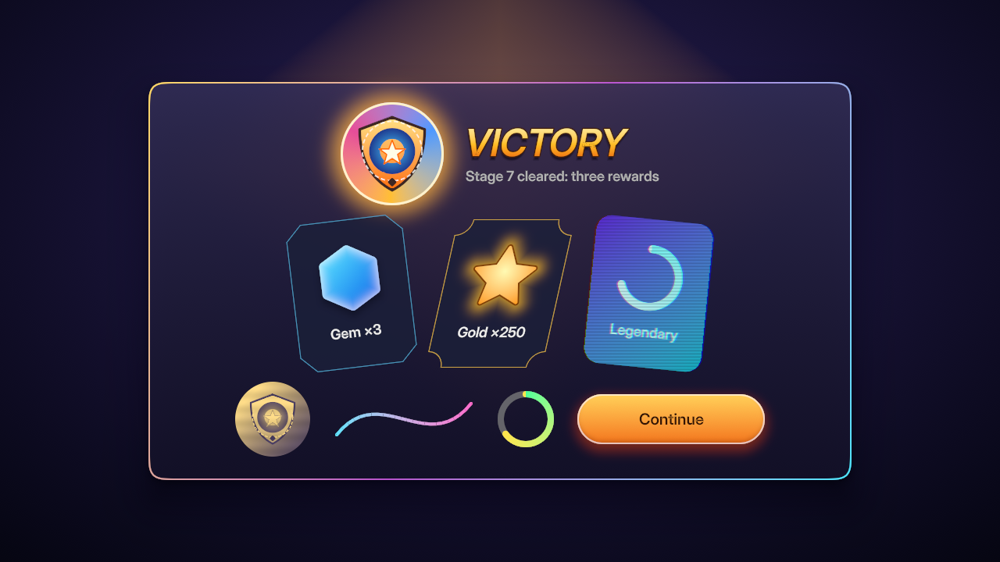

# U1: the UI render pass, sample screen

`sample/` is a game of one screen drawn through `og.ui.setDraw` (no style,
no atlas): every surface is the UI pass's (`docs/ui.md` §5). It cooks a
`type vector` (`assets/ui/emblem.svg`) and a `type ui-material`
(`assets/ui/duotone.wgsl`) and loads them with `og.load.vector` and
`og.load.uiMaterial`.

Run (native host, lavapipe in the orb, dev addon):

```sh
og run tests/evidence/u1/sample --headless --size 1280x720 \
  --commands "2:screenshot:sample-screen.png" --out <dir>
```

`tick 120 screenshot`, world hash `63cd1d077cf48a67`.



What the frame shows, read at 1280×720 and 640×360:

- The ground: a radial gradient (violet to near black) with a diamond
  gradient's warm glow above the panel, mixed in OKLab and dithered (no
  bands in the dark falloff).
- The panel: glass. The backdrop blur shows the ground's glow softened
  through the panel's top edge. It has squircle corners, a gradient
  border stroke inside the edge (gold, violet, cyan from top left to
  bottom right), and two drop shadows: a tight key and a 60 px ambient
  shadow darkening the ground below it.
- The medallion: a conic sweep (gold, pink, blue) clipped to a circle
  with an antialiased edge, a cream inside stroke, and an outer glow. The
  cooked emblem sits on it: a gradient shield, the even-odd blue ring with
  its hole, and the dashed rim. It is drawn again at 70 px in the portrait.
- The title: "VICTORY" with a vertical gradient fill (cream, gold,
  orange), a dark outside outline and a soft shadow, leaned like an italic
  by a -0.2 rad skew: the glyphs, outline, fill and shadow take the skew
  together (read at 3×: no glyph off its outline). The subtitle uses the
  theme's `inkMuted` token.
- The cards, each with an element transform (`og.ui.props`): the first
  has bevelled corners and is turned -0.12 rad, the second has notched
  corners and is skewed -0.22 rad along x; their gems, strokes, glows and
  captions turn and shear with them, the notch stroke unbroken along the
  slanted sides.
  The hexagon has an inner glow and a drop shadow; the star is a
  gradient polygon with a stroke and a glow. The third card is composited
  through the hologram material (scanlines and a chromatic split over its
  ring and caption) and turned 0.1 rad: the layer composites in the
  turned card's shape (the scanlines are the material's, in screen space).
- The footer: the portrait composited through the custom duotone
  material (luminance to dark violet and gold). Then a cubic Bézier path
  with a cyan-to-pink gradient and round caps, a cooldown arc (round caps,
  conic green to yellow) over a 12 % white ring track, and a capsule button
  with a gradient, an inside stroke, an orange drop shadow and an inner
  shadow.

A faint rectangle in the O of "VICTORY" is in the plain label too, without
`setDraw`: the cooked Inter-Display distance field magnified at
display size. The U1 pass does not cause it.

## After the rebase onto U2 (element transforms)

U2 bakes translation and scale into the old commands and leaves a turn or
skew in `DrawItem.transform`; the UI pass takes the whole map: a shape's
centre is mapped and its 2×2 composed with the map's linear part, so
rotation, scale and skew are exact for every shape, stroke, effect, clip,
vector and layer composite, and text takes the map per glyph
(`UiTextEffects.transform`). U2's sprites dropped the skew.

`hover-corner.png`: the hovered card of `examples/ui-motion` mid-spring
(`2.36:screenshot`, its top-left corner at 8×), origin/main 5eea63d6 left,
this branch right. On main the nine-slice corner piece and the edge
pieces of the turned quad meet in 1 px steps; the analytic rectangle's
edge is one continuous line.


